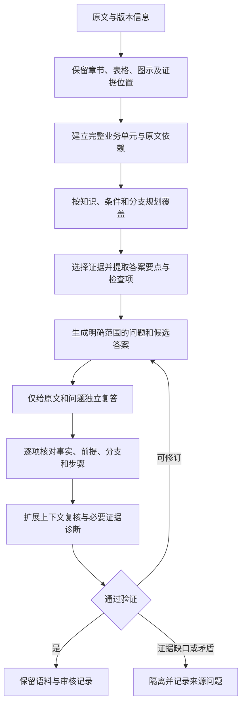

# 基于文档生成 QA 的研究进展与项目建议

调研日期：2026-10-08。重点是从已有文档生成可用于训练的问答语料，尤其是证据覆盖、答案忠实性、跨章节关联、完整业务链路和多轮上下文。资料以论文正文、作者公开代码仓库和官方工具文档为主。2026 年的新工作中包含预印本，不能把发布时间或作者自报结果当作成熟度保证。

论文版本、日期及官方工程入口另见[来源记录](research-sources.json)。

**主要判断：这条路线已有直接相关研究。对当前项目最值得借鉴的组合是 GraphGen 的知识覆盖规划、pdfQA 的扩展上下文复核、Roundtrip Consistency 的复答过滤，以及按原文建立的业务链路检查表。** 这些方法可以改善语料生成，但不能代替业务专家确认源文档本身正确、现行且完整。

## 1. 研究任务的区别

| 任务 | 生成数据的用途 | 验证重点 | 对当前项目的意义 |
|---|---|---|---|
| 文档知识训练语料 | 微调模型，让模型掌握文档内容或更会利用文档 | 知识覆盖、答案支持、问法变化、训练后的未见问题表现 | GraphGen、Bonito、AdaptLLM、LAB 最直接相关 |
| 文档阅读训练语料 | 输入包含文档，训练阅读、整合、引用能力 | 对原文的忠实性、长回答质量、跨来源整合 | Genie、FM2DS 等提供生成与过滤方法 |
| RAG/PDF 评测语料 | 评测解析、检索及回答系统 | 可回答性、证据集合、难度、错误与拒答 | pdfQA、TRIAD、Ragas 的质量控制可借鉴，但评测数据分布不能直接照搬成训练分布 |
| 对话与问题改写语料 | 训练指代解析、问题改写、检索 | 多轮承接、独立问题与历史问题的一致性 | SIGDIAL 2025 的文档对话生成工作提供明确的数据结构 |

本报告不把“生成了 QA”“QA 自动得分高”“微调有效”和“知识已经闭卷固化”视为同一个结论。

## 2. 最直接相关的工作

### 2.1 Roundtrip Consistency：先有答案，再生成问题，再独立回答

[R01] **Synthetic QA Corpora Generation with Roundtrip Consistency**，2019。

这是一条仍有价值的基础路线：训练答案抽取模型、问题生成模型和问答模型。从原文抽出答案片段，以“原文＋答案”生成问题，再让问答模型根据“原文＋问题”重新预测答案，保留与原答案一致的样本。论文在 SQuAD2、Natural Questions 上验证了合成语料的作用。

对项目的启示是，让生成的问题确实能从原文重新得到答案。复答时不向回答器展示候选答案，可以减少照着候选答案确认的倾向。不过原方法主要针对抽取式短答案；业务流程答案需要按事实、前提、步骤和分支比对，不能只做字符串匹配。复答一致也不能证明两个模型没有共同错误。

### 2.2 PAQ：局部可回答还不够，问题需要明确的范围

[R02] **PAQ: 65 Million Probably-Asked Questions and What You Can Do With Them**，2021。

PAQ 包含段落选择、答案抽取、问题生成和全局过滤。它指出，给定生成时的那一个段落，模型能答对，不代表问题脱离该段落后仍然明确。因此全局过滤只给问题，由开放域 QA 系统检索并复答，而不是把原生成段落直接交给它。

这一思路对设备文档很实用：问题不能只写“它的输出是什么”“这个值是多少”，需要明确设备、对象、版本和条件。PAQ 主要面向 Wikipedia 的短事实问答；全局过滤的成功还依赖检索，不能把检索失败直接认定为候选答案错误。

### 2.3 AdaptLLM：从文档中的天然结构获取低噪声种子

[R03] **Adapting Large Language Models to Domains via Reading Comprehension**，2023，ICLR 2024。

AdaptLLM 把领域原文转换为阅读理解练习，并与原文一起用于领域适应。其重要特点是大量使用模式和规则挖掘，而不是全部交给 LLM 自由编写。练习包括定义、摘要、词语到文本、推断、因果常识及补全等，实验涉及生物医学、金融、法律。

对项目可优先抽取定义句、条件句、明确列出的状态、参数和表格映射作为生成种子。这样能减少事实被自由改写的机会。其模式覆盖不等于完整流程覆盖，中文工程规程也需要重新适配规则。

### 2.4 Genie：结构化原文与三类过滤

[R04] **Genie: Achieving Human Parity in Content-Grounded Datasets Generation**，ICLR 2024。

Genie 的流程是内容准备、生成、过滤。它把 HTML 转为保留列表、表格、链接和章节结构的 Markdown，再使用少量内容—样例示范生成任务样本。过滤分别检查格式、忠实性和回答质量：忠实性使用 NLI 模型判断原文对答案的支持，质量使用奖励模型评分。论文包含长答案问答和摘要任务。

最有用的启示是把三个标准分开：格式正确、原文支持、回答有用。对业务流程还要另加完整性检查；例如一个回答只包含第一步，内容完全有原文支持，也可能遗漏问题要求的后续步骤。论文标题中的 human parity 是其具体实验结论，不能直接推及中文运行规程。

### 2.5 Bonito：已有开源的文档到指令生成器

[R05] **Learning to Generate Instruction Tuning Datasets for Zero-Shot Task Adaptation**，ACL Findings 2024。

Bonito 将“未标注文本＋任务类型”转换为 instruction-response 样本。论文用 38 个数据集、323 个元模板和约 165 万样本训练生成器，支持 16 类任务，公开了模型和代码。论文的领域适应实验重点验证 yes/no QA、抽取式 QA 和 NLI。

它适合做低成本的事实问答生成基线，验证直接使用开源生成器是否足够。现有实验不能证明它能稳定生成中文设备检修的长流程答案；还需单独验证中文、表格、条件分支和跨章节关系。

### 2.6 LAB / InstructLab：按知识和技能分类组织生成

[R06] **LAB: Large-Scale Alignment for ChatBots**，2024。

LAB 以 taxonomy 组织知识、基础技能和组合技能。知识数据生成使用文档、手册和书籍作为事实来源，并在分类叶节点提供少量人工种子；生成后再用教师模型检查回答是否忠于原文。论文的技能生成流程明确拆分为问题生成、问题审核、答案生成、问答对审核。

这对项目最有价值的是先明确题目类别和覆盖范围，再生成样本。可按设备状态、保护逻辑、检修、参数、接口、异常处理组织目录。但原工作使用人工种子，并且教师兼任评审，不能当作没有任何人工输入的独立质量认证。

开源入口也需要更新：`instructlab/sdg` README 已说明新贡献迁至 **SDG Hub**。SDG Hub 提供解析、生成、转换、过滤等可组合流水线；它是工程框架，实际质量仍取决于具体生成与验证流程。

### 2.7 GraphGen：与“文档生成 QA 后微调”最直接匹配

[R07] **GraphGen: Enhancing Supervised Fine-Tuning for LLMs with Knowledge-Driven Synthetic Data Generation**，2025-05。

GraphGen 分为四步：从原文抽取实体和关系构建细粒度知识图；评估目标模型对这些知识的掌握；按深度、长度和知识掌握程度采样子图；生成 atomic、aggregated、multi-hop 三种 QA。

其知识掌握评估值得准确理解。论文称受 ECE 启发，但实际方法是将关系描述改写为多个肯定和否定陈述，计算目标模型回答 yes/no 的概率与交叉熵损失，再优先选择高损失关系。它并非单靠自然语言自报“我有多少把握”。同时，论文把抽取出的关系描述作为正确陈述，因此该分数衡量的是相对抽取结果的掌握程度，不能证明关系本身正确。

实验在农业知识、医学聚合问答和 HotpotQA 派生任务上，测微调后的闭卷 QA，并与 Genie、LongForm、EntiGraph 等合成方法比较。主结果使用 ROUGE-F；这是直接的训练有效性证据，但不能等同于工程流程的步骤正确率或业务专家认可。

当前公开仓库已支持 PDF/MinerU、多个本地/API 推理后端、多种 QA 类型及图质量评估。论文方法与后来增加的工程功能要分开理解。

**项目适用点：** 用结构化关联决定生成预算，覆盖模型薄弱知识和跨章节关联。**需要补上的部分：** 图边不仅要表示“相关”，还应保留原文证据、适用条件、版本、先后顺序和例外。实体共现或图上可达不代表业务上允许的操作链。

### 2.8 K2V：把一部分知识 QA 转成可验证任务

[R08] **Knowledge-to-Verification: Exploring RLVR for LLMs in Knowledge-Intensive Domains**，2026-05，arXiv。

K2V 是使用 GraphGen 的后续工作。它从文档知识图采样两条相连关系构成的五元组 `(实体1, 关系1, 实体2, 关系2, 实体3)`，遮掉其中一个实体，生成填空式问题。被遮掉的实体名称作为可用规则核验的答案。它还为每题生成检查表，由 LLM 逐项检查回答中的推理过程；训练时只有最终答案正确才授予相应推理奖励。

对 QA 生成的启示是：为能够确定答案的参数、映射、状态和实体关系建立可核验样本，并保存明确的检查项。其原目标包含 RLVR，本项目无需为借鉴这些数据设计立即引入强化学习。

限制是：填空实体可核验，依赖抽取结果正确且问题答案唯一；LLM 检查表仍是模型判断。两跳实体关联也不能直接替代包含多种条件与恢复步骤的业务流程。

### 2.9 德国法律领域工作：同一来源生成不同层次的问题

[R09] **Domain-Adaptation through Synthetic Data: Fine-Tuning Large Language Models for German Law**，2026-01，arXiv。

这项工作按四层生成：条款理解、用户自然问法、情境应用、多条款整合。要求回答只依据给定法条，保留法条引用，并限制各层数量；独立 reviewer 提示过滤不可回答、无支持和冗余样本。论文报告 31,777 条候选中保留 23,905 条，并做了 LoRA 微调比较。

值得借鉴的是同一来源生成不同任务，而不只是换几个措辞。其实验同时改变了分层生成和过滤，不能把收益全部归因于 reviewer。训练测试按法条/来源段落分开，主要验证领域适应与未见来源问答，不能单独证明同一批私有文档已被模型闭卷记住。

## 3. 对完整上下文尤其有价值的工作

### 3.1 pdfQA：检查补充上下文后答案是否仍然成立

[R10] **pdfQA: Diverse, Challenging, and Realistic Question Answering over PDFs**，2026-01，arXiv。

pdfQA 找到有配套 `.tex` 或 `.html` 的 PDF，从结构化来源生成 QA，再从 PDF 开始评测。它以段落和表格建立带位置的信息源，每次选择一个种子段落及 5–15 个相邻或语义相关来源，并按答案类型、答案长度、推理、难度、模态、来源数量、位置与距离等维度生成题目。

其最值得移植的是两级有效性验证：

- **内部有效性：** 根据生成时选择的证据，答案是否正确？
- **扩展有效性：** 加入原文中其他语义相关来源后，答案是否仍然正确？其他章节可能提供遗漏的限制或矛盾。

它还检查问题是否能独立理解，例如避免“上表中”的问法。对用户担心的完整上下文，扩展复核比单纯要求模型“严格根据当前片段”更有针对性。不过 top-k 扩展仍可能漏检相关证据，不能宣称等价于全文穷尽审核。

论文生成 7,655 条候选，经过质量与难度过滤保留 1,982 条；人工抽查 200 条，88% 完全正确，标注者一致率 93%。这明确说明严格自动过滤仍存在残余错误，也不能把该比例转用为本项目的质量估计。

其难度过滤会排除小模型能答对的题，是为构造挑战性评测集服务。训练数据需要保留基本事实与常规流程，不能照搬“只留下难题”。本项目也没有所有 PDF 的完美结构化副本，需要先评估实际解析质量。

### 3.2 FM2DS：验证问题是否真的需要跨来源和跨模态

[R11] **FM2DS: Few-Shot Multimodal Multihop Data Synthesis with Knowledge Distillation for Question Answering**，2024-12 首发，Findings of EMNLP 2025。

FM2DS 把相关文档池、few-shot 示范、问题生成与验证、答案生成与验证、检索查询生成与验证串起来，处理文本、图像和表格。它排除将两个无关事实简单并列的伪多跳问题，并检查问题是否可以只靠单文档或单模态回答。答案检查包括实体、数值和关系一致性，以及多次生成一致性。

项目可借鉴其检查跨章节题是否确实用到了必要证据，以及涉及接线图/表格的问题是否真正依赖这些来源。不过同一模型多次一致不等于独立事实认证。其合成训练集和 benchmark 答案平均约两词，任务形态与长业务流程不同，应借鉴验证方法而非答案长度。

### 3.3 TRIAD：生成—验证—反馈修订

[R12] **Automating Multi-Hop RAG Evaluation via TRIAD: From Context Extraction to Validated Dataset Generation**，2026-08，论文标注 INLG 2026 接收。

TRIAD 从语料中选初始片段，检索相关片段，寻找桥接主题，再生成比较、交集或组合类问题。验证器检查答案质量、可回答性和多跳需求；失败时反馈给生成器修订，之后再标注支持与干扰上下文。其人工验证中，HotpotQA/MuSiQue 派生样本的可回答率为 90%/93%，答案正确率为 92%/98%，真多跳比例为 91%/85%。这些是分项结果，不能合并成一个“总正确率”。

它适合借鉴反馈修订、充分上下文检查和支持/干扰证据标注。论文也通过移除支持上下文构造不可回答设置，但明确说明没有穷尽检查整个语料库是否存在另一份支持证据。

因此这种拒答标签依赖评测边界。若模型已从训练中学到知识，推理时不给原文并不自动意味着应拒答。不能将 RAG 的缺证据测试直接变成闭卷知识训练的通用拒答规则。

### 3.4 文档生成对话：同时保存依赖历史与独立问题

[R13] **Building Open-Retrieval Conversational Question Answering Systems by Generating Synthetic Data and Decontextualizing User Questions**，SIGDIAL 2025。

这项工作先把文档转为重要且能独立理解的命题，再从命题生成对话。每一轮保存依赖历史的用户问题、补全指代后的独立问题、答案以及支持命题。实验重点是问题改写器和检索器，并没有完成“用这些数据微调回答生成模型”的全面验证。

项目可以保留“前一轮讨论了哪个设备/状态/条件”，让后续的“那还能切换吗”“检修后呢”明确承接。独立问题是补全上下文，而不是删除上下文。原文拆成简单命题时可能丢失条件与步骤关系，因此要保留命题到原文及完整业务单元的映射。

## 4. 其他近期方向与反例

| 工作 | 已核对的贡献 | 对本项目的取舍 |
|---|---|---|
| [R14] Self-Study Reconsidered，2026-06 | 发现生成 QA 的证据覆盖很快饱和，不同 seed 仍反复选择显眼片段；固定目标可以缓解偏差 | 先规划证据目标；论文明确指出固定单句会损失跨句关系，本项目应以完整条件/链路单元为目标 |
| [R15] How Fine-Grained Should a RAG Benchmark Be?，2026-06 | 研究按层次分类控制题目复杂度、答案类型和语言变化 | 可借鉴采样维度；是 RAG 评测研究，不能据此确定本项目最优训练比例 |
| [R16] Exploiting Intrinsic Duality for Multi-Hop Question Generation，2026-08 | 联合学习“文档＋答案生成问题”和“文档＋问题生成答案”，强化双向对齐 | 提供 QG/QA 互相验证的方向，但需要监督训练，不是直接可用的零标注文档流水线 |
| [R17] Think Less, Label Better，2025-09 首发，IEEE ICC 2026 | 电信领域多阶段、检索支撑的生成与精炼，并以 groundedness 等指标过滤 | 与技术文档领域接近，但实际使用 50 条领域专家核验种子，不能描述为无专家输入方案 |
| [R18] WinSyn，2026-09 | 构造企业文档与事件环境，再生成 QA 用于评测 | 新增合成事件属于虚构事实；不宜把这种语料混入“只将 rawdoc 知识固化”的训练目标 |

[R19] **Ragas 官方测试集生成文档**提供可实现的工程参考：分层文档节点、实体/关键词抽取、关系构建、图遍历和 scenario 生成。其示例关系包括实体相似度，关系成立并不保证因果或业务步骤关联。这里的 scenario 可以是题目来源、长度和风格配置，不必虚构一次实际故障事件。

## 5. 文献支持的结论与本项目的设计判断

### 5.1 文献直接支持的部分

1. **自由生成容易漏覆盖、重复覆盖。** Self-Study Reconsidered 给出了直接分析；GraphGen 和分类生成提供可控选择知识的办法。
2. **局部正确可能在扩展上下文后不成立。** pdfQA 专门设计了扩展有效性检查；PAQ 则从问题歧义角度说明局部过滤的不足。
3. **多来源输入不自动等于真正多跳。** FM2DS、TRIAD 检查单来源是否已经足够，以及组合是否有意义。
4. **原文支持、回答完整、事实正确是不同维度。** Genie 的忠实性过滤主要检查支持；pdfQA 和 TRIAD 的人工复核展示了自动流程的残余错误。
5. **多轮 QA 需要显式保存历史依赖。** 文档对话工作同时保存 contextualized/decontextualized 问题及支持命题，给出了具体结构。

### 5.2 面向业务规程的设计判断

以下是对上述研究的项目化组合，尚不能说已被某一篇论文完整验证：

- 以一个有完整前提和分支的业务单元作为覆盖目标，并沿原文依赖补齐上下文。切分长度是计算约束，不应决定业务链路边界。
- 保留最小支持证据和更广的关联上下文。答案的每个事实必须能回查支持证据；更广上下文用于检查条件、例外、冲突和恢复步骤。
- 图或关系表应保存关系类型，如前置条件、先于、仅当、禁止、恢复条件、版本适用。主题相似关系可以用于寻找候选，但不用于推断操作许可。
- 单点题可以只要求单点答案；“完整链路”题需要回答全部必要阶段。不能让所有问题都复述整份规程，也不能用一组局部题替代整链路题。
- 若原文没有给出某一步、现场阈值或恢复条件，将其记录为缺口，不让生成器根据常识补齐。

## 6. 建议的生成与验证流程

步骤说明：

1. **先把源文档解析和版本问题显式化。** 数值、单位、表格合并单元格、脚注、图片中的标识与文字，不能在生成前静默丢失。版本冲突且优先级未确认时分别标注来源，不自动融合。
2. **先选要覆盖的证据，再让模型写题。** 每个业务单元建立覆盖清单，记录已经被有效 QA 覆盖的事实、条件和分支。增加生成数量时优先填补缺口。
3. **先从原文提取答案要点和检查项。** 再生成问题与候选回答，减少生成器自己选择容易回答的内容。检查表也必须有原文依据，不能只从候选回答反向列出。
4. **复答器不看候选答案。** 比较实体、数字、单位、条件、禁止项和顺序。长答案允许不同措辞，但必要事实不能漏、不能多。
5. **做扩展上下文复核。** 检查相邻小节、同设备关联章节、相关脚注、适用版本和已知引用。检索 top-k 可以缩小检查范围，但记录未覆盖的来源范围。
6. **按题型诊断必要证据。** 对桥接题，检查缺一段关键证据后能否完成推断；对流程题，检查每个要求阶段是否有支持。比较题与流程整合题不必符合所有桥接题的判据，不能统一使用“删一段后必须完全不可回答”的规则。
7. **保存失败与修订记录。** 统计错误原因，并抽查被拒绝样本，避免过滤器持续淘汰某些有用题型。模型意见冲突时标记待复核，不用多数票覆盖原文矛盾。

工程上可先使用现有本地语料流水线做这一组合。GraphGen 或 SDG Hub 可用来比较和复用组件，是否全面替换应由小范围实测决定。

### 6.1 建议覆盖的题型

| 题型 | 生成依据 | 验证要求 |
|---|---|---|
| 定义、参数、接口映射 | 明确原文句、表格与单位 | 对象、型号、版本、行列映射准确 |
| 完整流程 | 原文前提、步骤、确认、恢复与例外 | 必要阶段完整、顺序正确、禁止事项保留 |
| 条件分支 | 原文明确的条件组合 | 改一个条件只影响相应结论，不沿用另一分支 |
| 跨章节整合 | 有原文支持的关联关系 | 每项结论有来源，不能混用相似设备或不同版本 |
| 错误前提纠正 | 与明确原文冲突的问法 | 指出错误并给出文档支持的正确范围 |
| 信息不足 | 文档未给、条件未明确或来源冲突 | 说明缺少什么依据；不能泛化为“没提供原文就拒答” |
| 多轮追问 | 明确历史对象、状态和条件 | 历史承接、独立问题及答案一致 |

没有真实案例时，可把文档明确给出的条件放进假设问题，例如“若 A 系统严重故障且 B 系统无故障……”。假设必须明确标识，回答只使用原文规则。不得把生成的设备故障时间、现场测量值或处理结果当作真实案例事实。

### 6.2 当前文档中的链路示例

当前已提取的《设备概况》6.0 版相关段落包括：`p1345` 保护主机检修后恢复条件，`p1351` 保护故障级别与出口规定，`p1367` 紧急故障、检修状态、保护退出数量及逻辑限制。

可以据此生成一个整合问题：**按该版文档，三套保护中一套发生紧急故障且需要检修时，退出、检修状态、剩余保护逻辑和恢复条件分别是什么？若又一套退出，原文增加了哪些限制？**

候选答案应逐项包含：故障保护退出运行并闭锁出口；必要检修可切至 TEST；一套退出时执行“二取一”，但接地极线路差动保护和中性母线差动保护除外；检修后须确认各项功能恢复正常且无出口信号，才能恢复至 ACTIVE；两套退出时执行“一取一”，剩余运行系统不允许切至 TEST。

这展示了如何在多个段落之间保留同一个条件链和例外，而不是创建一个未经文档支持的真实故障故事。这里只复述指定版本文档，源文档的现行性仍需另外确认。

### 6.3 数据记录与质量指标

现有项目已经保存 SHA256、版本、证据位置、答案片段和上下文单元依赖闭包，不需要重新丢弃这些结构。建议在此基础上补足：

| 记录 | 用途 |
|---|---|
| `knowledge_ids`、`chain_id`、覆盖维度 | 计算覆盖缺口及知识重复，而不只统计 QA 条数 |
| `source_ids`、原文片段、文档版本、适用范围 | 回查每个答案事实的来源 |
| `prerequisites`、`branches`、`ordered_steps`、`exceptions`、`restoration_conditions` | 检查流程遗漏、顺序与条件混用；只记录原文已有信息 |
| `answer_checklist` 及各检查项来源 | 按题目要求计算必要内容覆盖率 |
| `question_standalone`、`history_dependencies` | 同时支持单轮与多轮数据 |
| 复答结果、扩展复核范围、拒绝/修订原因 | 审计过滤过程和残余风险 |

建议分别报告：原文不支持的新增事实率、数字/单位/表格映射错误率、必要条件与例外遗漏率、步骤顺序错误率、有效知识及分支覆盖率、近重复率，以及每条有效 QA 的生成成本。原文字符覆盖率可以辅助判断，但不能代表逻辑链路覆盖；自动模型评分须标明判定器和审核状态。

## 7. 应如何验证对本项目有效

先做小范围生成比较，选定义参数、表格映射、带例外的流程和跨章节关联等不同单元。保持来源与生成预算一致，比较：直接分块生成、规划覆盖后生成、再增加复答过滤、再增加扩展上下文及链路检查。保留各阶段候选，才能区分生成改善和过滤改善。

通过语料质量比较后再做训练对照；控制基座、训练目标、更新量与 token 预算，不能只按 QA 条数判断收益。以下评测分别回答不同问题：

| 评测 | 原文能否参与训练 | 测试输入 | 回答的问题 |
|---|---|---|---|
| 已学文档的闭卷知识 | 可以 | 不提供原文，问题及近似改写留出 | 文档知识是否进入参数，能否回答未见问法 |
| 已学文档的开卷回答 | 可以 | 提供原文或检索证据 | 微调后是否更会读、整合和完整作答 |
| 未见文档的开卷泛化 | 测试文档及相关依赖留出 | 提供测试文档 | 是否学到通用阅读/流程理解能力 |
| 边界处理 | 根据明确测试范围设计 | 条件不足、版本不明、文档冲突等 | 是否避免无依据补全并正确说明缺口 |

已有 39 题参与过后续数据设计，应继续作为开发回归集。最终测试须另外冻结；同一 QA 及近似改写不能同时进入训练与测试。闭卷固化实验允许相关原文进入训练，否则测不到“学过这份文档后会不会回答”；未见文档泛化则应隔离完整依赖单元。

此前使用 `sft_context.jsonl`，评测输入也包含原文，因此已有回归体现的是带文档回答质量，不能据此断言闭卷知识固化失败，也不能在未做对照前将退化原因归到某一个数据或训练因素。

## 8. 原始资料

以下链接均为论文或作者/工具官方入口。报告中所述效果仅限对应实验，不表示已在本项目复现。

- **R01** [Synthetic QA Corpora Generation with Roundtrip Consistency](https://arxiv.org/abs/1906.05416)
- **R02** [PAQ: 65 Million Probably-Asked Questions and What You Can Do With Them](https://arxiv.org/abs/2102.07033)
- **R03** [Adapting Large Language Models to Domains via Reading Comprehension](https://arxiv.org/abs/2309.09530)；[AdaptLLM 代码](https://github.com/microsoft/LMOps/tree/main/adaptllm)
- **R04** [Genie: Achieving Human Parity in Content-Grounded Datasets Generation](https://arxiv.org/abs/2401.14367)
- **R05** [Learning to Generate Instruction Tuning Datasets for Zero-Shot Task Adaptation](https://arxiv.org/abs/2402.18334)；[Bonito 代码与模型入口](https://github.com/BatsResearch/bonito)
- **R06** [LAB: Large-Scale Alignment for ChatBots](https://arxiv.org/abs/2403.01081)；[旧 SDG 仓库迁移说明](https://github.com/instructlab/sdg)；[SDG Hub](https://github.com/Red-Hat-AI-Innovation-Team/sdg_hub)
- **R07** [GraphGen](https://arxiv.org/abs/2505.20416)；[代码与当前 README](https://github.com/open-sciencelab/GraphGen)
- **R08** [Knowledge-to-Verification](https://arxiv.org/abs/2605.18261)；[K2V 作者代码](https://github.com/SeedScientist/K2V)
- **R09** [Domain-Adaptation through Synthetic Data: Fine-Tuning Large Language Models for German Law](https://arxiv.org/abs/2601.14160)
- **R10** [pdfQA](https://arxiv.org/abs/2601.02285)；[代码](https://github.com/tobischimanski/pdfQA)
- **R11** [FM2DS](https://arxiv.org/abs/2412.07030)
- **R12** [TRIAD](https://arxiv.org/abs/2608.21558)；[代码](https://github.com/lorenzbrehme/triad)
- **R13** [Building Open-Retrieval Conversational Question Answering Systems by Generating Synthetic Data and Decontextualizing User Questions](https://arxiv.org/abs/2507.04884)；[代码](https://github.com/christosvhs/Document-Grounded-Conversational-QA)
- **R14** [Self-Study Reconsidered: The Hidden Fragility of Learning from Self-Generated QA](https://arxiv.org/abs/2606.32002)
- **R15** [How Fine-Grained Should a RAG Benchmark Be? A Hierarchical Framework for Synthetic Question Generation](https://arxiv.org/abs/2606.12789)
- **R16** [Exploiting Intrinsic Duality for Multi-Hop Question Generation](https://arxiv.org/abs/2608.00712)
- **R17** [Think Less, Label Better: Multi-Stage Domain-Grounded Synthetic Data Generation for Fine-Tuning Large Language Models in Telecommunications](https://arxiv.org/abs/2509.25736)
- **R18** [WinSyn: An Automated Pipeline for Realistic Enterprise Question-Answering Evaluation](https://arxiv.org/abs/2609.12171)
- **R19** [Ragas 官方文档：Testset Generation for RAG](https://docs.ragas.io/en/stable/concepts/test_data_generation/rag/)
