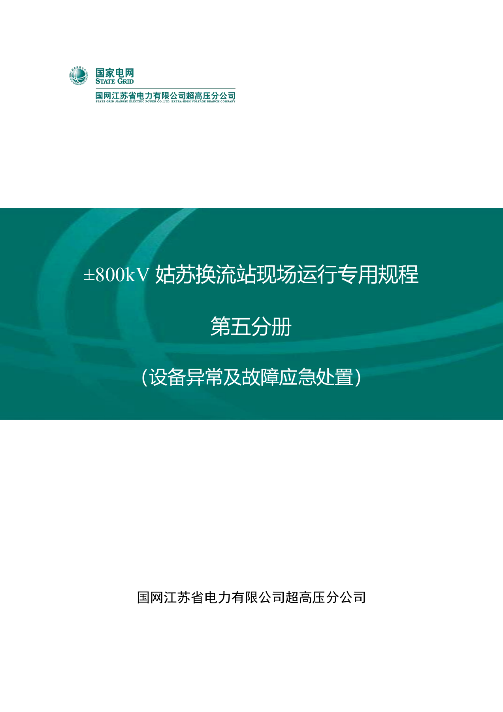
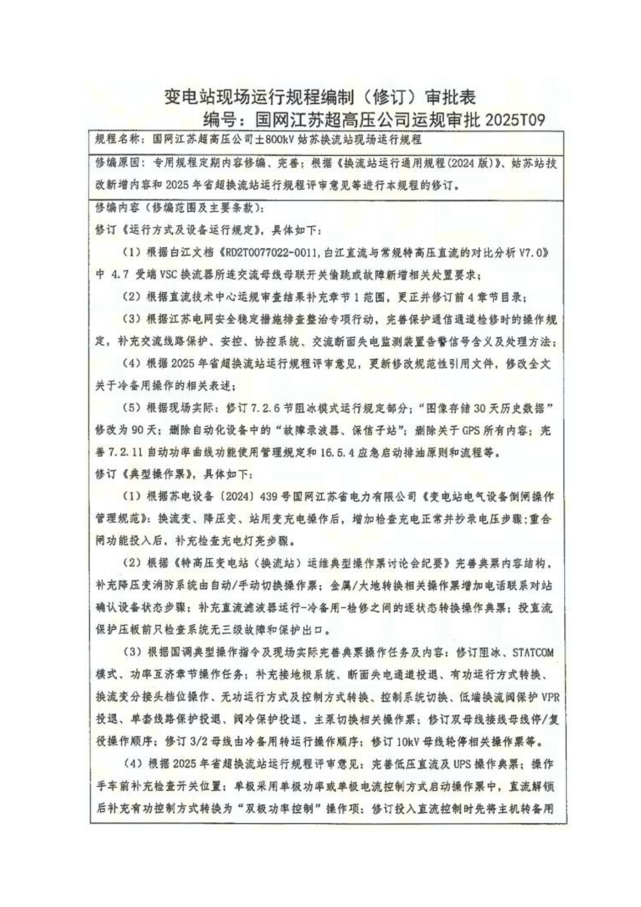
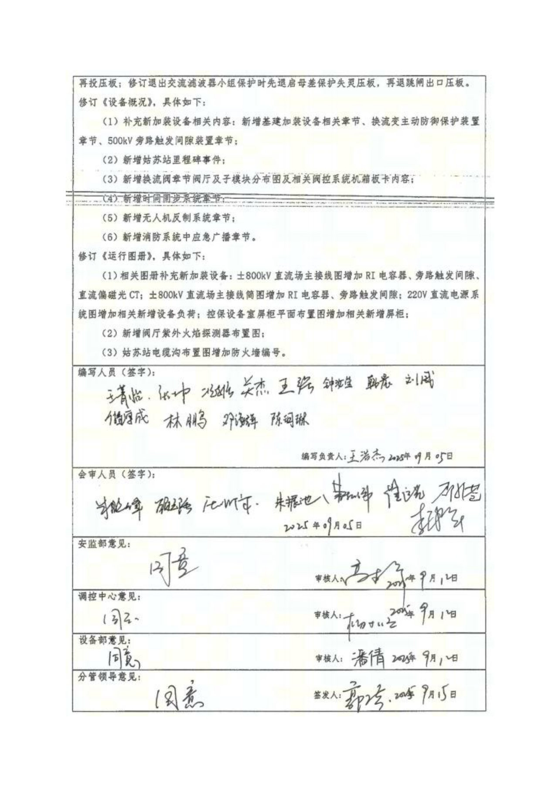

# ±800kV 姑苏换流站现场运行专用规程

第五分册：设备异常及故障应急处置 · 版本 6.0 · 2025 年 9 月

> 转换说明：本文件为原 PDF 的 Markdown 转写。保留原文措辞、条款编号和顺序，只调整排版、合并换行并移除正文页脚页码；未作业务修订。封面及扫描审批表以原页图片保留，审批表未转写为可检索文字。

- 来源：[原始 PDF](<../../../rawdoc/姑苏站/运行规程/规程五：±800kV姑苏换流站运行规程（设备异常与事故处理）.pdf>)
- 页码：PDF 共 96 页；正文原书第 1-86 页对应 PDF 第 11-96 页。
- 结构：15 章、194 个原目录项、1,903 个编号单元（含标题及条款）。
- 定位：每个编号单元前的 HTML 注释记录 PDF 页码和原书页码；跨页条款已合并，页码范围保留。
- 原文疑似笔误、重复提示、编号异常及条件限定语均保留；转换不代表条款已通过业务审核。

<!-- source_pdf_sha256: 98d56bcdf4e494127af59c3e5cd4f535d0324d0f6832827eac0a6fb473074bd3 -->

## 封面（PDF 第 1 页）



<!-- source-begin: cover; pdf_pages=1 -->
```text
±800kV 姑苏换流站现场运行专用规程

        第五分册

  （设备异常及故障应急处置）


   国网江苏省电力有限公司超高压分公司
```
<!-- source-end: cover -->

## 版本与编审信息（PDF 第 2 页）

<!-- source-begin: version; pdf_pages=2 -->
```text
±800kV 姑苏换流站现场运行专用规程
            第五分册
  （设备异常及故障应急处置）
             版本号[6.0]


 批准：              郭 涛
 审定：    沈明慷、朱晓峰、高拓宇、杨文明、潘 倩
 审核：    王浩杰、顾元强、朱振池、曹松伟、许卫刚、
            崔运光、邵新苍、李诗华
 编制：    张 坤、关 杰、储厚成、王菁怡、钟汝莹
        王 强、况志强、韩 晨、邓海晖、林 鹏
               刘 威、陈玥琳


       国网江苏省电力有限公司超高压分公司
           二 O 二五年九月
```
<!-- source-end: version -->

## 修订审批表（PDF 第 3-4 页）

以下两页为扫描图像，保留表格及手写签批的原貌。

### PDF 第 3 页



### PDF 第 4 页



## 前言（PDF 第 5 页）

<!-- source-begin: preface; pdf_pages=5 -->
白鹤滩—江苏工程是我国实施“西电东送”战略及实现“碳达峰、碳中和”战略的重点工程，是促进国家能源结构调整和节能减排的重大清洁能源项目，是国家电网坚持新发展理念的又一创新型工程，对于优化能源配置、保障电力供应、拉动经济增长、推动绿色发展、引领技术创新等具有显著的综合效益和长远的战略意义。该工程起于四川省凉山州建昌换流站，止于江苏省苏州市姑苏换流站，途经四川、重庆、湖北、安徽、江苏 5 省（直辖市），线路全长 2081.4 公里，额定电压±800kV，额定电流 5000A，额定输送容量 8000MW，总投资 307 亿元，于 2020 年 11 月获得国家发改委核准，于 2022 年 12 月建成投运。

±800kV 特高压姑苏换流站位于常熟市辛庄镇南沙河路，东侧紧邻 500kV 常熟南变电站，占地面积约 28.8 公顷。工程首次采用混合级联特高压直流输电技术，送端采用双 12 脉动常规直流，受端姑苏换流站高端采用单 12 脉动常规直流，低端采用 3 个柔直并联，是世界上首座采用常规直流和柔性直流混合级联接线的特高压换流站。LCC 和 3 个 VSC 分别接入 4 组交流母线，高端 LCC 接入 3/2 接线交流场，π入斗山\~常熟南 2 回 500k V 线路，新建 1 回 500kV 线路至常熟南变电站，共 5 回出线；低端 VSC1 接入双母线接线交流场，VSC2、VSC3 接入双母双分段接线交流场，VSC1 π入张家港\~常熟北单线，VSC2、VSC3 各新建 2 回线路至木渎、玉山变电站，共 6 回出线。500kV 交流滤波器场共 3 大组 9 小组，包含5 组 HP12/24 交流滤波器，3 组 SC 并联电容器，1 组 HP3 交流滤波器，小组容量 300Mvar，总容量2700Mvar。接地极极址位于常州市武进区湟里镇迈步村，距站址直线距离约 80km，接地极线路长150.51km，与±500kV 政平换流站共用接地极。

2025 年 03 月，完成双极低端 VSC1 直流偏磁抑制功能加装；2025 年 06 月，完成低端换流变主动防御系统加装；2025 年 06 月，完成双极低端 VSC1 旁路触发间隙加装；2025 年 06 月，完成双极低端VSC1 RI 电容器加装。

按照《国家电网公司直流换流站运行规程编制导则》等规程规定，依据换流站设备资料，结合姑苏换流站实际情况，国网江苏省电力有限公司超高压分公司组织人员编写了《±800kV 特高压姑苏换流站运行规程》。

本《规程》共分六册，分别为设备概况分册、运行方式与设备运行规定分册、设备巡视分册、设备异常与事故处理分册、典型操作票分册和运行图册分册。本册为设备概况分册，其内容涵盖了设备概况、一次设备、二次设备及辅助设备等。

本《规程》由国网江苏省电力有限公司超高压分公司特高压交直流运检中心归口并负责解释。

由于本《规程》编者水平有限，执行过程中发现的问题请及时向国网江苏省电力有限公司超高压分公司特高压交直流运检中心反映。
<!-- source-end: preface -->

## 原目录（PDF 第 6-10 页）

目录名称及原书页码照原文保留；点击条目可跳转到正文。

| 章节与条目 | 原书页码 | PDF 页码 |
| --- | ---: | ---: |
| [**1 总则**](#clause-1) | 1 | 11 |
| [1.1 目的](#clause-1-1) | 1 | 11 |
| [1.2 职责](#clause-1-2) | 1 | 11 |
| [**2 一般规定**](#clause-2) | 2 | 12 |
| [2.1 事故处理原则](#clause-2-1) | 2 | 12 |
| [2.2 事故处理规定](#clause-2-2) | 2 | 12 |
| [2.3 设备事故处理规定](#clause-2-3) | 3 | 13 |
| [**3 电网事故处理预案**](#clause-3) | 6 | 16 |
| [3.1 换流站黑启动处理预案](#clause-3-1) | 6 | 16 |
| [3.2 双极闭锁处理预案](#clause-3-2) | 6 | 16 |
| [3.3 极闭锁处理预案](#clause-3-3) | 7 | 17 |
| [3.4 单换流器闭锁处理预案](#clause-3-4) | 7 | 17 |
| [3.5 直流系统功率回降处理预案](#clause-3-5) | 8 | 18 |
| [3.6 换流器在线投入/退出不成功处理预案](#clause-3-6) | 8 | 18 |
| [**4 换流变事故处理预案**](#clause-4) | 9 | 19 |
| [4.1 换流变跳闸事故处置预案](#clause-4-1) | 9 | 19 |
| [4.2 换流变电气量保护动作处理预案](#clause-4-2) | 9 | 19 |
| [4.3 换流变非电量保护报警处理预案](#clause-4-3) | 10 | 20 |
| [4.4 换流变冷却器故障处理预案](#clause-4-4) | 10 | 20 |
| [4.5 换流变在大负荷时失去备用冷却器处理预案](#clause-4-5) | 11 | 21 |
| [4.6 换流变冷却器潜油泵漏油处理预案](#clause-4-6) | 11 | 21 |
| [4.7 换流变动力电源丢失处理预案](#clause-4-7) | 11 | 21 |
| [4.8 换流变油温高/绕组温度高处理预案](#clause-4-8) | 12 | 22 |
| [4.9 换流变本体压力释放阀动作处理预案](#clause-4-9) | 12 | 22 |
| [4.10 换流变油位过高处理预案](#clause-4-10) | 13 | 23 |
| [4.11 换流变油位低处理预案](#clause-4-11) | 13 | 23 |
| [4.12 换流变分接头三相不一致处理预案](#clause-4-12) | 13 | 23 |
| [4.13 换流变轻瓦斯/重瓦斯保护动作跳闸处理预案](#clause-4-13) | 14 | 24 |
| [4.14 换流变阀侧套管 SF6 压力报警处理预案](#clause-4-14) | 15 | 25 |
| [4.15 换流变着火处理预案](#clause-4-15) | 15 | 25 |
| [4.16 一体化在线监测报警处理预案](#clause-4-16) | 16 | 26 |
| [**5 GIS 设备事故处理预案**](#clause-5) | 17 | 27 |
| [5.1 GIS 交流断路器 SF6 压力低处理预案](#clause-5-1) | 17 | 27 |
| [5.2 GIS 设备气室（断路器气室以外）SF6 气体压力低报警处理](#clause-5-2) | 17 | 27 |
| [5.3 GIS 断路器储能不正常处理预案](#clause-5-3) | 18 | 28 |
| [5.4 GIS 断路器拒动处理预案](#clause-5-4) | 18 | 28 |
| [5.5 GIS 隔离开关/接地刀闸拒动处理预案](#clause-5-5) | 19 | 29 |
| [5.6 GIS 隔离开关操作不到位处理预案](#clause-5-6) | 19 | 29 |
| [5.7 GIS 接地刀闸操作不到位处理预案](#clause-5-7) | 19 | 29 |
| [5.8 GIS 断路器动作不到位处理预案](#clause-5-8) | 20 | 30 |
| [5.9 GIS 断路器灭弧室爆炸处理预案](#clause-5-9) | 20 | 30 |
| [5.10 保护动作 GIS 断路器拒分处理预案](#clause-5-10) | 21 | 31 |
| [5.11 GIS 断路器偷跳（误跳）处理预案](#clause-5-11) | 21 | 31 |
| [5.12 操动机构压力低闭锁分合闸处理预案](#clause-5-12) | 21 | 31 |
| [5.13 操动机构频繁打压处理预案](#clause-5-13) | 22 | 32 |
| [5.14 内部绝缘故障、击穿处理预案](#clause-5-14) | 22 | 32 |
| [5.15 声响异常处理预案](#clause-5-15) | 23 | 33 |
| [5.16 局部过热处理预案](#clause-5-16) | 23 | 33 |
| [5.17 GIS 分、合闸异常处理预案](#clause-5-17) | 23 | 33 |
| [5.18 GIS 电压互感器故障处理预案](#clause-5-18) | 24 | 34 |
| [5.19 GIS 电流互感器故障处理预案](#clause-5-19) | 24 | 34 |
| [5.20 GIS 出线套管故障处理预案](#clause-5-20) | 24 | 34 |
| [5.21 GIS 交流母线故障处理预案](#clause-5-21) | 25 | 35 |
| [**6 交流滤波器场设备事故处理预案**](#clause-6) | 26 | 36 |
| [6.1 交流滤波器断路器 SF6 压力低处理预案](#clause-6-1) | 26 | 36 |
| [6.2 交流滤波器断路器储能不正常处理预案](#clause-6-2) | 26 | 36 |
| [6.3 交流滤波器断路器拒动处理预案](#clause-6-3) | 26 | 36 |
| [6.4 交流滤波器场隔离开关/接地刀闸拒动处理预案](#clause-6-4) | 27 | 37 |
| [6.5 交流滤波器隔离开关操作不到位处理预案](#clause-6-5) | 27 | 37 |
| [6.6 交流滤波器接地刀闸操作不到位处理预案](#clause-6-6) | 28 | 38 |
| [6.7 交流滤波器母线电压互感器故障处理预案](#clause-6-7) | 28 | 38 |
| [6.8 交流滤波器场电流互感器故障处理预案](#clause-6-8) | 28 | 38 |
| [6.9 交流滤波器场母线避雷器故障处理预案](#clause-6-9) | 29 | 39 |
| [6.10 交流滤波器母线故障处理预案](#clause-6-10) | 29 | 39 |
| [6.11 运行中最小交流滤波器组数不满足处理预案](#clause-6-11) | 29 | 39 |
| [6.12 交流滤波器/并联电容器电容器渗漏油处理预案](#clause-6-12) | 30 | 40 |
| [6.13 交流滤波器/并联电容器设备接头过热处理预案](#clause-6-13) | 30 | 40 |
| [6.14 交流滤波器大组保护动作处理预案](#clause-6-14) | 30 | 40 |
| [6.15 交流滤波器小组保护动作处理预案](#clause-6-15) | 31 | 41 |
| [6.16 交流滤波器小组保护报警处理预案](#clause-6-16) | 31 | 41 |
| [6.17 无功减载动作处理预案](#clause-6-17) | 31 | 41 |
| [**7 直流场设备事故处理预案**](#clause-7) | 33 | 43 |
| [7.1 直流断路器 SF6 压力低处理预案](#clause-7-1) | 33 | 43 |
| [7.2 阀旁路开关区域断路器 SF6 压力低处理预案](#clause-7-2) | 33 | 43 |
| [7.3 阀旁路开关区域断路器弹簧储能故障处理预案](#clause-7-3) | 34 | 44 |
| [7.4 可控自恢复消能装置不能正常投入处理预案](#clause-7-4) | 34 | 44 |
| [7.5 可控自恢复消能装置不能正常退出处理预案](#clause-7-5) | 34 | 44 |
| [7.6 直流滤波器电容器漏油处理预案](#clause-7-6) | 35 | 45 |
| [7.7 直流极母线故障处理预案](#clause-7-7) | 35 | 45 |
| [7.8 直流场设备放电闪络的处理预案](#clause-7-8) | 35 | 45 |
| [7.9 直流光 CT 故障处理预案](#clause-7-9) | 36 | 46 |
| [7.10 直流极母线隔离开关过热处理预案](#clause-7-10) | 36 | 46 |
| [7.11 直流分压器故障处理预案](#clause-7-11) | 37 | 47 |
| [7.12 直流场隔离开关拒动处理预案](#clause-7-12) | 37 | 47 |
| [7.13 直流场接地刀闸拒动处理预案](#clause-7-13) | 37 | 47 |
| [7.14 直流滤波器保护动作跳闸处理预案](#clause-7-14) | 38 | 48 |
| [7.15 直流滤波器保护报警处理预案](#clause-7-15) | 38 | 48 |
| [7.16 直流分压器气体压力低处理预案](#clause-7-16) | 39 | 49 |
| [7.17 平波电抗器红外测温过热处理预案](#clause-7-17) | 39 | 49 |
| [**8 控制系统故障处理预案**](#clause-8) | 40 | 50 |
| [8.1 运行人员工作站 OWS 死机处理预案](#clause-8-1) | 40 | 50 |
| [8.2 控制系统单系统故障处理预案（以 A 系统为例）](#clause-8-2) | 40 | 50 |
| [8.3 PCS-9540 主机死机处理预案](#clause-8-3) | 41 | 51 |
| [8.4 PF 动作处理预案](#clause-8-4) | 41 | 51 |
| [**9 保护和远动装置事故处理预案**](#clause-9) | 42 | 52 |
| [9.1 远传信号不正确或中断处理预案](#clause-9-1) | 42 | 52 |
| [9.2 保护装置异常处理预案](#clause-9-2) | 42 | 52 |
| [9.3 线路保护动作处理预案](#clause-9-3) | 43 | 53 |
| [9.4 断路器保护动作处理预案](#clause-9-4) | 44 | 54 |
| [9.5 母差保护动作处理预案](#clause-9-5) | 44 | 54 |
| [9.6 直流线路保护动作处理预案](#clause-9-6) | 45 | 55 |
| [9.7 直流线路保护动作跳闸处理预案](#clause-9-7) | 45 | 55 |
| [9.8 换流器保护动作跳闸处理预案](#clause-9-8) | 45 | 55 |
| [9.9 换流器保护动作报警处理预案](#clause-9-9) | 46 | 56 |
| [9.10 极保护动作报警处理预案](#clause-9-10) | 46 | 56 |
| [9.11 极保护动作跳闸处理预案](#clause-9-11) | 47 | 57 |
| [9.12 直流穿墙套管 SF6 密度低报警处理预案](#clause-9-12) | 47 | 57 |
| [9.13 双极中性母线差动保护动作处理预案](#clause-9-13) | 47 | 57 |
| [9.14 接地极不平衡保护告警处理预案](#clause-9-14) | 48 | 58 |
| [9.15 接地极线过负荷保护动作处理预案](#clause-9-15) | 48 | 58 |
| [9.16 接地线线路阻抗监视报警处理预案](#clause-9-16) | 48 | 58 |
| [9.17 站接地过流保护动作处理预案](#clause-9-17) | 48 | 58 |
| [9.18 金属回线纵差保护动作处理预案](#clause-9-18) | 49 | 59 |
| [9.19 直流开关保护动作处理预案](#clause-9-19) | 49 | 59 |
| [9.20 安控/协控装置故障预案](#clause-9-20) | 49 | 59 |
| [9.21 站间通讯故障处理预案](#clause-9-21) | 50 | 60 |
| [9.22 慢速类保护动作处置预案](#clause-9-22) | 50 | 60 |
| [**10 阀内水冷系统故障处理预案**](#clause-10) | 52 | 62 |
| [10.1 内水冷流量低处理预案](#clause-10-1) | 52 | 62 |
| [10.2 内水冷温度高处理预案](#clause-10-2) | 52 | 62 |
| [10.3 内水冷泄漏处理预案](#clause-10-3) | 53 | 63 |
| [10.4 内水冷主水循环泵故障处理预案](#clause-10-4) | 53 | 63 |
| [10.5 内水冷主循环泵异常但未切至备用泵运行处理预案](#clause-10-5) | 54 | 64 |
| [10.6 内水冷水位低报警处理预案](#clause-10-6) | 54 | 64 |
| [10.7 内水冷电导率高报警处理预案](#clause-10-7) | 54 | 64 |
| [10.8 阀漏水检测保护动作处理预案](#clause-10-8) | 55 | 65 |
| [10.9 三通阀故障处理预案](#clause-10-9) | 55 | 65 |
| [10.10 阀内水冷去离子回路中的低流量报警](#clause-10-10) | 55 | 65 |
| [10.11 膨胀罐/高位水箱液位低](#clause-10-11) | 56 | 66 |
| [10.12 膨胀罐氮气压力低报警](#clause-10-12) | 56 | 66 |
| [10.13 主循环泵剧烈振动](#clause-10-13) | 57 | 67 |
| [10.14 阀内水冷传感器故障报警](#clause-10-14) | 57 | 67 |
| [10.15 单套阀冷控制保护系统故障](#clause-10-15) | 57 | 67 |
| [**11 外水冷系统故障处理预案**](#clause-11) | 58 | 68 |
| [11.1 外水冷冷却塔风扇故障处理预案](#clause-11-1) | 58 | 68 |
| [11.2 外风冷风机电源全部丢失处理预案](#clause-11-2) | 58 | 68 |
| [11.3 阀外水冷冷却塔风机全停](#clause-11-3) | 59 | 69 |
| [11.4 外水冷不能自动补水处理预案](#clause-11-4) | 59 | 69 |
| [11.5 外水冷系统喷淋泵故障处理预案](#clause-11-5) | 60 | 70 |
| [11.6 外水冷喷淋泵或泵坑内管道漏水处理预案](#clause-11-6) | 60 | 70 |
| [11.7 阀外水冷房积水](#clause-11-7) | 60 | 70 |
| [11.8 反渗透单元压差高](#clause-11-8) | 61 | 71 |
| [**12 站用电系统故障处理预案**](#clause-12) | 62 | 72 |
| [12.1 500kV 变压器压力释放报警处理预案](#clause-12-1) | 62 | 72 |
| [12.2 500kV 变压器油位高/低报警处理预案](#clause-12-2) | 62 | 72 |
| [12.3 500kV 变压器油温/绕组温度高处理预案](#clause-12-3) | 62 | 72 |
| [12.4 500kV 变压器瓦斯继电器告警及动作处理预案](#clause-12-4) | 63 | 73 |
| [12.5 500kV 变压器保护动作跳闸处理预案](#clause-12-5) | 63 | 73 |
| [12.6 500kV 变压器 PT 断线报警处理预案](#clause-12-6) | 64 | 74 |
| [12.7 站用电丢失一路进线电源处理预案](#clause-12-7) | 64 | 74 |
| [12.8 站用电 35kV 断路器故障处理预案](#clause-12-8) | 64 | 74 |
| [12.9 站用 10/0.4kV 变压器温度高报警处理预案](#clause-12-9) | 65 | 75 |
| [12.10 站用 10/0.4kV 变压器保护动作跳闸处理预案](#clause-12-10) | 65 | 75 |
| [12.11 站用电 10kV 断路器储能不正常处理预案](#clause-12-11) | 65 | 75 |
| [12.12 站用电 10kV 母线故障处理预案](#clause-12-12) | 66 | 76 |
| [12.13 站用电 400V 一条母线故障处理预案](#clause-12-13) | 66 | 76 |
| [12.14 400V 负荷开关跳闸处理预案](#clause-12-14) | 66 | 76 |
| [12.15 220V 直流系统接地故障处理预案](#clause-12-15) | 67 | 77 |
| [12.16 直流充电机故障处理预案](#clause-12-16) | 67 | 77 |
| [12.17 UPS 系统故障处理预案](#clause-12-17) | 67 | 77 |
| [12.18 蓄电池过欠压报警处理预案](#clause-12-18) | 68 | 78 |
| [12.19 蓄电池故障处理预案](#clause-12-19) | 68 | 78 |
| [12.20 220V 直流系统交流欠压故障处理预案](#clause-12-20) | 68 | 78 |
| [**13 辅助供水系统故障处理预案**](#clause-13) | 70 | 80 |
| [13.1 站外供水中断处理预案](#clause-13-1) | 70 | 80 |
| [13.2 生活/设备水箱水位低处理预案](#clause-13-2) | 70 | 80 |
| [13.3 工业/消防水池水位低处理预案](#clause-13-3) | 70 | 80 |
| [13.4 泵房漏水事故处理预案](#clause-13-4) | 71 | 81 |
| [13.5 生活泵故障处理预案](#clause-13-5) | 71 | 81 |
| [13.6 泵房排污泵不能自动启动处理预案](#clause-13-6) | 71 | 81 |
| [**14 空调通风系统故障处理预案**](#clause-14) | 73 | 83 |
| [14.1 阀厅空调室外机故障处理预案](#clause-14-1) | 73 | 83 |
| [14.2 压差传感器报警处理预案](#clause-14-2) | 73 | 83 |
| [14.3 控制柜电源故障处理预案](#clause-14-3) | 73 | 83 |
| [14.4 加热器故障处理预案](#clause-14-4) | 74 | 84 |
| [14.5 防火阀故障处理预案](#clause-14-5) | 74 | 84 |
| [14.6 送风机故障处理预案](#clause-14-6) | 74 | 84 |
| [14.7 阀厅空调全停处理预案](#clause-14-7) | 74 | 84 |
| [14.8 事故排烟风机故障处理预案](#clause-14-8) | 75 | 85 |
| [14.9 室内空调单体机、多联机组故障处理预案](#clause-14-9) | 75 | 85 |
| [**15 消防系统事故处理预案**](#clause-15) | 76 | 86 |
| [15.1 阀厅设备着火处理预案](#clause-15-1) | 76 | 86 |
| [15.2 换流变压器火灾处理预案](#clause-15-2) | 76 | 86 |
| [15.3 交流滤波器电抗器火灾处理预案](#clause-15-3) | 77 | 87 |
| [15.4 站用 500/35kV 变压器火灾处理预案](#clause-15-4) | 77 | 87 |
| [15.5 站用 35/10kV 变压器火灾处理预案](#clause-15-5) | 78 | 88 |
| [15.6 站用 10/0.4kV 变压器火灾处理预案](#clause-15-6) | 78 | 88 |
| [15.7 控制、保护系统屏柜火灾处理预案](#clause-15-7) | 79 | 89 |
| [15.8 阀厅紫外线探测器/烟雾探测器报警处理预案](#clause-15-8) | 79 | 89 |
| [15.9 图像型火焰探测器报警处理预案](#clause-15-9) | 79 | 89 |
| [15.10 水喷雾灭火系统故障处理预案](#clause-15-10) | 79 | 89 |
| [15.11 泡沫喷雾灭火系统故障处理预案](#clause-15-11) | 82 | 92 |
| [15.12 消防给水及消火栓系统故障处理预案](#clause-15-12) | 83 | 93 |
| [15.13 火灾自动报警系统与消防监控故障处理预案](#clause-15-13) | 85 | 95 |

<!-- source-begin: body -->

<!-- clause=1; pdf_pages=11; printed_pages=1 -->
<a id="clause-1"></a>

## 1 总则

<!-- clause=1.1; pdf_pages=11; printed_pages=1 -->
<a id="clause-1-1"></a>

### 1.1 目的

<!-- clause=1.1.1; pdf_pages=11; printed_pages=1 -->
<a id="clause-1-1-1"></a>

**1.1.1** 为规范姑苏换流站事故处理工作，在事故和紧急事件发生后迅速有效地控制和处理，减轻事故对人身、设备和电网的影响，减少财产损失，将事故局部化，保证跨区电网的安全稳定运行和职工的人身安全。

<!-- clause=1.2; pdf_pages=11; printed_pages=1 -->
<a id="clause-1-2"></a>

### 1.2 职责

<!-- clause=1.2.1; pdf_pages=11; printed_pages=1 -->
<a id="clause-1-2-1"></a>

**1.2.1** 姑苏换流站当班值长是安全生产的第一负责人，应熟练掌握并组织全值人员贯彻执行本规定，在设备、系统出现异常或事故时，应积极组织处理。

<!-- clause=1.2.2; pdf_pages=11; printed_pages=1 -->
<a id="clause-1-2-2"></a>

**1.2.2** 各运行值班员是反事故措施和事故处理预案的具体实施人员，要严格遵守各项规章制度，认真学习并熟练掌握换流站反事故措施和事故处理预案，及时发现设备缺陷和异常情况，在当班值长的组织下及时正确地进行事故处理。

<!-- clause=2; pdf_pages=12; printed_pages=2 -->
<a id="clause-2"></a>

## 2 一般规定

<!-- clause=2.1; pdf_pages=12; printed_pages=2 -->
<a id="clause-2-1"></a>

### 2.1 事故处理原则

<!-- clause=2.1.1; pdf_pages=12; printed_pages=2 -->
<a id="clause-2-1-1"></a>

**2.1.1** 尽快限制事故扩大，消除人身及设备危险。

<!-- clause=2.1.2; pdf_pages=12; printed_pages=2 -->
<a id="clause-2-1-2"></a>

**2.1.2** 尽力保证恢复站用电源。

<!-- clause=2.1.3; pdf_pages=12; printed_pages=2 -->
<a id="clause-2-1-3"></a>

**2.1.3** 及时处理设备事故，尽快恢复设备送电，处理事故时，严防误操作。

<!-- clause=2.1.4; pdf_pages=12; printed_pages=2 -->
<a id="clause-2-1-4"></a>

**2.1.4** 事故发生和主要操作的时间应做记录，及时将情况报告有关领导和调度。

<!-- clause=2.1.5; pdf_pages=12; printed_pages=2 -->
<a id="clause-2-1-5"></a>

**2.1.5** 事故发生时应根据表计、保护、报警信号及自动装置动作情况，进行分析判断，做出处理方案，处理中防止非同期并列和系统事故扩大。

<!-- clause=2.2; pdf_pages=12; printed_pages=2 -->
<a id="clause-2-2"></a>

### 2.2 事故处理规定

<!-- clause=2.2.1; pdf_pages=12; printed_pages=2 -->
<a id="clause-2-2-1"></a>

**2.2.1** 国调值班调度员是国调管辖系统事故处理的指挥者。事故处理时，运行值班人员应做到：

<!-- clause=2.2.1.1; pdf_pages=12; printed_pages=2 -->
<a id="clause-2-2-1-1"></a>

**2.2.1.1** 迅速限制事故发展，消除事故根源，解除对人身、设备和电网安全的威胁。

<!-- clause=2.2.1.2; pdf_pages=12; printed_pages=2 -->
<a id="clause-2-2-1-2"></a>

**2.2.1.2** 用一切可能的方法保持正常设备的运行和对重要设备及站用电的正常供电。

<!-- clause=2.2.1.3; pdf_pages=12; printed_pages=2 -->
<a id="clause-2-2-1-3"></a>

**2.2.1.3** 电网解列后要尽快恢复并列运行。

<!-- clause=2.2.1.4; pdf_pages=12; printed_pages=2 -->
<a id="clause-2-2-1-4"></a>

**2.2.1.4** 尽快恢复对已停电的设备供电。

<!-- clause=2.2.2; pdf_pages=12; printed_pages=2 -->
<a id="clause-2-2-2"></a>

**2.2.2** 调整并恢复正常电网运行方式。

<!-- clause=2.2.3; pdf_pages=12; printed_pages=2 -->
<a id="clause-2-2-3"></a>

**2.2.3** 当有关电网发生影响国调管辖系统安全运行的事故时，运行值班员应尽快将事故简要情况汇报国调值班调度员；事故处理完毕后，运行值班员应及时提交事故原始报告并向国调值班调度员汇报详细情况。

<!-- clause=2.2.4; pdf_pages=12; printed_pages=2 -->
<a id="clause-2-2-4"></a>

**2.2.4** 国调管辖系统发生事故时，运行值班员应立即向国调汇报事故概况，在查明情况后，应尽快详细汇报。汇报内容应包括事故发生的时间及现象、跳闸开关、继电保护动作情况及电压、潮流的变化等。

<!-- clause=2.2.5; pdf_pages=12; printed_pages=2 -->
<a id="clause-2-2-5"></a>

**2.2.5** 为防止事故扩大，运行值班员可不待调度指令自行进行以下紧急操作

<!-- clause=2.2.5.1; pdf_pages=12; printed_pages=2 -->
<a id="clause-2-2-5-1"></a>

**2.2.5.1** 对人身和设备安全有威胁的设备停电。

<!-- clause=2.2.5.2; pdf_pages=12; printed_pages=2 -->
<a id="clause-2-2-5-2"></a>

**2.2.5.2** 将故障停运已损坏的设备隔离。

<!-- clause=2.2.5.3; pdf_pages=12; printed_pages=2 -->
<a id="clause-2-2-5-3"></a>

**2.2.5.3** 当站用电部分或全部停电时，恢复其电源。

<!-- clause=2.2.5.4; pdf_pages=12; printed_pages=2 -->
<a id="clause-2-2-5-4"></a>

**2.2.5.4** 站规程中规定可以不待调度指令自行处理者。

<!-- clause=2.2.6; pdf_pages=12; printed_pages=2 -->
<a id="clause-2-2-6"></a>

**2.2.6** 电压互感器或电流互感器发生异常情况时，应迅速按规程规定进行处理，并向国调值班调度员汇报。

<!-- clause=2.2.7; pdf_pages=12,13; printed_pages=2,3 -->
<a id="clause-2-2-7"></a>

**2.2.7** 事故处理时，只允许与事故处理有关的领导和工作人员留在控制室内，其他无关人员应迅速离开；非事故单位不应在事故处理当时向运行值班员询问事故原因和过程，以免影响事故处理。

<!-- clause=2.2.8; pdf_pages=13; printed_pages=3 -->
<a id="clause-2-2-8"></a>

**2.2.8** 事故处理完毕后，应将事故情况详细记录，并按规定报告。

<!-- clause=2.2.9; pdf_pages=13; printed_pages=3 -->
<a id="clause-2-2-9"></a>

**2.2.9** 事故调查工作按《国家电网公司安全事故调查规程》进行。

<!-- clause=2.2.10; pdf_pages=13; printed_pages=3 -->
<a id="clause-2-2-10"></a>

**2.2.10** 频率、电压发生异常情况时，运行值班员应加强监视，及时向国调汇报。

<!-- clause=2.3; pdf_pages=13; printed_pages=3 -->
<a id="clause-2-3"></a>

### 2.3 设备事故处理规定

<!-- clause=2.3.1; pdf_pages=13; printed_pages=3 -->
<a id="clause-2-3-1"></a>

#### 2.3.1 线路事故处理

<!-- clause=2.3.1.1; pdf_pages=13; printed_pages=3 -->
<a id="clause-2-3-1-1"></a>

**2.3.1.1** 线路跳闸后，应立即按相关规定控制断面潮流和母线电压、更改安控方式，收集故障相关信息并汇报值班调度员，由值班调度员综合考虑跳闸线路的有关设备信息并确定是否试送。若有明显的故障现象或特征，应查明原因后再考虑是否试送。在试送前应考虑：

<!-- clause=2.3.1.1.1; pdf_pages=13; printed_pages=3 -->
<a id="clause-2-3-1-1-1"></a>

**2.3.1.1.1** 线路故障跳闸后，经调度下令后，一般允许试送一次。如试送不成功，需再次试送，必须经主管生产领导同意。

<!-- clause=2.3.1.1.2; pdf_pages=13; printed_pages=3 -->
<a id="clause-2-3-1-1-2"></a>

**2.3.1.1.2** 线路故障跳闸后，若开关的故障切除次数已达到规定次数，运行值班人员应根据规定向调度提出停电检修建议。

<!-- clause=2.3.1.1.3; pdf_pages=13; printed_pages=3 -->
<a id="clause-2-3-1-1-3"></a>

**2.3.1.1.3** 带电作业线路故障跳闸后，现场运行人员应视设备仍然带电并尽快联系值班调度员，值班调度员未与工作负责人取得联系前不得试送线路。值班调度员应与相关单位确认线路具备试送条件，方可按照上述规定进行试送。

<!-- clause=2.3.1.1.4; pdf_pages=13; printed_pages=3 -->
<a id="clause-2-3-1-1-4"></a>

**2.3.1.1.4** 判断故障可能发生在站内时，应待现场确认站内相关一、二次设备检查无异常后，方可进行试送。

<!-- clause=2.3.2; pdf_pages=13; printed_pages=3 -->
<a id="clause-2-3-2"></a>

#### 2.3.2 变压器事故处理

<!-- clause=2.3.2.1; pdf_pages=13; printed_pages=3 -->
<a id="clause-2-3-2-1"></a>

##### 2.3.2.1 变压器开关跳闸时，根据变压器保护动作情况作如下处理

<!-- clause=2.3.2.1.1; pdf_pages=13; printed_pages=3 -->
<a id="clause-2-3-2-1-1"></a>

**2.3.2.1.1** 变压器的重瓦斯保护或差动保护动作跳闸，不得进行试送电；在检查变压器外部无明显故障，检查瓦斯气体和故障录波器动作情况，确认变压器内部无故障者，可以试送一次，有条件时应进行零起升压。

<!-- clause=2.3.2.1.2; pdf_pages=13; printed_pages=3 -->
<a id="clause-2-3-2-1-2"></a>

**2.3.2.1.2** 变压器后备过流保护动作跳闸，在找到故障并有效隔离后，可试送一次。

<!-- clause=2.3.3; pdf_pages=13; printed_pages=3 -->
<a id="clause-2-3-3"></a>

#### 2.3.3 母线事故处理

<!-- clause=2.3.3.1; pdf_pages=13; printed_pages=3 -->
<a id="clause-2-3-3-1"></a>

**2.3.3.1** 当母线发生故障或失压后，运行值班员应立即报告国调值班调度员，并同时将故障母线上的开关全部断开。

<!-- clause=2.3.3.2; pdf_pages=13; printed_pages=3 -->
<a id="clause-2-3-3-2"></a>

**2.3.3.2** 当母线故障停电后，运行值班员应立即对停电的母线进行外部检查，并把检查情况汇报国调值班调度员，在国调值班调度员的指挥下，按下述原则进行处理

<!-- clause=2.3.3.2.1; pdf_pages=13; printed_pages=3 -->
<a id="clause-2-3-3-2-1"></a>

**2.3.3.2.1** 找到故障点并能迅速隔离的，在隔离故障后对停电母线恢复运行。

<!-- clause=2.3.3.2.2; pdf_pages=13; printed_pages=3 -->
<a id="clause-2-3-3-2-2"></a>

**2.3.3.2.2** 找到故障点但不能很快隔离的，应将该母线转为检修。

<!-- clause=2.3.3.2.3; pdf_pages=13; printed_pages=3 -->
<a id="clause-2-3-3-2-3"></a>

**2.3.3.2.3** 确认母线故障但找不到故障点的，一般不得对停电母线试送。

<!-- clause=2.3.3.2.4; pdf_pages=14; printed_pages=4 -->
<a id="clause-2-3-3-2-4"></a>

**2.3.3.2.4** 对停电母线进行试送，应尽可能用外来电源。

<!-- clause=2.3.3.2.5; pdf_pages=14; printed_pages=4 -->
<a id="clause-2-3-3-2-5"></a>

**2.3.3.2.5** 试送开关必须完好，并有完备的继电保护。有条件者可对故障母线进行零起升压。

<!-- clause=2.3.4; pdf_pages=14; printed_pages=4 -->
<a id="clause-2-3-4"></a>

#### 2.3.4 开关故障处理

<!-- clause=2.3.4.1; pdf_pages=14; printed_pages=4 -->
<a id="clause-2-3-4-1"></a>

**2.3.4.1** 开关远方操作失灵时，若允许就地操作，必须三相同时操作，不得分相操作；开关操作时，发生非全相运行，应立即拉开该开关。

<!-- clause=2.3.4.2; pdf_pages=14; printed_pages=4 -->
<a id="clause-2-3-4-2"></a>

**2.3.4.2** 开关运行时发生单相或两相断开且三相不一致保护未跳开开关运行相，应立即将该开关三相拉开。

<!-- clause=2.3.4.3; pdf_pages=14; printed_pages=4 -->
<a id="clause-2-3-4-3"></a>

**2.3.4.3** 开关异常出现“合闸闭锁”尚未出现“分闸闭锁”时，应立即拉开异常开关；出现“分闸闭锁”时，应停用开关的操作电源，并按规程进行处理。

<!-- clause=2.3.5; pdf_pages=14; printed_pages=4 -->
<a id="clause-2-3-5"></a>

#### 2.3.5 通信中断的事故处理

<!-- clause=2.3.5.1; pdf_pages=14; printed_pages=4 -->
<a id="clause-2-3-5-1"></a>

**2.3.5.1** 国调与换流站间的通信联系中断时，各方应积极采取措施，尽快恢复通信联系，如不能尽快恢复，国调可通过有关网省调的通信联系转达调度业务。

<!-- clause=2.3.5.2; pdf_pages=14; printed_pages=4 -->
<a id="clause-2-3-5-2"></a>

**2.3.5.2** 当调度与换流站间的通信中断时。

<!-- clause=2.3.5.2.1; pdf_pages=14; printed_pages=4 -->
<a id="clause-2-3-5-2-1"></a>

**2.3.5.2.1** 换流站的运行方式，尽可能保持不变。

<!-- clause=2.3.5.2.2; pdf_pages=14; printed_pages=4 -->
<a id="clause-2-3-5-2-2"></a>

**2.3.5.2.2** 正在进行检修的设备，在通信中断期间完工，可以恢复运行时，只能待通信恢复正常后，再恢复运行。

<!-- clause=2.3.5.3; pdf_pages=14; printed_pages=4 -->
<a id="clause-2-3-5-3"></a>

**2.3.5.3** 当国调值班调度员下达操作指令后，受令方未重复指令或虽已重复指令但未经国调值班调度员同意执行操作前，失去通信联系，则该操作指令不得执行；若已经国调值班调度员同意执行操作，可以将该操作指令全部执行完毕。国调值班调度员在下达了操作指令后而未接到完成操作指令的报告前，与受令单位失去通信联系，则仍认为该操作指令正在执行中。

<!-- clause=2.3.5.4; pdf_pages=14; printed_pages=4 -->
<a id="clause-2-3-5-4"></a>

**2.3.5.4** 凡涉及国调管辖系统安全问题或时间性没有特殊要求的调度业务联系，失去通信联系后，在与国调值班调度员联系前不得自行处理；紧急情况下按规程规定处理。

<!-- clause=2.3.5.5; pdf_pages=14; printed_pages=4 -->
<a id="clause-2-3-5-5"></a>

**2.3.5.5** 在通信恢复后，应立即向国调值班调度员补报在通信中断期间一切应汇报事项。

<!-- clause=2.3.6; pdf_pages=14; printed_pages=4 -->
<a id="clause-2-3-6"></a>

#### 2.3.6 直流输电系统事故处理

<!-- clause=2.3.6.1; pdf_pages=14; printed_pages=4 -->
<a id="clause-2-3-6-1"></a>

**2.3.6.1** 直流线路故障，再启动失败致使直流系统某极停运，根据调度要求可允许对该极线路进行一次加压试验。试验成功后，可以恢复相应极系统运行。

<!-- clause=2.3.6.2; pdf_pages=14; printed_pages=4 -->
<a id="clause-2-3-6-2"></a>

**2.3.6.2** 因换流阀、极母线、平波电抗器等直流 800kV 设备故障引起直流输电系统换流阀或极停运，未经检查处理不得恢复运行。在重新启动前，应在发生故障的换流站进行空载加压试验。

<!-- clause=2.3.6.3; pdf_pages=14; printed_pages=4 -->
<a id="clause-2-3-6-3"></a>

**2.3.6.3** 运行的交流滤波器因故障需退出运行时，换流站在确认备用交流滤波器具备运行条件后，经国调值班调度员许可，可以进行手动投切交流滤波器（先投后切）。

<!-- clause=2.3.6.4; pdf_pages=15; printed_pages=5 -->
<a id="clause-2-3-6-4"></a>

**2.3.6.4** 换流阀和阀冷却水系统在运行中发生异常时，按站内有关规程处理。当发生换流阀冷却水超温、换流变油温高等影响直流输电系统送电能力的设备报警时，换流站运行值班员可向国调值班调度员汇报并提出降低直流输送功率等措施，国调值班调度员根据电网情况下令处理。

<!-- clause=3; pdf_pages=16; printed_pages=6 -->
<a id="clause-3"></a>

## 3 电网事故处理预案

<!-- clause=3.1; pdf_pages=16; printed_pages=6 -->
<a id="clause-3-1"></a>

### 3.1 换流站黑启动处理预案

<!-- clause=3.1.1; pdf_pages=16; printed_pages=6 -->
<a id="clause-3-1-1"></a>

#### 3.1.1 现象

<!-- clause=3.1.1.1; pdf_pages=16; printed_pages=6 -->
<a id="clause-3-1-1-1"></a>

**3.1.1.1** 站用电全停，直流系统停运，交流系统失电，水冷、空调、消防等辅助系统停运。

<!-- clause=3.1.2; pdf_pages=16; printed_pages=6 -->
<a id="clause-3-1-2"></a>

#### 3.1.2 处理

<!-- clause=3.1.2.1; pdf_pages=16; printed_pages=6 -->
<a id="clause-3-1-2-1"></a>

**3.1.2.1** 汇报调度和领导；

<!-- clause=3.1.2.2; pdf_pages=16; printed_pages=6 -->
<a id="clause-3-1-2-2"></a>

**3.1.2.2** 拉开站内交流系统处于合闸位置的开关，退出安控装置；

<!-- clause=3.1.2.3; pdf_pages=16; printed_pages=6 -->
<a id="clause-3-1-2-3"></a>

**3.1.2.3** 若外来站用电源能够恢复，立即申请调度恢复外来站用电源运行；

<!-- clause=3.1.2.4; pdf_pages=16; printed_pages=6 -->
<a id="clause-3-1-2-4"></a>

**3.1.2.4** 若外来站用电源不能恢复，联系相关调度对交流系统进行充电，通过站内站用变恢复站用电运行；

<!-- clause=3.1.2.5; pdf_pages=16; printed_pages=6 -->
<a id="clause-3-1-2-5"></a>

**3.1.2.5** 若外来电源及交流系统均不具备带电条件，联系当地供电公司请求应急电源车进行支援，恢复站用电 400V 系统运行；

<!-- clause=3.1.2.6; pdf_pages=16; printed_pages=6 -->
<a id="clause-3-1-2-6"></a>

**3.1.2.6** 检查站用电负荷、直流 220V 负荷、UPS 负荷、通讯电源运行正常；

<!-- clause=3.1.2.7; pdf_pages=16; printed_pages=6 -->
<a id="clause-3-1-2-7"></a>

**3.1.2.7** 检查交直流控制保护装置、安控装置运行正常；

<!-- clause=3.1.2.8; pdf_pages=16; printed_pages=6 -->
<a id="clause-3-1-2-8"></a>

**3.1.2.8** 检查服务器、OWS、故障录波、故障测距、规约转换屏、信息子站等有关二次设备运行正常；

<!-- clause=3.1.2.9; pdf_pages=16; printed_pages=6 -->
<a id="clause-3-1-2-9"></a>

**3.1.2.9** 查远动、通信系统工作正常；

<!-- clause=3.1.2.10; pdf_pages=16; printed_pages=6 -->
<a id="clause-3-1-2-10"></a>

**3.1.2.10** 查水冷、空调、消防系统供电正常，逐步恢复系统正常运行；

<!-- clause=3.1.2.11; pdf_pages=16; printed_pages=6 -->
<a id="clause-3-1-2-11"></a>

**3.1.2.11** 检查并确认现场一次设备状态，按照调度指令进行交流系统恢复；

<!-- clause=3.1.2.12; pdf_pages=16; printed_pages=6 -->
<a id="clause-3-1-2-12"></a>

**3.1.2.12** 恢复站用电系统正常方式运行；

<!-- clause=3.1.2.13; pdf_pages=16; printed_pages=6 -->
<a id="clause-3-1-2-13"></a>

**3.1.2.13** 投入安控装置，恢复直流系统运行。

<!-- clause=3.2; pdf_pages=16; printed_pages=6 -->
<a id="clause-3-2"></a>

### 3.2 双极闭锁处理预案

<!-- clause=3.2.1; pdf_pages=16; printed_pages=6 -->
<a id="clause-3-2-1"></a>

#### 3.2.1 现象

<!-- clause=3.2.1.1; pdf_pages=16; printed_pages=6 -->
<a id="clause-3-2-1-1"></a>

**3.2.1.1** OWS 发相关保护动作信号，故障录波器启动；

<!-- clause=3.2.1.2; pdf_pages=16; printed_pages=6 -->
<a id="clause-3-2-1-2"></a>

**3.2.1.2** 双极闭锁；

<!-- clause=3.2.1.3; pdf_pages=16; printed_pages=6 -->
<a id="clause-3-2-1-3"></a>

**3.2.1.3** 所有换流器交流侧开关跳闸并锁定；

<!-- clause=3.2.1.4; pdf_pages=16; printed_pages=6 -->
<a id="clause-3-2-1-4"></a>

**3.2.1.4** 双极均退至隔离状态；

<!-- clause=3.2.1.5; pdf_pages=16; printed_pages=6 -->
<a id="clause-3-2-1-5"></a>

**3.2.1.5** 交流滤波器全部退出运行。

<!-- clause=3.2.2; pdf_pages=16; printed_pages=6 -->
<a id="clause-3-2-2"></a>

#### 3.2.2 处理

<!-- clause=3.2.2.1; pdf_pages=17; printed_pages=7 -->
<a id="clause-3-2-2-1"></a>

**3.2.2.1** 检查交流系统潮流、电压、频率有无越限，汇报调度及领导；

<!-- clause=3.2.2.2; pdf_pages=17; printed_pages=7 -->
<a id="clause-3-2-2-2"></a>

**3.2.2.2** 检查交流滤波器是否全部退出运行；

<!-- clause=3.2.2.3; pdf_pages=17; printed_pages=7 -->
<a id="clause-3-2-2-3"></a>

**3.2.2.3** 检查一次设备状态变化情况，检查动作保护范围内设备是否正常，并及时向调度及领导进行详细汇报；

<!-- clause=3.2.2.4; pdf_pages=17; printed_pages=7 -->
<a id="clause-3-2-2-4"></a>

**3.2.2.4** 查看保护装置动作情况，整理故障录波，并及时传真至调度和相关部门；

<!-- clause=3.2.2.5; pdf_pages=17; printed_pages=7 -->
<a id="clause-3-2-2-5"></a>

**3.2.2.5** 将双极（故障设备）隔离并转检修，通知检修人员进行处理。

<!-- clause=3.3; pdf_pages=17; printed_pages=7 -->
<a id="clause-3-3"></a>

### 3.3 极闭锁处理预案

<!-- clause=3.3.1; pdf_pages=17; printed_pages=7 -->
<a id="clause-3-3-1"></a>

#### 3.3.1 现象

<!-- clause=3.3.1.1; pdf_pages=17; printed_pages=7 -->
<a id="clause-3-3-1-1"></a>

**3.3.1.1** OWS 发相关保护动作信号，故障录波器启动；

<!-- clause=3.3.1.2; pdf_pages=17; printed_pages=7 -->
<a id="clause-3-3-1-2"></a>

**3.3.1.2** 故障极闭锁，功率全部或部分转移至另一极；

<!-- clause=3.3.1.3; pdf_pages=17; printed_pages=7 -->
<a id="clause-3-3-1-3"></a>

**3.3.1.3** 故障极内换流器交流侧开关跳闸并锁定；

<!-- clause=3.3.1.4; pdf_pages=17; printed_pages=7 -->
<a id="clause-3-3-1-4"></a>

**3.3.1.4** 故障极退至隔离状态。

<!-- clause=3.3.2; pdf_pages=17; printed_pages=7 -->
<a id="clause-3-3-2"></a>

#### 3.3.2 处理

<!-- clause=3.3.2.1; pdf_pages=17; printed_pages=7 -->
<a id="clause-3-3-2-1"></a>

**3.3.2.1** 检查直流系统功率变化和滤波器退出情况，及时汇报调度及领导；

<!-- clause=3.3.2.2; pdf_pages=17; printed_pages=7 -->
<a id="clause-3-3-2-2"></a>

**3.3.2.2** 若故障极闭锁引起另一极过负荷，则申请调度进行运行方式调整；

<!-- clause=3.3.2.3; pdf_pages=17; printed_pages=7 -->
<a id="clause-3-3-2-3"></a>

**3.3.2.3** 检查一次设备状态变化情况，检查动作保护范围内设备是否正常，并及时向调度及领导进行详细汇报；

<!-- clause=3.3.2.4; pdf_pages=17; printed_pages=7 -->
<a id="clause-3-3-2-4"></a>

**3.3.2.4** 查看保护装置动作情况，整理故障录波，并及时传真至调度和相关部门；

<!-- clause=3.3.2.5; pdf_pages=17; printed_pages=7 -->
<a id="clause-3-3-2-5"></a>

**3.3.2.5** 申请调度将故障极（设备）转至检修，通知检修人员进行处理。

<!-- clause=3.3.2.6; pdf_pages=17; printed_pages=7 -->
<a id="clause-3-3-2-6"></a>

**3.3.2.6** 关注接地极电流情况，做好方式切换准备。

<!-- clause=3.4; pdf_pages=17; printed_pages=7 -->
<a id="clause-3-4"></a>

### 3.4 单换流器闭锁处理预案

<!-- clause=3.4.1; pdf_pages=17; printed_pages=7 -->
<a id="clause-3-4-1"></a>

#### 3.4.1 现象

<!-- clause=3.4.1.1; pdf_pages=17; printed_pages=7 -->
<a id="clause-3-4-1-1"></a>

**3.4.1.1** OWS 发相关保护动作信号，故障录波器启动；

<!-- clause=3.4.1.2; pdf_pages=17; printed_pages=7 -->
<a id="clause-3-4-1-2"></a>

**3.4.1.2** 故障换流器闭锁，功率转移至运行换流器；

<!-- clause=3.4.1.3; pdf_pages=17; printed_pages=7 -->
<a id="clause-3-4-1-3"></a>

**3.4.1.3** 故障换流器交流侧开关跳闸并锁定；

<!-- clause=3.4.1.4; pdf_pages=17; printed_pages=7 -->
<a id="clause-3-4-1-4"></a>

**3.4.1.4** 故障换流器退至隔离状态。

<!-- clause=3.4.2; pdf_pages=17; printed_pages=7 -->
<a id="clause-3-4-2"></a>

#### 3.4.2 处理

<!-- clause=3.4.2.1; pdf_pages=17; printed_pages=7 -->
<a id="clause-3-4-2-1"></a>

**3.4.2.1** 检查直流系统功率变化和滤波器退出情况，及时汇报调度及领导；

<!-- clause=3.4.2.2; pdf_pages=17; printed_pages=7 -->
<a id="clause-3-4-2-2"></a>

**3.4.2.2** 若故障换流器闭锁引起本极另一台换流器或另一极过负荷，则申请调度进行运行方式调整；

<!-- clause=3.4.2.3; pdf_pages=17; printed_pages=7 -->
<a id="clause-3-4-2-3"></a>

**3.4.2.3** 检查一次设备状态变化情况，检查动作保护范围内设备是否正常，并及时向调度及领导进行详细汇报；

<!-- clause=3.4.2.4; pdf_pages=18; printed_pages=8 -->
<a id="clause-3-4-2-4"></a>

**3.4.2.4** 查看保护装置动作情况，整理故障录波，并及时传真至调度和相关部门；

<!-- clause=3.4.2.5; pdf_pages=18; printed_pages=8 -->
<a id="clause-3-4-2-5"></a>

**3.4.2.5** 申请调度将故障换流器（设备）转至检修，通知检修人员进行处理。

<!-- clause=3.5; pdf_pages=18; printed_pages=8 -->
<a id="clause-3-5"></a>

### 3.5 直流系统功率回降处理预案

<!-- clause=3.5.1; pdf_pages=18; printed_pages=8 -->
<a id="clause-3-5-1"></a>

#### 3.5.1 现象

<!-- clause=3.5.1.1; pdf_pages=18; printed_pages=8 -->
<a id="clause-3-5-1-1"></a>

**3.5.1.1** OWS 发相应保护启动功率回降报警（内水冷出阀温度高、绝对最小滤波器、接地极线路过负荷保护、安控装置），故障录波启动；

<!-- clause=3.5.1.2; pdf_pages=18; printed_pages=8 -->
<a id="clause-3-5-1-2"></a>

**3.5.1.2** 直流电流（功率）下降；

<!-- clause=3.5.1.3; pdf_pages=18; printed_pages=8 -->
<a id="clause-3-5-1-3"></a>

**3.5.1.3** 交流滤波器自动退出（视无功情况而定）；

<!-- clause=3.5.2; pdf_pages=18; printed_pages=8 -->
<a id="clause-3-5-2"></a>

#### 3.5.2 处理

<!-- clause=3.5.2.1; pdf_pages=18; printed_pages=8 -->
<a id="clause-3-5-2-1"></a>

**3.5.2.1** 汇报调度及领导；

<!-- clause=3.5.2.2; pdf_pages=18; printed_pages=8 -->
<a id="clause-3-5-2-2"></a>

**3.5.2.2** 若其它换流器或另一极过负荷，则应申请调度进行运行方式调整；

<!-- clause=3.5.2.3; pdf_pages=18; printed_pages=8 -->
<a id="clause-3-5-2-3"></a>

**3.5.2.3** 检查故障换流器阀结温度是否正常，检查换流器进出水温度是否正常；

<!-- clause=3.5.2.4; pdf_pages=18; printed_pages=8 -->
<a id="clause-3-5-2-4"></a>

**3.5.2.4** 若换流器结温过高或换流器进出水温度过高，检查阀水冷系统运行情况，若水冷系统运行存在异常，则执行对应设备事故处理预案；

<!-- clause=3.5.2.5; pdf_pages=18; printed_pages=8 -->
<a id="clause-3-5-2-5"></a>

**3.5.2.5** 若交流滤波器跳闸引起功率回降，在有备用交流滤波器的情况下，先手动投入备用交流滤波器后，再向调度汇报申请恢复系统输送功率；若备用交流滤波器不可用，则向调度申请降低功率直至报警复归；

<!-- clause=3.5.2.6; pdf_pages=18; printed_pages=8 -->
<a id="clause-3-5-2-6"></a>

**3.5.2.6** 若接地极线路过负荷引起功率回降，汇报调度调整运行方式。

<!-- clause=3.6; pdf_pages=18; printed_pages=8 -->
<a id="clause-3-6"></a>

### 3.6 换流器在线投入/退出不成功处理预案

<!-- clause=3.6.1; pdf_pages=18; printed_pages=8 -->
<a id="clause-3-6-1"></a>

#### 3.6.1 现象

<!-- clause=3.6.1.1; pdf_pages=18; printed_pages=8 -->
<a id="clause-3-6-1-1"></a>

**3.6.1.1** 事件记录发操作指令未成功执行；

<!-- clause=3.6.1.2; pdf_pages=18; printed_pages=8 -->
<a id="clause-3-6-1-2"></a>

**3.6.1.2** 换流器在线投退不成功，直流系统仍按原运行方式运行。

<!-- clause=3.6.2; pdf_pages=18; printed_pages=8 -->
<a id="clause-3-6-2"></a>

#### 3.6.2 处理

<!-- clause=3.6.2.1; pdf_pages=18; printed_pages=8 -->
<a id="clause-3-6-2-1"></a>

**3.6.2.1** 汇报调度及站领导；

<!-- clause=3.6.2.2; pdf_pages=18; printed_pages=8 -->
<a id="clause-3-6-2-2"></a>

**3.6.2.2** 在软件中检查操作联锁条件是否满足；

<!-- clause=3.6.2.3; pdf_pages=18; printed_pages=8 -->
<a id="clause-3-6-2-3"></a>

**3.6.2.3** 现场检查操作设备联锁、控制方式、操作电源是否正常，若不在正常方式，立即恢复；

<!-- clause=3.6.2.4; pdf_pages=18; printed_pages=8 -->
<a id="clause-3-6-2-4"></a>

**3.6.2.4** 若现场检查无异常且软件联锁满足条件，通知检修进行处理。

<!-- clause=4; pdf_pages=19; printed_pages=9 -->
<a id="clause-4"></a>

## 4 换流变事故处理预案

<!-- clause=4.1; pdf_pages=19; printed_pages=9 -->
<a id="clause-4-1"></a>

### 4.1 换流变跳闸事故处置预案

<!-- clause=4.1.1; pdf_pages=19; printed_pages=9 -->
<a id="clause-4-1-1"></a>

#### 4.1.1 现象

<!-- clause=4.1.1.1; pdf_pages=19; printed_pages=9 -->
<a id="clause-4-1-1-1"></a>

**4.1.1.1** 中央报警动作，换流变跳闸 ，相应阀组闭锁。

<!-- clause=4.1.2; pdf_pages=19; printed_pages=9 -->
<a id="clause-4-1-2"></a>

#### 4.1.2 处理

<!-- clause=4.1.2.1; pdf_pages=19; printed_pages=9 -->
<a id="clause-4-1-2-1"></a>

**4.1.2.1** 立即检查事件类型、时间、直流系统输送功率情况，迅速向调度汇报开关动作情况及直流输送功率是否过负荷，按照国调的指令进行功率调整。

<!-- clause=4.1.2.2; pdf_pages=19; printed_pages=9 -->
<a id="clause-4-1-2-2"></a>

**4.1.2.2** 检查保护动作情况，做好记录，并对保护范围内所有连接的电气设备进行检查有无短路、闪络等明显故障现象。根据保护动作情况以及其它监测装置，判断换流变是否故障跳闸。

<!-- clause=4.1.2.3; pdf_pages=19; printed_pages=9 -->
<a id="clause-4-1-2-3"></a>

**4.1.2.3** 检查换流变跳闸前的负荷以及跳闸后的油位、油温、油色，现场检查换流变有无喷油、冒烟，瓷套有无闪络、破裂。压力释放阀是否动作或其他明显的故障迹象，瓦斯继电器内有无气体等。

<!-- clause=4.1.2.4; pdf_pages=19; printed_pages=9 -->
<a id="clause-4-1-2-4"></a>

**4.1.2.4** 分析故障录波图，及时向国调汇报具体保护动作情况、安控情况，按照要求及时上传故障录波图、事件列表等现场材料。

<!-- clause=4.1.2.5; pdf_pages=19; printed_pages=9 -->
<a id="clause-4-1-2-5"></a>

**4.1.2.5** 若检查结果表明换流变跳闸非故障引起，则对换流变绝缘油进行色谱分析无异常后，经领导同意，汇报调度同意后，可以重新投入运行。

<!-- clause=4.1.2.6; pdf_pages=19; printed_pages=9 -->
<a id="clause-4-1-2-6"></a>

**4.1.2.6** 如果有以下情况，应认为换流变内部存在故障，必须进一步查明原因，排除故障，并经电气试验、色谱分析以及其他针对性试验证明故障排除后，方可重新投入运行。

<!-- clause=4.1.2.7; pdf_pages=19; printed_pages=9 -->
<a id="clause-4-1-2-7"></a>

**4.1.2.7** 瓦斯继电器中抽取的气体分析判断为可燃性气体。

<!-- clause=4.1.2.8; pdf_pages=19; printed_pages=9 -->
<a id="clause-4-1-2-8"></a>

**4.1.2.8** 换流变有明显的内部故障特征，如外壳变形、油位异常、强烈喷油等。

<!-- clause=4.1.2.9; pdf_pages=19; printed_pages=9 -->
<a id="clause-4-1-2-9"></a>

**4.1.2.9** 换流变套管有明显的闪络痕迹或破损、断裂等。

<!-- clause=4.1.2.10; pdf_pages=19; printed_pages=9 -->
<a id="clause-4-1-2-10"></a>

**4.1.2.10** 差动、瓦斯、压力释放等继电保护装置有两套或两套以上动作。

<!-- clause=4.1.2.11; pdf_pages=19; printed_pages=9 -->
<a id="clause-4-1-2-11"></a>

**4.1.2.11** 若换流变后备过流保护动作跳闸，在找到故障并有效隔离后，经调度同意，可试送一次。

<!-- clause=4.1.2.12; pdf_pages=19; printed_pages=9 -->
<a id="clause-4-1-2-12"></a>

**4.1.2.12** 换流变试送必须经领导同意方可进行。

<!-- clause=4.2; pdf_pages=19; printed_pages=9 -->
<a id="clause-4-2"></a>

### 4.2 换流变电气量保护动作处理预案

<!-- clause=4.2.1; pdf_pages=19; printed_pages=9 -->
<a id="clause-4-2-1"></a>

#### 4.2.1 现象

<!-- clause=4.2.1.1; pdf_pages=19; printed_pages=9 -->
<a id="clause-4-2-1-1"></a>

**4.2.1.1** 事件记录出现相应换流变保护动作报警信号；

<!-- clause=4.2.1.2; pdf_pages=19; printed_pages=9 -->
<a id="clause-4-2-1-2"></a>

**4.2.1.2** 对应换流器闭锁；

<!-- clause=4.2.1.3; pdf_pages=20; printed_pages=10 -->
<a id="clause-4-2-1-3"></a>

**4.2.1.3** 相应的交流开关跳闸并锁定；

<!-- clause=4.2.1.4; pdf_pages=20; printed_pages=10 -->
<a id="clause-4-2-1-4"></a>

**4.2.1.4** 启动断路器失灵保护。

<!-- clause=4.2.2; pdf_pages=20; printed_pages=10 -->
<a id="clause-4-2-2"></a>

#### 4.2.2 处理

<!-- clause=4.2.2.1; pdf_pages=20; printed_pages=10 -->
<a id="clause-4-2-2-1"></a>

**4.2.2.1** 立即汇报调度及领导；

<!-- clause=4.2.2.2; pdf_pages=20; printed_pages=10 -->
<a id="clause-4-2-2-2"></a>

**4.2.2.2** 检查直流系统运行情况，直流系统存在过负荷情况则应立即将直流功率降至当前电压水平下最大允许功率，并立即汇报调度，必要时申请调度进行运行方式调整；

<!-- clause=4.2.2.3; pdf_pages=20; printed_pages=10 -->
<a id="clause-4-2-2-3"></a>

**4.2.2.3** 检查现场一次设备动作情况；

<!-- clause=4.2.2.4; pdf_pages=20; printed_pages=10 -->
<a id="clause-4-2-2-4"></a>

**4.2.2.4** 检查保护范围内的一次设备有无明显故障；

<!-- clause=4.2.2.5; pdf_pages=20; printed_pages=10 -->
<a id="clause-4-2-2-5"></a>

**4.2.2.5** 若设备有明显故障，应及时进行隔离，做好安全措施；

<!-- clause=4.2.2.6; pdf_pages=20; printed_pages=10 -->
<a id="clause-4-2-2-6"></a>

**4.2.2.6** 检查保护装置的动作情况，查看故障信息；

<!-- clause=4.2.2.7; pdf_pages=20; printed_pages=10 -->
<a id="clause-4-2-2-7"></a>

**4.2.2.7** 整理故障录波、事件记录，并传真至相关调度和部门；

<!-- clause=4.2.2.8; pdf_pages=20; printed_pages=10 -->
<a id="clause-4-2-2-8"></a>

**4.2.2.8** 通知检修人员检查处理分析；

<!-- clause=4.2.2.9; pdf_pages=20; printed_pages=10 -->
<a id="clause-4-2-2-9"></a>

**4.2.2.9** 若确认保护装置误动，停用保护装置后，可恢复设备送电。

<!-- clause=4.3; pdf_pages=20; printed_pages=10 -->
<a id="clause-4-3"></a>

### 4.3 换流变非电量保护报警处理预案

<!-- clause=4.3.1; pdf_pages=20; printed_pages=10 -->
<a id="clause-4-3-1"></a>

#### 4.3.1 现象

<!-- clause=4.3.1.1; pdf_pages=20; printed_pages=10 -->
<a id="clause-4-3-1-1"></a>

**4.3.1.1** 事件记录发相应换流变保护报警信号。

<!-- clause=4.3.2; pdf_pages=20; printed_pages=10 -->
<a id="clause-4-3-2"></a>

#### 4.3.2 处理

<!-- clause=4.3.2.1; pdf_pages=20; printed_pages=10 -->
<a id="clause-4-3-2-1"></a>

**4.3.2.1** 汇报调度及领导；

<!-- clause=4.3.2.2; pdf_pages=20; printed_pages=10 -->
<a id="clause-4-3-2-2"></a>

**4.3.2.2** 密切监视换流变运行情况，包括油温，绕组温度等；

<!-- clause=4.3.2.3; pdf_pages=20; printed_pages=10 -->
<a id="clause-4-3-2-3"></a>

**4.3.2.3** 到现场检查变压器运行情况，必要时可采取启动备用冷却器，采取辅助降温措施；

<!-- clause=4.3.2.4; pdf_pages=20; printed_pages=10 -->
<a id="clause-4-3-2-4"></a>

**4.3.2.4** 检查换流变三相电流是否平衡、是否过流过负荷；

<!-- clause=4.3.2.5; pdf_pages=20; printed_pages=10 -->
<a id="clause-4-3-2-5"></a>

**4.3.2.5** 通知检修人员检查处理分析；

<!-- clause=4.3.2.6; pdf_pages=20; printed_pages=10 -->
<a id="clause-4-3-2-6"></a>

**4.3.2.6** 如报警持续未消除并伴随产生其它异常情况，经中心主管生产领导批准可申请调度调整系统运行方式，必要时降低直流功率，直至申请停运。

<!-- clause=4.4; pdf_pages=20; printed_pages=10 -->
<a id="clause-4-4"></a>

### 4.4 换流变冷却器故障处理预案

<!-- clause=4.4.1; pdf_pages=20; printed_pages=10 -->
<a id="clause-4-4-1"></a>

#### 4.4.1 现象

<!-- clause=4.4.1.1; pdf_pages=20; printed_pages=10 -->
<a id="clause-4-4-1-1"></a>

**4.4.1.1** 事件记录发相应报警信号。

<!-- clause=4.4.2; pdf_pages=20; printed_pages=10 -->
<a id="clause-4-4-2"></a>

#### 4.4.2 处理

<!-- clause=4.4.2.1; pdf_pages=20; printed_pages=10 -->
<a id="clause-4-4-2-1"></a>

**4.4.2.1** 现场检查冷却器运行情况，检查冷却器是否停运，检查冷却器电源小开关是否跳闸，检查油流指示器是否正常，检查冷却器风扇是否故障，并密切监视换流变油温和绕组温度；

<!-- clause=4.4.2.2; pdf_pages=21; printed_pages=11 -->
<a id="clause-4-4-2-2"></a>

**4.4.2.2** 检查换流变控制柜电源及控制回路情况，若交流电源正常，使用冷却器控制把手强启冷却器，若交流电源故障，检查上级 400V 供电情况，并立即恢复，若电源小开关跳闸，检查电源故障原因，尽快恢复电源。若未出现异常情况，可以试合一次电源小开关并检查冷却风扇运行情况，试合不成功联系检修处理；

<!-- clause=4.4.2.3; pdf_pages=21; printed_pages=11 -->
<a id="clause-4-4-2-3"></a>

**4.4.2.3** 若冷却器不能立即恢复运行，采取降低换流变周围环境温度的措施（如开启换流变水喷雾系统，开启 boxin 风机等）；

<!-- clause=4.4.2.4; pdf_pages=21; printed_pages=11 -->
<a id="clause-4-4-2-4"></a>

**4.4.2.4** 汇报调度和领导并通知检修人员处理；

<!-- clause=4.4.2.5; pdf_pages=21; printed_pages=11 -->
<a id="clause-4-4-2-5"></a>

**4.4.2.5** 若油温和绕组温度持续上升并超过报警值，经领导批准向调度申请降低该极功率；

<!-- clause=4.5; pdf_pages=21; printed_pages=11 -->
<a id="clause-4-5"></a>

### 4.5 换流变在大负荷时失去备用冷却器处理预案

<!-- clause=4.5.1; pdf_pages=21; printed_pages=11 -->
<a id="clause-4-5-1"></a>

#### 4.5.1 现象

<!-- clause=4.5.1.1; pdf_pages=21; printed_pages=11 -->
<a id="clause-4-5-1-1"></a>

**4.5.1.1** 某一组冷却器故障报警。

<!-- clause=4.5.2; pdf_pages=21; printed_pages=11 -->
<a id="clause-4-5-2"></a>

#### 4.5.2 处理

<!-- clause=4.5.2.1; pdf_pages=21; printed_pages=11 -->
<a id="clause-4-5-2-1"></a>

**4.5.2.1** 现场检查剩余冷却器是否全部运行正常；

<!-- clause=4.5.2.2; pdf_pages=21; printed_pages=11 -->
<a id="clause-4-5-2-2"></a>

**4.5.2.2** 若有冷却器未启动，则检查冷却器未启动的原因，并尽快恢复冷却器的运行；

<!-- clause=4.5.2.3; pdf_pages=21; printed_pages=11 -->
<a id="clause-4-5-2-3"></a>

**4.5.2.3** 若无法启动冷却器，则做好安措通知检修人员处理，尽快将冷却器恢复运行；

<!-- clause=4.5.2.4; pdf_pages=21; printed_pages=11 -->
<a id="clause-4-5-2-4"></a>

**4.5.2.4** 加强换流变绕组（油）温度监视，必要时启动临时方式进行降温；

<!-- clause=4.5.2.5; pdf_pages=21; printed_pages=11 -->
<a id="clause-4-5-2-5"></a>

**4.5.2.5** 如果温度持续上升达到告警值，经主管生产领导批准，申请调度降低该阀组直流功率。

<!-- clause=4.6; pdf_pages=21; printed_pages=11 -->
<a id="clause-4-6"></a>

### 4.6 换流变冷却器潜油泵漏油处理预案

<!-- clause=4.6.1; pdf_pages=21; printed_pages=11 -->
<a id="clause-4-6-1"></a>

#### 4.6.1 现象

<!-- clause=4.6.1.1; pdf_pages=21; printed_pages=11 -->
<a id="clause-4-6-1-1"></a>

**4.6.1.1** 地面有大量油迹，冷却器潜油泵下部滴油。

<!-- clause=4.6.2; pdf_pages=21; printed_pages=11 -->
<a id="clause-4-6-2"></a>

#### 4.6.2 处理

<!-- clause=4.6.2.1; pdf_pages=21; printed_pages=11 -->
<a id="clause-4-6-2-1"></a>

**4.6.2.1** 立即将该组冷却器停用，关闭潜油泵电源；

<!-- clause=4.6.2.2; pdf_pages=21; printed_pages=11 -->
<a id="clause-4-6-2-2"></a>

**4.6.2.2** 关闭该组冷却器上下蝶阀；

<!-- clause=4.6.2.3; pdf_pages=21; printed_pages=11 -->
<a id="clause-4-6-2-3"></a>

**4.6.2.3** 处理中应密切监视换流变的油位；

<!-- clause=4.6.2.4; pdf_pages=21; printed_pages=11 -->
<a id="clause-4-6-2-4"></a>

**4.6.2.4** 汇报领导，通知检修人员处理。

<!-- clause=4.7; pdf_pages=21; printed_pages=11 -->
<a id="clause-4-7"></a>

### 4.7 换流变动力电源丢失处理预案

<!-- clause=4.7.1; pdf_pages=21; printed_pages=11 -->
<a id="clause-4-7-1"></a>

#### 4.7.1 现象

<!-- clause=4.7.1.1; pdf_pages=21; printed_pages=11 -->
<a id="clause-4-7-1-1"></a>

**4.7.1.1** 事件记录发换流变压器辅助电源丢失报警；

<!-- clause=4.7.1.2; pdf_pages=21; printed_pages=11 -->
<a id="clause-4-7-1-2"></a>

**4.7.1.2** 换流变动力电源自动切换至备用电源。

<!-- clause=4.7.2; pdf_pages=22; printed_pages=12 -->
<a id="clause-4-7-2"></a>

#### 4.7.2 处理

<!-- clause=4.7.2.1; pdf_pages=22; printed_pages=12 -->
<a id="clause-4-7-2-1"></a>

**4.7.2.1** 现场检查换流变汇控柜内电源切至另一路运行正常，冷却器风扇运行正常，油流指示正常，对该路电源回路进行红外监测；

<!-- clause=4.7.2.2; pdf_pages=22; printed_pages=12 -->
<a id="clause-4-7-2-2"></a>

**4.7.2.2** 如果换流变汇控柜内外观检查明显异常，如烟雾、高温、焦糊味、声音异常等，应检查该路冷却器 400V 电源开关是否跳闸，如果未跳闸将该开关断开，如果已经跳闸，做好安措联系检修人员处理；

<!-- clause=4.7.2.3; pdf_pages=22; printed_pages=12 -->
<a id="clause-4-7-2-3"></a>

**4.7.2.3** 如果换流变汇控柜内外观检查无异常，检查 400V 配电室冷却器电源开关是否跳闸。如果未跳闸，而 400V 母线电压正常，则将该故障电源开关断开，联系检修人员处理；如果 400V 配电室该路冷却器电源开关已经跳开，检查开关和电源回路无明显异常后，可将跳闸开关试合一次，试合不成功联系检修人员处理，在试合之前应将换流变汇控柜内电源切换把手切至备用电源；

<!-- clause=4.7.2.4; pdf_pages=22; printed_pages=12 -->
<a id="clause-4-7-2-4"></a>

**4.7.2.4** 如果两路冷却器电源均不能恢复，监视换流变运行温度。换流变油温达到报警值经主管生产领导批准，申请调度将对应换流器停运。

<!-- clause=4.8; pdf_pages=22; printed_pages=12 -->
<a id="clause-4-8"></a>

### 4.8 换流变油温高/绕组温度高处理预案

<!-- clause=4.8.1; pdf_pages=22; printed_pages=12 -->
<a id="clause-4-8-1"></a>

#### 4.8.1 现象

<!-- clause=4.8.2; pdf_pages=22; printed_pages=12 -->
<a id="clause-4-8-2"></a>

#### 4.8.2 油温高动作现象

<!-- clause=4.8.2.1; pdf_pages=22; printed_pages=12 -->
<a id="clause-4-8-2-1"></a>

**4.8.2.1** 事件记录发换流变油温高报警；

<!-- clause=4.8.3; pdf_pages=22; printed_pages=12 -->
<a id="clause-4-8-3"></a>

#### 4.8.3 绕组温度高动作现象

<!-- clause=4.8.3.1; pdf_pages=22; printed_pages=12 -->
<a id="clause-4-8-3-1"></a>

**4.8.3.1** 事件记录发换流变绕组温高报警；

<!-- clause=4.8.4; pdf_pages=22; printed_pages=12 -->
<a id="clause-4-8-4"></a>

#### 4.8.4 处理

<!-- clause=4.8.4.1; pdf_pages=22; printed_pages=12 -->
<a id="clause-4-8-4-1"></a>

**4.8.4.1** 现场检查换流变油温/绕组温度达到报警值，汇报调度和领导；

<!-- clause=4.8.4.2; pdf_pages=22; printed_pages=12 -->
<a id="clause-4-8-4-2"></a>

**4.8.4.2** 若温度表计未达到报警值，通知检修人员检查监视和报警回路是否正常；

<!-- clause=4.8.4.3; pdf_pages=22; printed_pages=12 -->
<a id="clause-4-8-4-3"></a>

**4.8.4.3** 通过与 OWS 显示值比对及三相换流变之间比对，若判断为表计故障，通知检修人员处理。若确为温度高，检查冷却器是否全部投入运行；现场温度表计指示与 OWS 是否一致，若相差较大，通知检修人员检查监视和报警回路是否正常；

<!-- clause=4.8.4.4; pdf_pages=22; printed_pages=12 -->
<a id="clause-4-8-4-4"></a>

**4.8.4.4** 若冷却器未全部投入运行，检查冷却器未启动的原因，并尽快恢复运行；

<!-- clause=4.8.4.5; pdf_pages=22; printed_pages=12 -->
<a id="clause-4-8-4-5"></a>

**4.8.4.5** 若冷却器已全部投入运行，温度持续升高达到报警值，经领导批准，申请调度调整直流运行方式直至温度降至允许范围内。

<!-- clause=4.9; pdf_pages=22; printed_pages=12 -->
<a id="clause-4-9"></a>

### 4.9 换流变本体压力释放阀动作处理预案

<!-- clause=4.9.1; pdf_pages=22; printed_pages=12 -->
<a id="clause-4-9-1"></a>

#### 4.9.1 现象

<!-- clause=4.9.1.1; pdf_pages=22; printed_pages=12 -->
<a id="clause-4-9-1-1"></a>

**4.9.1.1** 事件记录发换流变压力释放阀动作报警。

<!-- clause=4.9.2; pdf_pages=23; printed_pages=13 -->
<a id="clause-4-9-2"></a>

#### 4.9.2 处理

<!-- clause=4.9.2.1; pdf_pages=23; printed_pages=13 -->
<a id="clause-4-9-2-1"></a>

**4.9.2.1** 汇报调度及领导；

<!-- clause=4.9.2.2; pdf_pages=23; printed_pages=13 -->
<a id="clause-4-9-2-2"></a>

**4.9.2.2** 立即派人到现场检查，确认换流变压力释放阀是否动作；

<!-- clause=4.9.2.3; pdf_pages=23; printed_pages=13 -->
<a id="clause-4-9-2-3"></a>

**4.9.2.3** 若现场压力释放阀未动作，通知检修人员对二次回路进行检查处理；

<!-- clause=4.9.2.4; pdf_pages=23; printed_pages=13 -->
<a id="clause-4-9-2-4"></a>

**4.9.2.4** 若现场压力释放阀动作，联系检修人员取油样分析；

<!-- clause=4.9.2.5; pdf_pages=23; printed_pages=13 -->
<a id="clause-4-9-2-5"></a>

**4.9.2.5** 若油样分析结果无异常，汇报调度和领导，复归信号并加强观察；

<!-- clause=4.9.2.6; pdf_pages=23; printed_pages=13 -->
<a id="clause-4-9-2-6"></a>

**4.9.2.6** 若油样分析结果显示换流变内部有故障，经领导同意后，申请调度将该换流变停运。

<!-- clause=4.10; pdf_pages=23; printed_pages=13 -->
<a id="clause-4-10"></a>

### 4.10 换流变油位过高处理预案

<!-- clause=4.10.1; pdf_pages=23; printed_pages=13 -->
<a id="clause-4-10-1"></a>

#### 4.10.1 现象

<!-- clause=4.10.1.1; pdf_pages=23; printed_pages=13 -->
<a id="clause-4-10-1-1"></a>

**4.10.1.1** 事件记录报换流变压器油位异常报警；

<!-- clause=4.10.2; pdf_pages=23; printed_pages=13 -->
<a id="clause-4-10-2"></a>

#### 4.10.2 处理

<!-- clause=4.10.2.1; pdf_pages=23; printed_pages=13 -->
<a id="clause-4-10-2-1"></a>

**4.10.2.1** 若由于环境温度高，换流变压器负荷重及充油过多导致油位过高，经检查确认后，如需放油，经调度许可将重瓦斯保护应改接信号，通知检修人员处理。

<!-- clause=4.10.2.2; pdf_pages=23; printed_pages=13 -->
<a id="clause-4-10-2-2"></a>

**4.10.2.2** 若为仪表、二次回路、胶囊等故障引起的假油位，通知检修人员处理。

<!-- clause=4.11; pdf_pages=23; printed_pages=13 -->
<a id="clause-4-11"></a>

### 4.11 换流变油位低处理预案

<!-- clause=4.11.1; pdf_pages=23; printed_pages=13 -->
<a id="clause-4-11-1"></a>

#### 4.11.1 现象

<!-- clause=4.11.1.1; pdf_pages=23; printed_pages=13 -->
<a id="clause-4-11-1-1"></a>

**4.11.1.1** 油枕油位低告警。

<!-- clause=4.11.2; pdf_pages=23; printed_pages=13 -->
<a id="clause-4-11-2"></a>

#### 4.11.2 处理

<!-- clause=4.11.2.1; pdf_pages=23; printed_pages=13 -->
<a id="clause-4-11-2-1"></a>

**4.11.2.1** 现场检查换流变油位，确认是否油位低，是否有漏油的情况，若油位正常，汇报领导并通知运维人员检查处理；

<!-- clause=4.11.2.2; pdf_pages=23; printed_pages=13 -->
<a id="clause-4-11-2-2"></a>

**4.11.2.2** 若现场确认油位低，现场检查换流变漏油情况；

<!-- clause=4.11.2.3; pdf_pages=23; printed_pages=13 -->
<a id="clause-4-11-2-3"></a>

**4.11.2.3** 若未发现漏油，汇报领导，通知运维人员检查处理。

<!-- clause=4.11.2.4; pdf_pages=23; printed_pages=13 -->
<a id="clause-4-11-2-4"></a>

**4.11.2.4** 若发现大量漏油，汇报领导，并申请调度退出该阀组，将故障换流变转检修，关闭阀门将漏油点隔离，如关闭本体油枕至本体油箱的阀门，关闭分接头油枕至分接头油箱的阀门，关闭本体油箱至冷却器的阀门，尽可能采取相应的隔离措施，做好防火措施，通知检修人员处理。

<!-- clause=4.12; pdf_pages=23; printed_pages=13 -->
<a id="clause-4-12"></a>

### 4.12 换流变分接头三相不一致处理预案

<!-- clause=4.12.1; pdf_pages=23; printed_pages=13 -->
<a id="clause-4-12-1"></a>

#### 4.12.1 现象

<!-- clause=4.12.1.1; pdf_pages=23; printed_pages=13 -->
<a id="clause-4-12-1-1"></a>

**4.12.1.1** 事件记录发换流变分接头不一致报警信号。

<!-- clause=4.12.2; pdf_pages=23; printed_pages=13 -->
<a id="clause-4-12-2"></a>

#### 4.12.2 处理

<!-- clause=4.12.2.1; pdf_pages=24; printed_pages=14 -->
<a id="clause-4-12-2-1"></a>

**4.12.2.1** 如果当前功率在升降过程中应首先向调度汇报并申请暂停功率升降；

<!-- clause=4.12.2.2; pdf_pages=24; printed_pages=14 -->
<a id="clause-4-12-2-2"></a>

**4.12.2.2** 现场检查分接开关的传动机构是否正常，并将异常相分接开关档位机械显示位置、行程表盘位置与正常相换流变分接开关档位显示和 OWS 档位显示进行对比检查；

<!-- clause=4.12.2.3; pdf_pages=24; printed_pages=14 -->
<a id="clause-4-12-2-3"></a>

**4.12.2.3** 当现场检查发现分接开关调节机构外观出现明显变形、传动杆脱扣等问题，应立即申请调度停电处理；

<!-- clause=4.12.2.4; pdf_pages=24; printed_pages=14 -->
<a id="clause-4-12-2-4"></a>

**4.12.2.4** 当分接开关外形、传动杆无异常时，申请调度将 OWS 上对应极的换流变分接开关控制转为远方手动控制；

<!-- clause=4.12.2.5; pdf_pages=24; printed_pages=14 -->
<a id="clause-4-12-2-5"></a>

##### 4.12.2.5 现场检查发现分接开关电机电源小开关未跳开时，按下述步骤进行处理：

<!-- clause=4.12.2.5.1; pdf_pages=24; printed_pages=14 -->
<a id="clause-4-12-2-5-1"></a>

**4.12.2.5.1** 远方手动调节异常相换流变分接开关档位至与其他相档位相同；

<!-- clause=4.12.2.5.2; pdf_pages=24; printed_pages=14 -->
<a id="clause-4-12-2-5-2"></a>

**4.12.2.5.2** 如无法调节，检查备用控制系统是否正常，如果工作正常，切换控制系统，对异常相档位进行调节至与其他相档位相同；

<!-- clause=4.12.2.5.3; pdf_pages=24; printed_pages=14 -->
<a id="clause-4-12-2-5-3"></a>

**4.12.2.5.3** 如仍无法调节，现场人员检查异常相与正常相分接开关档位差是否超过 2档，超过 2 档时，先调整正常相档位与异常相档位相差 1 档，以防止在处理过程中导致档位相差 3 档以上；

<!-- clause=4.12.2.5.4; pdf_pages=24; printed_pages=14 -->
<a id="clause-4-12-2-5-4"></a>

**4.12.2.5.4** 如后台无法调节，现场电动将异常分接开关档位操作一档，并与正常相档位一致。现场要两人进行，一人操作，一人监视凸轮位置指示盘表针显示位置，监视人员发现凸轮位置指示盘表针到达指定位置没有停止而是仍继续转动时，应立即通知操作人员手动断开电机电源小开关；

<!-- clause=4.12.2.5.5; pdf_pages=24; printed_pages=14 -->
<a id="clause-4-12-2-5-5"></a>

**4.12.2.5.5** 如果操作不成功，通知检修人员进行检查。同时，申请调度将正常相分接开关调整到与故障相分接开关档位一致，调节过程中应注意角度与电压的变化在正常范围内。并建议调度在问题处理前停止升降功率操作，期间现场人员要做好直流系统运行状况的监视。

<!-- clause=4.12.2.6; pdf_pages=24; printed_pages=14 -->
<a id="clause-4-12-2-6"></a>

**4.12.2.6** 当检查发现分接开关电机电源小开关跳开时，通知检修人员处理，对故障元器件进行处理前，禁止试合电机电源开关；

<!-- clause=4.12.2.7; pdf_pages=24; printed_pages=14 -->
<a id="clause-4-12-2-7"></a>

**4.12.2.7** 在将分接开关控制模式由手动切换到自动之前，如果条件允许，可申请调度在 OWS 上远方手动对三相换流变分接开关同时进行升、降一次的联调操作。在联调操作前，应做好事故预想，异常相分接开关前要有两人，一人站在分接开关电机电源开关前准备应急切断电源，一人监视凸轮位置指示盘表针显示位置，监视人员发现凸轮位置指示盘表针到达指定位置后没有停止而仍继续转动时，应立即手动断开电机电源小开关，防止换流变分接开关滑档。

<!-- clause=4.13; pdf_pages=24; printed_pages=14 -->
<a id="clause-4-13"></a>

### 4.13 换流变轻瓦斯/重瓦斯保护动作跳闸处理预案

<!-- clause=4.13.1; pdf_pages=24; printed_pages=14 -->
<a id="clause-4-13-1"></a>

#### 4.13.1 现象

<!-- clause=4.13.1.1; pdf_pages=24; printed_pages=14 -->
<a id="clause-4-13-1-1"></a>

**4.13.1.1** 事件记录发换流变轻瓦斯/重瓦斯报护动作跳闸信号；

<!-- clause=4.13.1.2; pdf_pages=25; printed_pages=15 -->
<a id="clause-4-13-1-2"></a>

**4.13.1.2** 相应换流器 Y 闭锁；

<!-- clause=4.13.1.3; pdf_pages=25; printed_pages=15 -->
<a id="clause-4-13-1-3"></a>

**4.13.1.3** 相应交流开关跳闸并锁定。

<!-- clause=4.13.2; pdf_pages=25; printed_pages=15 -->
<a id="clause-4-13-2"></a>

#### 4.13.2 处理

<!-- clause=4.13.2.1; pdf_pages=25; printed_pages=15 -->
<a id="clause-4-13-2-1"></a>

**4.13.2.1** 立即汇报调度及领导；

<!-- clause=4.13.2.2; pdf_pages=25; printed_pages=15 -->
<a id="clause-4-13-2-2"></a>

**4.13.2.2** 检查直流系统负荷情况，若直流系统过负荷则申请调度降低直流功率至额定值，必要时申请调度调整系统运行方式；

<!-- clause=4.13.2.3; pdf_pages=25; printed_pages=15 -->
<a id="clause-4-13-2-3"></a>

**4.13.2.3** 现场检查故障换流变已停运，对应换流器已被隔离；

<!-- clause=4.13.2.4; pdf_pages=25; printed_pages=15 -->
<a id="clause-4-13-2-4"></a>

**4.13.2.4** 检查瓦斯继电器浮球位置和换流变外观有无喷油，损坏等明显故障；

<!-- clause=4.13.2.5; pdf_pages=25; printed_pages=15 -->
<a id="clause-4-13-2-5"></a>

**4.13.2.5** 整理故障录波、事件记录，并传真至相关调度和部门；

<!-- clause=4.13.2.6; pdf_pages=25; printed_pages=15 -->
<a id="clause-4-13-2-6"></a>

**4.13.2.6** 联系检修人员检查处理分析；

<!-- clause=4.13.2.7; pdf_pages=25; printed_pages=15 -->
<a id="clause-4-13-2-7"></a>

**4.13.2.7** 如经检修人员确认重瓦斯保护误动，经主管生产领导批准，报调度同意后，停用重瓦斯保护（但差动及其它保护必须投入），按调度令对换流变充电恢复运行。

<!-- clause=4.14; pdf_pages=25; printed_pages=15 -->
<a id="clause-4-14"></a>

### 4.14 换流变阀侧套管 SF6 压力报警处理预案

<!-- clause=4.14.1; pdf_pages=25; printed_pages=15 -->
<a id="clause-4-14-1"></a>

#### 4.14.1 现象

<!-- clause=4.14.1.1; pdf_pages=25; printed_pages=15 -->
<a id="clause-4-14-1-1"></a>

**4.14.1.1** 事件记录发换流变阀侧套管 SF6 压力低报警信号。

<!-- clause=4.14.2; pdf_pages=25; printed_pages=15 -->
<a id="clause-4-14-2"></a>

#### 4.14.2 处理

<!-- clause=4.14.2.1; pdf_pages=25; printed_pages=15 -->
<a id="clause-4-14-2-1"></a>

**4.14.2.1** 通过现场表计及后台检查换流变套管 SF6 压力是否正常；

<!-- clause=4.14.2.2; pdf_pages=25; printed_pages=15 -->
<a id="clause-4-14-2-2"></a>

**4.14.2.2** 分析该套管历史压力趋势、通知检修人员检查报警回路是否正常，确认报警是否真实存在；

<!-- clause=4.14.2.3; pdf_pages=25; printed_pages=15 -->
<a id="clause-4-14-2-3"></a>

**4.14.2.3** 若为误报警，为防止保护误动作，则申请中心主管生产领导批准，将跳闸回路解除，运行人员现场加强监视；

<!-- clause=4.14.2.4; pdf_pages=25; printed_pages=15 -->
<a id="clause-4-14-2-4"></a>

**4.14.2.4** 若确认为等级 1 报警，则密切监视套管运行情况，并通知检修人员现场检查是否漏气，如果无明显渗漏点则补充至额定值加强监视，如果有明显渗漏点必要时汇报调度及领导申请停电处理；

<!-- clause=4.14.2.5; pdf_pages=25; printed_pages=15 -->
<a id="clause-4-14-2-5"></a>

**4.14.2.5** 若发现压力持续降低至等级 2 报警，申请调度停电处理；

<!-- clause=4.14.2.6; pdf_pages=25; printed_pages=15 -->
<a id="clause-4-14-2-6"></a>

**4.14.2.6** 直流系统过负荷则申请调度降低直流功率至额定值，必要时申请调度调整系统运行方式。

<!-- clause=4.15; pdf_pages=25; printed_pages=15 -->
<a id="clause-4-15"></a>

### 4.15 换流变着火处理预案

<!-- clause=4.15.1; pdf_pages=25; printed_pages=15 -->
<a id="clause-4-15-1"></a>

#### 4.15.1 现象：

<!-- clause=4.15.1.1; pdf_pages=25; printed_pages=15 -->
<a id="clause-4-15-1-1"></a>

**4.15.1.1** 中央报警显示换流变火灾告警，火灾报警系统发火灾告警。

<!-- clause=4.15.2; pdf_pages=25; printed_pages=15 -->
<a id="clause-4-15-2"></a>

#### 4.15.2 处理：

<!-- clause=4.15.2.1; pdf_pages=26; printed_pages=16 -->
<a id="clause-4-15-2-1"></a>

**4.15.2.1** 现场确认换流变是否已着火，若没有着火，则复归告警，对误发火警的换流变进行详细检查。

<!-- clause=4.15.2.2; pdf_pages=26; printed_pages=16 -->
<a id="clause-4-15-2-2"></a>

**4.15.2.2** 若确实着火，则立即汇报国调及站领导，同时检查变压器是否停电，若未停电，应将着火换流变停电，停运冷却器，断开换流变动力电源，通知站内驻站消防员赶赴着火地点，同时拨打 119，并派人至站门口迎接。检查在运阀或极直流输送功率是否过负荷，若直流系统过负荷则申请调度降低直流功率至额定值或申请调度调整系统运行方式。

<!-- clause=4.15.2.3; pdf_pages=26; printed_pages=16 -->
<a id="clause-4-15-2-3"></a>

**4.15.2.3** 检测换流变泡沫喷淋系统是否自动启动，若未启动则手动启动，可在泡沫消防室启动紧急手动启动或者在主控制楼消防屏柜上将手动启动按钮拨至启动位置，监视消防系统工作是否正常。远方手动启动不成功，在换流变泡沫消防室机械手动启动泡沫消防系统。启动泡沫泡对着火换流变进行灭火。同时根据火势情况汇报站领导，经许可后开展排油。

<!-- clause=4.15.2.4; pdf_pages=26; printed_pages=16 -->
<a id="clause-4-15-2-4"></a>

**4.15.2.4** 所有非灭火参与人员应立即撤离换流变区域。

<!-- clause=4.15.2.5; pdf_pages=26; printed_pages=16 -->
<a id="clause-4-15-2-5"></a>

**4.15.2.5** 换流变隔离，做好安措，通知相关人员处理。

<!-- clause=4.16; pdf_pages=26; printed_pages=16 -->
<a id="clause-4-16"></a>

### 4.16 一体化在线监测报警处理预案

<!-- clause=4.16.1; pdf_pages=26; printed_pages=16 -->
<a id="clause-4-16-1"></a>

#### 4.16.1 现象

<!-- clause=4.16.1.1; pdf_pages=26; printed_pages=16 -->
<a id="clause-4-16-1-1"></a>

**4.16.1.1** 一体化在线监测后台报警。

<!-- clause=4.16.2; pdf_pages=26; printed_pages=16 -->
<a id="clause-4-16-2"></a>

#### 4.16.2 处理

<!-- clause=4.16.2.1; pdf_pages=26; printed_pages=16 -->
<a id="clause-4-16-2-1"></a>

**4.16.2.1** 现场检查在线气体监测装置后台主机及相应监测数据是否正常；

<!-- clause=4.16.2.2; pdf_pages=26; printed_pages=16 -->
<a id="clause-4-16-2-2"></a>

**4.16.2.2** 确认数据无异常，则复归该报警，并通知检修人员查找误报原因；

<!-- clause=4.16.2.3; pdf_pages=26; printed_pages=16 -->
<a id="clause-4-16-2-3"></a>

**4.16.2.3** 若数据显示确实达到报警值，加强监视，汇报领导；

分析气体检测数据趋势，通知检修人员检查处理分析。

<!-- clause=5; pdf_pages=27; printed_pages=17 -->
<a id="clause-5"></a>

## 5 GIS 设备事故处理预案

<!-- clause=5.1; pdf_pages=27; printed_pages=17 -->
<a id="clause-5-1"></a>

### 5.1 GIS 交流断路器 SF6 压力低处理预案

<!-- clause=5.1.1; pdf_pages=27; printed_pages=17 -->
<a id="clause-5-1-1"></a>

#### 5.1.1 现象

<!-- clause=5.1.1.1; pdf_pages=27; printed_pages=17 -->
<a id="clause-5-1-1-1"></a>

**5.1.1.1** 事件记录发 GIS 断路器 SF6 压力低报警。

<!-- clause=5.1.2; pdf_pages=27; printed_pages=17 -->
<a id="clause-5-1-2"></a>

#### 5.1.2 处理

<!-- clause=5.1.2.1; pdf_pages=27; printed_pages=17 -->
<a id="clause-5-1-2-1"></a>

**5.1.2.1** 通过一体化在线监测后台对相应断路器 SF6 压力进行查询，若后台显示 SF6压力正常，应去现场确认；

<!-- clause=5.1.2.2; pdf_pages=27; printed_pages=17 -->
<a id="clause-5-1-2-2"></a>

**5.1.2.2** 在现场检查，应先确认 GIS 设备室入口 SF6 气体检漏仪无报警，若有报警，应启动轴流风机，戴防毒面具或者正压式呼吸器、穿防护服方可进入；现场检查断路器气室SF6 气体压力是否正常，若压力指示正常，则联系检修人员对相应的二次回路进行检查；

<!-- clause=5.1.2.3; pdf_pages=27; printed_pages=17 -->
<a id="clause-5-1-2-3"></a>

**5.1.2.3** 若后台显示 SF6 压力低于告警值，现场检查 SF6 压力同样偏低，通知检修使用SF6 气体泄漏检测仪进行检测，未发现明显的泄漏点且压力未继续降低，则加强观察，必要时汇报调度并申请调度将该断路器转至检修，联系检修人员进行处理；

<!-- clause=5.1.2.4; pdf_pages=27; printed_pages=17 -->
<a id="clause-5-1-2-4"></a>

**5.1.2.4** 若发现有明显的泄漏点，且 SF6 气体压力降低迅速，或已低于闭锁压力，此时严禁拉开断路器，应立即断开断路器操作电源和控制电源，汇报调度，并申请将该断路器转至隔离，联系检修人员处理；

<!-- clause=5.1.2.5; pdf_pages=27; printed_pages=17 -->
<a id="clause-5-1-2-5"></a>

**5.1.2.5** 若断路器气室 SF6 压力降低缓慢，则在断路器 SF6 压力降至闭锁压力之前，申请调度拉开断路器，将断路器转至隔离，并联系检修人员处理；

<!-- clause=5.1.2.6; pdf_pages=27; printed_pages=17 -->
<a id="clause-5-1-2-6"></a>

**5.1.2.6** 汇报调度，调整运行方式。

<!-- clause=5.2; pdf_pages=27; printed_pages=17 -->
<a id="clause-5-2"></a>

### 5.2 GIS 设备气室（断路器气室以外）SF6 气体压力低报警处理

<!-- clause=5.2.1; pdf_pages=27; printed_pages=17 -->
<a id="clause-5-2-1"></a>

#### 5.2.1 现象

<!-- clause=5.2.1.1; pdf_pages=27; printed_pages=17 -->
<a id="clause-5-2-1-1"></a>

**5.2.1.1** 事件记录发 GIS 相应气室 SF6 压力低报警。

<!-- clause=5.2.2; pdf_pages=27; printed_pages=17 -->
<a id="clause-5-2-2"></a>

#### 5.2.2 处理

<!-- clause=5.2.2.1; pdf_pages=27; printed_pages=17 -->
<a id="clause-5-2-2-1"></a>

**5.2.2.1** 通过一体化在线监测后台对相应断路器 SF6 压力进行查询，若后台显示 SF6压力正常，应去现场确认；

<!-- clause=5.2.2.2; pdf_pages=27; printed_pages=17 -->
<a id="clause-5-2-2-2"></a>

**5.2.2.2** 在现场检查，应先确认 GIS 设备室入口 SF6 气体检漏仪无报警，若有报警，应启动轴流风机，戴防毒面具或者正压式呼吸器、穿防护服方可进入；现场检查相应气室，SF6气体压力是否正常，若压力正常，则联系检修人员对相应的二次回路进行检查；

<!-- clause=5.2.2.3; pdf_pages=27; printed_pages=17 -->
<a id="clause-5-2-2-3"></a>

**5.2.2.3** 若后台显示 SF6 压力低于告警值，现场检查相应气室 SF6 气体压力同样低于告警值，且未发现明显的泄漏点，压力未继续降低，则加强监视并联系检修人员处理；

<!-- clause=5.2.2.4; pdf_pages=28; printed_pages=18 -->
<a id="clause-5-2-2-4"></a>

**5.2.2.4** 如果发现有明显的泄漏点，应立即汇报调度进行运行方式调整，将该气室进行隔离，做好安全措施，联系检修人员处理。

<!-- clause=5.3; pdf_pages=28; printed_pages=18 -->
<a id="clause-5-3"></a>

### 5.3 GIS 断路器储能不正常处理预案

<!-- clause=5.3.1; pdf_pages=28; printed_pages=18 -->
<a id="clause-5-3-1"></a>

#### 5.3.1 现象

<!-- clause=5.3.1.1; pdf_pages=28; printed_pages=18 -->
<a id="clause-5-3-1-1"></a>

**5.3.1.1** 事件记录发 GIS 断路器油压低告警；

<!-- clause=5.3.1.2; pdf_pages=28; printed_pages=18 -->
<a id="clause-5-3-1-2"></a>

**5.3.1.2** 事件记录发 GIS 断路器储能超时告警；

<!-- clause=5.3.1.3; pdf_pages=28; printed_pages=18 -->
<a id="clause-5-3-1-3"></a>

**5.3.1.3** 现场故障显示器上有相应的报警指示。

<!-- clause=5.3.2; pdf_pages=28; printed_pages=18 -->
<a id="clause-5-3-2"></a>

#### 5.3.2 处理

<!-- clause=5.3.2.1; pdf_pages=28; printed_pages=18 -->
<a id="clause-5-3-2-1"></a>

**5.3.2.1** 现场检查 GIS 断路器储能指示是否在正常范围。若正常，应联系检修人员检查储能监视回路是否正常；

<!-- clause=5.3.2.2; pdf_pages=28; printed_pages=18 -->
<a id="clause-5-3-2-2"></a>

**5.3.2.2** 若未储能，现场检查 GIS 断路器电机电源是否正常，若电源小开关跳开，试合一次，试合不成功联系检修人员处理；

<!-- clause=5.3.2.3; pdf_pages=28; printed_pages=18 -->
<a id="clause-5-3-2-3"></a>

**5.3.2.3** 若储能电机回路正常，再合上后仍未能正常储能，并再次报储能超时并或跳开电机电源小开关时，当出现“合闸闭锁”尚未出现“分闸闭锁”，应立即拉开此断路器，汇报申请调度并申请将此断路器转至检修隔离，并联系检修人员处理；

<!-- clause=5.3.2.4; pdf_pages=28; printed_pages=18 -->
<a id="clause-5-3-2-4"></a>

**5.3.2.4** 当出现“分闸闭锁”，应停用此断路器的操作电源，汇报调度及领导，并申请将异常断路器隔离。

<!-- clause=5.3.2.5; pdf_pages=28; printed_pages=18 -->
<a id="clause-5-3-2-5"></a>

**5.3.2.5** 若此断路器为中开关，通过同串两边开关进行隔离，若此断路器为边开关，通过同串的中开关及异常断路器相连母线的所有开关进行隔离。将异常断路器隔离后，联系检修人员处理

<!-- clause=5.4; pdf_pages=28; printed_pages=18 -->
<a id="clause-5-4"></a>

### 5.4 GIS 断路器拒动处理预案

<!-- clause=5.4.1; pdf_pages=28; printed_pages=18 -->
<a id="clause-5-4-1"></a>

#### 5.4.1 现象

<!-- clause=5.4.1.1; pdf_pages=28; printed_pages=18 -->
<a id="clause-5-4-1-1"></a>

**5.4.1.1** 断路器无法操作。

<!-- clause=5.4.2; pdf_pages=28; printed_pages=18 -->
<a id="clause-5-4-2"></a>

#### 5.4.2 处理

<!-- clause=5.4.2.1; pdf_pages=28; printed_pages=18 -->
<a id="clause-5-4-2-1"></a>

**5.4.2.1** 汇报领导；

<!-- clause=5.4.2.2; pdf_pages=28; printed_pages=18 -->
<a id="clause-5-4-2-2"></a>

**5.4.2.2** 查联锁条件是否满足；

<!-- clause=5.4.2.3; pdf_pages=28; printed_pages=18 -->
<a id="clause-5-4-2-3"></a>

**5.4.2.3** 现场检查开关状态，检查操作机构是否故障；

<!-- clause=5.4.2.4; pdf_pages=28; printed_pages=18 -->
<a id="clause-5-4-2-4"></a>

**5.4.2.4** 检查 SF6 压力是否正常，弹簧储能是否正常；

<!-- clause=5.4.2.5; pdf_pages=28; printed_pages=18 -->
<a id="clause-5-4-2-5"></a>

**5.4.2.5** 检查 GIS 断路器的控制电源、电机电源、操作继电器箱电源是否投入，未投则立即恢复电源。

<!-- clause=5.4.2.6; pdf_pages=28; printed_pages=18 -->
<a id="clause-5-4-2-6"></a>

**5.4.2.6** 检查 GIS 断路器相应就地控制柜故障显示器上控制方式是否正常；如果属于机械故障或其它故障，则立即通知检修人员处理，并向调度汇报。

<!-- clause=5.5; pdf_pages=29; printed_pages=19 -->
<a id="clause-5-5"></a>

### 5.5 GIS 隔离开关/接地刀闸拒动处理预案

<!-- clause=5.5.1; pdf_pages=29; printed_pages=19 -->
<a id="clause-5-5-1"></a>

#### 5.5.1 现象

<!-- clause=5.5.1.1; pdf_pages=29; printed_pages=19 -->
<a id="clause-5-5-1-1"></a>

**5.5.1.1** GIS 隔离开关/接地刀闸无法操作。

<!-- clause=5.5.2; pdf_pages=29; printed_pages=19 -->
<a id="clause-5-5-2"></a>

#### 5.5.2 处理

<!-- clause=5.5.2.1; pdf_pages=29; printed_pages=19 -->
<a id="clause-5-5-2-1"></a>

**5.5.2.1** 汇报领导；

<!-- clause=5.5.2.2; pdf_pages=29; printed_pages=19 -->
<a id="clause-5-5-2-2"></a>

**5.5.2.2** 查看联锁条件是否满足；

<!-- clause=5.5.2.3; pdf_pages=29; printed_pages=19 -->
<a id="clause-5-5-2-3"></a>

**5.5.2.3** 检查 GIS 隔离开关/接地刀闸电机电源、控制电源是否投入，未投入立即投入；

<!-- clause=5.5.2.4; pdf_pages=29; printed_pages=19 -->
<a id="clause-5-5-2-4"></a>

**5.5.2.4** 检查 GIS 隔离开关/接地刀闸控制屏柜上是否有报警信号，若能复归则立即复归；

<!-- clause=5.5.2.5; pdf_pages=29; printed_pages=19 -->
<a id="clause-5-5-2-5"></a>

**5.5.2.5** 检查 GIS 隔离开关/接地刀闸相应就地控制柜故障显示器内控制方式是否正常；

<!-- clause=5.5.2.6; pdf_pages=29; printed_pages=19 -->
<a id="clause-5-5-2-6"></a>

**5.5.2.6** 如果是机械故障或其它故障则立即通知检修人员处理，并向调度汇报。

<!-- clause=5.6; pdf_pages=29; printed_pages=19 -->
<a id="clause-5-6"></a>

### 5.6 GIS 隔离开关操作不到位处理预案

<!-- clause=5.6.1; pdf_pages=29; printed_pages=19 -->
<a id="clause-5-6-1"></a>

#### 5.6.1 现象

<!-- clause=5.6.1.1; pdf_pages=29; printed_pages=19 -->
<a id="clause-5-6-1-1"></a>

**5.6.1.1** GIS 隔离开关状态指示不到位；

<!-- clause=5.6.1.2; pdf_pages=29; printed_pages=19 -->
<a id="clause-5-6-1-2"></a>

**5.6.1.2** GIS 隔离开关状态指示到位但实际位置不到位；

<!-- clause=5.6.1.3; pdf_pages=29; printed_pages=19 -->
<a id="clause-5-6-1-3"></a>

**5.6.1.3** 现场设备有异常声音。

<!-- clause=5.6.2; pdf_pages=29; printed_pages=19 -->
<a id="clause-5-6-2"></a>

#### 5.6.2 处理

<!-- clause=5.6.2.1; pdf_pages=29; printed_pages=19 -->
<a id="clause-5-6-2-1"></a>

**5.6.2.1** 立即将有关情况汇报领导；

<!-- clause=5.6.2.2; pdf_pages=29; printed_pages=19 -->
<a id="clause-5-6-2-2"></a>

**5.6.2.2** 现场检查设备具体情况，有无机构卡涩、脱扣情况，有无异常声音等，做好摄像并汇报调度和领导；

<!-- clause=5.6.2.3; pdf_pages=29; printed_pages=19 -->
<a id="clause-5-6-2-3"></a>

**5.6.2.3** 若机构卡涩、脱扣等，应立即联系检修人员处理；

<!-- clause=5.6.2.4; pdf_pages=29; printed_pages=19 -->
<a id="clause-5-6-2-4"></a>

**5.6.2.4** 若是刀闸合闸不到位经领导批准，申请调度拉开该隔离开关；

<!-- clause=5.6.2.5; pdf_pages=29; printed_pages=19 -->
<a id="clause-5-6-2-5"></a>

**5.6.2.5** 如果电动操作无法拉开隔离开关，应申请调度将该隔离开关隔离，在隔离故障隔离开关的过程中，应考虑负荷的的倒换、滤波器的切换等；

<!-- clause=5.6.2.6; pdf_pages=29; printed_pages=19 -->
<a id="clause-5-6-2-6"></a>

**5.6.2.6** 做好安全措施，联系检修人员处理。

<!-- clause=5.7; pdf_pages=29; printed_pages=19 -->
<a id="clause-5-7"></a>

### 5.7 GIS 接地刀闸操作不到位处理预案

<!-- clause=5.7.1; pdf_pages=29; printed_pages=19 -->
<a id="clause-5-7-1"></a>

#### 5.7.1 现象

<!-- clause=5.7.1.1; pdf_pages=29; printed_pages=19 -->
<a id="clause-5-7-1-1"></a>

**5.7.1.1** 接地刀闸状态指示不到位；

<!-- clause=5.7.1.2; pdf_pages=29; printed_pages=19 -->
<a id="clause-5-7-1-2"></a>

**5.7.1.2** 状态指示到位但实际位置不到位。

<!-- clause=5.7.2; pdf_pages=29; printed_pages=19 -->
<a id="clause-5-7-2"></a>

#### 5.7.2 处理

<!-- clause=5.7.2.1; pdf_pages=29; printed_pages=19 -->
<a id="clause-5-7-2-1"></a>

**5.7.2.1** 立即将有关情况汇报领导；

<!-- clause=5.7.2.2; pdf_pages=30; printed_pages=20 -->
<a id="clause-5-7-2-2"></a>

**5.7.2.2** 检查接地刀闸具体情况，若机构卡涩、脱扣应立即联系检修人员处理；

<!-- clause=5.7.2.3; pdf_pages=30; printed_pages=20 -->
<a id="clause-5-7-2-3"></a>

**5.7.2.3** 经领导批准，申请调度对该接地刀闸进行远方试分合，如果远方操作不成功，可考虑现场电动操作；

<!-- clause=5.7.2.4; pdf_pages=30; printed_pages=20 -->
<a id="clause-5-7-2-4"></a>

**5.7.2.4** 如果上述操作均不成功，应立即通知检修人员处理。

<!-- clause=5.8; pdf_pages=30; printed_pages=20 -->
<a id="clause-5-8"></a>

### 5.8 GIS 断路器动作不到位处理预案

<!-- clause=5.8.1; pdf_pages=30; printed_pages=20 -->
<a id="clause-5-8-1"></a>

#### 5.8.1 现象

<!-- clause=5.8.1.1; pdf_pages=30; printed_pages=20 -->
<a id="clause-5-8-1-1"></a>

**5.8.1.1** 事件记录报警，故障录波启动；

<!-- clause=5.8.1.2; pdf_pages=30; printed_pages=20 -->
<a id="clause-5-8-1-2"></a>

**5.8.1.2** 有关状态指示、电流读数不正常；

<!-- clause=5.8.1.3; pdf_pages=30; printed_pages=20 -->
<a id="clause-5-8-1-3"></a>

**5.8.1.3** 现场设备有异常声音；

<!-- clause=5.8.2; pdf_pages=30; printed_pages=20 -->
<a id="clause-5-8-2"></a>

#### 5.8.2 处理

<!-- clause=5.8.2.1; pdf_pages=30; printed_pages=20 -->
<a id="clause-5-8-2-1"></a>

**5.8.2.1** 立即将有关情况汇报领导；

<!-- clause=5.8.2.2; pdf_pages=30; printed_pages=20 -->
<a id="clause-5-8-2-2"></a>

**5.8.2.2** 现场检查设备具体情况，如果声音异常，应做好摄像并汇报调度和领导；

<!-- clause=5.8.2.3; pdf_pages=30; printed_pages=20 -->
<a id="clause-5-8-2-3"></a>

**5.8.2.3** 经领导批准，申请调度拉开该断路器；

<!-- clause=5.8.2.4; pdf_pages=30; printed_pages=20 -->
<a id="clause-5-8-2-4"></a>

**5.8.2.4** 如果断路器拉不开，应申请调度将该断路器隔离；

<!-- clause=5.8.2.5; pdf_pages=30; printed_pages=20 -->
<a id="clause-5-8-2-5"></a>

**5.8.2.5** 在故障隔离过程中，应考虑负荷的倒换、滤波器的切换等；做好安全措施，联系检修人员处理。

<!-- clause=5.9; pdf_pages=30; printed_pages=20 -->
<a id="clause-5-9"></a>

### 5.9 GIS 断路器灭弧室爆炸处理预案

<!-- clause=5.9.1; pdf_pages=30; printed_pages=20 -->
<a id="clause-5-9-1"></a>

#### 5.9.1 现象

<!-- clause=5.9.1.1; pdf_pages=30; printed_pages=20 -->
<a id="clause-5-9-1-1"></a>

**5.9.1.1** 保护动作，相应断路器在分位，故障断路器电流、功率显示为零。

<!-- clause=5.9.1.2; pdf_pages=30; printed_pages=20 -->
<a id="clause-5-9-1-2"></a>

**5.9.1.2** 现场检查发现断路器灭弧室炸裂，绝缘介质逸出；

<!-- clause=5.9.2; pdf_pages=30; printed_pages=20 -->
<a id="clause-5-9-2"></a>

#### 5.9.2 处理

<!-- clause=5.9.2.1; pdf_pages=30; printed_pages=20 -->
<a id="clause-5-9-2-1"></a>

**5.9.2.1** 检查监控系统断路器跳闸情况及告警等信息；

<!-- clause=5.9.2.2; pdf_pages=30; printed_pages=20 -->
<a id="clause-5-9-2-2"></a>

**5.9.2.2** 结合保护装置动作情况，核对断路器的实际位置，确定故障区域，查找故障点；

<!-- clause=5.9.2.3; pdf_pages=30; printed_pages=20 -->
<a id="clause-5-9-2-3"></a>

**5.9.2.3** 找出故障点后，对故障间隔及关联设备进行全面检查，重点检查爆炸断路器相邻设备有无受损，引线有无受力拉伤、损坏的现象；

<!-- clause=5.9.2.4; pdf_pages=30; printed_pages=20 -->
<a id="clause-5-9-2-4"></a>

**5.9.2.4** 汇报值班调控人员一、二次设备检查结果；

<!-- clause=5.9.2.5; pdf_pages=30; printed_pages=20 -->
<a id="clause-5-9-2-5"></a>

**5.9.2.5** 若爆炸现场引起火灾，应立即对火灾点进行隔离，然后进行扑救，必要时联系消防部门；

<!-- clause=5.9.2.6; pdf_pages=30; printed_pages=20 -->
<a id="clause-5-9-2-6"></a>

**5.9.2.6** 若相邻设备受损，无法继续安全运行时，应立即向值班调控人员申请停运；

<!-- clause=5.9.2.7; pdf_pages=30; printed_pages=20 -->
<a id="clause-5-9-2-7"></a>

**5.9.2.7** 隔离故障断路器，按照值班调控人员指令将非故障设备恢复运行；

<!-- clause=5.9.2.8; pdf_pages=31; printed_pages=21 -->
<a id="clause-5-9-2-8"></a>

**5.9.2.8** 现场检查时，检查人员应按规定使用安全防护用品。检查时如需进入室内，应开启所有排风机进行强制排风 15 分钟，并用检漏仪测量 SF6 气体合格，用仪器检测含氧量合格。

<!-- clause=5.10; pdf_pages=31; printed_pages=21 -->
<a id="clause-5-10"></a>

### 5.10 保护动作 GIS 断路器拒分处理预案

<!-- clause=5.10.1; pdf_pages=31; printed_pages=21 -->
<a id="clause-5-10-1"></a>

#### 5.10.1 现象

<!-- clause=5.10.1.1; pdf_pages=31; printed_pages=21 -->
<a id="clause-5-10-1-1"></a>

**5.10.1.1** 故障间隔保护动作，断路器拒分。后备保护动作切除故障，相应断路器跳闸。

<!-- clause=5.10.1.2; pdf_pages=31; printed_pages=21 -->
<a id="clause-5-10-1-2"></a>

**5.10.1.2** 拒分断路器在合位，电流、功率显示为零。

<!-- clause=5.10.2; pdf_pages=31; printed_pages=21 -->
<a id="clause-5-10-2"></a>

#### 5.10.2 处理

<!-- clause=5.10.2.1; pdf_pages=31; printed_pages=21 -->
<a id="clause-5-10-2-1"></a>

**5.10.2.1** 检查监控系统断路器跳闸情况及告警等信息。

<!-- clause=5.10.2.2; pdf_pages=31; printed_pages=21 -->
<a id="clause-5-10-2-2"></a>

**5.10.2.2** 结合保护装置动作情况，核对断路器的实际位置，确定拒动断路器。

<!-- clause=5.10.2.3; pdf_pages=31; printed_pages=21 -->
<a id="clause-5-10-2-3"></a>

**5.10.2.3** 检查断路器保护出口压板是否按规定投入、控制电源是否正常、控制回路接线有无松动、直流回路绝缘是否良好、气动、液压操动机构压力是否正常、弹簧操动机构储能是否正常、SF6 气体压力是否在合格范围内、汇控柜或机构箱内远方/就地把手是否在“远方”位置，分闸线圈是否有烧损痕迹。

<!-- clause=5.10.2.4; pdf_pages=31; printed_pages=21 -->
<a id="clause-5-10-2-4"></a>

**5.10.2.4** 向值班调控人员汇报一、二次设备检查结果，按照值班调控人员指令隔离故障点及拒动断路器，并将非故障设备恢复运行。

<!-- clause=5.11; pdf_pages=31; printed_pages=21 -->
<a id="clause-5-11"></a>

### 5.11 GIS 断路器偷跳（误跳）处理预案

<!-- clause=5.11.1; pdf_pages=31; printed_pages=21 -->
<a id="clause-5-11-1"></a>

#### 5.11.1 现象

<!-- clause=5.11.1.1; pdf_pages=31; printed_pages=21 -->
<a id="clause-5-11-1-1"></a>

**5.11.1.1** 无系统故障特征。

<!-- clause=5.11.1.2; pdf_pages=31; printed_pages=21 -->
<a id="clause-5-11-1-2"></a>

**5.11.1.2** 无保护动作信号，监控系统有断路器变位信息。

<!-- clause=5.11.2; pdf_pages=31; printed_pages=21 -->
<a id="clause-5-11-2"></a>

#### 5.11.2 处理

<!-- clause=5.11.2.1; pdf_pages=31; printed_pages=21 -->
<a id="clause-5-11-2-1"></a>

**5.11.2.1** 检查监控系统断路器跳闸情况及光字、告警等信息。

<!-- clause=5.11.2.2; pdf_pages=31; printed_pages=21 -->
<a id="clause-5-11-2-2"></a>

**5.11.2.2** 结合现场工作情况及天气状况分析判断。

<!-- clause=5.11.2.3; pdf_pages=31; printed_pages=21 -->
<a id="clause-5-11-2-3"></a>

**5.11.2.3** 对由于人员误碰、断路器受机械外力振动，保护屏受外力振动、二次回路故障等原因引起的偷跳（误跳），应查明原因，排除故障后，汇报值班调控人员，恢复送电；

<!-- clause=5.11.2.4; pdf_pages=31; printed_pages=21 -->
<a id="clause-5-11-2-4"></a>

**5.11.2.4** 对由于其他电气或机械部分故障，无法立即恢复送电的，应汇报值班调控人员，将偷跳（误跳）断路器隔离，联系检修人员处理。

<!-- clause=5.11.2.5; pdf_pages=31; printed_pages=21 -->
<a id="clause-5-11-2-5"></a>

**5.11.2.5** 恢复送电时，应根据调令及现场运行方式使用同期装置，防止非同期合闸。

<!-- clause=5.12; pdf_pages=31; printed_pages=21 -->
<a id="clause-5-12"></a>

### 5.12 操动机构压力低闭锁分合闸处理预案

<!-- clause=5.12.1; pdf_pages=31; printed_pages=21 -->
<a id="clause-5-12-1"></a>

#### 5.12.1 现象

<!-- clause=5.12.1.1; pdf_pages=32; printed_pages=22 -->
<a id="clause-5-12-1-1"></a>

**5.12.1.1** 监控系统或保护装置发出操动机构油（气）压力低告警、闭锁重合闸、闭锁合闸、闭锁分闸、控制回路断线等告警信息，并可能伴随油泵运转超时等告警信息。

<!-- clause=5.12.1.2; pdf_pages=32; printed_pages=22 -->
<a id="clause-5-12-1-2"></a>

**5.12.1.2** 现场检查发现油（气）压力表指示异常。

<!-- clause=5.12.2; pdf_pages=32; printed_pages=22 -->
<a id="clause-5-12-2"></a>

#### 5.12.2 处理

<!-- clause=5.12.2.1; pdf_pages=32; printed_pages=22 -->
<a id="clause-5-12-2-1"></a>

**5.12.2.1** 现场检查设备压力表指示是否正常。

<!-- clause=5.12.2.2; pdf_pages=32; printed_pages=22 -->
<a id="clause-5-12-2-2"></a>

**5.12.2.2** 检查断路器储能操动机构电源是否正常、机构箱内二次元件有无过热烧损现象、油泵（空压机）运转是否正常。

<!-- clause=5.12.2.3; pdf_pages=32; printed_pages=22 -->
<a id="clause-5-12-2-3"></a>

**5.12.2.3** 检查储能操动机构手动释压阀是否关闭到位，液压操动机构油位是否正常，有无严重漏油，气动操动机构有无漏气现象、排水阀、气水分离器电磁排污阀是否关闭严密。

<!-- clause=5.12.2.4; pdf_pages=32; printed_pages=22 -->
<a id="clause-5-12-2-4"></a>

**5.12.2.4** 运行中储能操动机构压力值降至闭锁值以下时，应立即断开储能操动电机电源，汇报值班调控人员，断开断路器操作电源，按照值班调控人员指令隔离该断路器。

<!-- clause=5.13; pdf_pages=32; printed_pages=22 -->
<a id="clause-5-13"></a>

### 5.13 操动机构频繁打压处理预案

<!-- clause=5.13.1; pdf_pages=32; printed_pages=22 -->
<a id="clause-5-13-1"></a>

#### 5.13.1 现象

<!-- clause=5.13.1.1; pdf_pages=32; printed_pages=22 -->
<a id="clause-5-13-1-1"></a>

**5.13.1.1** 监控系统频繁发出油泵（空压机）运转动作、复归告警信息。

<!-- clause=5.13.1.2; pdf_pages=32; printed_pages=22 -->
<a id="clause-5-13-1-2"></a>

**5.13.1.2** 现场检查油泵（空压机）运转频次超出厂家规定值事件记录报警，故障录波启动；

<!-- clause=5.13.2; pdf_pages=32; printed_pages=22 -->
<a id="clause-5-13-2"></a>

#### 5.13.2 处理

<!-- clause=5.13.2.1; pdf_pages=32; printed_pages=22 -->
<a id="clause-5-13-2-1"></a>

**5.13.2.1** 现场检查油泵（空压机）运转情况；

<!-- clause=5.13.2.2; pdf_pages=32; printed_pages=22 -->
<a id="clause-5-13-2-2"></a>

**5.13.2.2** 检查液压操动机构油位是否正常，有无渗漏油，手动释压阀是否关闭到位；气动操动机构有无漏气现象、排水阀、气水分离器电磁排污阀是否关闭严密；

<!-- clause=5.13.2.3; pdf_pages=32; printed_pages=22 -->
<a id="clause-5-13-2-3"></a>

**5.13.2.3** 现场检查油泵（空压机）启、停值设定是否符合厂家规定；

<!-- clause=5.13.2.4; pdf_pages=32; printed_pages=22 -->
<a id="clause-5-13-2-4"></a>

**5.13.2.4** 低温季节时检查加热驱潮装置是否正常工作；

<!-- clause=5.13.2.5; pdf_pages=32; printed_pages=22 -->
<a id="clause-5-13-2-5"></a>

**5.13.2.5** 必要时联系检修人员处理。

<!-- clause=5.14; pdf_pages=32; printed_pages=22 -->
<a id="clause-5-14"></a>

### 5.14 内部绝缘故障、击穿处理预案

<!-- clause=5.14.1; pdf_pages=32; printed_pages=22 -->
<a id="clause-5-14-1"></a>

#### 5.14.1 现象

<!-- clause=5.14.1.1; pdf_pages=32; printed_pages=22 -->
<a id="clause-5-14-1-1"></a>

**5.14.1.1** 组合电器内部绝缘故障、击穿将造成保护动作跳闸，在不同接线方式下，将造成出线保护、母线保护或主变后备保护等动作。

<!-- clause=5.14.2; pdf_pages=32; printed_pages=22 -->
<a id="clause-5-14-2"></a>

#### 5.14.2 处理

<!-- clause=5.14.2.1; pdf_pages=32; printed_pages=22 -->
<a id="clause-5-14-2-1"></a>

**5.14.2.1** 检查现场故障情况（保护动作情况、现场运行方式、故障设备外观等），汇报值班调控人员；

<!-- clause=5.14.2.2; pdf_pages=32; printed_pages=22 -->
<a id="clause-5-14-2-2"></a>

**5.14.2.2** 根据值班调控人员指令隔离故障组合电器，将其他非故障设备恢复运行，联系检修人员处理。

<!-- clause=5.15; pdf_pages=33; printed_pages=23 -->
<a id="clause-5-15"></a>

### 5.15 声响异常处理预案

<!-- clause=5.15.1; pdf_pages=33; printed_pages=23 -->
<a id="clause-5-15-1"></a>

#### 5.15.1 现象

<!-- clause=5.15.1.1; pdf_pages=33; printed_pages=23 -->
<a id="clause-5-15-1-1"></a>

**5.15.1.1** 与正常运行时对比有明显增大且伴有各种杂音。

<!-- clause=5.15.2; pdf_pages=33; printed_pages=23 -->
<a id="clause-5-15-2"></a>

#### 5.15.2 处理

<!-- clause=5.15.2.1; pdf_pages=33; printed_pages=23 -->
<a id="clause-5-15-2-1"></a>

**5.15.2.1** 伴有电火花、爆裂声时，立即申请停电处理；

<!-- clause=5.15.2.2; pdf_pages=33; printed_pages=23 -->
<a id="clause-5-15-2-2"></a>

**5.15.2.2** 伴有振动声时，检查组合电器外壳及接地紧固螺栓有无松动，必要时联系检修人员处理；

<!-- clause=5.15.2.3; pdf_pages=33; printed_pages=23 -->
<a id="clause-5-15-2-3"></a>

**5.15.2.3** 伴有放电的“吱吱”等声响时，检查本体或套管外表面是否有局部放电或电晕，联系检修人员处理。

<!-- clause=5.16; pdf_pages=33; printed_pages=23 -->
<a id="clause-5-16"></a>

### 5.16 局部过热处理预案

<!-- clause=5.16.1; pdf_pages=33; printed_pages=23 -->
<a id="clause-5-16-1"></a>

#### 5.16.1 现象

<!-- clause=5.16.1.1; pdf_pages=33; printed_pages=23 -->
<a id="clause-5-16-1-1"></a>

**5.16.1.1** 红外测温中罐体、引线接头等部位温度异常偏高。

<!-- clause=5.16.2; pdf_pages=33; printed_pages=23 -->
<a id="clause-5-16-2"></a>

#### 5.16.2 处理

<!-- clause=5.16.2.1; pdf_pages=33; printed_pages=23 -->
<a id="clause-5-16-2-1"></a>

**5.16.2.1** 红外测温发现组合电器罐体温度异常升高时，应考虑是否为内部发热导致。并联系检修人员进行精确测温判断；

<!-- clause=5.16.2.2; pdf_pages=33; printed_pages=23 -->
<a id="clause-5-16-2-2"></a>

**5.16.2.2** 红外测温发现组合电器引线接头温度异常升高时：

<!-- clause=5.16.2.3; pdf_pages=33; printed_pages=23 -->
<a id="clause-5-16-2-3"></a>

**5.16.2.3** 发热部分和正常相温差不超过 15K，应对该部位增加测温次数，进行缺陷跟踪。

<!-- clause=5.16.2.4; pdf_pages=33; printed_pages=23 -->
<a id="clause-5-16-2-4"></a>

**5.16.2.4** 发热部分最高温度≥90℃或相对温差≥80%，应加强检测，必要时上报调控中心，申请转移负荷或倒换运行方式；

<!-- clause=5.16.2.5; pdf_pages=33; printed_pages=23 -->
<a id="clause-5-16-2-5"></a>

**5.16.2.5** 发热部分最高温度≥130℃或相对温差≥95%，应立即上报调控中心，申请转移负荷或倒换运行方式，必要时停运该组合电器。

<!-- clause=5.17; pdf_pages=33; printed_pages=23 -->
<a id="clause-5-17"></a>

### 5.17 GIS 分、合闸异常处理预案

<!-- clause=5.17.1; pdf_pages=33; printed_pages=23 -->
<a id="clause-5-17-1"></a>

#### 5.17.1 现象

<!-- clause=5.17.1.1; pdf_pages=33; printed_pages=23 -->
<a id="clause-5-17-1-1"></a>

**5.17.1.1** 分、合闸指示器指示不正确、指示不到位；操作过程中有非正常金属撞击声。

<!-- clause=5.17.2; pdf_pages=33; printed_pages=23 -->
<a id="clause-5-17-2"></a>

#### 5.17.2 处理

<!-- clause=5.17.2.1; pdf_pages=33; printed_pages=23 -->
<a id="clause-5-17-2-1"></a>

**5.17.2.1** 检查分、合闸指示器标识是否存在脱落变形，操动机构机械传动部分是否变形、脱落；

<!-- clause=5.17.2.2; pdf_pages=33; printed_pages=23 -->
<a id="clause-5-17-2-2"></a>

**5.17.2.2** 结合运行方式和操作命令，检查监控系统变位、保护装置、遥测、遥信等信息确认设备实际位置，联系检修人员处理。

<!-- clause=5.18; pdf_pages=34; printed_pages=24 -->
<a id="clause-5-18"></a>

### 5.18 GIS 电压互感器故障处理预案

<!-- clause=5.18.1; pdf_pages=34; printed_pages=24 -->
<a id="clause-5-18-1"></a>

#### 5.18.1 现象

<!-- clause=5.18.1.1; pdf_pages=34; printed_pages=24 -->
<a id="clause-5-18-1-1"></a>

**5.18.1.1** 母线电压指示不正常。

<!-- clause=5.18.2; pdf_pages=34; printed_pages=24 -->
<a id="clause-5-18-2"></a>

#### 5.18.2 处理

<!-- clause=5.18.2.1; pdf_pages=34; printed_pages=24 -->
<a id="clause-5-18-2-1"></a>

**5.18.2.1** 检查电压互感器一次设备有无异常；

<!-- clause=5.18.2.2; pdf_pages=34; printed_pages=24 -->
<a id="clause-5-18-2-2"></a>

**5.18.2.2** 检查电压互感器二次小空开及二次回路；

<!-- clause=5.18.2.3; pdf_pages=34; printed_pages=24 -->
<a id="clause-5-18-2-3"></a>

**5.18.2.3** 如发现电压回路二次小开关跳开、可试合一次，若试合不成功，则联系检修人员处理；

<!-- clause=5.18.2.4; pdf_pages=34; printed_pages=24 -->
<a id="clause-5-18-2-4"></a>

**5.18.2.4** 如发现二次电压回路有积水、发热、断线等现象或一次设备有故障，应断开二次回路小开关，主管生产领导批准后申请调度将其隔离，联系检修人员处理。

<!-- clause=5.19; pdf_pages=34; printed_pages=24 -->
<a id="clause-5-19"></a>

### 5.19 GIS 电流互感器故障处理预案

<!-- clause=5.19.1; pdf_pages=34; printed_pages=24 -->
<a id="clause-5-19-1"></a>

#### 5.19.1 现象

<!-- clause=5.19.1.1; pdf_pages=34; printed_pages=24 -->
<a id="clause-5-19-1-1"></a>

**5.19.1.1** 相关电流指示异常；

<!-- clause=5.19.1.2; pdf_pages=34; printed_pages=24 -->
<a id="clause-5-19-1-2"></a>

**5.19.1.2** 测温显示电流互感器温度异常；

<!-- clause=5.19.1.3; pdf_pages=34; printed_pages=24 -->
<a id="clause-5-19-1-3"></a>

**5.19.1.3** 有关的保护和自动装置工作不正常；

<!-- clause=5.19.1.4; pdf_pages=34; printed_pages=24 -->
<a id="clause-5-19-1-4"></a>

**5.19.1.4** 二次回路端子处发生火花或有放电声。

<!-- clause=5.19.2; pdf_pages=34; printed_pages=24 -->
<a id="clause-5-19-2"></a>

#### 5.19.2 处理

<!-- clause=5.19.2.1; pdf_pages=34; printed_pages=24 -->
<a id="clause-5-19-2-1"></a>

**5.19.2.1** 检查电流互感器一次设备有无异常；

<!-- clause=5.19.2.2; pdf_pages=34; printed_pages=24 -->
<a id="clause-5-19-2-2"></a>

**5.19.2.2** 检查电流互感器二次回路是否正常；

<!-- clause=5.19.2.3; pdf_pages=34; printed_pages=24 -->
<a id="clause-5-19-2-3"></a>

**5.19.2.3** 若有明显故障，立即汇报调度，申请断开相应开关、隔离开关，隔离故障电流互感器；

<!-- clause=5.19.2.4; pdf_pages=34; printed_pages=24 -->
<a id="clause-5-19-2-4"></a>

**5.19.2.4** 若电流互感器过热，应加强监视，若温度持续上升，应及时申请调度将故障电流互感器进行隔离；

<!-- clause=5.19.2.5; pdf_pages=34; printed_pages=24 -->
<a id="clause-5-19-2-5"></a>

**5.19.2.5** 做好安全措施，联系检修人员处理。

<!-- clause=5.20; pdf_pages=34; printed_pages=24 -->
<a id="clause-5-20"></a>

### 5.20 GIS 出线套管故障处理预案

<!-- clause=5.20.1; pdf_pages=34; printed_pages=24 -->
<a id="clause-5-20-1"></a>

#### 5.20.1 现象

<!-- clause=5.20.1.1; pdf_pages=34; printed_pages=24 -->
<a id="clause-5-20-1-1"></a>

**5.20.1.1** GIS 套管裂纹，且有明显放电痕迹。

<!-- clause=5.20.1.2; pdf_pages=34; printed_pages=24 -->
<a id="clause-5-20-1-2"></a>

**5.20.1.2** GIS 出线套管所在气室 SF6 压力低报警；

<!-- clause=5.20.2; pdf_pages=34; printed_pages=24 -->
<a id="clause-5-20-2"></a>

#### 5.20.2 处理

<!-- clause=5.20.2.1; pdf_pages=34; printed_pages=24 -->
<a id="clause-5-20-2-1"></a>

**5.20.2.1** 立即汇报领导；

<!-- clause=5.20.2.2; pdf_pages=34; printed_pages=24 -->
<a id="clause-5-20-2-2"></a>

**5.20.2.2** 做好现场检查工作；

<!-- clause=5.20.2.3; pdf_pages=35; printed_pages=25 -->
<a id="clause-5-20-2-3"></a>

**5.20.2.3** 经领导批准后，申请调度隔离故障套管；操作前考虑直流系统方式调整、滤波器备用和站用电系统倒换；

<!-- clause=5.20.2.4; pdf_pages=35; printed_pages=25 -->
<a id="clause-5-20-2-4"></a>

**5.20.2.4** 做好安措，联系检修人员检查处理。

<!-- clause=5.21; pdf_pages=35; printed_pages=25 -->
<a id="clause-5-21"></a>

### 5.21 GIS 交流母线故障处理预案

<!-- clause=5.21.1; pdf_pages=35; printed_pages=25 -->
<a id="clause-5-21-1"></a>

#### 5.21.1 现象

<!-- clause=5.21.1.1; pdf_pages=35; printed_pages=25 -->
<a id="clause-5-21-1-1"></a>

**5.21.1.1** 事件记录发报警，故障录波启动；

<!-- clause=5.21.1.2; pdf_pages=35; printed_pages=25 -->
<a id="clause-5-21-1-2"></a>

**5.21.1.2** 故障母线电压为零；

<!-- clause=5.21.1.3; pdf_pages=35; printed_pages=25 -->
<a id="clause-5-21-1-3"></a>

**5.21.1.3** 连至故障母线上的所有开关跳开。

<!-- clause=5.21.2; pdf_pages=35; printed_pages=25 -->
<a id="clause-5-21-2"></a>

#### 5.21.2 处理

<!-- clause=5.21.2.1; pdf_pages=35; printed_pages=25 -->
<a id="clause-5-21-2-1"></a>

**5.21.2.1** 全面检查故障母线上一次设备和保护动作情况，查找故障原因；

<!-- clause=5.21.2.2; pdf_pages=35; printed_pages=25 -->
<a id="clause-5-21-2-2"></a>

**5.21.2.2** 监视系统运行及时汇报调度，并按调度指令调整运行方式；

<!-- clause=5.21.2.3; pdf_pages=35; printed_pages=25 -->
<a id="clause-5-21-2-3"></a>

**5.21.2.3** 如果找到故障点，并能迅速隔离或属瞬间故障且已消失，可对停电母线恢复送电，若故障点不能很快隔离，则将故障母线转检修；

<!-- clause=5.21.2.4; pdf_pages=35; printed_pages=25 -->
<a id="clause-5-21-2-4"></a>

**5.21.2.4** 经检查找不到故障点，经领导批准并报调度同意后，可对故障母线试充电一次，不成功，申请调度转检修。试送电断路器必须完好且保护加用正常，母线保护加用正常。

<!-- clause=6; pdf_pages=36; printed_pages=26 -->
<a id="clause-6"></a>

## 6 交流滤波器场设备事故处理预案

<!-- clause=6.1; pdf_pages=36; printed_pages=26 -->
<a id="clause-6-1"></a>

### 6.1 交流滤波器断路器 SF6 压力低处理预案

<!-- clause=6.1.1; pdf_pages=36; printed_pages=26 -->
<a id="clause-6-1-1"></a>

#### 6.1.1 现象

<!-- clause=6.1.1.1; pdf_pages=36; printed_pages=26 -->
<a id="clause-6-1-1-1"></a>

**6.1.1.1** 事件记录发交流滤波器断路器 SF6 压力低报警。

<!-- clause=6.1.2; pdf_pages=36; printed_pages=26 -->
<a id="clause-6-1-2"></a>

#### 6.1.2 处理

<!-- clause=6.1.2.1; pdf_pages=36; printed_pages=26 -->
<a id="clause-6-1-2-1"></a>

**6.1.2.1** 现场检查交流滤波器断路器三相 SF6 压力，如果压力正常，通知检修人员进一步检查；

<!-- clause=6.1.2.2; pdf_pages=36; printed_pages=26 -->
<a id="clause-6-1-2-2"></a>

**6.1.2.2** 如果现场检查 SF6 压力高于闭锁压力且没有继续下降，立即通知检修人员处理。如果 SF6 压力有缓慢下降且未闭锁断路器，申请调度切换交流滤波器（先投后切），在分闸闭锁前拉开该断路器并转检修，通知检修人员处理；

<!-- clause=6.1.2.3; pdf_pages=36; printed_pages=26 -->
<a id="clause-6-1-2-3"></a>

**6.1.2.3** 若 SF6 压力迅速下降或闭锁断路器操作，断开断路器控制电源；

<!-- clause=6.1.2.4; pdf_pages=36; printed_pages=26 -->
<a id="clause-6-1-2-4"></a>

**6.1.2.4** 检查交流滤波器备用情况，若不能满足大组滤波器退出后直流系统运行条件，经领导批准申请调度降低直流功率；

<!-- clause=6.1.2.5; pdf_pages=36; printed_pages=26 -->
<a id="clause-6-1-2-5"></a>

**6.1.2.5** 用备用交流滤波器替换该大组已投运交流滤波器，先投后切；

<!-- clause=6.1.2.6; pdf_pages=36; printed_pages=26 -->
<a id="clause-6-1-2-6"></a>

**6.1.2.6** 申请调度将该大组交流滤波器退出以隔离故障断路器，故障断路器隔离后应将该大组滤波器转热备用，通知检修人员处理。

<!-- clause=6.2; pdf_pages=36; printed_pages=26 -->
<a id="clause-6-2"></a>

### 6.2 交流滤波器断路器储能不正常处理预案

<!-- clause=6.2.1; pdf_pages=36; printed_pages=26 -->
<a id="clause-6-2-1"></a>

#### 6.2.1 现象

<!-- clause=6.2.1.1; pdf_pages=36; printed_pages=26 -->
<a id="clause-6-2-1-1"></a>

**6.2.1.1** 事件记录发交流滤波器断路器告警。

<!-- clause=6.2.2; pdf_pages=36; printed_pages=26 -->
<a id="clause-6-2-2"></a>

#### 6.2.2 处理

<!-- clause=6.2.2.1; pdf_pages=36; printed_pages=26 -->
<a id="clause-6-2-2-1"></a>

**6.2.2.1** 现场检查交流滤波器断路器弹簧储能指示是否在正常范围；若正常，应联系检修人员检查弹簧储能监视回路是否正常；

<!-- clause=6.2.2.2; pdf_pages=36; printed_pages=26 -->
<a id="clause-6-2-2-2"></a>

**6.2.2.2** 现场检查交流滤波器断路器操作机构电源是否正常，若电源开关跳开，试合一次，试合不成功联系检修人员处理；

<!-- clause=6.2.2.3; pdf_pages=36; printed_pages=26 -->
<a id="clause-6-2-2-3"></a>

**6.2.2.3** 如检查确认现场断路器操作机构弹簧储能不在正常位置，申请调度，调整运行方式，将该大组交流滤波器退出以隔离故障断路器，故障断路器隔离后应将该大组滤波器转热备用；全过程中应注意滤波器投退对直流运行的影响，遵循先投后退的原则，尽量减少对直流系统的影响，联系检修处理。

<!-- clause=6.3; pdf_pages=36; printed_pages=26 -->
<a id="clause-6-3"></a>

### 6.3 交流滤波器断路器拒动处理预案

<!-- clause=6.3.1; pdf_pages=36; printed_pages=26 -->
<a id="clause-6-3-1"></a>

#### 6.3.1 现象

<!-- clause=6.3.1.1; pdf_pages=37; printed_pages=27 -->
<a id="clause-6-3-1-1"></a>

**6.3.1.1** 交流滤波器断路器操作时拒动。

<!-- clause=6.3.2; pdf_pages=37; printed_pages=27 -->
<a id="clause-6-3-2"></a>

#### 6.3.2 处理

<!-- clause=6.3.2.1; pdf_pages=37; printed_pages=27 -->
<a id="clause-6-3-2-1"></a>

**6.3.2.1** 查看断路器联锁条件是否满足；

<!-- clause=6.3.2.2; pdf_pages=37; printed_pages=27 -->
<a id="clause-6-3-2-2"></a>

**6.3.2.2** 现场检查断路器状态，检查其操作机构是否故障；

<!-- clause=6.3.2.3; pdf_pages=37; printed_pages=27 -->
<a id="clause-6-3-2-3"></a>

**6.3.2.3** 检查 SF6 压力是否正常，弹簧储能是否正常；

<!-- clause=6.3.2.4; pdf_pages=37; printed_pages=27 -->
<a id="clause-6-3-2-4"></a>

**6.3.2.4** 检查断路器的操作电源、电机电源是否投入，未投入则立即投入；

<!-- clause=6.3.2.5; pdf_pages=37; printed_pages=27 -->
<a id="clause-6-3-2-5"></a>

**6.3.2.5** 如果属于机械故障或其它故障，则立即通知检修人员处理，必要时申请调度，用备用交流滤波器替换该大组已投运交流滤波器（先投后切），将该大组交流滤波器退出以隔离故障断路器，故障断路器隔离后应将该大组滤波器转热备用。

<!-- clause=6.4; pdf_pages=37; printed_pages=27 -->
<a id="clause-6-4"></a>

### 6.4 交流滤波器场隔离开关/接地刀闸拒动处理预案

<!-- clause=6.4.1; pdf_pages=37; printed_pages=27 -->
<a id="clause-6-4-1"></a>

#### 6.4.1 现象

<!-- clause=6.4.1.1; pdf_pages=37; printed_pages=27 -->
<a id="clause-6-4-1-1"></a>

**6.4.1.1** 交流场滤波器隔离开关/接地刀闸操作时拒动。

<!-- clause=6.4.2; pdf_pages=37; printed_pages=27 -->
<a id="clause-6-4-2"></a>

#### 6.4.2 处理

<!-- clause=6.4.2.1; pdf_pages=37; printed_pages=27 -->
<a id="clause-6-4-2-1"></a>

**6.4.2.1** 查看隔离开关/接地刀闸联锁条件是否满足；

<!-- clause=6.4.2.2; pdf_pages=37; printed_pages=27 -->
<a id="clause-6-4-2-2"></a>

**6.4.2.2** 检查现场隔离开关、接地刀闸间的机械联锁是否被设置，如果有，则立即释放；

<!-- clause=6.4.2.3; pdf_pages=37; printed_pages=27 -->
<a id="clause-6-4-2-3"></a>

**6.4.2.3** 现场检查隔离开关/接地刀闸操作机构箱电机电源、操作电源是否投入，未投入则立即投入；

<!-- clause=6.4.2.4; pdf_pages=37; printed_pages=27 -->
<a id="clause-6-4-2-4"></a>

**6.4.2.4** 检查隔离开关/接地刀闸控制方式是否正常；

<!-- clause=6.4.2.5; pdf_pages=37; printed_pages=27 -->
<a id="clause-6-4-2-5"></a>

**6.4.2.5** 如果属于机械故障或其它故障立即通知检修人员处理。

<!-- clause=6.5; pdf_pages=37; printed_pages=27 -->
<a id="clause-6-5"></a>

### 6.5 交流滤波器隔离开关操作不到位处理预案

<!-- clause=6.5.1; pdf_pages=37; printed_pages=27 -->
<a id="clause-6-5-1"></a>

#### 6.5.1 现象

<!-- clause=6.5.1.1; pdf_pages=37; printed_pages=27 -->
<a id="clause-6-5-1-1"></a>

**6.5.1.1** 相应隔离开关操作不到位，在 OWS 上显示为黄色；

<!-- clause=6.5.1.2; pdf_pages=37; printed_pages=27 -->
<a id="clause-6-5-1-2"></a>

**6.5.1.2** 现场隔离开关未操作到位。

<!-- clause=6.5.2; pdf_pages=37; printed_pages=27 -->
<a id="clause-6-5-2"></a>

#### 6.5.2 处理

<!-- clause=6.5.2.1; pdf_pages=37; printed_pages=27 -->
<a id="clause-6-5-2-1"></a>

**6.5.2.1** 检查电机电源是否正常，若不正常，试合电机电源开关或复归热偶继电器后，重新操作；

<!-- clause=6.5.2.2; pdf_pages=37; printed_pages=27 -->
<a id="clause-6-5-2-2"></a>

**6.5.2.2** 若电源正常，三相电动拉开该隔离开关，再次试合一次；若仍不到位，拉开此隔离开关；

<!-- clause=6.5.2.3; pdf_pages=37; printed_pages=27 -->
<a id="clause-6-5-2-3"></a>

**6.5.2.3** 若无法三相联动，分相电动拉开；

<!-- clause=6.5.2.4; pdf_pages=37; printed_pages=27 -->
<a id="clause-6-5-2-4"></a>

**6.5.2.4** 若无法电动操作，运行人员可手动操作；

<!-- clause=6.5.2.5; pdf_pages=37; printed_pages=27 -->
<a id="clause-6-5-2-5"></a>

**6.5.2.5** 若隔离开关持续放电，且拉不开，检查交流滤波器备用情况，若不能满足该大组退出后绝对最小滤波器组要求，申请调度降低直流功率；

<!-- clause=6.5.2.6; pdf_pages=38; printed_pages=28 -->
<a id="clause-6-5-2-6"></a>

**6.5.2.6** 用备用交流滤波器替换大组已投运交流滤波器（先投后切）；

<!-- clause=6.5.2.7; pdf_pages=38; printed_pages=28 -->
<a id="clause-6-5-2-7"></a>

**6.5.2.7** 申请调度，调整运行方式，将该大组交流滤波器退出以隔离故障隔离开关，通知检修人员处理。

<!-- clause=6.6; pdf_pages=38; printed_pages=28 -->
<a id="clause-6-6"></a>

### 6.6 交流滤波器接地刀闸操作不到位处理预案

<!-- clause=6.6.1; pdf_pages=38; printed_pages=28 -->
<a id="clause-6-6-1"></a>

#### 6.6.1 现象

<!-- clause=6.6.1.1; pdf_pages=38; printed_pages=28 -->
<a id="clause-6-6-1-1"></a>

**6.6.1.1** 相应接地刀闸动作不到位，在 OWS 上显示为黄色。

<!-- clause=6.6.1.2; pdf_pages=38; printed_pages=28 -->
<a id="clause-6-6-1-2"></a>

**6.6.1.2** 现场接地刀闸未操作到位。

<!-- clause=6.6.2; pdf_pages=38; printed_pages=28 -->
<a id="clause-6-6-2"></a>

#### 6.6.2 处理

<!-- clause=6.6.2.1; pdf_pages=38; printed_pages=28 -->
<a id="clause-6-6-2-1"></a>

**6.6.2.1** 现场检查设备有无机械、电源及二次回路故障；

<!-- clause=6.6.2.2; pdf_pages=38; printed_pages=28 -->
<a id="clause-6-6-2-2"></a>

**6.6.2.2** 地刀不到位时，必要时经站长批准，运行人员可手动操作；

<!-- clause=6.6.2.3; pdf_pages=38; printed_pages=28 -->
<a id="clause-6-6-2-3"></a>

**6.6.2.3** 做好安全措施，通知检修人员处理。

<!-- clause=6.7; pdf_pages=38; printed_pages=28 -->
<a id="clause-6-7"></a>

### 6.7 交流滤波器母线电压互感器故障处理预案

<!-- clause=6.7.1; pdf_pages=38; printed_pages=28 -->
<a id="clause-6-7-1"></a>

#### 6.7.1 现象

<!-- clause=6.7.1.1; pdf_pages=38; printed_pages=28 -->
<a id="clause-6-7-1-1"></a>

**6.7.1.1** 相关电压指示不正常；

<!-- clause=6.7.1.2; pdf_pages=38; printed_pages=28 -->
<a id="clause-6-7-1-2"></a>

**6.7.1.2** 有关的保护和自动装置工作不正常。

<!-- clause=6.7.2; pdf_pages=38; printed_pages=28 -->
<a id="clause-6-7-2"></a>

#### 6.7.2 处理

<!-- clause=6.7.2.1; pdf_pages=38; printed_pages=28 -->
<a id="clause-6-7-2-1"></a>

**6.7.2.1** 检查故障电压互感器有无异常，若有明显的闪络、漏油等故障，检查交流滤波器备用情况，申请调度调整系统功率和切换交流滤波器（先投后切），将故障的电压互感器隔离；

<!-- clause=6.7.2.2; pdf_pages=38; printed_pages=28 -->
<a id="clause-6-7-2-2"></a>

**6.7.2.2** 若电压互感器本体无异常，则检查电压互感器二次回路；

<!-- clause=6.7.2.2.1; pdf_pages=38; printed_pages=28 -->
<a id="clause-6-7-2-2-1"></a>

**6.7.2.2.1** 如发现电压回路二次小开关跳开，通知检修现场检查处理，区分跳开的小开关为测量回路或保护回路，若为测量回路，可试合一次，若合不上，则停用；若为保护回路，应先申请调度退出与此小开关有关的保护，方可进行试合，试合不成功，则停用；

<!-- clause=6.7.2.2.2; pdf_pages=38; printed_pages=28 -->
<a id="clause-6-7-2-2-2"></a>

**6.7.2.2.2** 如发现二次电压回路有积水、发热、断线等现象，应断开二次回路小开关，若为保护回路，应先申请调度退出与此小开关有关的保护。

<!-- clause=6.8; pdf_pages=38; printed_pages=28 -->
<a id="clause-6-8"></a>

### 6.8 交流滤波器场电流互感器故障处理预案

<!-- clause=6.8.1; pdf_pages=38; printed_pages=28 -->
<a id="clause-6-8-1"></a>

#### 6.8.1 现象

<!-- clause=6.8.1.1; pdf_pages=38; printed_pages=28 -->
<a id="clause-6-8-1-1"></a>

**6.8.1.1** 事件记录发报警，故障录波启动，相关保护动作或闭锁。

<!-- clause=6.8.2; pdf_pages=38; printed_pages=28 -->
<a id="clause-6-8-2"></a>

#### 6.8.2 处理

<!-- clause=6.8.2.1; pdf_pages=38; printed_pages=28 -->
<a id="clause-6-8-2-1"></a>

**6.8.2.1** 汇报国调、领导；

<!-- clause=6.8.2.2; pdf_pages=38; printed_pages=28 -->
<a id="clause-6-8-2-2"></a>

**6.8.2.2** 立即派人现场检查对应电流互感器一次设备是否存在放电，异常响声等情况；

<!-- clause=6.8.2.3; pdf_pages=38; printed_pages=28 -->
<a id="clause-6-8-2-3"></a>

**6.8.2.3** 若一次设备有故障，应立即拉开断路器，并申请调度将其隔离；

<!-- clause=6.8.2.4; pdf_pages=39; printed_pages=29 -->
<a id="clause-6-8-2-4"></a>

**6.8.2.4** 根据设备故障程度向调度申请进行滤波器替换，将故障交流电流互感器所在滤波器停运，做好安措并通知检修人员处理。

<!-- clause=6.9; pdf_pages=39; printed_pages=29 -->
<a id="clause-6-9"></a>

### 6.9 交流滤波器场母线避雷器故障处理预案

<!-- clause=6.9.1; pdf_pages=39; printed_pages=29 -->
<a id="clause-6-9-1"></a>

#### 6.9.1 现象

<!-- clause=6.9.1.1; pdf_pages=39; printed_pages=29 -->
<a id="clause-6-9-1-1"></a>

**6.9.1.1** 事件记录发报警，故障录波启动。

<!-- clause=6.9.2; pdf_pages=39; printed_pages=29 -->
<a id="clause-6-9-2"></a>

#### 6.9.2 事故处理

<!-- clause=6.9.2.1; pdf_pages=39; printed_pages=29 -->
<a id="clause-6-9-2-1"></a>

**6.9.2.1** 汇报国调、领导；

<!-- clause=6.9.2.2; pdf_pages=39; printed_pages=29 -->
<a id="clause-6-9-2-2"></a>

**6.9.2.2** 现场对避雷器进行外观检查，灭弧口是否冲开，避雷器是否有破裂、闪络现象；

<!-- clause=6.9.2.3; pdf_pages=39; printed_pages=29 -->
<a id="clause-6-9-2-3"></a>

**6.9.2.3** 如果避雷器有明显故障，检查交流滤波器备用情况，若不能满足大组滤波器退出后直流系统运行条件，申请调度降低直流功率；

<!-- clause=6.9.2.4; pdf_pages=39; printed_pages=29 -->
<a id="clause-6-9-2-4"></a>

**6.9.2.4** 用备用交流滤波器替换大组已投运交流滤波器（先投后切）；

<!-- clause=6.9.2.5; pdf_pages=39; printed_pages=29 -->
<a id="clause-6-9-2-5"></a>

**6.9.2.5** 申请调度，调整运行方式，立即申请调度将相应的滤波器母线停电，全面检查故障区域内其他设备有无损坏，通知检修人员处理；

<!-- clause=6.10; pdf_pages=39; printed_pages=29 -->
<a id="clause-6-10"></a>

### 6.10 交流滤波器母线故障处理预案

<!-- clause=6.10.1; pdf_pages=39; printed_pages=29 -->
<a id="clause-6-10-1"></a>

#### 6.10.1 现象

<!-- clause=6.10.1.1; pdf_pages=39; printed_pages=29 -->
<a id="clause-6-10-1-1"></a>

**6.10.1.1** 母线保护动作，相应开关跳闸，故障录波启动。

<!-- clause=6.10.2; pdf_pages=39; printed_pages=29 -->
<a id="clause-6-10-2"></a>

#### 6.10.2 事故处理

<!-- clause=6.10.2.1; pdf_pages=39; printed_pages=29 -->
<a id="clause-6-10-2-1"></a>

**6.10.2.1** 立即检查备用交流滤波器投入情况及直流功率有无功率回降，并汇报国调、领导；

<!-- clause=6.10.2.2; pdf_pages=39; printed_pages=29 -->
<a id="clause-6-10-2-2"></a>

**6.10.2.2** 现场检查母线差动保护范围内一次设备外观有无异常，母线有无脱落、摆动、断股，母线上所有开关是否均已跳开，若没有跳开，应手动拉开，并汇报国调；

<!-- clause=6.10.2.3; pdf_pages=39; printed_pages=29 -->
<a id="clause-6-10-2-3"></a>

**6.10.2.3** 如果找到故障点，应申请调度将故障母线转至检修；

<!-- clause=6.10.2.4; pdf_pages=39; printed_pages=29 -->
<a id="clause-6-10-2-4"></a>

**6.10.2.4** 经过检查不能找到故障点时，可对停电母线试送电一次，试送开关必须完好，并有完备的继电保护。

<!-- clause=6.11; pdf_pages=39; printed_pages=29 -->
<a id="clause-6-11"></a>

### 6.11 运行中最小交流滤波器组数不满足处理预案

<!-- clause=6.11.1; pdf_pages=39; printed_pages=29 -->
<a id="clause-6-11-1"></a>

#### 6.11.1 现象

<!-- clause=6.11.1.1; pdf_pages=39; printed_pages=29 -->
<a id="clause-6-11-1-1"></a>

**6.11.1.1** 事件记录发最小滤波器不满足报警。

<!-- clause=6.11.2; pdf_pages=39; printed_pages=29 -->
<a id="clause-6-11-2"></a>

#### 6.11.2 处理

<!-- clause=6.11.2.1; pdf_pages=39; printed_pages=29 -->
<a id="clause-6-11-2-1"></a>

**6.11.2.1** 汇报领导，密切监视直流系统运行状态；

<!-- clause=6.11.2.2; pdf_pages=39; printed_pages=29 -->
<a id="clause-6-11-2-2"></a>

**6.11.2.2** 检查无功功率控制方式是否正常；

<!-- clause=6.11.2.3; pdf_pages=39; printed_pages=29 -->
<a id="clause-6-11-2-3"></a>

**6.11.2.3** 检查可用滤波器的开关控制方式、弹簧储能是否正常；

<!-- clause=6.11.2.4; pdf_pages=40; printed_pages=30 -->
<a id="clause-6-11-2-4"></a>

**6.11.2.4** 若以上检查均正常，应加强系统监视，必要时申请调度投入备用的交流滤波器；

<!-- clause=6.11.2.5; pdf_pages=40; printed_pages=30 -->
<a id="clause-6-11-2-5"></a>

**6.11.2.5** 若暂时无可用的备用滤波器，应加快现场检修滤波器检修工作，尽快恢复滤波器备用。

<!-- clause=6.12; pdf_pages=40; printed_pages=30 -->
<a id="clause-6-12"></a>

### 6.12 交流滤波器/并联电容器电容器渗漏油处理预案

<!-- clause=6.12.1; pdf_pages=40; printed_pages=30 -->
<a id="clause-6-12-1"></a>

#### 6.12.1 现象

<!-- clause=6.12.1.1; pdf_pages=40; printed_pages=30 -->
<a id="clause-6-12-1-1"></a>

**6.12.1.1** 交流滤波器/并联电容器电容器渗漏油。

<!-- clause=6.12.2; pdf_pages=40; printed_pages=30 -->
<a id="clause-6-12-2"></a>

#### 6.12.2 处理

<!-- clause=6.12.2.1; pdf_pages=40; printed_pages=30 -->
<a id="clause-6-12-2-1"></a>

**6.12.2.1** 若缓慢向下滴油，汇报领导，加强监视，及时进行检修处理；

<!-- clause=6.12.2.2; pdf_pages=40; printed_pages=30 -->
<a id="clause-6-12-2-2"></a>

**6.12.2.2** 若渗漏速度很快，应立即申请调度使用备用交流滤波器替换故障滤波器（先投后切），并将故障滤波器转检修；

<!-- clause=6.12.2.3; pdf_pages=40; printed_pages=30 -->
<a id="clause-6-12-2-3"></a>

**6.12.2.3** 通知检修人员处理。

<!-- clause=6.13; pdf_pages=40; printed_pages=30 -->
<a id="clause-6-13"></a>

### 6.13 交流滤波器/并联电容器设备接头过热处理预案

<!-- clause=6.13.1; pdf_pages=40; printed_pages=30 -->
<a id="clause-6-13-1"></a>

#### 6.13.1 现象

<!-- clause=6.13.1.1; pdf_pages=40; printed_pages=30 -->
<a id="clause-6-13-1-1"></a>

**6.13.1.1** 红外测温显示设备接头温度过高。

<!-- clause=6.13.2; pdf_pages=40; printed_pages=30 -->
<a id="clause-6-13-2"></a>

#### 6.13.2 处理

<!-- clause=6.13.2.1; pdf_pages=40; printed_pages=30 -->
<a id="clause-6-13-2-1"></a>

**6.13.2.1** 汇报领导，密切监视设备运行状况；

<!-- clause=6.13.2.2; pdf_pages=40; printed_pages=30 -->
<a id="clause-6-13-2-2"></a>

**6.13.2.2** 若接头温度过高，申请调度使用备用交流滤波器进行替换（先投后切），并将该小组滤波器隔离；

<!-- clause=6.13.2.3; pdf_pages=40; printed_pages=30 -->
<a id="clause-6-13-2-3"></a>

**6.13.2.3** 通知检修人员处理。

<!-- clause=6.14; pdf_pages=40; printed_pages=30 -->
<a id="clause-6-14"></a>

### 6.14 交流滤波器大组保护动作处理预案

<!-- clause=6.14.1; pdf_pages=40; printed_pages=30 -->
<a id="clause-6-14-1"></a>

#### 6.14.1 现象

<!-- clause=6.14.1.1; pdf_pages=40; printed_pages=30 -->
<a id="clause-6-14-1-1"></a>

**6.14.1.1** 事件记录发交流滤波器保护动作报警；

<!-- clause=6.14.1.2; pdf_pages=40; printed_pages=30 -->
<a id="clause-6-14-1-2"></a>

**6.14.1.2** 大组滤波器开关跳闸并锁定；

<!-- clause=6.14.1.3; pdf_pages=40; printed_pages=30 -->
<a id="clause-6-14-1-3"></a>

**6.14.1.3** 故障录波启动。

<!-- clause=6.14.2; pdf_pages=40; printed_pages=30 -->
<a id="clause-6-14-2"></a>

#### 6.14.2 处理

<!-- clause=6.14.2.1; pdf_pages=40; printed_pages=30 -->
<a id="clause-6-14-2-1"></a>

**6.14.2.1** 立即汇报国调、领导；

<!-- clause=6.14.2.2; pdf_pages=40; printed_pages=30 -->
<a id="clause-6-14-2-2"></a>

**6.14.2.2** 检查备用交流滤波器投入情况；

<!-- clause=6.14.2.3; pdf_pages=40; printed_pages=30 -->
<a id="clause-6-14-2-3"></a>

**6.14.2.3** 检查直流系统是否有功率回降；

<!-- clause=6.14.2.4; pdf_pages=40; printed_pages=30 -->
<a id="clause-6-14-2-4"></a>

**6.14.2.4** 检查保护范围内设备动作情况，若小组滤波器开关没有跳开，则立即手动拉开；

<!-- clause=6.14.2.5; pdf_pages=41; printed_pages=31 -->
<a id="clause-6-14-2-5"></a>

**6.14.2.5** 现场检查保护范围内设备，根据故障位置申请调度将相应设备转检修，通知检修人员处理。

<!-- clause=6.15; pdf_pages=41; printed_pages=31 -->
<a id="clause-6-15"></a>

### 6.15 交流滤波器小组保护动作处理预案

<!-- clause=6.15.1; pdf_pages=41; printed_pages=31 -->
<a id="clause-6-15-1"></a>

#### 6.15.1 现象

<!-- clause=6.15.1.1; pdf_pages=41; printed_pages=31 -->
<a id="clause-6-15-1-1"></a>

**6.15.1.1** 事件记录发相应滤波器保护动作报警；

<!-- clause=6.15.1.2; pdf_pages=41; printed_pages=31 -->
<a id="clause-6-15-1-2"></a>

**6.15.1.2** 相应滤波器断路器跳闸并锁定；

<!-- clause=6.15.1.3; pdf_pages=41; printed_pages=31 -->
<a id="clause-6-15-1-3"></a>

**6.15.1.3** 启动故障录波。

<!-- clause=6.15.2; pdf_pages=41; printed_pages=31 -->
<a id="clause-6-15-2"></a>

#### 6.15.2 处理

<!-- clause=6.15.2.1; pdf_pages=41; printed_pages=31 -->
<a id="clause-6-15-2-1"></a>

**6.15.2.1** 立即汇报国调、领导；

<!-- clause=6.15.2.2; pdf_pages=41; printed_pages=31 -->
<a id="clause-6-15-2-2"></a>

**6.15.2.2** 检查备用交流滤波器是否正常投入，若交流滤波器需求不满足，申请手动投入备用交流滤波器；

<!-- clause=6.15.2.3; pdf_pages=41; printed_pages=31 -->
<a id="clause-6-15-2-3"></a>

**6.15.2.3** 现场检查相应滤波器断路器已跳闸；

<!-- clause=6.15.2.4; pdf_pages=41; printed_pages=31 -->
<a id="clause-6-15-2-4"></a>

**6.15.2.4** 申请调度将故障滤波器转检修，通知检修人员处理；

<!-- clause=6.16; pdf_pages=41; printed_pages=31 -->
<a id="clause-6-16"></a>

### 6.16 交流滤波器小组保护报警处理预案

<!-- clause=6.16.1; pdf_pages=41; printed_pages=31 -->
<a id="clause-6-16-1"></a>

#### 6.16.1 现象

<!-- clause=6.16.1.1; pdf_pages=41; printed_pages=31 -->
<a id="clause-6-16-1-1"></a>

**6.16.1.1** 事件记录发相应滤波器保护报警。

<!-- clause=6.16.2; pdf_pages=41; printed_pages=31 -->
<a id="clause-6-16-2"></a>

#### 6.16.2 处理

<!-- clause=6.16.2.1; pdf_pages=41; printed_pages=31 -->
<a id="clause-6-16-2-1"></a>

**6.16.2.1** 立即汇报国调、领导；

<!-- clause=6.16.2.2; pdf_pages=41; printed_pages=31 -->
<a id="clause-6-16-2-2"></a>

**6.16.2.2** 检查报警滤波器的运行参数是否正常，现场检查报警滤波器设备运行情况；

<!-- clause=6.16.2.3; pdf_pages=41; printed_pages=31 -->
<a id="clause-6-16-2-3"></a>

**6.16.2.3** 若交流滤波器发电容器不平衡保护告警信号、过流保护、零序电流保护告警信号时，如有备用滤波器，申请将故障交流滤波器退出运行进行处理。如无备用，应加强监视并将有关情况汇报国调。如告警信号自行消除，应及时向国调汇报；

<!-- clause=6.16.2.4; pdf_pages=41; printed_pages=31 -->
<a id="clause-6-16-2-4"></a>

**6.16.2.4** 若交流滤波器电容器不平衡保护Ⅱ段发告警信号时，应在 2 小时内申请将故障交流滤波器退出运行进行处理。如无备用交流滤波器，应申请调度降低直流输送功率后退出故障交流滤波器；

<!-- clause=6.16.2.5; pdf_pages=41; printed_pages=31 -->
<a id="clause-6-16-2-5"></a>

**6.16.2.5** 若交流滤波器发失谐保护告警信号时，应加强监视；

<!-- clause=6.16.2.6; pdf_pages=41; printed_pages=31 -->
<a id="clause-6-16-2-6"></a>

**6.16.2.6** 若交流滤波器发电阻过负荷保护、电抗过负荷保护等告警信号时，应尽快申请将故障交流滤波器退出运行进行处理。如无备用交流滤波器，应申请调度降低直流输送功率后退出故障交流滤波器；

<!-- clause=6.16.2.7; pdf_pages=41; printed_pages=31 -->
<a id="clause-6-16-2-7"></a>

**6.16.2.7** 若现场检查发现设备故障或异常，应及时申请调度将该组滤波器转检修；

<!-- clause=6.16.2.8; pdf_pages=41; printed_pages=31 -->
<a id="clause-6-16-2-8"></a>

**6.16.2.8** 做好安全措施，通知检修人员处理。

<!-- clause=6.17; pdf_pages=41; printed_pages=31 -->
<a id="clause-6-17"></a>

### 6.17 无功减载动作处理预案

<!-- clause=6.17.1; pdf_pages=42; printed_pages=32 -->
<a id="clause-6-17-1"></a>

#### 6.17.1 现象

<!-- clause=6.17.1.1; pdf_pages=42; printed_pages=32 -->
<a id="clause-6-17-1-1"></a>

**6.17.1.1** 事件记录发无功不满足功率回降报警；

<!-- clause=6.17.1.2; pdf_pages=42; printed_pages=32 -->
<a id="clause-6-17-1-2"></a>

**6.17.1.2** 直流功率回降。

<!-- clause=6.17.2; pdf_pages=42; printed_pages=32 -->
<a id="clause-6-17-2"></a>

#### 6.17.2 处理

<!-- clause=6.17.2.1; pdf_pages=42; printed_pages=32 -->
<a id="clause-6-17-2-1"></a>

**6.17.2.1** 立即汇报国调、领导；

<!-- clause=7; pdf_pages=43; printed_pages=33 -->
<a id="clause-7"></a>

## 7 直流场设备事故处理预案

<!-- clause=7.1; pdf_pages=43; printed_pages=33 -->
<a id="clause-7-1"></a>

### 7.1 直流断路器 SF6 压力低处理预案

<!-- clause=7.1.1; pdf_pages=43; printed_pages=33 -->
<a id="clause-7-1-1"></a>

#### 7.1.1 现象

<!-- clause=7.1.1.1; pdf_pages=43; printed_pages=33 -->
<a id="clause-7-1-1-1"></a>

**7.1.1.1** 事件记录“0100 SF6 压力低”报警（0100 开关）。

<!-- clause=7.1.2; pdf_pages=43; printed_pages=33 -->
<a id="clause-7-1-2"></a>

#### 7.1.2 处理

<!-- clause=7.1.2.1; pdf_pages=43; printed_pages=33 -->
<a id="clause-7-1-2-1"></a>

**7.1.2.1** 现场检查开关 SF6 压力指示是否正常，汇报国调及领导；

<!-- clause=7.1.2.2; pdf_pages=43; printed_pages=33 -->
<a id="clause-7-1-2-2"></a>

**7.1.2.2** 若现场检查开关无明显漏气点、主断口 SF6 压力指示在 0.4Mpa 及以上，且无下降趋势则应加强现场 SF6 压力监视，通知检修检查原因；

<!-- clause=7.1.2.3; pdf_pages=43; printed_pages=33 -->
<a id="clause-7-1-2-3"></a>

**7.1.2.3** 若现场检查开关无明显漏气点、主断口 SF6 压力指示在 0.35Mpa 以上，且无下降趋势则应加强现场 SF6 压力监视，同时通知检修带电补充 SF6 气体；

<!-- clause=7.1.2.4; pdf_pages=43; printed_pages=33 -->
<a id="clause-7-1-2-4"></a>

**7.1.2.4** 若现场检查开关无明显漏气点、主断口 SF6 压力指示在 0.3Mpa 以上，且有下降趋势则应申请国调降低直流功率或转移功率，将相应极停运，做好安措通知检修处理；

<!-- clause=7.1.2.5; pdf_pages=43; printed_pages=33 -->
<a id="clause-7-1-2-5"></a>

**7.1.2.5** 若现场检查开关有明显漏气点、SF6 压力下降很快、主断口已接近或低于0.3Mpa，则立即断开开关的控制电源，向国调申请降低直流功率或转移功率，将相应极停运，做好安措通知检修处理。

<!-- clause=7.2; pdf_pages=43; printed_pages=33 -->
<a id="clause-7-2"></a>

### 7.2 阀旁路开关区域断路器 SF6 压力低处理预案

<!-- clause=7.2.1; pdf_pages=43; printed_pages=33 -->
<a id="clause-7-2-1"></a>

#### 7.2.1 现象

<!-- clause=7.2.1.1; pdf_pages=43; printed_pages=33 -->
<a id="clause-7-2-1-1"></a>

**7.2.1.1** 事件记录发“8011 SF6/N2 泄露”报警；

<!-- clause=7.2.2; pdf_pages=43; printed_pages=33 -->
<a id="clause-7-2-2"></a>

#### 7.2.2 处理

<!-- clause=7.2.2.1; pdf_pages=43; printed_pages=33 -->
<a id="clause-7-2-2-1"></a>

**7.2.2.1** 现场检查 SF6 压力指示是否正常，汇报国调及领导；

<!-- clause=7.2.2.2; pdf_pages=43; printed_pages=33 -->
<a id="clause-7-2-2-2"></a>

**7.2.2.2** 若现场旁路开关 SF6 压力指示在 0.6MPa 以上，且无下降趋势则应加强现场气体压力监视，通知检修人员检查原因；

<!-- clause=7.2.2.3; pdf_pages=43; printed_pages=33 -->
<a id="clause-7-2-2-3"></a>

**7.2.2.3** 若现场旁路开关 SF6 压力指示在 0.55MPa，且无下降趋势则应加强现场气体压力监视，同时通知检修带电补充 SF6 气体；

<!-- clause=7.2.2.4; pdf_pages=43; printed_pages=33 -->
<a id="clause-7-2-2-4"></a>

**7.2.2.4** 若现场旁路开关 SF6 压力指示在 0.5MPa，且有下降趋势，则应申请国调降低直流功率或转移功率，在旁路开关 SF6 压力低于合闸闭锁前将相应换流器停运，将旁路开关做好安措通知检修处理；

<!-- clause=7.2.2.5; pdf_pages=43; printed_pages=33 -->
<a id="clause-7-2-2-5"></a>

**7.2.2.5** 若现场旁路开关 SF6 压力下降很快且压力值已接近或低于 0.5MPa，则立即断开旁路开关的控制电源，向国调申请降低直流功率或转移功率，将相应极停运，将旁路开关做好安措通知检修处理。

<!-- clause=7.3; pdf_pages=44; printed_pages=34 -->
<a id="clause-7-3"></a>

### 7.3 阀旁路开关区域断路器弹簧储能故障处理预案

<!-- clause=7.3.1; pdf_pages=44; printed_pages=34 -->
<a id="clause-7-3-1"></a>

#### 7.3.1 现象

<!-- clause=7.3.1.1; pdf_pages=44; printed_pages=34 -->
<a id="clause-7-3-1-1"></a>

**7.3.1.1** 事件记录发“=P1-WN-Q1(0100)断路器电动机/油传输故障” 报警（0100 开关）。

<!-- clause=7.3.2; pdf_pages=44; printed_pages=34 -->
<a id="clause-7-3-2"></a>

#### 7.3.2 处理

<!-- clause=7.3.2.1; pdf_pages=44; printed_pages=34 -->
<a id="clause-7-3-2-1"></a>

**7.3.2.1** 立即派人现场检查开关储能是否正常、储能电机电源小开关是否跳闸，汇报领导；

<!-- clause=7.3.2.2; pdf_pages=44; printed_pages=34 -->
<a id="clause-7-3-2-2"></a>

**7.3.2.2** 若现场开关储能正常、储能电机电源正常，则应加强监视，并通知检修人员检查原因；

<!-- clause=7.3.2.3; pdf_pages=44; printed_pages=34 -->
<a id="clause-7-3-2-3"></a>

**7.3.2.3** 若现场开关储能不正常或未储能，立即查找原因，若是电机电源小开关跳闸，则手动合上小开关检查开关自动储能正常，若电机电源小开关再次跳开或是因驱动链条或储能弹簧故障导致无法储能，通知检修人员处理，必要时申请国调申请调度调整运行方式将该开关转至检修。

<!-- clause=7.4; pdf_pages=44; printed_pages=34 -->
<a id="clause-7-4"></a>

### 7.4 可控自恢复消能装置不能正常投入处理预案

<!-- clause=7.4.1; pdf_pages=44; printed_pages=34 -->
<a id="clause-7-4-1"></a>

#### 7.4.1 现象

<!-- clause=7.4.1.1; pdf_pages=44; printed_pages=34 -->
<a id="clause-7-4-1-1"></a>

**7.4.1.1** 事件记录极控 PCP 发“可控自恢复消能装置无法合闸”报警。

<!-- clause=7.4.2; pdf_pages=44; printed_pages=34 -->
<a id="clause-7-4-2"></a>

#### 7.4.2 处理

<!-- clause=7.4.2.1; pdf_pages=44; printed_pages=34 -->
<a id="clause-7-4-2-1"></a>

**7.4.2.1** 立即通过摄像头实时监视报警可控自恢复消能装置运行情况，汇报国调值班调度员和领导；

<!-- clause=7.4.2.2; pdf_pages=44; printed_pages=34 -->
<a id="clause-7-4-2-2"></a>

**7.4.2.2** 密切监视低端换流器子模块电压，若低端换流器子模块电压值正常，通知检修人员检查原因。

<!-- clause=7.4.2.3; pdf_pages=44; printed_pages=34 -->
<a id="clause-7-4-2-3"></a>

**7.4.2.3** 若低端换流器子模块电压值有明显上升趋势且接仅 2.6kV，汇报国调值班调度员和领导，向国调申请降低直流功率或转移功率，将相应极停运。

<!-- clause=7.5; pdf_pages=44; printed_pages=34 -->
<a id="clause-7-5"></a>

### 7.5 可控自恢复消能装置不能正常退出处理预案

<!-- clause=7.5.1; pdf_pages=44; printed_pages=34 -->
<a id="clause-7-5-1"></a>

#### 7.5.1 现象

<!-- clause=7.5.1.1; pdf_pages=44; printed_pages=34 -->
<a id="clause-7-5-1-1"></a>

**7.5.1.1** 事件记录极控 PCP 发“可控自恢复消能装置无法分闸”或“分闸失灵”报警。

<!-- clause=7.5.2; pdf_pages=44; printed_pages=34 -->
<a id="clause-7-5-2"></a>

#### 7.5.2 处理

<!-- clause=7.5.2.1; pdf_pages=44; printed_pages=34 -->
<a id="clause-7-5-2-1"></a>

**7.5.2.1** 立即通过摄像头实时监视报警可控自恢复消能装置运行情况，汇报国调值班调度员和领导；

<!-- clause=7.5.2.2; pdf_pages=44; printed_pages=34 -->
<a id="clause-7-5-2-2"></a>

**7.5.2.2** 密切监视消能装置本体运行状态，若产生荷电率越限告警（大于 85%）且荷电率无明显上升趋势，立即汇报调度和领导，通知检修人员检查原因。

<!-- clause=7.5.2.3; pdf_pages=45; printed_pages=35 -->
<a id="clause-7-5-2-3"></a>

**7.5.2.3** 若荷电率值有明显上升趋势，且荷电率越限告警接地 90%，汇报国调值班调度员和领导，向国调申请降低直流功率或转移功率，将相应极停运。

<!-- clause=7.6; pdf_pages=45; printed_pages=35 -->
<a id="clause-7-6"></a>

### 7.6 直流滤波器电容器漏油处理预案

<!-- clause=7.6.1; pdf_pages=45; printed_pages=35 -->
<a id="clause-7-6-1"></a>

#### 7.6.1 现象

<!-- clause=7.6.1.1; pdf_pages=45; printed_pages=35 -->
<a id="clause-7-6-1-1"></a>

**7.6.1.1** 直流滤波器电容器渗漏油。

<!-- clause=7.6.2; pdf_pages=45; printed_pages=35 -->
<a id="clause-7-6-2"></a>

#### 7.6.2 处理

<!-- clause=7.6.2.1; pdf_pages=45; printed_pages=35 -->
<a id="clause-7-6-2-1"></a>

**7.6.2.1** 现场检查电容器漏油情况，监视该组滤波器不平衡电流值，汇报领导；

<!-- clause=7.6.2.2; pdf_pages=45; printed_pages=35 -->
<a id="clause-7-6-2-2"></a>

**7.6.2.2** 若现场电容器存在大量漏油，申请调度停运该组滤波器；

<!-- clause=7.6.2.3; pdf_pages=45; printed_pages=35 -->
<a id="clause-7-6-2-3"></a>

**7.6.2.3** 将退出运行的滤波器做好安措，通知检修人员处理。

<!-- clause=7.6.2.4; pdf_pages=45; printed_pages=35 -->
<a id="clause-7-6-2-4"></a>

**7.6.2.4** 直流滤波器退出，申请对应极 LCC 停运。

<!-- clause=7.7; pdf_pages=45; printed_pages=35 -->
<a id="clause-7-7"></a>

### 7.7 直流极母线故障处理预案

<!-- clause=7.7.1; pdf_pages=45; printed_pages=35 -->
<a id="clause-7-7-1"></a>

#### 7.7.1 现象

<!-- clause=7.7.1.1; pdf_pages=45; printed_pages=35 -->
<a id="clause-7-7-1-1"></a>

**7.7.1.1** 事件记录发“直流母线差动保护动作信号”，故障录波启动；

<!-- clause=7.7.1.2; pdf_pages=45; printed_pages=35 -->
<a id="clause-7-7-1-2"></a>

**7.7.1.2** 该极闭锁；

<!-- clause=7.7.1.3; pdf_pages=45; printed_pages=35 -->
<a id="clause-7-7-1-3"></a>

**7.7.1.3** 直流场极隔离；

<!-- clause=7.7.1.4; pdf_pages=45; printed_pages=35 -->
<a id="clause-7-7-1-4"></a>

**7.7.1.4** 交流侧断路器跳闸并锁定；

<!-- clause=7.7.1.5; pdf_pages=45; printed_pages=35 -->
<a id="clause-7-7-1-5"></a>

**7.7.1.5** 断路器失灵保护启动。

<!-- clause=7.7.2; pdf_pages=45; printed_pages=35 -->
<a id="clause-7-7-2"></a>

#### 7.7.2 处理

<!-- clause=7.7.2.1; pdf_pages=45; printed_pages=35 -->
<a id="clause-7-7-2-1"></a>

**7.7.2.1** 立即汇报国调及领导，检查另一个极运行情况，若过负荷应立即申请国调将功率值降至额定功率运行，通知检修人员；

<!-- clause=7.7.2.2; pdf_pages=45; printed_pages=35 -->
<a id="clause-7-7-2-2"></a>

**7.7.2.2** 全面检查保护范围内的一次设备，重点检查直流穿墙套管及母线支撑瓷瓶；检查平波电抗器的情况；

<!-- clause=7.7.2.3; pdf_pages=45; printed_pages=35 -->
<a id="clause-7-7-2-3"></a>

**7.7.2.3** 如有明显故障点，应将故障母线隔离，做好安全措施，通知检修人员处理；

<!-- clause=7.7.2.4; pdf_pages=45; printed_pages=35 -->
<a id="clause-7-7-2-4"></a>

**7.7.2.4** 如果未检查出异常，在得到领导同意后，申请调度对故障极进行 OLT 试验，试验正常，恢复该极运行；否则转为检修，通知检修人员全面检查；

<!-- clause=7.7.2.5; pdf_pages=45; printed_pages=35 -->
<a id="clause-7-7-2-5"></a>

**7.7.2.5** 整理故障录波、事件记录，并传真至相关调度和部门。

<!-- clause=7.8; pdf_pages=45; printed_pages=35 -->
<a id="clause-7-8"></a>

### 7.8 直流场设备放电闪络的处理预案

<!-- clause=7.8.1; pdf_pages=45; printed_pages=35 -->
<a id="clause-7-8-1"></a>

#### 7.8.1 现象

<!-- clause=7.8.1.1; pdf_pages=45; printed_pages=35 -->
<a id="clause-7-8-1-1"></a>

**7.8.1.1** 直流场设备支柱绝缘子闪络，有明显的放电声音。

<!-- clause=7.8.2; pdf_pages=45; printed_pages=35 -->
<a id="clause-7-8-2"></a>

#### 7.8.2 处理

<!-- clause=7.8.2.1; pdf_pages=46; printed_pages=36 -->
<a id="clause-7-8-2-1"></a>

**7.8.2.1** 查看天气情况是否大雾、阴雨天气，应安排专人驻足观察，做好影像资料收集工作，当放电声加重并出现放电弧光达到绝缘子总长的 1/4～1/3 时，应申请调度将相应停运；

<!-- clause=7.8.2.2; pdf_pages=46; printed_pages=36 -->
<a id="clause-7-8-2-2"></a>

**7.8.2.2** 如果放电情况未改善，可申请退出一个阀组运行，若放电情况仍未改善，则申请该极停运；

<!-- clause=7.8.2.3; pdf_pages=46; printed_pages=36 -->
<a id="clause-7-8-2-3"></a>

**7.8.2.3** 如果放电情况有所改善，待天气情况好转时，对室外设备进行全面检查无异常后，申请该极恢复全压运行。

<!-- clause=7.9; pdf_pages=46; printed_pages=36 -->
<a id="clause-7-9"></a>

### 7.9 直流光 CT 故障处理预案

<!-- clause=7.9.1; pdf_pages=46; printed_pages=36 -->
<a id="clause-7-9-1"></a>

#### 7.9.1 现象

<!-- clause=7.9.1.1; pdf_pages=46; printed_pages=36 -->
<a id="clause-7-9-1-1"></a>

**7.9.1.1** 极母线差动保护动作或者极差动保护动作等；

<!-- clause=7.9.1.2; pdf_pages=46; printed_pages=36 -->
<a id="clause-7-9-1-2"></a>

**7.9.1.2** 极闭锁。

<!-- clause=7.9.2; pdf_pages=46; printed_pages=36 -->
<a id="clause-7-9-2"></a>

#### 7.9.2 处理

<!-- clause=7.9.2.1; pdf_pages=46; printed_pages=36 -->
<a id="clause-7-9-2-1"></a>

**7.9.2.1** 马上检查事件记录，判断保护动作是否正确，并立即安排人员现场检查保护区内的一次设备是否异常：如果该光 CT 故障导致相应保护动作出口，汇报调度及领导，如果由于光 CT 的原因，故障极未转至极隔离时，应及时通知检修人员进行处理。若正常极隔离，检查另一个极运行情况，若过负荷应立即申请国调将功率值降至额定功率运行，通知检修人员；

<!-- clause=7.9.2.2; pdf_pages=46; printed_pages=36 -->
<a id="clause-7-9-2-2"></a>

**7.9.2.2** 汇报调度及相关领导，打印事件记录和故障录波图并传真至国调；并立即通知检修人员到现场处理如有必要应检查线路故障定位(LFL)事件记录；

<!-- clause=7.9.2.3; pdf_pages=46; printed_pages=36 -->
<a id="clause-7-9-2-3"></a>

**7.9.2.3** 申请调度将相关极转为检修状态；

<!-- clause=7.9.2.4; pdf_pages=46; printed_pages=36 -->
<a id="clause-7-9-2-4"></a>

**7.9.2.4** 现场检查直流光 CT 表面是否明显放电痕迹，如有明显放电痕迹，应立即汇报领导。并通知生计部门准备相关的备品备件；

<!-- clause=7.9.2.5; pdf_pages=46; printed_pages=36 -->
<a id="clause-7-9-2-5"></a>

**7.9.2.5** 如果未检查出异常，在得到相关领导同意后，申请调度对故障极进行 OLT 试验（不带线路），试验正常，恢复该极运行。

<!-- clause=7.10; pdf_pages=46; printed_pages=36 -->
<a id="clause-7-10"></a>

### 7.10 直流极母线隔离开关过热处理预案

<!-- clause=7.10.1; pdf_pages=46; printed_pages=36 -->
<a id="clause-7-10-1"></a>

#### 7.10.1 现象

<!-- clause=7.10.1.1; pdf_pages=46; printed_pages=36 -->
<a id="clause-7-10-1-1"></a>

**7.10.1.1** 红外测温发现直流极母线隔离开关温度过高。

<!-- clause=7.10.2; pdf_pages=46; printed_pages=36 -->
<a id="clause-7-10-2"></a>

#### 7.10.2 处理

<!-- clause=7.10.2.1; pdf_pages=46; printed_pages=36 -->
<a id="clause-7-10-2-1"></a>

**7.10.2.1** 密切监视该隔离开关的运行状态，使用红外测温工具持续对该隔离开关进行测温；

<!-- clause=7.10.2.2; pdf_pages=46; printed_pages=36 -->
<a id="clause-7-10-2-2"></a>

**7.10.2.2** 汇报领导，通知检修人员；

<!-- clause=7.10.2.3; pdf_pages=47; printed_pages=37 -->
<a id="clause-7-10-2-3"></a>

**7.10.2.3** 如果此隔离开关温度没有下降的趋势，始终维持在高位，甚至其温度在不断的上升达到了该隔离开关的最高允许值，则申请国调降低直流系统负荷，若降低负荷后刀闸温度仍然没有下降，则将相应极停运，将该隔离开关转为检修；

<!-- clause=7.10.2.4; pdf_pages=47; printed_pages=37 -->
<a id="clause-7-10-2-4"></a>

**7.10.2.4** 如果该隔离开关的过热是由于环境因素引起，经过观察该隔离开关温度有下降的趋势，则应加强监视。

<!-- clause=7.11; pdf_pages=47; printed_pages=37 -->
<a id="clause-7-11"></a>

### 7.11 直流分压器故障处理预案

<!-- clause=7.11.1; pdf_pages=47; printed_pages=37 -->
<a id="clause-7-11-1"></a>

#### 7.11.1 现象

<!-- clause=7.11.1.1; pdf_pages=47; printed_pages=37 -->
<a id="clause-7-11-1-1"></a>

**7.11.1.1** 事件记录发“分压器压力告警 1”或“分压器压力告警 2”。

<!-- clause=7.11.2; pdf_pages=47; printed_pages=37 -->
<a id="clause-7-11-2"></a>

#### 7.11.2 处理

<!-- clause=7.11.2.1; pdf_pages=47; printed_pages=37 -->
<a id="clause-7-11-2-1"></a>

**7.11.2.1** 如果保护动作出口，应立即检查直流负荷的转移与变化，防止另一个极过负荷运行，必要时申请调度调整系统运行方式；

<!-- clause=7.11.2.2; pdf_pages=47; printed_pages=37 -->
<a id="clause-7-11-2-2"></a>

**7.11.2.2** 检查一次设备动作情况，检查故障分压器有无明显故障；

<!-- clause=7.11.2.3; pdf_pages=47; printed_pages=37 -->
<a id="clause-7-11-2-3"></a>

**7.11.2.3** 汇报调度，领导；

<!-- clause=7.11.2.4; pdf_pages=47; printed_pages=37 -->
<a id="clause-7-11-2-4"></a>

**7.11.2.4** 申请调度将直流系统停运并转至检修状态；

<!-- clause=7.11.2.5; pdf_pages=47; printed_pages=37 -->
<a id="clause-7-11-2-5"></a>

**7.11.2.5** 通知检修人员检查处理分析。

<!-- clause=7.12; pdf_pages=47; printed_pages=37 -->
<a id="clause-7-12"></a>

### 7.12 直流场隔离开关拒动处理预案

<!-- clause=7.12.1; pdf_pages=47; printed_pages=37 -->
<a id="clause-7-12-1"></a>

#### 7.12.1 现象

<!-- clause=7.12.1.1; pdf_pages=47; printed_pages=37 -->
<a id="clause-7-12-1-1"></a>

**7.12.1.1** 故障隔离开关无法操作。

<!-- clause=7.12.2; pdf_pages=47; printed_pages=37 -->
<a id="clause-7-12-2"></a>

#### 7.12.2 处理

<!-- clause=7.12.2.1; pdf_pages=47; printed_pages=37 -->
<a id="clause-7-12-2-1"></a>

**7.12.2.1** 汇报领导，通知检修人员；

<!-- clause=7.12.2.2; pdf_pages=47; printed_pages=37 -->
<a id="clause-7-12-2-2"></a>

**7.12.2.2** 在软件中检查隔离开关联锁条件是否满足；

<!-- clause=7.12.2.3; pdf_pages=47; printed_pages=37 -->
<a id="clause-7-12-2-3"></a>

**7.12.2.3** 现场检查隔离开关操作箱内控制方式是否正常，如果不是，应立即恢复正常位置；

<!-- clause=7.12.2.4; pdf_pages=47; printed_pages=37 -->
<a id="clause-7-12-2-4"></a>

**7.12.2.4** 检查隔离开关的操作电源是否在合上位置，若跳开，可进行一次试合，不成功应通知检修人员处理；

<!-- clause=7.12.2.5; pdf_pages=47; printed_pages=37 -->
<a id="clause-7-12-2-5"></a>

**7.12.2.5** 若现场检查未发现异常，应通知检修人员检查处理分析，必要时申请调度将该隔离开关转检修人员；

<!-- clause=7.12.2.6; pdf_pages=47; printed_pages=37 -->
<a id="clause-7-12-2-6"></a>

**7.12.2.6** 分析隔离开关拒动的原因，原因不清之前严禁手动操作。

<!-- clause=7.13; pdf_pages=47; printed_pages=37 -->
<a id="clause-7-13"></a>

### 7.13 直流场接地刀闸拒动处理预案

<!-- clause=7.13.1; pdf_pages=47; printed_pages=37 -->
<a id="clause-7-13-1"></a>

#### 7.13.1 现象

<!-- clause=7.13.1.1; pdf_pages=47; printed_pages=37 -->
<a id="clause-7-13-1-1"></a>

**7.13.1.1** 故障接地刀闸无法操作。

<!-- clause=7.13.2; pdf_pages=48; printed_pages=38 -->
<a id="clause-7-13-2"></a>

#### 7.13.2 处理

<!-- clause=7.13.2.1; pdf_pages=48; printed_pages=38 -->
<a id="clause-7-13-2-1"></a>

**7.13.2.1** 汇报领导，通知检修人员；

<!-- clause=7.13.2.2; pdf_pages=48; printed_pages=38 -->
<a id="clause-7-13-2-2"></a>

**7.13.2.2** 在软件中检查接地刀闸的联锁条件是否满足；

<!-- clause=7.13.2.3; pdf_pages=48; printed_pages=38 -->
<a id="clause-7-13-2-3"></a>

**7.13.2.3** 现场检查接地刀闸操作箱内控制方式是否正常，如果不是，应立即恢复正常位置；

<!-- clause=7.13.2.4; pdf_pages=48; printed_pages=38 -->
<a id="clause-7-13-2-4"></a>

**7.13.2.4** 检查接地刀闸的操作电源是否在合上位置，若跳开，可进行一次试合，不成功应通知检修人员处理；

<!-- clause=7.13.2.5; pdf_pages=48; printed_pages=38 -->
<a id="clause-7-13-2-5"></a>

**7.13.2.5** 若现场检查未发现异常，应通知检修人员检查处理分析。

<!-- clause=7.14; pdf_pages=48; printed_pages=38 -->
<a id="clause-7-14"></a>

### 7.14 直流滤波器保护动作跳闸处理预案

<!-- clause=7.14.1; pdf_pages=48; printed_pages=38 -->
<a id="clause-7-14-1"></a>

#### 7.14.1 现象

<!-- clause=7.14.1.1; pdf_pages=48; printed_pages=38 -->
<a id="clause-7-14-1-1"></a>

**7.14.1.1** 事件记录发直流滤波器保护动作跳闸信号；

<!-- clause=7.14.1.2; pdf_pages=48; printed_pages=38 -->
<a id="clause-7-14-1-2"></a>

**7.14.1.2** 故障直流滤波器退至隔离状态；

<!-- clause=7.14.1.3; pdf_pages=48; printed_pages=38 -->
<a id="clause-7-14-1-3"></a>

**7.14.1.3** 若故障直流滤波器未隔离，极闭锁。

<!-- clause=7.14.2; pdf_pages=48; printed_pages=38 -->
<a id="clause-7-14-2"></a>

#### 7.14.2 处理

<!-- clause=7.14.2.1; pdf_pages=48; printed_pages=38 -->
<a id="clause-7-14-2-1"></a>

**7.14.2.1** 汇报国调及领导；

<!-- clause=7.14.2.2; pdf_pages=48; printed_pages=38 -->
<a id="clause-7-14-2-2"></a>

**7.14.2.2** 若故障直流滤波器未隔离，极闭锁，直流系统存在过负荷，则立即申请国调将直流系统功率降至额定值。

<!-- clause=7.14.2.3; pdf_pages=48; printed_pages=38 -->
<a id="clause-7-14-2-3"></a>

**7.14.2.3** 现场检查直流滤波器一次设备有无明显故障；

<!-- clause=7.14.2.4; pdf_pages=48; printed_pages=38 -->
<a id="clause-7-14-2-4"></a>

**7.14.2.4** 整理故障录波、事件记录，并传真至相关调度和部门，做好安全措施，通知检修人员检查处理分析；

<!-- clause=7.14.2.5; pdf_pages=48; printed_pages=38 -->
<a id="clause-7-14-2-5"></a>

**7.14.2.5** 若直流滤波器已隔离，申请调度转检修人员处理。

<!-- clause=7.15; pdf_pages=48; printed_pages=38 -->
<a id="clause-7-15"></a>

### 7.15 直流滤波器保护报警处理预案

<!-- clause=7.15.1; pdf_pages=48; printed_pages=38 -->
<a id="clause-7-15-1"></a>

#### 7.15.1 现象

<!-- clause=7.15.1.1; pdf_pages=48; printed_pages=38 -->
<a id="clause-7-15-1-1"></a>

**7.15.1.1** 事件记录发直流滤波器保护动作报警信号。

<!-- clause=7.15.2; pdf_pages=48; printed_pages=38 -->
<a id="clause-7-15-2"></a>

#### 7.15.2 处理

<!-- clause=7.15.2.1; pdf_pages=48; printed_pages=38 -->
<a id="clause-7-15-2-1"></a>

**7.15.2.1** 汇报领导，通知检修人员；

<!-- clause=7.15.2.2; pdf_pages=48; printed_pages=38 -->
<a id="clause-7-15-2-2"></a>

**7.15.2.2** 检查直流滤波器一次设备，有无明显故障；如果有明显故障应申请调度将该组滤波器转至检修；

<!-- clause=7.15.2.3; pdf_pages=48; printed_pages=38 -->
<a id="clause-7-15-2-3"></a>

**7.15.2.3** 如未发现明显异常，应加强监视，若滤波器运行情况持续恶化，则应在保护动作跳闸之前申请调度将该组滤波器转至检修；同时申请对应极 LCC 停运。

<!-- clause=7.15.2.4; pdf_pages=48; printed_pages=38 -->
<a id="clause-7-15-2-4"></a>

**7.15.2.4** 通知检修人员检查处理分析。

<!-- clause=7.16; pdf_pages=49; printed_pages=39 -->
<a id="clause-7-16"></a>

### 7.16 直流分压器气体压力低处理预案

<!-- clause=7.16.1; pdf_pages=49; printed_pages=39 -->
<a id="clause-7-16-1"></a>

#### 7.16.1 现象

<!-- clause=7.16.1.1; pdf_pages=49; printed_pages=39 -->
<a id="clause-7-16-1-1"></a>

**7.16.1.1** 事件记录发对应的分压器气体压力低报警；

<!-- clause=7.16.1.2; pdf_pages=49; printed_pages=39 -->
<a id="clause-7-16-1-2"></a>

**7.16.1.2** 若压力达到跳闸值则闭锁极；

<!-- clause=7.16.2; pdf_pages=49; printed_pages=39 -->
<a id="clause-7-16-2"></a>

#### 7.16.2 处理

<!-- clause=7.16.2.1; pdf_pages=49; printed_pages=39 -->
<a id="clause-7-16-2-1"></a>

**7.16.2.1** 检查 SF6 表计压力是否正常，各压力读数是否一致，汇报调度及领导；

<!-- clause=7.16.2.2; pdf_pages=49; printed_pages=39 -->
<a id="clause-7-16-2-2"></a>

**7.16.2.2** 若压力正常，通知检修人员检查处理；

<!-- clause=7.16.2.3; pdf_pages=49; printed_pages=39 -->
<a id="clause-7-16-2-3"></a>

**7.16.2.3** 若有就地表计，一个 SF6 压力低于报警值，其他压力表 SF6 压力正常，通知检修人员检查处理。两个及以上压力表 SF6 压力低于报警值，加强现场 SF6 压力监视。若无就地表计，加强后台 SF6 压力监视；

<!-- clause=7.16.2.4; pdf_pages=49; printed_pages=39 -->
<a id="clause-7-16-2-4"></a>

**7.16.2.4** 若 SF6 压力无明显下降，通知检修人员检查处理；

<!-- clause=7.16.2.5; pdf_pages=49; printed_pages=39 -->
<a id="clause-7-16-2-5"></a>

**7.16.2.5** 若 SF6 压力有缓慢下降，在达到 II 段报警后，经领导批准向调度申请将相应阀组退出，通知检修人员处理；

<!-- clause=7.16.2.6; pdf_pages=49; printed_pages=39 -->
<a id="clause-7-16-2-6"></a>

**7.16.2.6** 若 SF6 压力迅速下降，经领导批准向调度申请将相应阀组退出，通知检修人员处理；

<!-- clause=7.16.2.7; pdf_pages=49; printed_pages=39 -->
<a id="clause-7-16-2-7"></a>

**7.16.2.7** 若 SF6 气体压力低造成阀组闭锁，按照《单换流器闭锁处理预案》处理。

<!-- clause=7.17; pdf_pages=49; printed_pages=39 -->
<a id="clause-7-17"></a>

### 7.17 平波电抗器红外测温过热处理预案

<!-- clause=7.17.1; pdf_pages=49; printed_pages=39 -->
<a id="clause-7-17-1"></a>

#### 7.17.1 现象

<!-- clause=7.17.1.1; pdf_pages=49; printed_pages=39 -->
<a id="clause-7-17-1-1"></a>

**7.17.1.1** 现场对平波电抗器红外测温过热；

<!-- clause=7.17.2; pdf_pages=49; printed_pages=39 -->
<a id="clause-7-17-2"></a>

#### 7.17.2 处理

<!-- clause=7.17.2.1; pdf_pages=49; printed_pages=39 -->
<a id="clause-7-17-2-1"></a>

**7.17.2.1** 立即汇报调度及领导；

<!-- clause=7.17.2.2; pdf_pages=49; printed_pages=39 -->
<a id="clause-7-17-2-2"></a>

**7.17.2.2** 对发热平波电抗器持续测温，结合当日气温及运行工况监视其温度有无上升趋势，是否超过设备允许运行的最高温度；

<!-- clause=7.17.2.3; pdf_pages=49; printed_pages=39 -->
<a id="clause-7-17-2-3"></a>

**7.17.2.3** 若现场设备温度无上升趋势且在最高温度以下，应加强对设备的监视；

<!-- clause=7.17.2.4; pdf_pages=49; printed_pages=39 -->
<a id="clause-7-17-2-4"></a>

**7.17.2.4** 若温度虽在最高温度以下，但有上升趋势，汇报中心领导并申请国调降低直流功率或调整运行方式，将该极的平波电抗器隔离；

<!-- clause=7.17.2.5; pdf_pages=49; printed_pages=39 -->
<a id="clause-7-17-2-5"></a>

**7.17.2.5** 若温度已超过最高温度，汇报中心领导并申请国调调整运行方式，或停运该极，对该极平波电抗器隔离；

<!-- clause=7.17.2.6; pdf_pages=49; printed_pages=39 -->
<a id="clause-7-17-2-6"></a>

**7.17.2.6** 通知检修人员进行检查处理。

<!-- clause=8; pdf_pages=50; printed_pages=40 -->
<a id="clause-8"></a>

## 8 控制系统故障处理预案

<!-- clause=8.1; pdf_pages=50; printed_pages=40 -->
<a id="clause-8-1"></a>

### 8.1 运行人员工作站 OWS 死机处理预案

<!-- clause=8.1.1; pdf_pages=50; printed_pages=40 -->
<a id="clause-8-1-1"></a>

#### 8.1.1 现象

<!-- clause=8.1.1.1; pdf_pages=50; printed_pages=40 -->
<a id="clause-8-1-1-1"></a>

**8.1.1.1** 运行人员工作站 OWS 事件记录停止更新；

<!-- clause=8.1.1.2; pdf_pages=50; printed_pages=40 -->
<a id="clause-8-1-1-2"></a>

**8.1.1.2** 画面不能切换；

<!-- clause=8.1.1.3; pdf_pages=50; printed_pages=40 -->
<a id="clause-8-1-1-3"></a>

**8.1.1.3** 数据停止更新；

<!-- clause=8.1.1.4; pdf_pages=50; printed_pages=40 -->
<a id="clause-8-1-1-4"></a>

**8.1.1.4** 无法监视设备运行状况。

<!-- clause=8.1.2; pdf_pages=50; printed_pages=40 -->
<a id="clause-8-1-2"></a>

#### 8.1.2 处理

<!-- clause=8.1.2.1; pdf_pages=50; printed_pages=40 -->
<a id="clause-8-1-2-1"></a>

**8.1.2.1** 关闭运行人员工作站 NR HVDCexplore 系统程序并重新启动，查看故障是否排除；

<!-- clause=8.1.2.2; pdf_pages=50; printed_pages=40 -->
<a id="clause-8-1-2-2"></a>

**8.1.2.2** 若故障仍未排除，则将故障 OWS 主机重新启动；

<!-- clause=8.1.2.3; pdf_pages=50; printed_pages=40 -->
<a id="clause-8-1-2-3"></a>

**8.1.2.3** 检查其它工作站是否工作正常，若其它工作站工作正常则先利用其它工作站监控设备运行状态，并通知检修人员处理故障工作站；

<!-- clause=8.1.2.4; pdf_pages=50; printed_pages=40 -->
<a id="clause-8-1-2-4"></a>

**8.1.2.4** 若所有工作站均死机，立即检查 SCM 服务器工作状态，将 SCM 服务器重新启动，后将各个工作站逐一重新启动；

<!-- clause=8.1.2.5; pdf_pages=50; printed_pages=40 -->
<a id="clause-8-1-2-5"></a>

**8.1.2.5** 若故障仍未排除，则通知检修人员处理，并汇报调度及领导；

<!-- clause=8.1.2.6; pdf_pages=50; printed_pages=40 -->
<a id="clause-8-1-2-6"></a>

**8.1.2.6** 若 OWS 、LWS 均无法操作，确需操作设备可使用继电器室及控保室就地控制柜进行操作，通知检修人员进行处理；

<!-- clause=8.1.2.7; pdf_pages=50; printed_pages=40 -->
<a id="clause-8-1-2-7"></a>

**8.1.2.7** 现场巡视设备，确保各系统正常运行。

<!-- clause=8.2; pdf_pages=50; printed_pages=40 -->
<a id="clause-8-2"></a>

### 8.2 控制系统单系统故障处理预案（以 A 系统为例）

<!-- clause=8.2.1; pdf_pages=50; printed_pages=40 -->
<a id="clause-8-2-1"></a>

#### 8.2.1 现象

<!-- clause=8.2.1.1; pdf_pages=50; printed_pages=40 -->
<a id="clause-8-2-1-1"></a>

**8.2.1.1** 控制系统 A 发生严重故障；

<!-- clause=8.2.2; pdf_pages=50; printed_pages=40 -->
<a id="clause-8-2-2"></a>

#### 8.2.2 处理

<!-- clause=8.2.2.1; pdf_pages=50; printed_pages=40 -->
<a id="clause-8-2-2-1"></a>

**8.2.2.1** 汇报调度及领导；

<!-- clause=8.2.2.2; pdf_pages=50; printed_pages=40 -->
<a id="clause-8-2-2-2"></a>

**8.2.2.2** 若 B 系统无故障或轻微故障，在 OWS 后台或控制主机面板手动切换系统，将B 系统切至运行状态，将 A 系统切至服务状态。并将现场屏柜上的禁止切换按钮按下。

<!-- clause=8.2.2.3; pdf_pages=50; printed_pages=40 -->
<a id="clause-8-2-2-3"></a>

**8.2.2.3** 若 B 系统不可用（未处于备用状态），则 A 系统继续在运行状态。

<!-- clause=8.2.2.4; pdf_pages=50; printed_pages=40 -->
<a id="clause-8-2-2-4"></a>

**8.2.2.4** 现场检查主机及相关板卡有无异常；

<!-- clause=8.2.2.5; pdf_pages=50; printed_pages=40 -->
<a id="clause-8-2-2-5"></a>

**8.2.2.5** 若为主机故障，通知检修人员到场进行一次重启；

<!-- clause=8.2.2.6; pdf_pages=51; printed_pages=41 -->
<a id="clause-8-2-2-6"></a>

**8.2.2.6** 重启不成功或板卡故障，向调度申请将故障系统换至试验状态，通知检修人员处理。

<!-- clause=8.3; pdf_pages=51; printed_pages=41 -->
<a id="clause-8-3"></a>

### 8.3 PCS-9540 主机死机处理预案

<!-- clause=8.3.1; pdf_pages=51; printed_pages=41 -->
<a id="clause-8-3-1"></a>

#### 8.3.1 现象

<!-- clause=8.3.1.1; pdf_pages=51; printed_pages=41 -->
<a id="clause-8-3-1-1"></a>

**8.3.1.1** SCADA 界面主机故障状态变成红色；

<!-- clause=8.3.1.2; pdf_pages=51; printed_pages=41 -->
<a id="clause-8-3-1-2"></a>

**8.3.1.2** 检查发现 PCS-9540 主机死机。

<!-- clause=8.3.2; pdf_pages=51; printed_pages=41 -->
<a id="clause-8-3-2"></a>

#### 8.3.2 处理

<!-- clause=8.3.2.1; pdf_pages=51; printed_pages=41 -->
<a id="clause-8-3-2-1"></a>

**8.3.2.1** 立即暂停有关操作和检修维护工作，汇报调度和领导。

<!-- clause=8.3.2.2; pdf_pages=51; printed_pages=41 -->
<a id="clause-8-3-2-2"></a>

**8.3.2.2** 运行人员去现场检查：若直流站控主机死机，检查功率输送是否正常，检查开关、刀闸运行状态，检查无功控制是否正常等情况；若极控主机死机，检查功率输送是否正常，检查换流器触发角运行状态，检查换流变分接头档位是否正常；若阀组控制主机死机，检查开关、刀闸运行状态，检查阀组运行是否正常，检查阀水冷系统工作是否正常，检查换流变分接头档位是否正常。

<!-- clause=8.3.2.3; pdf_pages=51; printed_pages=41 -->
<a id="clause-8-3-2-3"></a>

**8.3.2.3** 紧急通知检修人员重启故障主机。

<!-- clause=8.3.2.4; pdf_pages=51; printed_pages=41 -->
<a id="clause-8-3-2-4"></a>

**8.3.2.4** 若重启后故障消除，恢复正常运行，并加强监视。

<!-- clause=8.3.2.5; pdf_pages=51; printed_pages=41 -->
<a id="clause-8-3-2-5"></a>

**8.3.2.5** 若重启后故障未消除，查找故障板卡或插件，必要时更换故障板卡或插件，同时对正常主机加强监视。

<!-- clause=8.4; pdf_pages=51; printed_pages=41 -->
<a id="clause-8-4"></a>

### 8.4 PF 动作处理预案

<!-- clause=8.4.1; pdf_pages=51; printed_pages=41 -->
<a id="clause-8-4-1"></a>

#### 8.4.1 现象

<!-- clause=8.4.1.1; pdf_pages=51; printed_pages=41 -->
<a id="clause-8-4-1-1"></a>

**8.4.1.1** OWS 后台极 1 高端阀控发 PF 动作告警。

<!-- clause=8.4.2; pdf_pages=51; printed_pages=41 -->
<a id="clause-8-4-2"></a>

#### 8.4.2 处理

<!-- clause=8.4.2.1; pdf_pages=51; printed_pages=41 -->
<a id="clause-8-4-2-1"></a>

**8.4.2.1** 汇报调度和领导。

<!-- clause=8.4.2.2; pdf_pages=51; printed_pages=41 -->
<a id="clause-8-4-2-2"></a>

**8.4.2.2** 若极 1 高端阀组一个单阀内有 8 个以下晶闸管级 PF 动作，根据事件记录及可控硅监视装置，判断故障可控硅位置，进一步汇报国调站部，通知检修，加强该阀组监视。

<!-- clause=8.4.2.3; pdf_pages=51; printed_pages=41 -->
<a id="clause-8-4-2-3"></a>

**8.4.2.3** 若极 1 高端阀组一个单阀内有 7 个晶闸管级 PF 动作，根据事件记录及可控硅监视装置，判断故障可控硅位置，进一步汇报国调站部，通知检修，必要时申请停运该换流器。

<!-- clause=8.4.2.4; pdf_pages=51; printed_pages=41 -->
<a id="clause-8-4-2-4"></a>

**8.4.2.4** 若极 1 高端阀组一个单阀内有 8 个及以上晶闸管级 PF 动作，该换流器自动闭锁。若其他运行换流器过负荷，应立即将直流功率降至当前电压水平下最大允许功率，并立即汇报调度。

<!-- clause=9; pdf_pages=52; printed_pages=42 -->
<a id="clause-9"></a>

## 9 保护和远动装置事故处理预案

<!-- clause=9.1; pdf_pages=52; printed_pages=42 -->
<a id="clause-9-1"></a>

### 9.1 远传信号不正确或中断处理预案

<!-- clause=9.1.1; pdf_pages=52; printed_pages=42 -->
<a id="clause-9-1-1"></a>

#### 9.1.1 现象

<!-- clause=9.1.1.1; pdf_pages=52; printed_pages=42 -->
<a id="clause-9-1-1-1"></a>

**9.1.1.1** 远动装置异常，导致远动信号无法上传;

<!-- clause=9.1.1.2; pdf_pages=52; printed_pages=42 -->
<a id="clause-9-1-1-2"></a>

**9.1.1.2** 信息子站数据无法上传至调度自动化，或调度自动化无法接受数据；

<!-- clause=9.1.1.3; pdf_pages=52; printed_pages=42 -->
<a id="clause-9-1-1-3"></a>

**9.1.1.3** 子站显示通讯异常（指示灯为红色），或子站模块出现异常。

<!-- clause=9.1.2; pdf_pages=52; printed_pages=42 -->
<a id="clause-9-1-2"></a>

#### 9.1.2 处理

<!-- clause=9.1.2.1; pdf_pages=52; printed_pages=42 -->
<a id="clause-9-1-2-1"></a>

**9.1.2.1** 现场检查通信主机，若发现主机“死机”，则向相应调度申请重启，若重启后通信仍然异常或中断则通知检修人员处理；

<!-- clause=9.1.2.2; pdf_pages=52; printed_pages=42 -->
<a id="clause-9-1-2-2"></a>

**9.1.2.2** 若未发现异常，则通知检修人员确认是否本站原因导致通信异常或中断，有关情况汇报调度。

<!-- clause=9.2; pdf_pages=52; printed_pages=42 -->
<a id="clause-9-2"></a>

### 9.2 保护装置异常处理预案

<!-- clause=9.2.1; pdf_pages=52; printed_pages=42 -->
<a id="clause-9-2-1"></a>

**9.2.1** 500kV 线路分相电流差动保护装置告警

<!-- clause=9.2.1.1; pdf_pages=52; printed_pages=42 -->
<a id="clause-9-2-1-1"></a>

**9.2.1.1** 现象事件记录发保护装置异常或闭锁信号。

<!-- clause=9.2.1.2; pdf_pages=52; printed_pages=42 -->
<a id="clause-9-2-1-2"></a>

##### 9.2.1.2 处理

<!-- clause=9.2.1.2.1; pdf_pages=52; printed_pages=42 -->
<a id="clause-9-2-1-2-1"></a>

**9.2.1.2.1** 运行人员立即检查保护装置运行情况，查看装置动作报告及故障录波，记录报警信息；

<!-- clause=9.2.1.2.2; pdf_pages=52; printed_pages=42 -->
<a id="clause-9-2-1-2-2"></a>

**9.2.1.2.2** 根据故障信息对相应的一、二次设备进行检查；

<!-- clause=9.2.1.2.3; pdf_pages=52; printed_pages=42 -->
<a id="clause-9-2-1-2-3"></a>

**9.2.1.2.3** 汇报调度和领导；

<!-- clause=9.2.1.2.4; pdf_pages=52; printed_pages=42 -->
<a id="clause-9-2-1-2-4"></a>

**9.2.1.2.4** 手动复归装置异常信号，若信号能够复归，运行人员应加强监视；若信号不能复归或复归后报警信号再次出现，则通知检修人员处理，申请调度退出该保护和线路远方跳闸及过电压保护。

<!-- clause=9.2.2; pdf_pages=52; printed_pages=42 -->
<a id="clause-9-2-2"></a>

**9.2.2** 500kV 线路远跳及过电压保护告警

<!-- clause=9.2.2.1; pdf_pages=52; printed_pages=42 -->
<a id="clause-9-2-2-1"></a>

##### 9.2.2.1 现象

<!-- clause=9.2.2.1.1; pdf_pages=52; printed_pages=42 -->
<a id="clause-9-2-2-1-1"></a>

**9.2.2.1.1** 事件记录发保护装置异常或闭锁信号。

<!-- clause=9.2.2.1.2; pdf_pages=52; printed_pages=42 -->
<a id="clause-9-2-2-1-2"></a>

###### 9.2.2.1.2 处理

<!-- clause=9.2.2.1.3; pdf_pages=52; printed_pages=42 -->
<a id="clause-9-2-2-1-3"></a>

**9.2.2.1.3** 运行人员立即检查保护装置运行情况，查看装置动作报告及故障录波，记录报警信息；

<!-- clause=9.2.2.1.4; pdf_pages=52; printed_pages=42 -->
<a id="clause-9-2-2-1-4"></a>

**9.2.2.1.4** 根据故障信息对相应的一、二次设备进行检查；

<!-- clause=9.2.2.1.5; pdf_pages=53; printed_pages=43 -->
<a id="clause-9-2-2-1-5"></a>

**9.2.2.1.5** 汇报调度和领导；

<!-- clause=9.2.2.1.6; pdf_pages=53; printed_pages=43 -->
<a id="clause-9-2-2-1-6"></a>

**9.2.2.1.6** 手动复归装置异常信号，若信号能够复归，运行人员应加强监视；若信号不能复归或复归后报警信号再次出现，则通知检修人员处理，申请调度退出该保护和线路分相电流差动保护。

<!-- clause=9.2.3; pdf_pages=53; printed_pages=43 -->
<a id="clause-9-2-3"></a>

**9.2.3** 500kV 断路器保护装置告警

<!-- clause=9.2.3.1; pdf_pages=53; printed_pages=43 -->
<a id="clause-9-2-3-1"></a>

##### 9.2.3.1 现象

<!-- clause=9.2.3.1.1; pdf_pages=53; printed_pages=43 -->
<a id="clause-9-2-3-1-1"></a>

**9.2.3.1.1** 事件记录发保护装置异常或闭锁信号。

<!-- clause=9.2.3.1.2; pdf_pages=53; printed_pages=43 -->
<a id="clause-9-2-3-1-2"></a>

###### 9.2.3.1.2 处理

<!-- clause=9.2.3.1.3; pdf_pages=53; printed_pages=43 -->
<a id="clause-9-2-3-1-3"></a>

**9.2.3.1.3** 运行人员立即检查保护装置运行情况，查看装置动作报告及故障录波，记录报警信息；

<!-- clause=9.2.3.1.4; pdf_pages=53; printed_pages=43 -->
<a id="clause-9-2-3-1-4"></a>

**9.2.3.1.4** 根据故障信息对相应的一、二次设备进行检查；

<!-- clause=9.2.3.1.5; pdf_pages=53; printed_pages=43 -->
<a id="clause-9-2-3-1-5"></a>

**9.2.3.1.5** 汇报调度和领导；

<!-- clause=9.2.3.1.6; pdf_pages=53; printed_pages=43 -->
<a id="clause-9-2-3-1-6"></a>

**9.2.3.1.6** 手动复归装置异常信号，若信号能够复归，运行人员应加强监视；若信号不能复归或复归后报警信号再次出现，则通知检修人员处理，申请调度断开该交流开关。

<!-- clause=9.2.4; pdf_pages=53; printed_pages=43 -->
<a id="clause-9-2-4"></a>

**9.2.4** 500kV 母线差动保护装置告警

<!-- clause=9.2.4.1; pdf_pages=53; printed_pages=43 -->
<a id="clause-9-2-4-1"></a>

##### 9.2.4.1 现象

<!-- clause=9.2.4.1.1; pdf_pages=53; printed_pages=43 -->
<a id="clause-9-2-4-1-1"></a>

**9.2.4.1.1** 事件记录发保护装置异常或闭锁信号。

<!-- clause=9.2.4.2; pdf_pages=53; printed_pages=43 -->
<a id="clause-9-2-4-2"></a>

##### 9.2.4.2 处理

<!-- clause=9.2.4.2.1; pdf_pages=53; printed_pages=43 -->
<a id="clause-9-2-4-2-1"></a>

**9.2.4.2.1** 运行人员立即检查保护装置运行情况，查看装置动作报告及故障录波，记录报警信息；

<!-- clause=9.2.4.2.2; pdf_pages=53; printed_pages=43 -->
<a id="clause-9-2-4-2-2"></a>

**9.2.4.2.2** 根据故障信息对相应的一、二次设备进行检查；

<!-- clause=9.2.4.2.3; pdf_pages=53; printed_pages=43 -->
<a id="clause-9-2-4-2-3"></a>

**9.2.4.2.3** 汇报调度和领导；

<!-- clause=9.2.4.2.4; pdf_pages=53; printed_pages=43 -->
<a id="clause-9-2-4-2-4"></a>

**9.2.4.2.4** 手动复归装置异常信号，若信号能够复归，运行人员应加强监视；若信号不能复归或复归后报警信号再次出现，则通知检修人员处理，申请调度退出该套母线差动保护。

<!-- clause=9.3; pdf_pages=53; printed_pages=43 -->
<a id="clause-9-3"></a>

### 9.3 线路保护动作处理预案

<!-- clause=9.3.1; pdf_pages=53; printed_pages=43 -->
<a id="clause-9-3-1"></a>

#### 9.3.1 现象

<!-- clause=9.3.1.1; pdf_pages=53; printed_pages=43 -->
<a id="clause-9-3-1-1"></a>

**9.3.1.1** 事件记录发线路保护动作信号；

<!-- clause=9.3.1.2; pdf_pages=53; printed_pages=43 -->
<a id="clause-9-3-1-2"></a>

**9.3.1.2** 相应线路开关跳闸或跳闸后重合。

<!-- clause=9.3.2; pdf_pages=53; printed_pages=43 -->
<a id="clause-9-3-2"></a>

#### 9.3.2 处理

<!-- clause=9.3.2.1; pdf_pages=53; printed_pages=43 -->
<a id="clause-9-3-2-1"></a>

**9.3.2.1** 汇报调度和领导；

<!-- clause=9.3.2.2; pdf_pages=53; printed_pages=43 -->
<a id="clause-9-3-2-2"></a>

**9.3.2.2** 检查保护装置运行情况，并查看装置动作报告、故障录波及故障测距，记录报警信息；

<!-- clause=9.3.2.3; pdf_pages=53; printed_pages=43 -->
<a id="clause-9-3-2-3"></a>

**9.3.2.3** 检查一次设备动作情况，发现设备异常应使用照相机拍照收集故障信息；

<!-- clause=9.3.2.4; pdf_pages=54; printed_pages=44 -->
<a id="clause-9-3-2-4"></a>

**9.3.2.4** 向调度和领导详细汇报设备检查情况、故障信息、故障测距；

<!-- clause=9.3.2.5; pdf_pages=54; printed_pages=44 -->
<a id="clause-9-3-2-5"></a>

**9.3.2.5** 整理故障录波、事件记录，并传真至相关调度和部门；

<!-- clause=9.3.2.6; pdf_pages=54; printed_pages=44 -->
<a id="clause-9-3-2-6"></a>

**9.3.2.6** 若线路重合闸成功则加强监视；

<!-- clause=9.3.2.7; pdf_pages=54; printed_pages=44 -->
<a id="clause-9-3-2-7"></a>

**9.3.2.7** 若线路重合闸不成功且故障点不在站内则根据调令进行相关操作；若线路重合闸不成功且故障点在站内则申请调度将线路转检修并做好安全措施通知检修人员处理。

<!-- clause=9.4; pdf_pages=54; printed_pages=44 -->
<a id="clause-9-4"></a>

### 9.4 断路器保护动作处理预案

<!-- clause=9.4.1; pdf_pages=54; printed_pages=44 -->
<a id="clause-9-4-1"></a>

#### 9.4.1 现象

<!-- clause=9.4.1.1; pdf_pages=54; printed_pages=44 -->
<a id="clause-9-4-1-1"></a>

**9.4.1.1** 事件记录发断路器保护动作信号；

<!-- clause=9.4.1.2; pdf_pages=54; printed_pages=44 -->
<a id="clause-9-4-1-2"></a>

**9.4.1.2** 相应断路器动作跳闸。

<!-- clause=9.4.2; pdf_pages=54; printed_pages=44 -->
<a id="clause-9-4-2"></a>

#### 9.4.2 处理

<!-- clause=9.4.2.1; pdf_pages=54; printed_pages=44 -->
<a id="clause-9-4-2-1"></a>

**9.4.2.1** 汇报调度和领导；

<!-- clause=9.4.2.2; pdf_pages=54; printed_pages=44 -->
<a id="clause-9-4-2-2"></a>

**9.4.2.2** 检查保护装置运行情况，并查看装置动作报告、故障录波，记录报警信息；

<!-- clause=9.4.2.3; pdf_pages=54; printed_pages=44 -->
<a id="clause-9-4-2-3"></a>

**9.4.2.3** 检查一次设备动作情况，确认开关实际位置；

<!-- clause=9.4.2.4; pdf_pages=54; printed_pages=44 -->
<a id="clause-9-4-2-4"></a>

**9.4.2.4** 向调度、领导详细汇报设备检查情况，并根据调度命令调整系统运行方式；

<!-- clause=9.4.2.5; pdf_pages=54; printed_pages=44 -->
<a id="clause-9-4-2-5"></a>

**9.4.2.5** 整理故障录波、事件记录，并传真至相关调度和部门；

<!-- clause=9.4.2.6; pdf_pages=54; printed_pages=44 -->
<a id="clause-9-4-2-6"></a>

**9.4.2.6** 若检查站内一次设备无明显异常，经检修人员确认为开关保护误动，则申请调度退出该保护，由检修人员处理；

<!-- clause=9.4.2.7; pdf_pages=54; printed_pages=44 -->
<a id="clause-9-4-2-7"></a>

**9.4.2.7** 若检查站内一次设备异常，则申请调度将该开关转检修并做好安全措施通知检修人员处理。

<!-- clause=9.5; pdf_pages=54; printed_pages=44 -->
<a id="clause-9-5"></a>

### 9.5 母差保护动作处理预案

<!-- clause=9.5.1; pdf_pages=54; printed_pages=44 -->
<a id="clause-9-5-1"></a>

#### 9.5.1 现象

<!-- clause=9.5.1.1; pdf_pages=54; printed_pages=44 -->
<a id="clause-9-5-1-1"></a>

**9.5.1.1** 事件记录发母差保护动作信号；

<!-- clause=9.5.1.2; pdf_pages=54; printed_pages=44 -->
<a id="clause-9-5-1-2"></a>

**9.5.1.2** 相应开关动作跳闸。

<!-- clause=9.5.2; pdf_pages=54; printed_pages=44 -->
<a id="clause-9-5-2"></a>

#### 9.5.2 处理

<!-- clause=9.5.2.1; pdf_pages=54; printed_pages=44 -->
<a id="clause-9-5-2-1"></a>

**9.5.2.1** 汇报调度和领导；

<!-- clause=9.5.2.2; pdf_pages=54; printed_pages=44 -->
<a id="clause-9-5-2-2"></a>

**9.5.2.2** 检查保护装置运行情况，并查看装置动作报告、故障录波，记录报警信息；

<!-- clause=9.5.2.3; pdf_pages=54; printed_pages=44 -->
<a id="clause-9-5-2-3"></a>

**9.5.2.3** 检查一次设备动作情况，确认开关实际位置；

<!-- clause=9.5.2.4; pdf_pages=54; printed_pages=44 -->
<a id="clause-9-5-2-4"></a>

**9.5.2.4** 向调度、领导详细汇报设备检查情况，并根据调度命令调整系统运行方式；

<!-- clause=9.5.2.5; pdf_pages=54; printed_pages=44 -->
<a id="clause-9-5-2-5"></a>

**9.5.2.5** 整理故障录波、事件记录，并传真至相关调度和部门；

<!-- clause=9.5.2.6; pdf_pages=54; printed_pages=44 -->
<a id="clause-9-5-2-6"></a>

**9.5.2.6** 现场检查母线保护范围内设备，若发现故障点，则申请调度将故障点隔离并做好安全措施通知检修人员处理；

<!-- clause=9.5.2.7; pdf_pages=55; printed_pages=45 -->
<a id="clause-9-5-2-7"></a>

**9.5.2.7** 若未发现故障点，经检修人员确认为保护误动，经主管生产领导批准后，向调度申请退出误动保护，恢复母线运行。

<!-- clause=9.6; pdf_pages=55; printed_pages=45 -->
<a id="clause-9-6"></a>

### 9.6 直流线路保护动作处理预案

<!-- clause=9.6.1; pdf_pages=55; printed_pages=45 -->
<a id="clause-9-6-1"></a>

#### 9.6.1 现象

<!-- clause=9.6.1.1; pdf_pages=55; printed_pages=45 -->
<a id="clause-9-6-1-1"></a>

**9.6.1.1** 事件记录发直流线路保护动作报警信号；

<!-- clause=9.6.1.2; pdf_pages=55; printed_pages=45 -->
<a id="clause-9-6-1-2"></a>

**9.6.1.2** 故障录波启动。

<!-- clause=9.6.2; pdf_pages=55; printed_pages=45 -->
<a id="clause-9-6-2"></a>

#### 9.6.2 处理

<!-- clause=9.6.2.1; pdf_pages=55; printed_pages=45 -->
<a id="clause-9-6-2-1"></a>

**9.6.2.1** 立即汇报调度及领导；

<!-- clause=9.6.2.2; pdf_pages=55; printed_pages=45 -->
<a id="clause-9-6-2-2"></a>

**9.6.2.2** 检查直流线路再启动动作情况，直流电压、电流及过负荷情况，若发生过负荷，汇报调度及领导，申请调度调整直流系统功率；

<!-- clause=9.6.2.3; pdf_pages=55; printed_pages=45 -->
<a id="clause-9-6-2-3"></a>

**9.6.2.3** 检查保护及安控装置动作情况，查看故障录波检查直流线路再启动动作情况，查看直流线路故障定位装置测距情况；

<!-- clause=9.6.2.4; pdf_pages=55; printed_pages=45 -->
<a id="clause-9-6-2-4"></a>

**9.6.2.4** 检查极母线设备运行情况；

<!-- clause=9.6.2.5; pdf_pages=55; printed_pages=45 -->
<a id="clause-9-6-2-5"></a>

**9.6.2.5** 若设备有闪络，按照《直流场设备放电闪络处理预案》处理；

<!-- clause=9.6.2.6; pdf_pages=55; printed_pages=45 -->
<a id="clause-9-6-2-6"></a>

**9.6.2.6** 若设备有明显异常，经领导批准申请调度停运该极，必要时申请调度调整直流功率，将故障点隔离，通知检修人员处理；

<!-- clause=9.6.2.7; pdf_pages=55; printed_pages=45 -->
<a id="clause-9-6-2-7"></a>

**9.6.2.7** 若短时间内频繁全压再启动成功，建议调度将故障极降压运行。

<!-- clause=9.7; pdf_pages=55; printed_pages=45 -->
<a id="clause-9-7"></a>

### 9.7 直流线路保护动作跳闸处理预案

<!-- clause=9.7.1; pdf_pages=55; printed_pages=45 -->
<a id="clause-9-7-1"></a>

#### 9.7.1 现象

<!-- clause=9.7.1.1; pdf_pages=55; printed_pages=45 -->
<a id="clause-9-7-1-1"></a>

**9.7.1.1** 换流器 Y 闭锁；

<!-- clause=9.7.1.2; pdf_pages=55; printed_pages=45 -->
<a id="clause-9-7-1-2"></a>

**9.7.1.2** 交流开关跳闸并锁定；

<!-- clause=9.7.1.3; pdf_pages=55; printed_pages=45 -->
<a id="clause-9-7-1-3"></a>

**9.7.1.3** 极隔离。

<!-- clause=9.7.2; pdf_pages=55; printed_pages=45 -->
<a id="clause-9-7-2"></a>

#### 9.7.2 处理

<!-- clause=9.7.2.1; pdf_pages=55; printed_pages=45 -->
<a id="clause-9-7-2-1"></a>

**9.7.2.1** 立即汇报调度及领导；

<!-- clause=9.7.2.2; pdf_pages=55; printed_pages=45 -->
<a id="clause-9-7-2-2"></a>

**9.7.2.2** 检查另一极系统运行情况，直流过负荷情况，必要时申请调度调整直流系统运行方式；

<!-- clause=9.7.2.3; pdf_pages=55; printed_pages=45 -->
<a id="clause-9-7-2-3"></a>

**9.7.2.3** 现场检查故障极隔离情况，检查交流滤波器投退情况；

<!-- clause=9.7.2.4; pdf_pages=55; printed_pages=45 -->
<a id="clause-9-7-2-4"></a>

**9.7.2.4** 整理故障录波、事件记录，并传真至相关调度和部门；

<!-- clause=9.7.2.5; pdf_pages=55; printed_pages=45 -->
<a id="clause-9-7-2-5"></a>

**9.7.2.5** 通知检修人员检查。

<!-- clause=9.8; pdf_pages=55; printed_pages=45 -->
<a id="clause-9-8"></a>

### 9.8 换流器保护动作跳闸处理预案

<!-- clause=9.8.1; pdf_pages=55; printed_pages=45 -->
<a id="clause-9-8-1"></a>

#### 9.8.1 现象

<!-- clause=9.8.1.1; pdf_pages=56; printed_pages=46 -->
<a id="clause-9-8-1-1"></a>

**9.8.1.1** 换流器闭锁；

<!-- clause=9.8.1.2; pdf_pages=56; printed_pages=46 -->
<a id="clause-9-8-1-2"></a>

**9.8.1.2** 换流器交流开关跳闸并锁定；

<!-- clause=9.8.1.3; pdf_pages=56; printed_pages=46 -->
<a id="clause-9-8-1-3"></a>

**9.8.1.3** 断路器失灵保护启动；

<!-- clause=9.8.1.4; pdf_pages=56; printed_pages=46 -->
<a id="clause-9-8-1-4"></a>

**9.8.1.4** 故障换流器隔离。

<!-- clause=9.8.2; pdf_pages=56; printed_pages=46 -->
<a id="clause-9-8-2"></a>

#### 9.8.2 处理

<!-- clause=9.8.2.1; pdf_pages=56; printed_pages=46 -->
<a id="clause-9-8-2-1"></a>

**9.8.2.1** 立即汇报调度及领导，通知检修人员；

<!-- clause=9.8.2.2; pdf_pages=56; printed_pages=46 -->
<a id="clause-9-8-2-2"></a>

**9.8.2.2** 检查直流系统过负荷情况，必要时申请调度调整直流系统运行方式；

<!-- clause=9.8.2.3; pdf_pages=56; printed_pages=46 -->
<a id="clause-9-8-2-3"></a>

**9.8.2.3** 整理故障录波、事件记录，现场检查换流器一次和二次设备，并将检查情况详细汇报调度；

<!-- clause=9.8.2.4; pdf_pages=56; printed_pages=46 -->
<a id="clause-9-8-2-4"></a>

**9.8.2.4** 申请调度将换流器转至检修状态，通知检修人员检查处理。

<!-- clause=9.9; pdf_pages=56; printed_pages=46 -->
<a id="clause-9-9"></a>

### 9.9 换流器保护动作报警处理预案

<!-- clause=9.9.1; pdf_pages=56; printed_pages=46 -->
<a id="clause-9-9-1"></a>

#### 9.9.1 现象

<!-- clause=9.9.1.1; pdf_pages=56; printed_pages=46 -->
<a id="clause-9-9-1-1"></a>

**9.9.1.1** 事件记录发换流阀保护动作报警信号。

<!-- clause=9.9.2; pdf_pages=56; printed_pages=46 -->
<a id="clause-9-9-2"></a>

#### 9.9.2 处理

<!-- clause=9.9.2.1; pdf_pages=56; printed_pages=46 -->
<a id="clause-9-9-2-1"></a>

**9.9.2.1** 立即汇报调度及领导，通知检修人员；

<!-- clause=9.9.2.2; pdf_pages=56; printed_pages=46 -->
<a id="clause-9-9-2-2"></a>

**9.9.2.2** 现场检查对应换流器及相关一次设备运行情况；

<!-- clause=9.9.2.3; pdf_pages=56; printed_pages=46 -->
<a id="clause-9-9-2-3"></a>

**9.9.2.3** 检查换流器控制保护系统及相关辅助系统运行是否正常；

<!-- clause=9.9.2.4; pdf_pages=56; printed_pages=46 -->
<a id="clause-9-9-2-4"></a>

**9.9.2.4** 若现场检查发现明显故障，应及时处理，必要时申请调度将对应换流器停运；

<!-- clause=9.9.2.5; pdf_pages=56; printed_pages=46 -->
<a id="clause-9-9-2-5"></a>

**9.9.2.5** 若现场检查无异常，应加强监视，必要时申请调度降低直流系统负荷或停运对应换流器；

<!-- clause=9.9.2.6; pdf_pages=56; printed_pages=46 -->
<a id="clause-9-9-2-6"></a>

**9.9.2.6** 停运换流器前，应视系统运行情况进行功率调整；

<!-- clause=9.9.2.7; pdf_pages=56; printed_pages=46 -->
<a id="clause-9-9-2-7"></a>

**9.9.2.7** 通知检修人员检查处理。

<!-- clause=9.10; pdf_pages=56; printed_pages=46 -->
<a id="clause-9-10"></a>

### 9.10 极保护动作报警处理预案

<!-- clause=9.10.1; pdf_pages=56; printed_pages=46 -->
<a id="clause-9-10-1"></a>

#### 9.10.1 现象

<!-- clause=9.10.1.1; pdf_pages=56; printed_pages=46 -->
<a id="clause-9-10-1-1"></a>

**9.10.1.1** 事件记录发极保护动作报警信号。

<!-- clause=9.10.2; pdf_pages=56; printed_pages=46 -->
<a id="clause-9-10-2"></a>

#### 9.10.2 处理

<!-- clause=9.10.2.1; pdf_pages=56; printed_pages=46 -->
<a id="clause-9-10-2-1"></a>

**9.10.2.1** 立即汇报调度及领导，通知检修人员；

<!-- clause=9.10.2.2; pdf_pages=56; printed_pages=46 -->
<a id="clause-9-10-2-2"></a>

**9.10.2.2** 现场检查对应极设备运行情况；

<!-- clause=9.10.2.3; pdf_pages=56; printed_pages=46 -->
<a id="clause-9-10-2-3"></a>

**9.10.2.3** 检查极控制保护系统及相关辅助系统运行情况；

<!-- clause=9.10.2.4; pdf_pages=56; printed_pages=46 -->
<a id="clause-9-10-2-4"></a>

**9.10.2.4** 若现场检查发现明显故障，应及时处理，必要时申请调度将故障极停运；

<!-- clause=9.10.2.5; pdf_pages=56; printed_pages=46 -->
<a id="clause-9-10-2-5"></a>

**9.10.2.5** 若现场检查无异常，应加强监视，必要时申请调度降低直流系统负荷或停运故障极；

<!-- clause=9.10.2.6; pdf_pages=57; printed_pages=47 -->
<a id="clause-9-10-2-6"></a>

**9.10.2.6** 极停运前，应视系统运行情况进行功率调整。

<!-- clause=9.11; pdf_pages=57; printed_pages=47 -->
<a id="clause-9-11"></a>

### 9.11 极保护动作跳闸处理预案

<!-- clause=9.11.1; pdf_pages=57; printed_pages=47 -->
<a id="clause-9-11-1"></a>

#### 9.11.1 现象

<!-- clause=9.11.1.1; pdf_pages=57; printed_pages=47 -->
<a id="clause-9-11-1-1"></a>

**9.11.1.1** 事件记录发极保护动作跳闸信号；

<!-- clause=9.11.1.2; pdf_pages=57; printed_pages=47 -->
<a id="clause-9-11-1-2"></a>

**9.11.1.2** 控制系统切换；

<!-- clause=9.11.1.3; pdf_pages=57; printed_pages=47 -->
<a id="clause-9-11-1-3"></a>

**9.11.1.3** 换流器闭锁；

<!-- clause=9.11.1.4; pdf_pages=57; printed_pages=47 -->
<a id="clause-9-11-1-4"></a>

**9.11.1.4** 交流开关跳闸并锁定；

<!-- clause=9.11.1.5; pdf_pages=57; printed_pages=47 -->
<a id="clause-9-11-1-5"></a>

**9.11.1.5** 断路器失灵保护启动。

<!-- clause=9.11.2; pdf_pages=57; printed_pages=47 -->
<a id="clause-9-11-2"></a>

#### 9.11.2 处理

<!-- clause=9.11.2.1; pdf_pages=57; printed_pages=47 -->
<a id="clause-9-11-2-1"></a>

**9.11.2.1** 汇报调度及领导，通知检修人员；

<!-- clause=9.11.2.2; pdf_pages=57; printed_pages=47 -->
<a id="clause-9-11-2-2"></a>

**9.11.2.2** 如果另外一个极还在运行，检查直流系统情况，必要时申请调度调整直流系统运行方式；

<!-- clause=9.11.2.3; pdf_pages=57; printed_pages=47 -->
<a id="clause-9-11-2-3"></a>

**9.11.2.3** 整理故障录波、事件记录，并传真至相关调度和部门；

<!-- clause=9.11.2.4; pdf_pages=57; printed_pages=47 -->
<a id="clause-9-11-2-4"></a>

**9.11.2.4** 检查现场故障极一次及二次设备情况，并将检查情况详细汇报调度。

<!-- clause=9.12; pdf_pages=57; printed_pages=47 -->
<a id="clause-9-12"></a>

### 9.12 直流穿墙套管 SF6 密度低报警处理预案

<!-- clause=9.12.1; pdf_pages=57; printed_pages=47 -->
<a id="clause-9-12-1"></a>

#### 9.12.1 现象

<!-- clause=9.12.1.1; pdf_pages=57; printed_pages=47 -->
<a id="clause-9-12-1-1"></a>

**9.12.1.1** 事件记录发直流穿墙套管 SF6 密度保护动作报警；

<!-- clause=9.12.2; pdf_pages=57; printed_pages=47 -->
<a id="clause-9-12-2"></a>

#### 9.12.2 处理

<!-- clause=9.12.2.1; pdf_pages=57; printed_pages=47 -->
<a id="clause-9-12-2-1"></a>

**9.12.2.1** 汇报调度及领导，通知检修人员；

<!-- clause=9.12.2.2; pdf_pages=57; printed_pages=47 -->
<a id="clause-9-12-2-2"></a>

**9.12.2.2** 若为 I 段报警，查看直流穿墙套管 SF6 密度监视表计读数，并加强监视；

<!-- clause=9.12.2.3; pdf_pages=57; printed_pages=47 -->
<a id="clause-9-12-2-3"></a>

**9.12.2.3** 若为 II 段报警，经领导批准向调度申请将相应阀组退出，通知检修人员处理；

<!-- clause=9.12.2.4; pdf_pages=57; printed_pages=47 -->
<a id="clause-9-12-2-4"></a>

**9.12.2.4** 若 SF6 气体压力低造成阀组闭锁，按照《单换流器闭锁处理预案》处理。

<!-- clause=9.13; pdf_pages=57; printed_pages=47 -->
<a id="clause-9-13"></a>

### 9.13 双极中性母线差动保护动作处理预案

<!-- clause=9.13.1; pdf_pages=57; printed_pages=47 -->
<a id="clause-9-13-1"></a>

#### 9.13.1 现象

<!-- clause=9.13.1.1; pdf_pages=57; printed_pages=47 -->
<a id="clause-9-13-1-1"></a>

**9.13.1.1** 双极运行方式下：事件记录报警，极平衡，NBGS 合闸；

<!-- clause=9.13.1.2; pdf_pages=57; printed_pages=47 -->
<a id="clause-9-13-1-2"></a>

**9.13.1.2** 单极运行方式下：事件记录报警，功率瞬降，换流器 Y 闭锁，极隔离，交流开关跳闸并锁定。

<!-- clause=9.13.2; pdf_pages=57; printed_pages=47 -->
<a id="clause-9-13-2"></a>

#### 9.13.2 处理

<!-- clause=9.13.2.1; pdf_pages=57; printed_pages=47 -->
<a id="clause-9-13-2-1"></a>

**9.13.2.1** 汇报调度及领导，通知检修人员；

<!-- clause=9.13.2.2; pdf_pages=57; printed_pages=47 -->
<a id="clause-9-13-2-2"></a>

**9.13.2.2** 现场检查双极中性母线区域设备运行情况，有无接地情况，并且将检查情况汇报调度；

<!-- clause=9.13.2.3; pdf_pages=58; printed_pages=48 -->
<a id="clause-9-13-2-3"></a>

**9.13.2.3** 整理故障录波、事件记录，并传真至相关调度和部门；

<!-- clause=9.13.2.4; pdf_pages=58; printed_pages=48 -->
<a id="clause-9-13-2-4"></a>

**9.13.2.4** 若保护动作跳闸，应检查现场设备动作情况，检查交流滤波器退出情况。

<!-- clause=9.14; pdf_pages=58; printed_pages=48 -->
<a id="clause-9-14"></a>

### 9.14 接地极不平衡保护告警处理预案

<!-- clause=9.14.1; pdf_pages=58; printed_pages=48 -->
<a id="clause-9-14-1"></a>

#### 9.14.1 现象

<!-- clause=9.14.1.1; pdf_pages=58; printed_pages=48 -->
<a id="clause-9-14-1-1"></a>

**9.14.1.1** 事件记录发接地极不平衡保护告警；

<!-- clause=9.14.2; pdf_pages=58; printed_pages=48 -->
<a id="clause-9-14-2"></a>

#### 9.14.2 处理

<!-- clause=9.14.2.1; pdf_pages=58; printed_pages=48 -->
<a id="clause-9-14-2-1"></a>

**9.14.2.1** 汇报调度及领导，通知检修人员；

<!-- clause=9.14.2.2; pdf_pages=58; printed_pages=48 -->
<a id="clause-9-14-2-2"></a>

**9.14.2.2** 检查接地极线路站内设备有无异常，通知接地极及线路运维单位进行检查。

<!-- clause=9.15; pdf_pages=58; printed_pages=48 -->
<a id="clause-9-15"></a>

### 9.15 接地极线过负荷保护动作处理预案

<!-- clause=9.15.1; pdf_pages=58; printed_pages=48 -->
<a id="clause-9-15-1"></a>

#### 9.15.1 现象

<!-- clause=9.15.1.1; pdf_pages=58; printed_pages=48 -->
<a id="clause-9-15-1-1"></a>

**9.15.1.1** 双极运行方式下：报警，极平衡；

<!-- clause=9.15.1.2; pdf_pages=58; printed_pages=48 -->
<a id="clause-9-15-1-2"></a>

**9.15.1.2** 单极运行方式下：报警，功率回降。

<!-- clause=9.15.2; pdf_pages=58; printed_pages=48 -->
<a id="clause-9-15-2"></a>

#### 9.15.2 处理

<!-- clause=9.15.2.1; pdf_pages=58; printed_pages=48 -->
<a id="clause-9-15-2-1"></a>

**9.15.2.1** 汇报调度及领导，通知检修人员；

<!-- clause=9.15.2.2; pdf_pages=58; printed_pages=48 -->
<a id="clause-9-15-2-2"></a>

**9.15.2.2** 双极运行方式下，检查接地极线路站内设备有无异常，如果极平衡后仍然偏大，通知接地极及线路运维单位进行检查，必要时申请调度调整直流系统运行方式；

<!-- clause=9.15.2.3; pdf_pages=58; printed_pages=48 -->
<a id="clause-9-15-2-3"></a>

**9.15.2.3** 单极运行方式下，检查功率回降是否正常，通知接地极及线路运维单位进行检查。

<!-- clause=9.16; pdf_pages=58; printed_pages=48 -->
<a id="clause-9-16"></a>

### 9.16 接地线线路阻抗监视报警处理预案

<!-- clause=9.16.1; pdf_pages=58; printed_pages=48 -->
<a id="clause-9-16-1"></a>

#### 9.16.1 现象

<!-- clause=9.16.1.1; pdf_pages=58; printed_pages=48 -->
<a id="clause-9-16-1-1"></a>

**9.16.1.1** 事件记录发接地极线路阻抗监视报警。

<!-- clause=9.16.2; pdf_pages=58; printed_pages=48 -->
<a id="clause-9-16-2"></a>

#### 9.16.2 处理

<!-- clause=9.16.2.1; pdf_pages=58; printed_pages=48 -->
<a id="clause-9-16-2-1"></a>

**9.16.2.1** 汇报领导，通知检修人员；

<!-- clause=9.16.2.2; pdf_pages=58; printed_pages=48 -->
<a id="clause-9-16-2-2"></a>

**9.16.2.2** 检查接地极线路阻抗监视装置和相关盘柜运行情况；

<!-- clause=9.16.2.3; pdf_pages=58; printed_pages=48 -->
<a id="clause-9-16-2-3"></a>

**9.16.2.3** 检查接地极线路站内设备有无异常，通知接地极及线路运维单位进行检查。

<!-- clause=9.17; pdf_pages=58; printed_pages=48 -->
<a id="clause-9-17"></a>

### 9.17 站接地过流保护动作处理预案

<!-- clause=9.17.1; pdf_pages=58; printed_pages=48 -->
<a id="clause-9-17-1"></a>

#### 9.17.1 现象

<!-- clause=9.17.1.1; pdf_pages=58; printed_pages=48 -->
<a id="clause-9-17-1-1"></a>

**9.17.1.1** 双极运行方式下：报警，极平衡，系统切换，极 Y 闭锁，极隔离，交流开关跳闸并启动断路器失灵保护；

<!-- clause=9.17.1.2; pdf_pages=59; printed_pages=49 -->
<a id="clause-9-17-1-2"></a>

**9.17.1.2** 单极运行方式下：报警，极 Y 闭锁，极隔离，交流开关跳闸并启动断路器失灵保护。

<!-- clause=9.17.2; pdf_pages=59; printed_pages=49 -->
<a id="clause-9-17-2"></a>

#### 9.17.2 处理

<!-- clause=9.17.2.1; pdf_pages=59; printed_pages=49 -->
<a id="clause-9-17-2-1"></a>

**9.17.2.1** 汇报调度及领导，通知检修人员；

<!-- clause=9.17.2.2; pdf_pages=59; printed_pages=49 -->
<a id="clause-9-17-2-2"></a>

**9.17.2.2** 检查直流系统运行情况，必要时申请调度调整系统运行方式；

<!-- clause=9.17.2.3; pdf_pages=59; printed_pages=49 -->
<a id="clause-9-17-2-3"></a>

**9.17.2.3** 现场检查站接地区域设备运行情况，并将检查情况汇报调度，尽快恢复接地极正常运行；

<!-- clause=9.17.2.4; pdf_pages=59; printed_pages=49 -->
<a id="clause-9-17-2-4"></a>

**9.17.2.4** 若保护动作跳闸，应检查现场设备动作情况，检查交流滤波器退出情况；

<!-- clause=9.17.2.5; pdf_pages=59; printed_pages=49 -->
<a id="clause-9-17-2-5"></a>

**9.17.2.5** 整理故障录波、事件记录，并传真至相关调度和部门。

<!-- clause=9.18; pdf_pages=59; printed_pages=49 -->
<a id="clause-9-18"></a>

### 9.18 金属回线纵差保护动作处理预案

<!-- clause=9.18.1; pdf_pages=59; printed_pages=49 -->
<a id="clause-9-18-1"></a>

#### 9.18.1 现象

<!-- clause=9.18.1.1; pdf_pages=59; printed_pages=49 -->
<a id="clause-9-18-1-1"></a>

**9.18.1.1** 事件记录发金属回线纵差保护动作信号；

<!-- clause=9.18.1.2; pdf_pages=59; printed_pages=49 -->
<a id="clause-9-18-1-2"></a>

**9.18.1.2** 功率瞬降；

<!-- clause=9.18.1.3; pdf_pages=59; printed_pages=49 -->
<a id="clause-9-18-1-3"></a>

**9.18.1.3** 换流器 Y 闭锁；

<!-- clause=9.18.1.4; pdf_pages=59; printed_pages=49 -->
<a id="clause-9-18-1-4"></a>

**9.18.1.4** 交流开关跳闸并锁定。

<!-- clause=9.18.2; pdf_pages=59; printed_pages=49 -->
<a id="clause-9-18-2"></a>

#### 9.18.2 处理

<!-- clause=9.18.2.1; pdf_pages=59; printed_pages=49 -->
<a id="clause-9-18-2-1"></a>

**9.18.2.1** 汇报调度及领导，通知检修人员；

<!-- clause=9.18.2.2; pdf_pages=59; printed_pages=49 -->
<a id="clause-9-18-2-2"></a>

**9.18.2.2** 检查设备动作情况，检查交流滤波器退出情况；

<!-- clause=9.18.2.3; pdf_pages=59; printed_pages=49 -->
<a id="clause-9-18-2-3"></a>

**9.18.2.3** 现场检查保护范围内设备情况，有无接地，并将检查情况汇报调度；

<!-- clause=9.18.2.4; pdf_pages=59; printed_pages=49 -->
<a id="clause-9-18-2-4"></a>

**9.18.2.4** 整理故障录波、事件记录，并传真至相关调度和部门。

<!-- clause=9.19; pdf_pages=59; printed_pages=49 -->
<a id="clause-9-19"></a>

### 9.19 直流开关保护动作处理预案

<!-- clause=9.19.1; pdf_pages=59; printed_pages=49 -->
<a id="clause-9-19-1"></a>

#### 9.19.1 现象

<!-- clause=9.19.1.1; pdf_pages=59; printed_pages=49 -->
<a id="clause-9-19-1-1"></a>

**9.19.1.1** 直流开关重合并锁定。

<!-- clause=9.19.2; pdf_pages=59; printed_pages=49 -->
<a id="clause-9-19-2"></a>

#### 9.19.2 处理

<!-- clause=9.19.2.1; pdf_pages=59; printed_pages=49 -->
<a id="clause-9-19-2-1"></a>

**9.19.2.1** 汇报调度及领导，通知检修人员；

<!-- clause=9.19.2.2; pdf_pages=59; printed_pages=49 -->
<a id="clause-9-19-2-2"></a>

**9.19.2.2** 现场检查直流开关设备运行情况，并且将检查情况汇报调度，必要时申请调度进行系统运行方式调整。

<!-- clause=9.20; pdf_pages=59; printed_pages=49 -->
<a id="clause-9-20"></a>

### 9.20 安控/协控装置故障预案

<!-- clause=9.20.1; pdf_pages=59; printed_pages=49 -->
<a id="clause-9-20-1"></a>

#### 9.20.1 现象

<!-- clause=9.20.1.1; pdf_pages=59; printed_pages=49 -->
<a id="clause-9-20-1-1"></a>

**9.20.1.1** 事件记录发相关报警；

<!-- clause=9.20.1.2; pdf_pages=59; printed_pages=49 -->
<a id="clause-9-20-1-2"></a>

**9.20.1.2** 安控装置主机操作面板上异常灯、PT 断线灯、通信异常灯亮；

<!-- clause=9.20.2; pdf_pages=60; printed_pages=50 -->
<a id="clause-9-20-2"></a>

#### 9.20.2 处理

<!-- clause=9.20.2.1; pdf_pages=60; printed_pages=50 -->
<a id="clause-9-20-2-1"></a>

**9.20.2.1** 立即汇报调度并申请调度退出该安控装置；

<!-- clause=9.20.2.2; pdf_pages=60; printed_pages=50 -->
<a id="clause-9-20-2-2"></a>

**9.20.2.2** 汇报领导，通知检修人员；

<!-- clause=9.20.2.3; pdf_pages=60; printed_pages=50 -->
<a id="clause-9-20-2-3"></a>

**9.20.2.3** 现场检查安控主机显示屏有无显示事件报告，若有事件报告，则尽快将此事件报告内容汇报调度，并打印此事件记录上传调度；若显示无事件报告，则通过查询安控上位机的实时运行数据来判别故障类型，并将查询结果尽快汇报调度，并打印上位机运行数据上传调度；

<!-- clause=9.20.2.4; pdf_pages=60; printed_pages=50 -->
<a id="clause-9-20-2-4"></a>

**9.20.2.4** 若检修人员能够立即解决装置的异常问题，则在消除装置的故障后，将装置故障检修情况汇报调度并申请将该装置投入运行；

<!-- clause=9.20.2.5; pdf_pages=60; printed_pages=50 -->
<a id="clause-9-20-2-5"></a>

**9.20.2.5** 若检修人员不能解决装置的异常问题，则通知厂家派人到现场进行处理；

<!-- clause=9.20.2.6; pdf_pages=60; printed_pages=50 -->
<a id="clause-9-20-2-6"></a>

**9.20.2.6** 当通信设备故障或其它异常情况，应立即汇报调度与国网信通公司；当造成安控命令传输通道中断时，应立即向调度申请退出故障通道相关联的安控装置通道，必要时可申请退出此安控装置，待消除故障后再申请使其恢复正常运行。

<!-- clause=9.21; pdf_pages=60; printed_pages=50 -->
<a id="clause-9-21"></a>

### 9.21 站间通讯故障处理预案

<!-- clause=9.21.1; pdf_pages=60; printed_pages=50 -->
<a id="clause-9-21-1"></a>

#### 9.21.1 现象

<!-- clause=9.21.1.1; pdf_pages=60; printed_pages=50 -->
<a id="clause-9-21-1-1"></a>

**9.21.1.1** 事件记录发相关报警；

<!-- clause=9.21.1.2; pdf_pages=60; printed_pages=50 -->
<a id="clause-9-21-1-2"></a>

**9.21.1.2** 功率控制方式自动转成后备同步控制。

<!-- clause=9.21.2; pdf_pages=60; printed_pages=50 -->
<a id="clause-9-21-2"></a>

#### 9.21.2 处理

<!-- clause=9.21.2.1; pdf_pages=60; printed_pages=50 -->
<a id="clause-9-21-2-1"></a>

**9.21.2.1** 若报警瞬时复归，检查站内通道切换装置动作情况，加强监视；

<!-- clause=9.21.2.2; pdf_pages=60; printed_pages=50 -->
<a id="clause-9-21-2-2"></a>

**9.21.2.2** 若报警无法复归，向调度汇报告警情况，检查站内相关盘柜和通讯设备运行情况；

<!-- clause=9.21.2.3; pdf_pages=60; printed_pages=50 -->
<a id="clause-9-21-2-3"></a>

**9.21.2.3** 通知检修人员检查处理。

<!-- clause=9.22; pdf_pages=60; printed_pages=50 -->
<a id="clause-9-22"></a>

### 9.22 慢速类保护动作处置预案

<!-- clause=9.22.1; pdf_pages=60; printed_pages=50 -->
<a id="clause-9-22-1"></a>

#### 9.22.1 现象

<!-- clause=9.22.1.1; pdf_pages=60; printed_pages=50 -->
<a id="clause-9-22-1-1"></a>

**9.22.1.1** 事件记录发相关报警。

<!-- clause=9.22.2; pdf_pages=60; printed_pages=50 -->
<a id="clause-9-22-2"></a>

#### 9.22.2 处理

<!-- clause=9.22.2.1; pdf_pages=60; printed_pages=50 -->
<a id="clause-9-22-2-1"></a>

**9.22.2.1** 根据以下情况分别处置；

<!-- clause=9.22.2.2; pdf_pages=60,61; printed_pages=50,51 -->
<a id="clause-9-22-2-2"></a>

**9.22.2.2** 换流变饱和保护（1）双极平衡运行时，若分接开关档位不一致则同步分接开关档位，必要时将分接开关打至手动，并调节分接开关同步；若检查故障录波，发现由于触发脉冲不对称导致换流变饱和保护告警，则切换控制系统；（2）双极不平衡运行时，应立即申请极平衡或调整直流功率，降低接地极电流；（3）单极大地回线方式运行时，应申请转换为金属回线运行，若不具备条件则申请降低直流功率，并密切监视换流变网侧中性点电流，若降至最小功率运行后，饱和保护告警仍未复归，可停运直流处理。

<!-- clause=9.22.2.3; pdf_pages=61; printed_pages=51 -->
<a id="clause-9-22-2-3"></a>

**9.22.2.3** 直流滤波器电容器接地保护（1）当滤波器首端电流小于刀闸断弧定值时，若该滤波器非两站该极唯一直流滤波器且切除后不会导致直流闭锁，应申请手动切除该组直流滤波器；若该直流滤波器为两站该极唯一直流滤波器或切除后将导致直流闭锁，应申请停运该极处理。（2）当滤波器首端电流大于刀闸断弧定值时应申请停运该极处理。

<!-- clause=9.22.2.4; pdf_pages=61; printed_pages=51 -->
<a id="clause-9-22-2-4"></a>

**9.22.2.4** 换相失败保护（1）对于主用控制系统交流电压测量畸变引起的换相失败，应及时切换控制系统，检查电压互感器相应二次回路以及主用控制系统测量板卡；（2）对于换流阀触发异常引起的换相失败，应及时切换控制系统，检查触发回路板卡、光纤等。

<!-- clause=9.22.2.5; pdf_pages=61; printed_pages=51 -->
<a id="clause-9-22-2-5"></a>

**9.22.2.5** 电压应力保护（1）对于交流电压测量异常引起的保护告警，检查冗余控制保护系统网侧电压是否一致，不一致时应及时切换并保持电压测量正常的控制系统运行，检查电压互感器相应二次回路情况。（2）对于换流变分接开关引起的保护告警，检查该极换流变分接开关档位是否一致，若分接开关档位就地显示一致，仅软件中档位数值跳变，应及时切换控制系统，检查分接开关信号回路；（3）若出现分接开关频繁升降，应将分接开关切至手动控制方式，将分接开关调节至频繁升降过程中的最低档位，并将该极、阀组换流变分接开关档位调至一致。

<!-- clause=9.22.2.6; pdf_pages=61; printed_pages=51 -->
<a id="clause-9-22-2-6"></a>

**9.22.2.6** 换流变过励磁保护：过励磁保护告警后，应立即汇报调度，建议调整交流系统电压或频率。

<!-- clause=9.22.2.7; pdf_pages=61; printed_pages=51 -->
<a id="clause-9-22-2-7"></a>

**9.22.2.7** 阀冷温度保护（1）通过控制面板检查各温度传感器测量值是否一致，判断温度传感器是否故障，若故障，应及时退出故障温度传感器；（2）若温度传感器均正常，检查喷淋泵、冷却塔阀门、冷却塔风扇或外风冷风扇是否运行正常，如有异常及时采取切换喷淋泵、投入冗余冷却能力、平衡水池加冰等措施，必要时申请降低直流功率。

<!-- clause=10; pdf_pages=62; printed_pages=52 -->
<a id="clause-10"></a>

## 10 阀内水冷系统故障处理预案

<!-- clause=10.1; pdf_pages=62; printed_pages=52 -->
<a id="clause-10-1"></a>

### 10.1 内水冷流量低处理预案

<!-- clause=10.1.1; pdf_pages=62; printed_pages=52 -->
<a id="clause-10-1-1"></a>

#### 10.1.1 现象

<!-- clause=10.1.1.1; pdf_pages=62; printed_pages=52 -->
<a id="clause-10-1-1-1"></a>

**10.1.1.1** 事件记录发冷却水流量低、进阀压力低报警；

<!-- clause=10.1.1.2; pdf_pages=62; printed_pages=52 -->
<a id="clause-10-1-1-2"></a>

**10.1.1.2** 冷却水流量低且进阀压力低引起主泵切换。

<!-- clause=10.1.2; pdf_pages=62; printed_pages=52 -->
<a id="clause-10-1-2"></a>

#### 10.1.2 处理

<!-- clause=10.1.2.1; pdf_pages=62; printed_pages=52 -->
<a id="clause-10-1-2-1"></a>

**10.1.2.1** 汇报领导；

<!-- clause=10.1.2.2; pdf_pages=62; printed_pages=52 -->
<a id="clause-10-1-2-2"></a>

**10.1.2.2** 检查管道流量、压力有无降低，若为压力差引起流量低报警，现场还应检查备用泵运行情况；

<!-- clause=10.1.2.3; pdf_pages=62; printed_pages=52 -->
<a id="clause-10-1-2-3"></a>

**10.1.2.3** 检查管道流量和进阀压力有无异常并横向比对，若判断为表计故障，在内水冷控制面板上将故障表计退出，通知检修人员处理；

<!-- clause=10.1.2.4; pdf_pages=62; printed_pages=52 -->
<a id="clause-10-1-2-4"></a>

**10.1.2.4** 检查主循环泵运行情况，转速是否正常，泵转动中有无刺耳的杂音（防止泵中有空气限制流速），发现异常切换主循环泵，通知检修人员处理；

<!-- clause=10.1.2.5; pdf_pages=62; printed_pages=52 -->
<a id="clause-10-1-2-5"></a>

**10.1.2.5** 若两套系统流量/压力测量值相近，应现场检查水冷管道有无渗漏，检查阀门位置是否正常，若发现渗漏点，则执行“内水冷泄露处理预案”；若阀门位置异常，应及时进行调整；

<!-- clause=10.1.2.6; pdf_pages=62; printed_pages=52 -->
<a id="clause-10-1-2-6"></a>

**10.1.2.6** 检查备用泵尾扇判断备用泵是否反转，若反转应为备用泵出口止回阀异常，及时隔离故障设备。

<!-- clause=10.1.2.7; pdf_pages=62; printed_pages=52 -->
<a id="clause-10-1-2-7"></a>

**10.1.2.7** 检查主循环回路过滤器压差，发现异常时，手动切换主泵。

<!-- clause=10.1.2.8; pdf_pages=62; printed_pages=52 -->
<a id="clause-10-1-2-8"></a>

**10.1.2.8** 若现场检查未发现异常，通知检修人员进行现场进一步检查确认。

<!-- clause=10.2; pdf_pages=62; printed_pages=52 -->
<a id="clause-10-2"></a>

### 10.2 内水冷温度高处理预案

<!-- clause=10.2.1; pdf_pages=62; printed_pages=52 -->
<a id="clause-10-2-1"></a>

#### 10.2.1 现象

<!-- clause=10.2.1.1; pdf_pages=62; printed_pages=52 -->
<a id="clause-10-2-1-1"></a>

**10.2.1.1** 事件记录发冷却水进阀温度高等报警信号。

<!-- clause=10.2.2; pdf_pages=62; printed_pages=52 -->
<a id="clause-10-2-2"></a>

#### 10.2.2 处理

<!-- clause=10.2.2.1; pdf_pages=62; printed_pages=52 -->
<a id="clause-10-2-2-1"></a>

**10.2.2.1** 检查空冷系统风机运转正常，冷却塔风扇的运行情况是否正常，发现异常，投入冗余冷却能力，退出故障设备，通知检修人员处理；

<!-- clause=10.2.2.2; pdf_pages=62; printed_pages=52 -->
<a id="clause-10-2-2-2"></a>

**10.2.2.2** 检查喷淋泵运行情况是否正常，发现异常，切至备用喷淋泵运行；

<!-- clause=10.2.2.3; pdf_pages=62; printed_pages=52 -->
<a id="clause-10-2-2-3"></a>

**10.2.2.3** 在内冷水房 VCCP 室查看冗余温度传感器，换流阀进出水温度及冷却塔出水温度是否相同，若差异较大，判断为传感器故障，及时隔离并更换；

<!-- clause=10.2.2.4; pdf_pages=62; printed_pages=52 -->
<a id="clause-10-2-2-4"></a>

**10.2.2.4** 若测量值接近，应监视温度,根据现场情况采取辅助降温措施；

<!-- clause=10.2.2.5; pdf_pages=63; printed_pages=53 -->
<a id="clause-10-2-2-5"></a>

**10.2.2.5** 如果水温接近保护动作值，可利用阀水冷保护定值与有无冗余冷却能力的关系，将冷却塔切至“手动”状态，使阀水冷控制保护系统收到“失去冗余冷却能力”信号，提高保护动作定值门槛；在恢复时同样需要注意这一点，避免引起保护误动。

<!-- clause=10.2.2.6; pdf_pages=63; printed_pages=53 -->
<a id="clause-10-2-2-6"></a>

**10.2.2.6** 若温度继续上升，经领导批准申请调度降低直流负荷。

<!-- clause=10.3; pdf_pages=63; printed_pages=53 -->
<a id="clause-10-3"></a>

### 10.3 内水冷泄漏处理预案

<!-- clause=10.3.1; pdf_pages=63; printed_pages=53 -->
<a id="clause-10-3-1"></a>

#### 10.3.1 现象

<!-- clause=10.3.1.1; pdf_pages=63; printed_pages=53 -->
<a id="clause-10-3-1-1"></a>

**10.3.1.1** 事件记录发 24 小时泄漏报警或高位水箱(膨胀罐)水位低报警；

<!-- clause=10.3.1.2; pdf_pages=63; printed_pages=53 -->
<a id="clause-10-3-1-2"></a>

**10.3.1.2** 巡视或监视过程中，发现内水冷有泄漏或水位异常降低。

<!-- clause=10.3.2; pdf_pages=63; printed_pages=53 -->
<a id="clause-10-3-2"></a>

#### 10.3.2 处理

<!-- clause=10.3.2.1; pdf_pages=63; printed_pages=53 -->
<a id="clause-10-3-2-1"></a>

**10.3.2.1** 检查内水冷膨胀水箱水位是否在正常范围内，若水位正常且无下降趋势，通知检修人员查找报警原因；

<!-- clause=10.3.2.2; pdf_pages=63; printed_pages=53 -->
<a id="clause-10-3-2-2"></a>

**10.3.2.2** 若水位在正常范围内,但缓慢下降,达到补水液位，检查补水泵是否启动，若未启动，手动启动补水泵，保持水位在正常范围，查找内冷水回路漏点；

<!-- clause=10.3.2.3; pdf_pages=63; printed_pages=53 -->
<a id="clause-10-3-2-3"></a>

**10.3.2.3** 检查阀厅地面是否有水迹，若发现阀塔漏水，经领导批准申请调度停电处理，若未发现阀厅设备漏水，经领导批准退出微分泄露保护；

<!-- clause=10.3.2.4; pdf_pages=63; printed_pages=53 -->
<a id="clause-10-3-2-4"></a>

**10.3.2.4** 若发现漏点且能有效封堵的，应立即进行封堵；若无法封堵但能够隔离的，应对漏水部分进行隔离；若不能隔离，应及时申请调度停电处理；

<!-- clause=10.3.2.5; pdf_pages=63; printed_pages=53 -->
<a id="clause-10-3-2-5"></a>

**10.3.2.5** 以上部位都未检查到漏水，而且冷却塔有备用冗余，可以采用先关闭一组冷却塔内水冷进出水阀门，然后检查膨胀罐水位是否下降，以排查冷却塔内部是否漏水，若发现冷却塔内部内冷水管道漏水，且冷却塔有备用冗余时，将该组冷却塔隔离，通知检修人员处理。

<!-- clause=10.3.2.6; pdf_pages=63; printed_pages=53 -->
<a id="clause-10-3-2-6"></a>

**10.3.2.6** 如果主循环泵漏水，立即切换至备用泵运行，断开故障泵软启动器控制柜上的电源开关和安全开关，关闭故障泵的进出水阀门，做好安措通知检修人员处理；

<!-- clause=10.3.2.7; pdf_pages=63; printed_pages=53 -->
<a id="clause-10-3-2-7"></a>

**10.3.2.7** （与 10.3.2.3 重复）

<!-- clause=10.3.2.8; pdf_pages=63; printed_pages=53 -->
<a id="clause-10-3-2-8"></a>

**10.3.2.8** 处理过程中，必要时可停用微分泄漏保护，在处理完毕后投入，并复归 24 小时泄漏报警。

<!-- clause=10.3.2.9; pdf_pages=63; printed_pages=53 -->
<a id="clause-10-3-2-9"></a>

**10.3.2.9** 若水位迅速下降，立即申请调度停电处理。

<!-- clause=10.4; pdf_pages=63; printed_pages=53 -->
<a id="clause-10-4"></a>

### 10.4 内水冷主水循环泵故障处理预案

<!-- clause=10.4.1; pdf_pages=63; printed_pages=53 -->
<a id="clause-10-4-1"></a>

#### 10.4.1 现象

<!-- clause=10.4.1.1; pdf_pages=63; printed_pages=53 -->
<a id="clause-10-4-1-1"></a>

**10.4.1.1** 阀内水冷系统主泵故障，备用泵投入运行正常.

<!-- clause=10.4.2; pdf_pages=63; printed_pages=53 -->
<a id="clause-10-4-2"></a>

#### 10.4.2 处理

<!-- clause=10.4.2.1; pdf_pages=63; printed_pages=53 -->
<a id="clause-10-4-2-1"></a>

**10.4.2.1** 汇报领导，通知检修人员处理；

<!-- clause=10.4.2.2; pdf_pages=64; printed_pages=54 -->
<a id="clause-10-4-2-2"></a>

**10.4.2.2** 如果内水冷系统主循环泵故障，备用泵投入运行正常，对故障主循环泵进行隔离检查期间禁止进行相关站用电切换操作。

<!-- clause=10.4.2.3; pdf_pages=64; printed_pages=54 -->
<a id="clause-10-4-2-3"></a>

**10.4.2.3** 检查主泵电机，若主泵电机有严重发热、冒烟起火现象，立即将主循环泵相应 400V 配电室开关拉开，断开内冷水室主泵电机安全开关，做好安措通知检修人员处理；组织人员用灭火器灭火。

<!-- clause=10.4.2.4; pdf_pages=64; printed_pages=54 -->
<a id="clause-10-4-2-4"></a>

**10.4.2.4** 若主泵电机外观检查正常，对主泵电机电源开关和安全开关进行检查，未发现异常，断开故障主泵电机安全开关，做好安措通知检修人员处理；

<!-- clause=10.4.2.5; pdf_pages=64; printed_pages=54 -->
<a id="clause-10-4-2-5"></a>

**10.4.2.5** 若开关跳开则将跳开开关试合一次，若试合成功，加强监视，试合不成功，通知检修人员处理；

<!-- clause=10.4.2.6; pdf_pages=64; printed_pages=54 -->
<a id="clause-10-4-2-6"></a>

**10.4.2.6** 一台泵运行的情况下，要加强监视直流系统的运行情况，严防丢失该泵电源（特别是进行站用电系统的倒换操作时）。

<!-- clause=10.5; pdf_pages=64; printed_pages=54 -->
<a id="clause-10-5"></a>

### 10.5 内水冷主循环泵异常但未切至备用泵运行处理预案

<!-- clause=10.5.1; pdf_pages=64; printed_pages=54 -->
<a id="clause-10-5-1"></a>

#### 10.5.1 现象

<!-- clause=10.5.1.1; pdf_pages=64; printed_pages=54 -->
<a id="clause-10-5-1-1"></a>

**10.5.1.1** 内水冷主循环泵异常但未能切至备用泵运行。

<!-- clause=10.5.2; pdf_pages=64; printed_pages=54 -->
<a id="clause-10-5-2"></a>

#### 10.5.2 处理

<!-- clause=10.5.2.1; pdf_pages=64; printed_pages=54 -->
<a id="clause-10-5-2-1"></a>

**10.5.2.1** 汇报领导，通知检修人员处理；

<!-- clause=10.5.2.2; pdf_pages=64; printed_pages=54 -->
<a id="clause-10-5-2-2"></a>

**10.5.2.2** 在内水冷房检查备用循环泵控制方式是否在自动位置，若不是应立即切至自动位置；

<!-- clause=10.5.2.3; pdf_pages=64; printed_pages=54 -->
<a id="clause-10-5-2-3"></a>

**10.5.2.3** 检查主泵电机运行情况，若有严重发热、冒烟、声音异常、电源开关烧糊现象，应立即在就地进行主泵切换操作，现场监视备用泵投入运行正常；

<!-- clause=10.5.2.4; pdf_pages=64; printed_pages=54 -->
<a id="clause-10-5-2-4"></a>

**10.5.2.4** 将内水冷室软启动器控制柜上故障泵的电源开关断开，断开故障泵的 400V 电源开关和安全开关，做好安措，通知检修人员处理；

<!-- clause=10.5.2.5; pdf_pages=64; printed_pages=54 -->
<a id="clause-10-5-2-5"></a>

**10.5.2.5** 若备用泵电机无法投入运行及投入运行后也有存在故障现象，申请调度将对应换流阀停运，然后将断开两台故障泵软启动器控制柜上的电源开关和 400V 配电室内的电源开关，断开两台故障泵电机安全开关，做好安措通知检修人员处理。

<!-- clause=10.6; pdf_pages=64; printed_pages=54 -->
<a id="clause-10-6"></a>

### 10.6 内水冷水位低报警处理预案

<!-- clause=10.6.1; pdf_pages=64; printed_pages=54 -->
<a id="clause-10-6-1"></a>

#### 10.6.1 现象

<!-- clause=10.6.1.1; pdf_pages=64; printed_pages=54 -->
<a id="clause-10-6-1-1"></a>

**10.6.1.1** 事件记录发膨胀罐（高位水箱）液位低报警信号。

<!-- clause=10.6.1.2; pdf_pages=64; printed_pages=54 -->
<a id="clause-10-6-1-2"></a>

##### 10.6.1.2 处理

<!-- clause=10.6.1.3; pdf_pages=64; printed_pages=54 -->
<a id="clause-10-6-1-3"></a>

**10.6.1.3** 处理同内水冷泄漏处理预案。

<!-- clause=10.7; pdf_pages=64; printed_pages=54 -->
<a id="clause-10-7"></a>

### 10.7 内水冷电导率高报警处理预案

<!-- clause=10.7.1; pdf_pages=65; printed_pages=55 -->
<a id="clause-10-7-1"></a>

#### 10.7.1 现象

<!-- clause=10.7.1.1; pdf_pages=65; printed_pages=55 -->
<a id="clause-10-7-1-1"></a>

**10.7.1.1** 事件记录发冷却水电导率高报警信号。

<!-- clause=10.7.2; pdf_pages=65; printed_pages=55 -->
<a id="clause-10-7-2"></a>

#### 10.7.2 处理

<!-- clause=10.7.2.1; pdf_pages=65; printed_pages=55 -->
<a id="clause-10-7-2-1"></a>

**10.7.2.1** 汇报领导，通知检修人员处理；

<!-- clause=10.7.2.2; pdf_pages=65; printed_pages=55 -->
<a id="clause-10-7-2-2"></a>

**10.7.2.2** 现场检查电导率表计的指示是否正常,两块表计读数是否一致；

<!-- clause=10.7.2.3; pdf_pages=65; printed_pages=55 -->
<a id="clause-10-7-2-3"></a>

**10.7.2.3** 若两块表计读数偏差较大，则可能为表计故障，通知检修人员检查处理分析；

<!-- clause=10.7.2.4; pdf_pages=65; printed_pages=55 -->
<a id="clause-10-7-2-4"></a>

**10.7.2.4** 如果表计读数基本一致则检查水质电导率，如果刚做过补水工作，检查所使用补充水的电导率；

<!-- clause=10.7.2.5; pdf_pages=65; printed_pages=55 -->
<a id="clause-10-7-2-5"></a>

**10.7.2.5** 检查内水冷电导率实际正常，则检查电导率测量装置的报警值整定，若电导率确实偏高，则立即联系检修人员处理。

<!-- clause=10.8; pdf_pages=65; printed_pages=55 -->
<a id="clause-10-8"></a>

### 10.8 阀漏水检测保护动作处理预案

<!-- clause=10.8.1; pdf_pages=65; printed_pages=55 -->
<a id="clause-10-8-1"></a>

#### 10.8.1 现象

<!-- clause=10.8.1.1; pdf_pages=65; printed_pages=55 -->
<a id="clause-10-8-1-1"></a>

**10.8.1.1** 事件记录发阀漏水监测报警信号。

<!-- clause=10.8.2; pdf_pages=65; printed_pages=55 -->
<a id="clause-10-8-2"></a>

#### 10.8.2 处理

<!-- clause=10.8.2.1; pdf_pages=65; printed_pages=55 -->
<a id="clause-10-8-2-1"></a>

**10.8.2.1** 汇报领导，通知检修人员处理；

<!-- clause=10.8.2.2; pdf_pages=65; printed_pages=55 -->
<a id="clause-10-8-2-2"></a>

**10.8.2.2** 立即用摄像头检查阀塔底部是否有水，同时派遣运维人员到对应阀厅的巡视走道进行检查。若检查无阀塔漏水情况且 OWS 事件告警已经复归或仍未复归，均应加强监视，并安排定期特巡。若确认阀塔已经漏水，须立即汇报当班值长。

<!-- clause=10.8.2.3; pdf_pages=65; printed_pages=55 -->
<a id="clause-10-8-2-3"></a>

**10.8.2.3** 若确认阀塔漏水后，视情况汇报领导并申请调度将阀组停运或进行紧急停运操作；

<!-- clause=10.8.2.4; pdf_pages=65; printed_pages=55 -->
<a id="clause-10-8-2-4"></a>

**10.8.2.4** 阀组紧急停运之后，立即停运阀冷系统。

<!-- clause=10.9; pdf_pages=65; printed_pages=55 -->
<a id="clause-10-9"></a>

### 10.9 三通阀故障处理预案

<!-- clause=10.9.1; pdf_pages=65; printed_pages=55 -->
<a id="clause-10-9-1"></a>

#### 10.9.1 现象

<!-- clause=10.9.1.1; pdf_pages=65; printed_pages=55 -->
<a id="clause-10-9-1-1"></a>

**10.9.1.1** 事件记录发电动三通阀故障报警；

<!-- clause=10.9.2; pdf_pages=65; printed_pages=55 -->
<a id="clause-10-9-2"></a>

#### 10.9.2 处理

<!-- clause=10.9.2.1; pdf_pages=65; printed_pages=55 -->
<a id="clause-10-9-2-1"></a>

**10.9.2.1** 汇报领导，通知检修人员处理；

<!-- clause=10.9.2.2; pdf_pages=65; printed_pages=55 -->
<a id="clause-10-9-2-2"></a>

**10.9.2.2** 现场查看冷却水进阀温度，对三通阀的开度进行检查；

<!-- clause=10.9.2.3; pdf_pages=65; printed_pages=55 -->
<a id="clause-10-9-2-3"></a>

**10.9.2.3** 若三通阀达到开启温度，仍未开启采用内循环内冷水方式，应持续监视冷却水温度，并将三通阀电源断开，手动开启三通阀。

<!-- clause=10.10; pdf_pages=65; printed_pages=55 -->
<a id="clause-10-10"></a>

### 10.10 阀内水冷去离子回路中的低流量报警

<!-- clause=10.10.1; pdf_pages=66; printed_pages=56 -->
<a id="clause-10-10-1"></a>

#### 10.10.1 现象

<!-- clause=10.10.1.1; pdf_pages=66; printed_pages=56 -->
<a id="clause-10-10-1-1"></a>

**10.10.1.1** 运行人员工作站报“内水冷去离子回路流量低”报警。

<!-- clause=10.10.2; pdf_pages=66; printed_pages=56 -->
<a id="clause-10-10-2"></a>

**10.10.2** 处理原则

<!-- clause=10.10.2.1; pdf_pages=66; printed_pages=56 -->
<a id="clause-10-10-2-1"></a>

**10.10.2.1** 现场检查去离子回路阀门的位置。

<!-- clause=10.10.2.2; pdf_pages=66; printed_pages=56 -->
<a id="clause-10-10-2-2"></a>

**10.10.2.2** 检查精密过滤器有无堵塞。

<!-- clause=10.10.2.3; pdf_pages=66; printed_pages=56 -->
<a id="clause-10-10-2-3"></a>

**10.10.2.3** 检查离子交换器有无堵塞。

<!-- clause=10.10.2.4; pdf_pages=66; printed_pages=56 -->
<a id="clause-10-10-2-4"></a>

**10.10.2.4** 检查流量计的报警整定值及接点。

<!-- clause=10.10.2.5; pdf_pages=66; printed_pages=56 -->
<a id="clause-10-10-2-5"></a>

**10.10.2.5** 根据启动说明调节流量。

<!-- clause=10.11; pdf_pages=66; printed_pages=56 -->
<a id="clause-10-11"></a>

### 10.11 膨胀罐/高位水箱液位低

<!-- clause=10.11.1; pdf_pages=66; printed_pages=56 -->
<a id="clause-10-11-1"></a>

#### 10.11.1 现象

<!-- clause=10.11.1.1; pdf_pages=66; printed_pages=56 -->
<a id="clause-10-11-1-1"></a>

**10.11.1.1** 运行人员工作站报“膨胀水箱液位低告警”。

<!-- clause=10.11.2; pdf_pages=66; printed_pages=56 -->
<a id="clause-10-11-2"></a>

**10.11.2** 处理原则

<!-- clause=10.11.2.1; pdf_pages=66; printed_pages=56 -->
<a id="clause-10-11-2-1"></a>

**10.11.2.1** 现场检查液位计液位读数，现场实际液位是否正常。

<!-- clause=10.11.2.2; pdf_pages=66; printed_pages=56 -->
<a id="clause-10-11-2-2"></a>

**10.11.2.2** 若现场液位低，检查补水泵是否启动，若未启动，检查补水罐是否有水，若补水罐液位正常，则手动启动内水冷补水泵，将内水冷膨胀罐/高位水箱液位补至正常范围，加强监视。

<!-- clause=10.11.2.3; pdf_pages=66; printed_pages=56 -->
<a id="clause-10-11-2-3"></a>

**10.11.2.3** 观察膨胀罐/高位水箱液位是否继续下降，并检查内水冷回路有无泄漏情况。

<!-- clause=10.11.2.4; pdf_pages=66; printed_pages=56 -->
<a id="clause-10-11-2-4"></a>

**10.11.2.4** 若检查未发现明显泄漏，继续观察膨胀罐/高位水箱液位持续下降，必要时申请停运检查。

<!-- clause=10.11.2.5; pdf_pages=66; printed_pages=56 -->
<a id="clause-10-11-2-5"></a>

**10.11.2.5** 若存在漏水情况则按照“内水冷系统漏水”进行处理。

<!-- clause=10.12; pdf_pages=66; printed_pages=56 -->
<a id="clause-10-12"></a>

### 10.12 膨胀罐氮气压力低报警

<!-- clause=10.12.1; pdf_pages=66; printed_pages=56 -->
<a id="clause-10-12-1"></a>

#### 10.12.1 现象

<!-- clause=10.12.1.1; pdf_pages=66; printed_pages=56 -->
<a id="clause-10-12-1-1"></a>

**10.12.1.1** 运行人员工作站报“膨胀水箱氮气压力低告警”。

<!-- clause=10.12.2; pdf_pages=66; printed_pages=56 -->
<a id="clause-10-12-2"></a>

**10.12.2** 处理原则

<!-- clause=10.12.2.1; pdf_pages=66; printed_pages=56 -->
<a id="clause-10-12-2-1"></a>

**10.12.2.1** 检查压力调节器设置是否正确。

<!-- clause=10.12.2.2; pdf_pages=66; printed_pages=56 -->
<a id="clause-10-12-2-2"></a>

**10.12.2.2** 检查压力释放阀设置是否正确。

<!-- clause=10.12.2.3; pdf_pages=66; printed_pages=56 -->
<a id="clause-10-12-2-3"></a>

**10.12.2.3** 检查氮气瓶压力是否正常。

<!-- clause=10.12.2.4; pdf_pages=66; printed_pages=56 -->
<a id="clause-10-12-2-4"></a>

**10.12.2.4** 检查补气排气设定值是否正常。

<!-- clause=10.12.2.5; pdf_pages=66; printed_pages=56 -->
<a id="clause-10-12-2-5"></a>

**10.12.2.5** 检查氮气回路阀门状态，常开阀门需全开。

<!-- clause=10.12.2.6; pdf_pages=66; printed_pages=56 -->
<a id="clause-10-12-2-6"></a>

**10.12.2.6** 检查有无泄漏。

<!-- clause=10.12.2.7; pdf_pages=67; printed_pages=57 -->
<a id="clause-10-12-2-7"></a>

**10.12.2.7** 检查膨胀罐/高位水箱压力变送器指示值确已达到报警值，切换至备用氮气瓶，并及时更换氮气瓶。

<!-- clause=10.13; pdf_pages=67; printed_pages=57 -->
<a id="clause-10-13"></a>

### 10.13 主循环泵剧烈振动

<!-- clause=10.13.1; pdf_pages=67; printed_pages=57 -->
<a id="clause-10-13-1"></a>

#### 10.13.1 现象

<!-- clause=10.13.1.1; pdf_pages=67; printed_pages=57 -->
<a id="clause-10-13-1-1"></a>

**10.13.1.1** 阀内水冷主循环泵振动剧烈。

<!-- clause=10.13.2; pdf_pages=67; printed_pages=57 -->
<a id="clause-10-13-2"></a>

**10.13.2** 处理原则

<!-- clause=10.13.2.1; pdf_pages=67; printed_pages=57 -->
<a id="clause-10-13-2-1"></a>

**10.13.2.1** 检查管道中是否有气体。

<!-- clause=10.13.2.2; pdf_pages=67; printed_pages=57 -->
<a id="clause-10-13-2-2"></a>

**10.13.2.2** 检查泵及电机固定螺栓是否紧固。

<!-- clause=10.13.2.3; pdf_pages=67; printed_pages=57 -->
<a id="clause-10-13-2-3"></a>

**10.13.2.3** 加强对该主循环泵监视，必要时检查备用主循环泵正常，手动切换至备用主循环泵运行，隔离故障泵并及时检查处理。

<!-- clause=10.13.2.4; pdf_pages=67; printed_pages=57 -->
<a id="clause-10-13-2-4"></a>

**10.13.2.4** 测量泵和电机轴承处是否明显升温。

<!-- clause=10.14; pdf_pages=67; printed_pages=57 -->
<a id="clause-10-14"></a>

### 10.14 阀内水冷传感器故障报警

<!-- clause=10.14.1; pdf_pages=67; printed_pages=57 -->
<a id="clause-10-14-1"></a>

#### 10.14.1 现象

<!-- clause=10.14.1.1; pdf_pages=67; printed_pages=57 -->
<a id="clause-10-14-1-1"></a>

**10.14.1.1** 运行人员工作站报“内水冷传感器故障相应报警”信号。

<!-- clause=10.14.2; pdf_pages=67; printed_pages=57 -->
<a id="clause-10-14-2"></a>

**10.14.2** 处理原则

<!-- clause=10.14.2.1; pdf_pages=67; printed_pages=57 -->
<a id="clause-10-14-2-1"></a>

**10.14.2.1** 在水冷控制面板上检查各传感器读数是否相近，若发现报警传感器测量值异常，做好隔离措施及时检查处理。

<!-- clause=10.14.2.2; pdf_pages=67; printed_pages=57 -->
<a id="clause-10-14-2-2"></a>

**10.14.2.2** 若检查未发现异常，做好隔离措施及时检查二次回路。

<!-- clause=10.15; pdf_pages=67; printed_pages=57 -->
<a id="clause-10-15"></a>

### 10.15 单套阀冷控制保护系统故障

<!-- clause=10.15.1; pdf_pages=67; printed_pages=57 -->
<a id="clause-10-15-1"></a>

#### 10.15.1 现象

<!-- clause=10.15.1.1; pdf_pages=67; printed_pages=57 -->
<a id="clause-10-15-1-1"></a>

**10.15.1.1** 运行人员工作站发“阀冷控制保护系统故障”。

<!-- clause=10.15.2; pdf_pages=67; printed_pages=57 -->
<a id="clause-10-15-2"></a>

**10.15.2** 处理原则

<!-- clause=10.15.2.1; pdf_pages=67; printed_pages=57 -->
<a id="clause-10-15-2-1"></a>

**10.15.2.1** 单套控制保护系统退出时应尽快处理，尽量减少单系统运行时间。

<!-- clause=10.15.2.2; pdf_pages=67; printed_pages=57 -->
<a id="clause-10-15-2-2"></a>

**10.15.2.2** 检查确认内水冷系统运行正常，且冗余控制保护系统运行正常。

<!-- clause=10.15.2.3; pdf_pages=67; printed_pages=57 -->
<a id="clause-10-15-2-3"></a>

**10.15.2.3** 检查事件记录查看退出原因，现场检查系统状态。

<!-- clause=10.15.2.4; pdf_pages=67; printed_pages=57 -->
<a id="clause-10-15-2-4"></a>

**10.15.2.4** 若异常原因不明或检查确认为硬件故障，联系专业人员进一步检查处理。

<!-- clause=10.15.2.5; pdf_pages=67; printed_pages=57 -->
<a id="clause-10-15-2-5"></a>

**10.15.2.5** 处理时相应出口压板（若有）退出的状况下进行，并确保另一系统运行正常。

<!-- clause=10.15.2.6; pdf_pages=67; printed_pages=57 -->
<a id="clause-10-15-2-6"></a>

**10.15.2.6** 分析评估无风险后，可进行一次重启。若重启不成功，通知专业人员处理。

<!-- clause=11; pdf_pages=68; printed_pages=58 -->
<a id="clause-11"></a>

## 11 外水冷系统故障处理预案

<!-- clause=11.1; pdf_pages=68; printed_pages=58 -->
<a id="clause-11-1"></a>

### 11.1 外水冷冷却塔风扇故障处理预案

<!-- clause=11.1.1; pdf_pages=68; printed_pages=58 -->
<a id="clause-11-1-1"></a>

#### 11.1.1 现象

<!-- clause=11.1.1.1; pdf_pages=68; printed_pages=58 -->
<a id="clause-11-1-1-1"></a>

**11.1.1.1** 事件记录发外水冷冷却塔风扇故障报警和冗余冷却能力丢失报警信号；

<!-- clause=11.1.1.2; pdf_pages=68; printed_pages=58 -->
<a id="clause-11-1-1-2"></a>

**11.1.1.2** 现场检查冷却塔风扇调频器故障、电源小开关跳闸或冷却塔风扇卡涩、皮带脱落等。

<!-- clause=11.1.2; pdf_pages=68; printed_pages=58 -->
<a id="clause-11-1-2"></a>

#### 11.1.2 处理

<!-- clause=11.1.2.1; pdf_pages=68; printed_pages=58 -->
<a id="clause-11-1-2-1"></a>

**11.1.2.1** 汇报领导；

<!-- clause=11.1.2.2; pdf_pages=68; printed_pages=58 -->
<a id="clause-11-1-2-2"></a>

**11.1.2.2** 检查外水冷系统运行情况,确认其它冷却塔运行正常，监视内水冷水温是否持续上升；

<!-- clause=11.1.2.3; pdf_pages=68; printed_pages=58 -->
<a id="clause-11-1-2-3"></a>

**11.1.2.3** 检查故障冷却塔风扇有无卡涩、皮带有无脱落，若有明显的刮擦或皮带脱落现象，则应及时将该冷却塔转至检修处理；

<!-- clause=11.1.2.4; pdf_pages=68; printed_pages=58 -->
<a id="clause-11-1-2-4"></a>

**11.1.2.4** 若外观检查无异常，则对风扇电源回路进行检查。若风扇电源开关跳闸，则对跳开的冷却塔风扇小开关进行一次试合，若试合成功，密切监视风扇运行情况；若试合不成功,则应在低负荷时断开该组风扇的电源开关及对应喷淋泵的电源开关，联系检修人员处理；同时应加强水冷系统温度监视，若内水冷温度异常升高，则立即恢复该喷淋泵运行；

<!-- clause=11.1.2.5; pdf_pages=68; printed_pages=58 -->
<a id="clause-11-1-2-5"></a>

**11.1.2.5** 若冷却塔风扇电源回路正常，试分合开关一次，如果成功，密切监视风扇运行情况；如果不成功，则应断开该冷却塔风扇电源总开关，做好安措隔离措施；同时应加强内水冷系统温度监视；

<!-- clause=11.1.2.6; pdf_pages=68; printed_pages=58 -->
<a id="clause-11-1-2-6"></a>

**11.1.2.6** 若在处理该冷却塔风扇故障时，其它冷却塔也发生故障，则应尽快通知检修人员将冷却塔投入运行，视现场情况采取辅助降温措施，必要时申请调度降低直流功率。

<!-- clause=11.2; pdf_pages=68; printed_pages=58 -->
<a id="clause-11-2"></a>

### 11.2 外风冷风机电源全部丢失处理预案

<!-- clause=11.2.1; pdf_pages=68; printed_pages=58 -->
<a id="clause-11-2-1"></a>

#### 11.2.1 现象

<!-- clause=11.2.1.1; pdf_pages=68; printed_pages=58 -->
<a id="clause-11-2-1-1"></a>

**11.2.1.1** 事件记录发风机变频故障报警；

<!-- clause=11.2.2; pdf_pages=68; printed_pages=58 -->
<a id="clause-11-2-2"></a>

#### 11.2.2 处理

<!-- clause=11.2.2.1; pdf_pages=68; printed_pages=58 -->
<a id="clause-11-2-2-1"></a>

**11.2.2.1** 汇报领导，通知检修人员处理；

<!-- clause=11.2.2.2; pdf_pages=68; printed_pages=58 -->
<a id="clause-11-2-2-2"></a>

**11.2.2.2** 对风机相应的电源开关、安全开关及电源回路进行检查，若相关电源开关跳闸立即试合，恢复风机运行；

<!-- clause=11.2.2.3; pdf_pages=69; printed_pages=59 -->
<a id="clause-11-2-2-3"></a>

**11.2.2.3** 若无法短时恢复，密切关注换流阀内冷却水温，必要时采取人工辅助降温措施，如外接轴流风机，使用消防水降低环境温度等方式，若无法维持冷却水温度，应在达到进阀温度跳闸值之前，申请国调降低直流功率或停运该阀组。

<!-- clause=11.2.2.4; pdf_pages=69; printed_pages=59 -->
<a id="clause-11-2-2-4"></a>

**11.2.2.4** 如果交流电源监控继电器存在异响、过热及焦糊味时，做好隔离措施及时检查处理。

<!-- clause=11.3; pdf_pages=69; printed_pages=59 -->
<a id="clause-11-3"></a>

### 11.3 阀外水冷冷却塔风机全停

<!-- clause=11.3.1; pdf_pages=69; printed_pages=59 -->
<a id="clause-11-3-1"></a>

#### 11.3.1 现象

<!-- clause=11.3.1.1; pdf_pages=69; printed_pages=59 -->
<a id="clause-11-3-1-1"></a>

**11.3.1.1** 运行人员工作站发“阀外水冷冷却塔风机故障”报警。

<!-- clause=11.3.1.2; pdf_pages=69; printed_pages=59 -->
<a id="clause-11-3-1-2"></a>

**11.3.1.2** 现场检查阀外水冷冷却塔风机全停。

<!-- clause=11.3.2; pdf_pages=69; printed_pages=59 -->
<a id="clause-11-3-2"></a>

**11.3.2** 处理原则

<!-- clause=11.3.2.1; pdf_pages=69; printed_pages=59 -->
<a id="clause-11-3-2-1"></a>

**11.3.2.1** 检查控制系统运行情况，检查风机控制是否正常。

<!-- clause=11.3.2.2; pdf_pages=69; printed_pages=59 -->
<a id="clause-11-3-2-2"></a>

**11.3.2.2** 检查故障冷却塔风扇运行情况，检查风机电源是否正常，若相关电源开关跳闸立即试合，恢复冷却塔风机运行，必要时强投冷却塔风机。

<!-- clause=11.3.2.3; pdf_pages=69; printed_pages=59 -->
<a id="clause-11-3-2-3"></a>

**11.3.2.3** 如果冷却塔风机不能短时恢复，密切监视内水冷进阀温度，关闭故障冷却塔进出水阀门，关闭进出水阀门时应该检查内冷水进阀流量。必要时，经领导批准申请调度降低相应阀组直流功率。

<!-- clause=11.3.2.4; pdf_pages=69; printed_pages=59 -->
<a id="clause-11-3-2-4"></a>

**11.3.2.4** 如果内水冷进阀温度有持续上升，接近跳闸温度，申请调度批准停运相应阀组。

<!-- clause=11.4; pdf_pages=69; printed_pages=59 -->
<a id="clause-11-4"></a>

### 11.4 外水冷不能自动补水处理预案

<!-- clause=11.4.1; pdf_pages=69; printed_pages=59 -->
<a id="clause-11-4-1"></a>

#### 11.4.1 现象

<!-- clause=11.4.1.1; pdf_pages=69; printed_pages=59 -->
<a id="clause-11-4-1-1"></a>

**11.4.1.1** 事件记录发补充水流量低、软化水流量低报警；

<!-- clause=11.4.1.2; pdf_pages=69; printed_pages=59 -->
<a id="clause-11-4-1-2"></a>

**11.4.1.2** 外水冷房控制盘显示喷淋水池水位低及相关设备故障信号。

<!-- clause=11.4.2; pdf_pages=69; printed_pages=59 -->
<a id="clause-11-4-2"></a>

#### 11.4.2 处理

<!-- clause=11.4.2.1; pdf_pages=69; printed_pages=59 -->
<a id="clause-11-4-2-1"></a>

**11.4.2.1** 现场检查外水冷系统设备、工业泵及工业水池水位是否正常；

<!-- clause=11.4.2.2; pdf_pages=69; printed_pages=59 -->
<a id="clause-11-4-2-2"></a>

**11.4.2.2** 必要时启动旁通水处理系统对喷淋水池进行补水；

<!-- clause=11.4.2.3; pdf_pages=69; printed_pages=59 -->
<a id="clause-11-4-2-3"></a>

**11.4.2.3** 如果水冷控制单元故障，手动启动原水泵并旁通水处理系统对喷淋水池进行补水。

<!-- clause=11.4.2.4; pdf_pages=69; printed_pages=59 -->
<a id="clause-11-4-2-4"></a>

**11.4.2.4** 若为外水冷处理设备故障，则视情况切换至备用设备或采取隔离措施，恢复外水冷补水，若不能恢复，应通知检修人员处理；

<!-- clause=11.4.2.5; pdf_pages=69; printed_pages=59 -->
<a id="clause-11-4-2-5"></a>

**11.4.2.5** 若相应阀组外冷水进水管故障，则用消防栓对喷淋水池进行紧急补水，联系检修人员处理；

<!-- clause=11.4.2.6; pdf_pages=69; printed_pages=59 -->
<a id="clause-11-4-2-6"></a>

**11.4.2.6** 汇报领导，加强水位监视。

<!-- clause=11.5; pdf_pages=70; printed_pages=60 -->
<a id="clause-11-5"></a>

### 11.5 外水冷系统喷淋泵故障处理预案

<!-- clause=11.5.1; pdf_pages=70; printed_pages=60 -->
<a id="clause-11-5-1"></a>

#### 11.5.1 现象

<!-- clause=11.5.1.1; pdf_pages=70; printed_pages=60 -->
<a id="clause-11-5-1-1"></a>

**11.5.1.1** 事件记录发喷淋泵故障报警信号；

<!-- clause=11.5.1.2; pdf_pages=70; printed_pages=60 -->
<a id="clause-11-5-1-2"></a>

**11.5.1.2** 现场检查故障喷淋泵已停运，备用喷淋泵投入运行。

<!-- clause=11.5.2; pdf_pages=70; printed_pages=60 -->
<a id="clause-11-5-2"></a>

#### 11.5.2 处理

<!-- clause=11.5.2.1; pdf_pages=70; printed_pages=60 -->
<a id="clause-11-5-2-1"></a>

**11.5.2.1** 泵故障引起两台冷却塔都不可用，汇报调度，视现场情况采取辅助降温措施，密切监视内水冷处理回路温度。

<!-- clause=11.5.2.2; pdf_pages=70; printed_pages=60 -->
<a id="clause-11-5-2-2"></a>

**11.5.2.2** 汇报领导；

<!-- clause=11.5.2.3; pdf_pages=70; printed_pages=60 -->
<a id="clause-11-5-2-3"></a>

**11.5.2.3** 检查外水冷系统运行情况，立即现场检查备用泵投入是否正常。如果现场检查备用泵投入正常，将故障泵隔离，在故障泵恢复正常前，派人驻守现场；

<!-- clause=11.5.2.4; pdf_pages=70; printed_pages=60 -->
<a id="clause-11-5-2-4"></a>

**11.5.2.4** 检查故障喷淋泵的电源回路，若有开关跳闸，可对跳开的喷淋泵电源小开关进行一次试合，若试合成功，则密切监视喷淋泵运行情况；

<!-- clause=11.5.2.5; pdf_pages=70; printed_pages=60 -->
<a id="clause-11-5-2-5"></a>

**11.5.2.5** 若试合不成功，则断开该泵电源开关及安全开关，做好安措，检修人员处理；

<!-- clause=11.5.2.6; pdf_pages=70; printed_pages=60 -->
<a id="clause-11-5-2-6"></a>

**11.5.2.6** 监视喷淋的进出水温度变化；

<!-- clause=11.5.2.7; pdf_pages=70; printed_pages=60 -->
<a id="clause-11-5-2-7"></a>

**11.5.2.7** 若温度异常升高，则申请降低直流负荷。

<!-- clause=11.6; pdf_pages=70; printed_pages=60 -->
<a id="clause-11-6"></a>

### 11.6 外水冷喷淋泵或泵坑内管道漏水处理预案

<!-- clause=11.6.1; pdf_pages=70; printed_pages=60 -->
<a id="clause-11-6-1"></a>

#### 11.6.1 现象

<!-- clause=11.6.1.1; pdf_pages=70; printed_pages=60 -->
<a id="clause-11-6-1-1"></a>

**11.6.1.1** 喷淋泵或基坑内管道漏水。

<!-- clause=11.6.2; pdf_pages=70; printed_pages=60 -->
<a id="clause-11-6-2"></a>

#### 11.6.2 处理

<!-- clause=11.6.2.1; pdf_pages=70; printed_pages=60 -->
<a id="clause-11-6-2-1"></a>

**11.6.2.1** 如果是喷淋泵漏水，则启动备用泵，停运漏水泵，并关闭该泵与喷淋水池之间的出水阀门，启动排污泵排出基坑内积水，加强对水冷系统的监视；

<!-- clause=11.6.2.2; pdf_pages=70; printed_pages=60 -->
<a id="clause-11-6-2-2"></a>

**11.6.2.2** 若为雨天，建筑物及沟道渗漏，组织人员进行堵漏；

<!-- clause=11.6.2.3; pdf_pages=70; printed_pages=60 -->
<a id="clause-11-6-2-3"></a>

**11.6.2.3** 若是基坑内管道漏水，则视漏水位置隔离漏水点，必要时停运有关的喷淋泵，通知检修人员处理；

<!-- clause=11.7; pdf_pages=70; printed_pages=60 -->
<a id="clause-11-7"></a>

### 11.7 阀外水冷房积水

<!-- clause=11.7.1; pdf_pages=70; printed_pages=60 -->
<a id="clause-11-7-1"></a>

#### 11.7.1 现象

<!-- clause=11.7.1.1; pdf_pages=70; printed_pages=60 -->
<a id="clause-11-7-1-1"></a>

**11.7.1.1** 运行人员工作站发“排污泵频繁启动”或“排污泵连续运行”信号。

<!-- clause=11.7.1.2; pdf_pages=70; printed_pages=60 -->
<a id="clause-11-7-1-2"></a>

**11.7.1.2** 巡检发现泵坑积水。

<!-- clause=11.7.2; pdf_pages=70; printed_pages=60 -->
<a id="clause-11-7-2"></a>

**11.7.2** 处理原则

<!-- clause=11.7.2.1; pdf_pages=70; printed_pages=60 -->
<a id="clause-11-7-2-1"></a>

**11.7.2.1** 现场检查外水冷房积水及渗漏情况。

<!-- clause=11.7.2.2; pdf_pages=70; printed_pages=60 -->
<a id="clause-11-7-2-2"></a>

**11.7.2.2** 检查排污泵排水情况，必要时启动临时备用排污泵排水。

<!-- clause=11.7.2.3; pdf_pages=71; printed_pages=61 -->
<a id="clause-11-7-2-3"></a>

**11.7.2.3** 检查喷淋泵漏水情况，如果发现漏水则切换至备用喷淋泵，将故障喷淋泵隔离并及时检查处理。

<!-- clause=11.7.2.4; pdf_pages=71; printed_pages=61 -->
<a id="clause-11-7-2-4"></a>

**11.7.2.4** 检查管道渗漏情况，如果发现管道渗漏进行隔离，必要时停用相应冷却塔。

<!-- clause=11.7.2.5; pdf_pages=71; printed_pages=61 -->
<a id="clause-11-7-2-5"></a>

**11.7.2.5** 如果为建筑物及沟道渗漏，或漏点无法隔离，组织人员进行堵漏。

<!-- clause=11.7.2.6; pdf_pages=71; printed_pages=61 -->
<a id="clause-11-7-2-6"></a>

**11.7.2.6** 如果积水持续上升，无法控制，必要时经领导批准申请调度停运相应阀组。

<!-- clause=11.8; pdf_pages=71; printed_pages=61 -->
<a id="clause-11-8"></a>

### 11.8 反渗透单元压差高

<!-- clause=11.8.1; pdf_pages=71; printed_pages=61 -->
<a id="clause-11-8-1"></a>

#### 11.8.1 现象

<!-- clause=11.8.1.1; pdf_pages=71; printed_pages=61 -->
<a id="clause-11-8-1-1"></a>

**11.8.1.1** 运行人员工作站发“反渗透单元压差高”报警。

<!-- clause=11.8.2; pdf_pages=71; printed_pages=61 -->
<a id="clause-11-8-2"></a>

**11.8.2** 处理原则

<!-- clause=11.8.2.1; pdf_pages=71; printed_pages=61 -->
<a id="clause-11-8-2-1"></a>

**11.8.2.1** 现场检查反渗透单元压力是否正常，检查传感器是否故障。

<!-- clause=11.8.2.2; pdf_pages=71; printed_pages=61 -->
<a id="clause-11-8-2-2"></a>

**11.8.2.2** 如果是压力传感器故障，则做好隔离措施及时更换压力传感器。

<!-- clause=11.8.2.3; pdf_pages=71; printed_pages=61 -->
<a id="clause-11-8-2-3"></a>

**11.8.2.3** 如果确认是反渗透单元压力高，则启动反洗程序对反渗透膜进行清洗。

<!-- clause=11.8.2.4; pdf_pages=71; printed_pages=61 -->
<a id="clause-11-8-2-4"></a>

**11.8.2.4** 旁通反渗透单元，对喷淋水池进行补水，并安排专人密切监视喷淋水池水位。

<!-- clause=12; pdf_pages=72; printed_pages=62 -->
<a id="clause-12"></a>

## 12 站用电系统故障处理预案

<!-- clause=12.1; pdf_pages=72; printed_pages=62 -->
<a id="clause-12-1"></a>

### 12.1 500kV 变压器压力释放报警处理预案

<!-- clause=12.1.1; pdf_pages=72; printed_pages=62 -->
<a id="clause-12-1-1"></a>

#### 12.1.1 现象

<!-- clause=12.1.1.1; pdf_pages=72; printed_pages=62 -->
<a id="clause-12-1-1-1"></a>

**12.1.1.1** 事件记录发变压器压力释放报警。

<!-- clause=12.1.2; pdf_pages=72; printed_pages=62 -->
<a id="clause-12-1-2"></a>

#### 12.1.2 处理

<!-- clause=12.1.2.1; pdf_pages=72; printed_pages=62 -->
<a id="clause-12-1-2-1"></a>

**12.1.2.1** 立即将有关情况汇报领导；

<!-- clause=12.1.2.2; pdf_pages=72; printed_pages=62 -->
<a id="clause-12-1-2-2"></a>

**12.1.2.2** 现场检查变压器压力释放阀动作情况：

<!-- clause=12.1.2.3; pdf_pages=72; printed_pages=62 -->
<a id="clause-12-1-2-3"></a>

**12.1.2.3** 若压力释放阀未动作，通知检修人员检查报警回路；

<!-- clause=12.1.2.4; pdf_pages=72; printed_pages=62 -->
<a id="clause-12-1-2-4"></a>

**12.1.2.4** 若压力释放阀已动作并喷油，申请调度将变压器转检修，并进行该变压器所带负荷倒换，待变压器停运后复归机械指示杆及电气信号手推复位杆，通知检修人员处理。

<!-- clause=12.1.2.5; pdf_pages=72; printed_pages=62 -->
<a id="clause-12-1-2-5"></a>

**12.1.2.5** 查站用电负荷运行正常。

<!-- clause=12.2; pdf_pages=72; printed_pages=62 -->
<a id="clause-12-2"></a>

### 12.2 500kV 变压器油位高/低报警处理预案

<!-- clause=12.2.1; pdf_pages=72; printed_pages=62 -->
<a id="clause-12-2-1"></a>

#### 12.2.1 现象

<!-- clause=12.2.1.1; pdf_pages=72; printed_pages=62 -->
<a id="clause-12-2-1-1"></a>

**12.2.1.1** 事件记录发变压器发油位高/低报警。

<!-- clause=12.2.2; pdf_pages=72; printed_pages=62 -->
<a id="clause-12-2-2"></a>

#### 12.2.2 处理

<!-- clause=12.2.2.1; pdf_pages=72; printed_pages=62 -->
<a id="clause-12-2-2-1"></a>

**12.2.2.1** 立即现场检查变压器外观有无异常，检查油位指示位置是否正常，检查各部温度是否正常，若变压器油位指示正常且温度未见明显升高，通知检修人员检查处理分析；

<!-- clause=12.2.2.2; pdf_pages=72; printed_pages=62 -->
<a id="clause-12-2-2-2"></a>

**12.2.2.2** 若现场检查油位指示偏高，通知检修人员检查处理分析；

<!-- clause=12.2.2.3; pdf_pages=72; printed_pages=62 -->
<a id="clause-12-2-2-3"></a>

**12.2.2.3** 若变压器大量漏油，立即将有关情况汇报领导，并申请调度将该变压器负荷进行倒换、隔离变压器转检修。

<!-- clause=12.3; pdf_pages=72; printed_pages=62 -->
<a id="clause-12-3"></a>

### 12.3 500kV 变压器油温/绕组温度高处理预案

<!-- clause=12.3.1; pdf_pages=72; printed_pages=62 -->
<a id="clause-12-3-1"></a>

#### 12.3.1 现象

<!-- clause=12.3.1.1; pdf_pages=72; printed_pages=62 -->
<a id="clause-12-3-1-1"></a>

**12.3.1.1** 事件记录发变压器油温/绕组温度高报警。

<!-- clause=12.3.2; pdf_pages=72; printed_pages=62 -->
<a id="clause-12-3-2"></a>

#### 12.3.2 处理

<!-- clause=12.3.2.1; pdf_pages=72; printed_pages=62 -->
<a id="clause-12-3-2-1"></a>

**12.3.2.1** 现场检查变压器远方和就地温度指示是否一致；

<!-- clause=12.3.2.2; pdf_pages=72; printed_pages=62 -->
<a id="clause-12-3-2-2"></a>

**12.3.2.2** 检查变压器是否过负荷，若过负荷，则转移部分负荷；

<!-- clause=12.3.2.3; pdf_pages=72; printed_pages=62 -->
<a id="clause-12-3-2-3"></a>

**12.3.2.3** 检查变压器声音是否正常，油温有无异常变化，有无其它故障现象；

<!-- clause=12.3.2.4; pdf_pages=72; printed_pages=62 -->
<a id="clause-12-3-2-4"></a>

**12.3.2.4** 检查变压器进出油阀门位置是否正常，散热片是否过脏，必要时申请停运进行处理；

<!-- clause=12.3.2.5; pdf_pages=73; printed_pages=63 -->
<a id="clause-12-3-2-5"></a>

**12.3.2.5** 在正常负载下，若站用变温度异常并持续上升，应立即向国调申请将其停运，停运时考虑站用电运行方式；

<!-- clause=12.3.2.6; pdf_pages=73; printed_pages=63 -->
<a id="clause-12-3-2-6"></a>

**12.3.2.6** 通知检修人员处理。

<!-- clause=12.4; pdf_pages=73; printed_pages=63 -->
<a id="clause-12-4"></a>

### 12.4 500kV 变压器瓦斯继电器告警及动作处理预案

<!-- clause=12.4.1; pdf_pages=73; printed_pages=63 -->
<a id="clause-12-4-1"></a>

#### 12.4.1 现象

<!-- clause=12.4.2; pdf_pages=73; printed_pages=63 -->
<a id="clause-12-4-2"></a>

**12.4.2** 事件记录发站用变压器瓦斯继电器报警；

<!-- clause=12.4.2.1; pdf_pages=73; printed_pages=63 -->
<a id="clause-12-4-2-1"></a>

**12.4.2.1** 变压器高压断路器跳闸。

<!-- clause=12.4.3; pdf_pages=73; printed_pages=63 -->
<a id="clause-12-4-3"></a>

#### 12.4.3 处理

<!-- clause=12.4.3.1; pdf_pages=73; printed_pages=63 -->
<a id="clause-12-4-3-1"></a>

**12.4.3.1** 若站用变压器本体轻/重瓦斯报警：

<!-- clause=12.4.3.1.1; pdf_pages=73; printed_pages=63 -->
<a id="clause-12-4-3-1-1"></a>

**12.4.3.1.1** 汇报领导；

<!-- clause=12.4.3.1.2; pdf_pages=73; printed_pages=63 -->
<a id="clause-12-4-3-1-2"></a>

**12.4.3.1.2** 检查变压器外观有无异常；

<!-- clause=12.4.3.1.3; pdf_pages=73; printed_pages=63 -->
<a id="clause-12-4-3-1-3"></a>

**12.4.3.1.3** 通知检修人员对站用变压器进行取气分析，必要时将故障变压器停电处理；

<!-- clause=12.4.3.1.4; pdf_pages=73; printed_pages=63 -->
<a id="clause-12-4-3-1-4"></a>

**12.4.3.1.4** 若站用变压器本体/分接头重瓦斯动作：

<!-- clause=12.4.3.1.5; pdf_pages=73; printed_pages=63 -->
<a id="clause-12-4-3-1-5"></a>

**12.4.3.1.5** 汇报领导；

<!-- clause=12.4.3.1.6; pdf_pages=73; printed_pages=63 -->
<a id="clause-12-4-3-1-6"></a>

**12.4.3.1.6** 检查站用变压器高压侧开关已跳开；

<!-- clause=12.4.3.1.7; pdf_pages=73; printed_pages=63 -->
<a id="clause-12-4-3-1-7"></a>

**12.4.3.1.7** 检查变压器外观有无喷油、损坏等明显故障；

<!-- clause=12.4.3.1.8; pdf_pages=73; printed_pages=63 -->
<a id="clause-12-4-3-1-8"></a>

**12.4.3.1.8** 做好安措，通知检修人员处理。

<!-- clause=12.5; pdf_pages=73; printed_pages=63 -->
<a id="clause-12-5"></a>

### 12.5 500kV 变压器保护动作跳闸处理预案

<!-- clause=12.5.1; pdf_pages=73; printed_pages=63 -->
<a id="clause-12-5-1"></a>

#### 12.5.1 现象

<!-- clause=12.5.1.1; pdf_pages=73; printed_pages=63 -->
<a id="clause-12-5-1-1"></a>

**12.5.1.1** 事件记录发对应变压器保护动作跳闸报警；

<!-- clause=12.5.1.2; pdf_pages=73; printed_pages=63 -->
<a id="clause-12-5-1-2"></a>

**12.5.1.2** 对应变压器高压断路器跳闸；

<!-- clause=12.5.1.3; pdf_pages=73; printed_pages=63 -->
<a id="clause-12-5-1-3"></a>

**12.5.1.3** 站用电 10kV 备自投系统动作，10kV 母线联络运行。

<!-- clause=12.5.2; pdf_pages=73; printed_pages=63 -->
<a id="clause-12-5-2"></a>

#### 12.5.2 处理

<!-- clause=12.5.2.1; pdf_pages=73; printed_pages=63 -->
<a id="clause-12-5-2-1"></a>

**12.5.2.1** 汇报领导；

<!-- clause=12.5.2.2; pdf_pages=73; printed_pages=63 -->
<a id="clause-12-5-2-2"></a>

**12.5.2.2** 检查设备动作情况，确认 10V 和 400V 备自投动作情况，检查 400V 重要负荷运行情况；

<!-- clause=12.5.2.3; pdf_pages=73; printed_pages=63 -->
<a id="clause-12-5-2-3"></a>

**12.5.2.3** 检查保护装置动作情况，收集故障信息；

<!-- clause=12.5.2.4; pdf_pages=73; printed_pages=63 -->
<a id="clause-12-5-2-4"></a>

**12.5.2.4** 对保护范围内所有连接的电气设备进行检查，有无短路、闪络等明显故障现象；

<!-- clause=12.5.2.5; pdf_pages=73; printed_pages=63 -->
<a id="clause-12-5-2-5"></a>

**12.5.2.5** 若检查发现明显故障，应将故障设备转至检修；

<!-- clause=12.5.2.6; pdf_pages=73; printed_pages=63 -->
<a id="clause-12-5-2-6"></a>

**12.5.2.6** 通知检修人员检查处理。

<!-- clause=12.6; pdf_pages=74; printed_pages=64 -->
<a id="clause-12-6"></a>

### 12.6 500kV 变压器 PT 断线报警处理预案

<!-- clause=12.6.1; pdf_pages=74; printed_pages=64 -->
<a id="clause-12-6-1"></a>

#### 12.6.1 现象

<!-- clause=12.6.1.1; pdf_pages=74; printed_pages=64 -->
<a id="clause-12-6-1-1"></a>

**12.6.1.1** 事件记录发 500kV 变压器 PT 断线。

<!-- clause=12.6.2; pdf_pages=74; printed_pages=64 -->
<a id="clause-12-6-2"></a>

#### 12.6.2 处理

<!-- clause=12.6.2.1; pdf_pages=74; printed_pages=64 -->
<a id="clause-12-6-2-1"></a>

**12.6.2.1** 汇报领导；

<!-- clause=12.6.2.2; pdf_pages=74; printed_pages=64 -->
<a id="clause-12-6-2-2"></a>

**12.6.2.2** 检查站用电负荷运行正常，确认站用电所有备自投在“投入”位置，现场检查变压器保护柜运行情况，若报警信号可以复归，则加强监视；

<!-- clause=12.6.2.3; pdf_pages=74; printed_pages=64 -->
<a id="clause-12-6-2-3"></a>

**12.6.2.3** 若不能复归；现场检查站用变 PT 及其二次端子箱有无异常；

<!-- clause=12.6.2.4; pdf_pages=74; printed_pages=64 -->
<a id="clause-12-6-2-4"></a>

**12.6.2.4** 若发现 PT 小开关跳开，可试合一次，试合前应经主管生产领导批准退出与此相关的保护，若试合不成功，通知检修人员处理；

<!-- clause=12.7; pdf_pages=74; printed_pages=64 -->
<a id="clause-12-7"></a>

### 12.7 站用电丢失一路进线电源处理预案

<!-- clause=12.7.1; pdf_pages=74; printed_pages=64 -->
<a id="clause-12-7-1"></a>

#### 12.7.1 现象

<!-- clause=12.7.1.1; pdf_pages=74; printed_pages=64 -->
<a id="clause-12-7-1-1"></a>

**12.7.1.1** 站用电相应开关跳开，进线电压显示为零；

<!-- clause=12.7.1.2; pdf_pages=74; printed_pages=64 -->
<a id="clause-12-7-1-2"></a>

**12.7.1.2** 事件记录发站用电丢失报警。

<!-- clause=12.7.1.3; pdf_pages=74; printed_pages=64 -->
<a id="clause-12-7-1-3"></a>

**12.7.1.3** 处理（以站用电#1M 进线为例）

<!-- clause=12.7.1.4; pdf_pages=74; printed_pages=64 -->
<a id="clause-12-7-1-4"></a>

**12.7.1.4** 若站用电 10kV 系统备自投动作正常，检查 10KV 进线开关拉开、母联开关合上正常；若站用电 10kV 系统备自投未动作，400V 备自投动作正常，检查 400V 进线开关拉开，母联开关合上正常；

<!-- clause=12.7.1.5; pdf_pages=74; printed_pages=64 -->
<a id="clause-12-7-1-5"></a>

**12.7.1.5** 若 10KV 及 400V 系统均没有自动切换，手动将 10KV 或 400V 母线联络运行；

<!-- clause=12.7.1.6; pdf_pages=74; printed_pages=64 -->
<a id="clause-12-7-1-6"></a>

**12.7.1.6** 检查 400V 负荷（包括换流变压器辅助电源、水冷系统电源、低压直流系统、空调系统等）运行正常；

<!-- clause=12.7.1.7; pdf_pages=74; printed_pages=64 -->
<a id="clause-12-7-1-7"></a>

**12.7.1.7** 汇报领导，将故障设备转检修，通知检修人员检查处理。

<!-- clause=12.8; pdf_pages=74; printed_pages=64 -->
<a id="clause-12-8"></a>

### 12.8 站用电 35kV 断路器故障处理预案

<!-- clause=12.8.1; pdf_pages=74; printed_pages=64 -->
<a id="clause-12-8-1"></a>

#### 12.8.1 现象

<!-- clause=12.8.1.1; pdf_pages=74; printed_pages=64 -->
<a id="clause-12-8-1-1"></a>

**12.8.1.1** 事件记录发断路器故障（弹簧未储能等）报警。

<!-- clause=12.8.2; pdf_pages=74; printed_pages=64 -->
<a id="clause-12-8-2"></a>

#### 12.8.2 处理

<!-- clause=12.8.2.1; pdf_pages=74; printed_pages=64 -->
<a id="clause-12-8-2-1"></a>

**12.8.2.1** 确认 10kV 及 400V 备自投系统在“投入”位置，必要时倒换站用电运行方式，汇报领导；

<!-- clause=12.8.2.2; pdf_pages=74; printed_pages=64 -->
<a id="clause-12-8-2-2"></a>

**12.8.2.2** 若断路器储能不正常：

<!-- clause=12.8.2.2.1; pdf_pages=74; printed_pages=64 -->
<a id="clause-12-8-2-2-1"></a>

**12.8.2.2.1** 检查断路器储能情况，如果储能正常，通知检修人员检查二次回路；

<!-- clause=12.8.2.2.2; pdf_pages=75; printed_pages=65 -->
<a id="clause-12-8-2-2-2"></a>

**12.8.2.2.2** 如果储能偏低，检查开关柜内储能电机电源开关是否跳开，如果跳开，试合一次，不成功，通知检修人员处理；

<!-- clause=12.8.2.2.3; pdf_pages=75; printed_pages=65 -->
<a id="clause-12-8-2-2-3"></a>

**12.8.2.2.3** 如果电机电源开关合上正常，则检查电机上一级电源，若上级电源开关跳开，则对电源开关进行一次试合，若试合不成功，通知检修人员处理。

<!-- clause=12.8.2.2.4; pdf_pages=75; printed_pages=65 -->
<a id="clause-12-8-2-2-4"></a>

**12.8.2.2.4** 若开关机构故障，应及时将故障开关停运，必要时向兴化县调申请安泰换流支 430 线线路转检修并通知检修人员处理。

<!-- clause=12.9; pdf_pages=75; printed_pages=65 -->
<a id="clause-12-9"></a>

### 12.9 站用 10/0.4kV 变压器温度高报警处理预案

<!-- clause=12.9.1; pdf_pages=75; printed_pages=65 -->
<a id="clause-12-9-1"></a>

#### 12.9.1 现象

<!-- clause=12.9.1.1; pdf_pages=75; printed_pages=65 -->
<a id="clause-12-9-1-1"></a>

**12.9.1.1** 事件记录发站用 10/0.4kV 变压器温度高报警。

<!-- clause=12.9.2; pdf_pages=75; printed_pages=65 -->
<a id="clause-12-9-2"></a>

**12.9.2** 处理（以站用变 111B 变为例）

<!-- clause=12.9.2.1; pdf_pages=75; printed_pages=65 -->
<a id="clause-12-9-2-1"></a>

**12.9.2.1** 汇报领导；

<!-- clause=12.9.2.2; pdf_pages=75; printed_pages=65 -->
<a id="clause-12-9-2-2"></a>

**12.9.2.2** 现场检查变压器温控器温度显示是否正常，有无异常声音；

<!-- clause=12.9.2.3; pdf_pages=75; printed_pages=65 -->
<a id="clause-12-9-2-3"></a>

**12.9.2.3** 若变压器温度高于风扇启动值（100℃），则检查风扇是否启动，如果没有启动，则先检查风扇电源是否合上，并手动启动风扇并加强监视；

<!-- clause=12.9.2.4; pdf_pages=75; printed_pages=65 -->
<a id="clause-12-9-2-4"></a>

**12.9.2.4** 若风扇已启动或风扇启动后温度仍无法下降，则手动转移部分负荷；

<!-- clause=12.9.2.5; pdf_pages=75; printed_pages=65 -->
<a id="clause-12-9-2-5"></a>

**12.9.2.5** 若 111B 温度仍无法下降或还有上升趋势，则立即手动拉开 D111 开关，将其转检修；

<!-- clause=12.9.2.6; pdf_pages=75; printed_pages=65 -->
<a id="clause-12-9-2-6"></a>

**12.9.2.6** 检查 400V 母线联络运行情况，所带负荷运行情况；

<!-- clause=12.9.2.7; pdf_pages=75; printed_pages=65 -->
<a id="clause-12-9-2-7"></a>

**12.9.2.7** 通知检修人员处理。

<!-- clause=12.10; pdf_pages=75; printed_pages=65 -->
<a id="clause-12-10"></a>

### 12.10 站用 10/0.4kV 变压器保护动作跳闸处理预案

<!-- clause=12.10.1; pdf_pages=75; printed_pages=65 -->
<a id="clause-12-10-1"></a>

#### 12.10.1 现象

<!-- clause=12.10.1.1; pdf_pages=75; printed_pages=65 -->
<a id="clause-12-10-1-1"></a>

**12.10.1.1** 变压器高、低压侧开关均跳开；

<!-- clause=12.10.1.2; pdf_pages=75; printed_pages=65 -->
<a id="clause-12-10-1-2"></a>

**12.10.1.2** 事件记录发站用电变压器保护动作报警；

<!-- clause=12.10.2; pdf_pages=75; printed_pages=65 -->
<a id="clause-12-10-2"></a>

**12.10.2** 处理（以站用变 111B 变为例）

<!-- clause=12.10.2.1; pdf_pages=75; printed_pages=65 -->
<a id="clause-12-10-2-1"></a>

**12.10.2.1** 检查 0.4kV 备自投动作情况；

<!-- clause=12.10.2.1.1; pdf_pages=75; printed_pages=65 -->
<a id="clause-12-10-2-1-1"></a>

**12.10.2.1.1** 若动作正常，检查 D411 开关拉开正常，D410 开关合上正常，检查相关负荷运行正常；

<!-- clause=12.10.2.1.2; pdf_pages=75; printed_pages=65 -->
<a id="clause-12-10-2-1-2"></a>

**12.10.2.1.2** 若动作不正常，则现场将 D410 开关合上，检查相关负荷运行正常；

<!-- clause=12.10.2.1.3; pdf_pages=75; printed_pages=65 -->
<a id="clause-12-10-2-1-3"></a>

**12.10.2.1.3** 对故障变压器进行详细检查，做好安全措施，通知检修人员检查处理。

<!-- clause=12.11; pdf_pages=75; printed_pages=65 -->
<a id="clause-12-11"></a>

### 12.11 站用电 10kV 断路器储能不正常处理预案

<!-- clause=12.11.1; pdf_pages=75; printed_pages=65 -->
<a id="clause-12-11-1"></a>

#### 12.11.1 现象

<!-- clause=12.11.1.1; pdf_pages=76; printed_pages=66 -->
<a id="clause-12-11-1-1"></a>

**12.11.1.1** 事件记录发站用电 10kV 开关未储能报警。

<!-- clause=12.11.2; pdf_pages=76; printed_pages=66 -->
<a id="clause-12-11-2"></a>

#### 12.11.2 处理

<!-- clause=12.11.2.1; pdf_pages=76; printed_pages=66 -->
<a id="clause-12-11-2-1"></a>

**12.11.2.1** 现场检查故障断路器储能是否正常；

<!-- clause=12.11.2.2; pdf_pages=76; printed_pages=66 -->
<a id="clause-12-11-2-2"></a>

**12.11.2.2** 检查储能电机电源小开关是否跳开；

<!-- clause=12.11.2.3; pdf_pages=76; printed_pages=66 -->
<a id="clause-12-11-2-3"></a>

**12.11.2.3** 若跳开，则试合一次；

<!-- clause=12.11.2.4; pdf_pages=76; printed_pages=66 -->
<a id="clause-12-11-2-4"></a>

**12.11.2.4** 以上检查无异常或电机电源开关试合后跳开，通知检修人员检查处理。

<!-- clause=12.12; pdf_pages=76; printed_pages=66 -->
<a id="clause-12-12"></a>

### 12.12 站用电 10kV 母线故障处理预案

<!-- clause=12.12.1; pdf_pages=76; printed_pages=66 -->
<a id="clause-12-12-1"></a>

#### 12.12.1 现象

<!-- clause=12.12.1.1; pdf_pages=76; printed_pages=66 -->
<a id="clause-12-12-1-1"></a>

**12.12.1.1** 站用电 10kV 母线故障；

<!-- clause=12.12.1.2; pdf_pages=76; printed_pages=66 -->
<a id="clause-12-12-1-2"></a>

**12.12.1.2** 相应开关跳开。

<!-- clause=12.12.2; pdf_pages=76; printed_pages=66 -->
<a id="clause-12-12-2"></a>

#### 12.12.2 处理

<!-- clause=12.12.2.1; pdf_pages=76; printed_pages=66 -->
<a id="clause-12-12-2-1"></a>

**12.12.2.1** 检查 400V 备自投动作情况，站用电负荷运行情况，若 400V 备自投未正常动作，手动合上 400V 母联开关；

<!-- clause=12.12.2.2; pdf_pages=76; printed_pages=66 -->
<a id="clause-12-12-2-2"></a>

**12.12.2.2** 检查故障母线所连开关是否跳开，若未跳开，则立即将其拉开；

<!-- clause=12.12.2.3; pdf_pages=76; printed_pages=66 -->
<a id="clause-12-12-2-3"></a>

**12.12.2.3** 汇报领导，将故障母线转检修，通知检修人员处理。

<!-- clause=12.13; pdf_pages=76; printed_pages=66 -->
<a id="clause-12-13"></a>

### 12.13 站用电 400V 一条母线故障处理预案

<!-- clause=12.13.1; pdf_pages=76; printed_pages=66 -->
<a id="clause-12-13-1"></a>

#### 12.13.1 现象

<!-- clause=12.13.1.1; pdf_pages=76; printed_pages=66 -->
<a id="clause-12-13-1-1"></a>

**12.13.1.1** 站用 10/0.4kV 变压器高、低压侧开关断开，400V 母线失压；

<!-- clause=12.13.1.2; pdf_pages=76; printed_pages=66 -->
<a id="clause-12-13-1-2"></a>

**12.13.1.2** 相应 400V 母线上所带负荷电源丢失。

<!-- clause=12.13.2; pdf_pages=76; printed_pages=66 -->
<a id="clause-12-13-2"></a>

#### 12.13.2 处理

<!-- clause=12.13.2.1; pdf_pages=76; printed_pages=66 -->
<a id="clause-12-13-2-1"></a>

**12.13.2.1** 汇报领导；

<!-- clause=12.13.2.2; pdf_pages=76; printed_pages=66 -->
<a id="clause-12-13-2-2"></a>

**12.13.2.2** 检查开关动作情况；

<!-- clause=12.13.2.3; pdf_pages=76; printed_pages=66 -->
<a id="clause-12-13-2-3"></a>

**12.13.2.3** 检查自动切换的负荷（包括换流变压器辅助电源、水冷系统电源、低压直流充电机、空调系统等）运行情况，；

<!-- clause=12.13.2.4; pdf_pages=76; printed_pages=66 -->
<a id="clause-12-13-2-4"></a>

**12.13.2.4** 检查 400V 母线负荷，将不能自动切换负荷手动切换，恢复正常供电；

<!-- clause=12.13.2.5; pdf_pages=76; printed_pages=66 -->
<a id="clause-12-13-2-5"></a>

**12.13.2.5** 将故障母线隔离，通知检修人员检查处理。

<!-- clause=12.14; pdf_pages=76; printed_pages=66 -->
<a id="clause-12-14"></a>

### 12.14 400V 负荷开关跳闸处理预案

<!-- clause=12.14.1; pdf_pages=76; printed_pages=66 -->
<a id="clause-12-14-1"></a>

#### 12.14.1 现象

<!-- clause=12.14.1.1; pdf_pages=76; printed_pages=66 -->
<a id="clause-12-14-1-1"></a>

**12.14.1.1** 站用电 400V 负荷开关跳闸；

<!-- clause=12.14.1.2; pdf_pages=76; printed_pages=66 -->
<a id="clause-12-14-1-2"></a>

**12.14.1.2** 相应设备电源丢失报警。

<!-- clause=12.14.2; pdf_pages=76; printed_pages=66 -->
<a id="clause-12-14-2"></a>

#### 12.14.2 处理

<!-- clause=12.14.2.1; pdf_pages=77; printed_pages=67 -->
<a id="clause-12-14-2-1"></a>

**12.14.2.1** 现场检查跳闸开关对应负荷运行情况，现场检查负荷开关跳开情况；

<!-- clause=12.14.2.2; pdf_pages=77; printed_pages=67 -->
<a id="clause-12-14-2-2"></a>

**12.14.2.2** 检查负荷电源是否自动切换，必要时进行手动切换；

<!-- clause=12.14.2.3; pdf_pages=77; printed_pages=67 -->
<a id="clause-12-14-2-3"></a>

**12.14.2.3** 若检查无异常，可对跳闸开关进行试合一次；

<!-- clause=12.14.2.4; pdf_pages=77; printed_pages=67 -->
<a id="clause-12-14-2-4"></a>

**12.14.2.4** 试合成功，检查负荷运行情况；

<!-- clause=12.14.2.5; pdf_pages=77; printed_pages=67 -->
<a id="clause-12-14-2-5"></a>

**12.14.2.5** 试合不成功，将开关隔离（拖出），通知检修人员处理。

<!-- clause=12.15; pdf_pages=77; printed_pages=67 -->
<a id="clause-12-15"></a>

### 12.15 220V 直流系统接地故障处理预案

<!-- clause=12.15.1; pdf_pages=77; printed_pages=67 -->
<a id="clause-12-15-1"></a>

#### 12.15.1 现象

<!-- clause=12.15.1.1; pdf_pages=77; printed_pages=67 -->
<a id="clause-12-15-1-1"></a>

**12.15.1.1** 事件记录发 220V 直流系统接地报警；

<!-- clause=12.15.1.2; pdf_pages=77; printed_pages=67 -->
<a id="clause-12-15-1-2"></a>

**12.15.1.2** 现场 220V 屏上接地故障指示灯亮。

<!-- clause=12.15.2; pdf_pages=77; printed_pages=67 -->
<a id="clause-12-15-2"></a>

#### 12.15.2 处理

<!-- clause=12.15.2.1; pdf_pages=77; printed_pages=67 -->
<a id="clause-12-15-2-1"></a>

**12.15.2.1** 现场检查屏柜负荷开关有无跳开，根据绝缘监测装置指示检查对应的直流负荷有无异常；

<!-- clause=12.15.2.2; pdf_pages=77; printed_pages=67 -->
<a id="clause-12-15-2-2"></a>

**12.15.2.2** 若现场检查发现明显故障，做好安措通知检修人员处理（应视负荷情况，采取必要的措施，如退出保护、系统切至 TEST 状态等，方能断开直流电源开关）；

<!-- clause=12.16; pdf_pages=77; printed_pages=67 -->
<a id="clause-12-16"></a>

### 12.16 直流充电机故障处理预案

<!-- clause=12.16.1; pdf_pages=77; printed_pages=67 -->
<a id="clause-12-16-1"></a>

#### 12.16.1 现象

<!-- clause=12.16.1.1; pdf_pages=77; printed_pages=67 -->
<a id="clause-12-16-1-1"></a>

**12.16.1.1** 事件记录发相应充电机故障报警；

<!-- clause=12.16.1.2; pdf_pages=77; printed_pages=67 -->
<a id="clause-12-16-1-2"></a>

**12.16.1.2** 现场直流充电机报警灯亮。

<!-- clause=12.16.2; pdf_pages=77; printed_pages=67 -->
<a id="clause-12-16-2"></a>

#### 12.16.2 处理

<!-- clause=12.16.2.1; pdf_pages=77; printed_pages=67 -->
<a id="clause-12-16-2-1"></a>

**12.16.2.1** 现场检查故障设备，分析原因；

<!-- clause=12.16.2.2; pdf_pages=77; printed_pages=67 -->
<a id="clause-12-16-2-2"></a>

**12.16.2.2** 将故障充电机退出，若 I/II 段充电母线充电机故障，投入备用充电机；

<!-- clause=12.16.2.3; pdf_pages=77; printed_pages=67 -->
<a id="clause-12-16-2-3"></a>

**12.16.2.3** 做好安全措施，通知检修人员处理。

<!-- clause=12.17; pdf_pages=77; printed_pages=67 -->
<a id="clause-12-17"></a>

### 12.17 UPS 系统故障处理预案

<!-- clause=12.17.1; pdf_pages=77; printed_pages=67 -->
<a id="clause-12-17-1"></a>

#### 12.17.1 现象

<!-- clause=12.17.1.1; pdf_pages=77; printed_pages=67 -->
<a id="clause-12-17-1-1"></a>

**12.17.1.1** 事件记录发相应 UPS 故障报警；

<!-- clause=12.17.1.2; pdf_pages=77; printed_pages=67 -->
<a id="clause-12-17-1-2"></a>

**12.17.1.2** 现场 UPS 逆变器故障报警灯亮。

<!-- clause=12.17.2; pdf_pages=77; printed_pages=67 -->
<a id="clause-12-17-2"></a>

#### 12.17.2 处理

<!-- clause=12.17.2.1; pdf_pages=77; printed_pages=67 -->
<a id="clause-12-17-2-1"></a>

**12.17.2.1** 现场检查 UPS 负荷，盘柜运行情况；

<!-- clause=12.17.2.2; pdf_pages=77; printed_pages=67 -->
<a id="clause-12-17-2-2"></a>

**12.17.2.2** 检查 UPS 交流电源是否工作正常，若跳开，将其试合一次；

<!-- clause=12.17.2.3; pdf_pages=77; printed_pages=67 -->
<a id="clause-12-17-2-3"></a>

**12.17.2.3** 若为蓄电池或整流逆变回路故障，应断开直流电源开关，并将 UPS 切至交流直接带负荷方式，检查各负荷运行正常；

<!-- clause=12.17.2.4; pdf_pages=78; printed_pages=68 -->
<a id="clause-12-17-2-4"></a>

**12.17.2.4** 如未发现明显的故障点，试投一次，试投成功加强监视，试投不成功，断开直流电源开关，将 UPS 切至交流直接带负荷方式，通知检修人员处理。

<!-- clause=12.18; pdf_pages=78; printed_pages=68 -->
<a id="clause-12-18"></a>

### 12.18 蓄电池过欠压报警处理预案

<!-- clause=12.18.1; pdf_pages=78; printed_pages=68 -->
<a id="clause-12-18-1"></a>

#### 12.18.1 现象

<!-- clause=12.18.1.1; pdf_pages=78; printed_pages=68 -->
<a id="clause-12-18-1-1"></a>

**12.18.1.1** 事件记录发相应的 220V 直流系统报警信号；

<!-- clause=12.18.1.2; pdf_pages=78; printed_pages=68 -->
<a id="clause-12-18-1-2"></a>

**12.18.1.2** 现场 220V 屏柜上告警灯亮。

<!-- clause=12.18.2; pdf_pages=78; printed_pages=68 -->
<a id="clause-12-18-2"></a>

#### 12.18.2 处理

<!-- clause=12.18.2.1; pdf_pages=78; printed_pages=68 -->
<a id="clause-12-18-2-1"></a>

**12.18.2.1** 现场检查蓄电池、充电机、交流电源的情况，通过微机直流测控装置检查单个蓄电池电压；

<!-- clause=12.18.2.2; pdf_pages=78; printed_pages=68 -->
<a id="clause-12-18-2-2"></a>

**12.18.2.2** 若充电机电源丢失，则应及时恢复充电机电源，对蓄电池均充，待蓄电池电压恢复至正常值后改为浮充；

<!-- clause=12.18.2.3; pdf_pages=78; printed_pages=68 -->
<a id="clause-12-18-2-3"></a>

**12.18.2.3** 若充电机故障，应及时投入备用充电机，对蓄电池均充，待蓄电池电压恢复至正常值后改为浮充，并将故障充电机退出运行；

<!-- clause=12.18.2.4; pdf_pages=78; printed_pages=68 -->
<a id="clause-12-18-2-4"></a>

**12.18.2.4** 若为蓄电池故障，则执行蓄电池故障处理预案；

<!-- clause=12.18.2.5; pdf_pages=78; printed_pages=68 -->
<a id="clause-12-18-2-5"></a>

**12.18.2.5** 汇报领导，通知检修人员处理。

<!-- clause=12.19; pdf_pages=78; printed_pages=68 -->
<a id="clause-12-19"></a>

### 12.19 蓄电池故障处理预案

<!-- clause=12.19.1; pdf_pages=78; printed_pages=68 -->
<a id="clause-12-19-1"></a>

#### 12.19.1 现象

<!-- clause=12.19.1.1; pdf_pages=78; printed_pages=68 -->
<a id="clause-12-19-1-1"></a>

**12.19.1.1** 蓄电池外观有明显故障（发热，腐蚀）。

<!-- clause=12.19.2; pdf_pages=78; printed_pages=68 -->
<a id="clause-12-19-2"></a>

#### 12.19.2 处理

<!-- clause=12.19.2.1; pdf_pages=78; printed_pages=68 -->
<a id="clause-12-19-2-1"></a>

**12.19.2.1** 如有刺激性气味，应先启动轴流风机、戴防毒面具进；

<!-- clause=12.19.2.2; pdf_pages=78; printed_pages=68 -->
<a id="clause-12-19-2-2"></a>

**12.19.2.2** 取下故障蓄电池对应的熔丝，隔离故障蓄电池，做好安措，通知检修人员处理；

<!-- clause=12.19.2.3; pdf_pages=78; printed_pages=68 -->
<a id="clause-12-19-2-3"></a>

**12.19.2.3** 加强监视直流母线运行情况，若发生直流母线掉电，将两段母线联络运行；

<!-- clause=12.19.2.4; pdf_pages=78; printed_pages=68 -->
<a id="clause-12-19-2-4"></a>

**12.19.2.4** 汇报领导。

<!-- clause=12.20; pdf_pages=78; printed_pages=68 -->
<a id="clause-12-20"></a>

### 12.20 220V 直流系统交流欠压故障处理预案

<!-- clause=12.20.1; pdf_pages=78; printed_pages=68 -->
<a id="clause-12-20-1"></a>

#### 12.20.1 现象

<!-- clause=12.20.1.1; pdf_pages=78; printed_pages=68 -->
<a id="clause-12-20-1-1"></a>

**12.20.1.1** 事件记录发 220V 直流系统交流欠压故障报警；

<!-- clause=12.20.2; pdf_pages=78; printed_pages=68 -->
<a id="clause-12-20-2"></a>

#### 12.20.2 处理

<!-- clause=12.20.2.1; pdf_pages=78; printed_pages=68 -->
<a id="clause-12-20-2-1"></a>

**12.20.2.1** 现场检查用万用表检查进线端子 A、B、C 三相电压是否在正常范围确认外部两路交流输入电源是否全部通电；

<!-- clause=12.20.2.2; pdf_pages=78; printed_pages=68 -->
<a id="clause-12-20-2-2"></a>

**12.20.2.2** 确认柜内交流配电开关全部合上；

<!-- clause=12.20.2.3; pdf_pages=79; printed_pages=69 -->
<a id="clause-12-20-2-3"></a>

**12.20.2.3** 确认交流采样线是否松脱。用万用表检查监控单元交流检测端（24～32）ABC三相电压是否有且在正常范围；

<!-- clause=12.20.2.4; pdf_pages=79; printed_pages=69 -->
<a id="clause-12-20-2-4"></a>

**12.20.2.4** 进入系统“参数设置”——“报警参数设置”，检查交流告警参数设置是否正常

<!-- clause=12.20.2.5; pdf_pages=79; printed_pages=69 -->
<a id="clause-12-20-2-5"></a>

**12.20.2.5** 进入系统“参数设置”——“数据校正”，将数据显示值和万用表实测值保持一致；

<!-- clause=13; pdf_pages=80; printed_pages=70 -->
<a id="clause-13"></a>

## 13 辅助供水系统故障处理预案

<!-- clause=13.1; pdf_pages=80; printed_pages=70 -->
<a id="clause-13-1"></a>

### 13.1 站外供水中断处理预案

<!-- clause=13.1.1; pdf_pages=80; printed_pages=70 -->
<a id="clause-13-1-1"></a>

#### 13.1.1 现象

<!-- clause=13.1.1.1; pdf_pages=80; printed_pages=70 -->
<a id="clause-13-1-1-1"></a>

**13.1.1.1** 工业/消防水池或生活/设备水箱水位持续降低且自站外输水管线进水管无流量。

<!-- clause=13.1.2; pdf_pages=80; printed_pages=70 -->
<a id="clause-13-1-2"></a>

#### 13.1.2 处理

<!-- clause=13.1.2.1; pdf_pages=80; printed_pages=70 -->
<a id="clause-13-1-2-1"></a>

**13.1.2.1** 查看工业/消防水池或生活/设备水箱主进水管流量；

<!-- clause=13.1.2.2; pdf_pages=80; printed_pages=70 -->
<a id="clause-13-1-2-2"></a>

**13.1.2.2** 联系常熟自来水厂，确认水源供水是否正常；

<!-- clause=13.1.2.2.1; pdf_pages=80; printed_pages=70 -->
<a id="clause-13-1-2-2-1"></a>

**13.1.2.2.1** 如供水正常，则表明供水管破裂，联系相关人员沿线巡查，查找漏水点；在供水恢复前，停止站内大用量供水；若短期无法进行修复处理，则联系消防部门送水，用于外冷水的消耗，保持工业/消防水池水位。

<!-- clause=13.1.2.2.2; pdf_pages=80; printed_pages=70 -->
<a id="clause-13-1-2-2-2"></a>

**13.1.2.2.2** 若供水不正常，则询问常熟自来水厂停水原因及处理时间，若短期能恢复供水，则密切监视水位。若短期无法恢复，则联系消防部门送水，用于外冷水的消耗，保持工业/消防水池水位。

<!-- clause=13.2; pdf_pages=80; printed_pages=70 -->
<a id="clause-13-2"></a>

### 13.2 生活/设备水箱水位低处理预案

<!-- clause=13.2.1; pdf_pages=80; printed_pages=70 -->
<a id="clause-13-2-1"></a>

#### 13.2.1 现象

<!-- clause=13.2.1.1; pdf_pages=80; printed_pages=70 -->
<a id="clause-13-2-1-1"></a>

**13.2.1.1** 生活/设备水箱水位持续降低。

<!-- clause=13.2.2; pdf_pages=80; printed_pages=70 -->
<a id="clause-13-2-2"></a>

#### 13.2.2 处理

<!-- clause=13.2.2.1; pdf_pages=80; printed_pages=70 -->
<a id="clause-13-2-2-1"></a>

**13.2.2.1** 查看生活/设备水泵是否停运；

<!-- clause=13.2.2.2; pdf_pages=80; printed_pages=70 -->
<a id="clause-13-2-2-2"></a>

**13.2.2.2** 如生活/设备水泵停运，联系检修人员查找故障原因；

<!-- clause=13.2.2.3; pdf_pages=80; printed_pages=70 -->
<a id="clause-13-2-2-3"></a>

**13.2.2.3** 若生活/设备水泵运行，但管道压力较低，联系查找漏水点，进行处理。

<!-- clause=13.3; pdf_pages=80; printed_pages=70 -->
<a id="clause-13-3"></a>

### 13.3 工业/消防水池水位低处理预案

<!-- clause=13.3.1; pdf_pages=80; printed_pages=70 -->
<a id="clause-13-3-1"></a>

#### 13.3.1 现象

<!-- clause=13.3.1.1; pdf_pages=80; printed_pages=70 -->
<a id="clause-13-3-1-1"></a>

**13.3.1.1** OWS 发工业/消防水池水位低报警；

<!-- clause=13.3.1.2; pdf_pages=80; printed_pages=70 -->
<a id="clause-13-3-1-2"></a>

**13.3.1.2** 现场检查工业/消防水池水位低。

<!-- clause=13.3.2; pdf_pages=80; printed_pages=70 -->
<a id="clause-13-3-2"></a>

#### 13.3.2 处理

<!-- clause=13.3.2.1; pdf_pages=80; printed_pages=70 -->
<a id="clause-13-3-2-1"></a>

**13.3.2.1** 现场检查工业/消防水池水位，同时检查进水管水流量是否正常；

<!-- clause=13.3.2.2; pdf_pages=80; printed_pages=70 -->
<a id="clause-13-3-2-2"></a>

**13.3.2.2** 现场检查工业/消防水处理回路相应阀门是否正常；

<!-- clause=13.3.2.3; pdf_pages=80,81; printed_pages=70,71 -->
<a id="clause-13-3-2-3"></a>

**13.3.2.3** 若阀门均正常，联系自来水公司，查明是否管道破损导致，联系检修人员处理；

<!-- clause=13.3.2.4; pdf_pages=81; printed_pages=71 -->
<a id="clause-13-3-2-4"></a>

**13.3.2.4** 若水位过低且无法立即恢复，则密切监视水位，联系消防部门/自来水公司送水，用于外冷水的消耗，保持工业/消防水池水位。

<!-- clause=13.4; pdf_pages=81; printed_pages=71 -->
<a id="clause-13-4"></a>

### 13.4 泵房漏水事故处理预案

<!-- clause=13.4.1; pdf_pages=81; printed_pages=71 -->
<a id="clause-13-4-1"></a>

#### 13.4.1 现象

<!-- clause=13.4.1.1; pdf_pages=81; printed_pages=71 -->
<a id="clause-13-4-1-1"></a>

**13.4.1.1** 泵房排污泵频繁启动或连续运行；

<!-- clause=13.4.1.2; pdf_pages=81; printed_pages=71 -->
<a id="clause-13-4-1-2"></a>

**13.4.1.2** 泵房内出现积水。

<!-- clause=13.4.2; pdf_pages=81; printed_pages=71 -->
<a id="clause-13-4-2"></a>

#### 13.4.2 处理

<!-- clause=13.4.2.1; pdf_pages=81; printed_pages=71 -->
<a id="clause-13-4-2-1"></a>

**13.4.2.1** 现场检查确认管道漏水位置，必要时启动排污泵排出积水；

<!-- clause=13.4.2.2; pdf_pages=81; printed_pages=71 -->
<a id="clause-13-4-2-2"></a>

**13.4.2.2** 若发现明显管网破损漏水倒换阀门，将漏水点隔离，联系检修人员进行处理；

<!-- clause=13.4.2.3; pdf_pages=81; printed_pages=71 -->
<a id="clause-13-4-2-3"></a>

**13.4.2.3** 若未发现明显漏水点，联系检修人员检查处理分析。

<!-- clause=13.5; pdf_pages=81; printed_pages=71 -->
<a id="clause-13-5"></a>

### 13.5 生活泵故障处理预案

<!-- clause=13.5.1; pdf_pages=81; printed_pages=71 -->
<a id="clause-13-5-1"></a>

#### 13.5.1 现象

<!-- clause=13.5.1.1; pdf_pages=81; printed_pages=71 -->
<a id="clause-13-5-1-1"></a>

**13.5.1.1** 综合泵房生活泵泵 1（2）故障或存在异常情况。

<!-- clause=13.5.2; pdf_pages=81; printed_pages=71 -->
<a id="clause-13-5-2"></a>

#### 13.5.2 处理

<!-- clause=13.5.2.1; pdf_pages=81; printed_pages=71 -->
<a id="clause-13-5-2-1"></a>

**13.5.2.1** 现场检查 1（2）#生活泵故障情况；

<!-- clause=13.5.2.2; pdf_pages=81; printed_pages=71 -->
<a id="clause-13-5-2-2"></a>

**13.5.2.2** 检查 2（1）#生活泵在“自动”状态正常；

<!-- clause=13.5.2.3; pdf_pages=81; printed_pages=71 -->
<a id="clause-13-5-2-3"></a>

**13.5.2.3** 将 1（2）#生活泵做好安措，联系检修人员处理；

<!-- clause=13.5.2.4; pdf_pages=81; printed_pages=71 -->
<a id="clause-13-5-2-4"></a>

**13.5.2.4** 若 2（1）#生活泵不能自动运行，则将其打至手动，启动 2（1）#生活泵，同时联系食堂储水，完毕后再将 2（1）#泵停止，联系检修人员处理；

<!-- clause=13.5.2.5; pdf_pages=81; printed_pages=71 -->
<a id="clause-13-5-2-5"></a>

**13.5.2.5** 若 2 台生活泵全部发生故障，通知检修人员检查处理分析。

<!-- clause=13.6; pdf_pages=81; printed_pages=71 -->
<a id="clause-13-6"></a>

### 13.6 泵房排污泵不能自动启动处理预案

<!-- clause=13.6.1; pdf_pages=81; printed_pages=71 -->
<a id="clause-13-6-1"></a>

#### 13.6.1 现象

<!-- clause=13.6.1.1; pdf_pages=81; printed_pages=71 -->
<a id="clause-13-6-1-1"></a>

**13.6.1.1** OWS 发综合泵房集水井水位高报警；

<!-- clause=13.6.1.2; pdf_pages=81; printed_pages=71 -->
<a id="clause-13-6-1-2"></a>

**13.6.1.2** 排污泵未启动。

<!-- clause=13.6.2; pdf_pages=81; printed_pages=71 -->
<a id="clause-13-6-2"></a>

#### 13.6.2 处理

<!-- clause=13.6.2.1; pdf_pages=81; printed_pages=71 -->
<a id="clause-13-6-2-1"></a>

**13.6.2.1** 现场检查集水井水位是否过高，两个排污泵是否运行；

<!-- clause=13.6.2.2; pdf_pages=81; printed_pages=71 -->
<a id="clause-13-6-2-2"></a>

**13.6.2.2** 现场检查排污泵是否在“自动”方式，电源是否丢失；

<!-- clause=13.6.2.3; pdf_pages=81; printed_pages=71 -->
<a id="clause-13-6-2-3"></a>

**13.6.2.3** 如电源没有丢失，且集水井水位确实过高，两个排污泵没有自动运行，在“手动”方式启动排污泵，必要时用手提式排污泵排出污水；

<!-- clause=13.6.2.4; pdf_pages=81; printed_pages=71 -->
<a id="clause-13-6-2-4"></a>

**13.6.2.4** 通知检修人员处理；

<!-- clause=13.6.2.5; pdf_pages=82; printed_pages=72 -->
<a id="clause-13-6-2-5"></a>

**13.6.2.5** 如集水井水位正常，通知检修人员检查液位接点。

<!-- clause=14; pdf_pages=83; printed_pages=73 -->
<a id="clause-14"></a>

## 14 空调通风系统故障处理预案

<!-- clause=14.1; pdf_pages=83; printed_pages=73 -->
<a id="clause-14-1"></a>

### 14.1 阀厅空调室外机故障处理预案

<!-- clause=14.1.1; pdf_pages=83; printed_pages=73 -->
<a id="clause-14-1-1"></a>

#### 14.1.1 现象

<!-- clause=14.1.1.1; pdf_pages=83; printed_pages=73 -->
<a id="clause-14-1-1-1"></a>

**14.1.1.1** 阀厅空调系统后台发“热泵机组故障”报警，阀厅空调室外机本体就地控制面板上发相应报警；

<!-- clause=14.1.1.2; pdf_pages=83; printed_pages=73 -->
<a id="clause-14-1-1-2"></a>

**14.1.1.2** 阀厅空调室外机停运。

<!-- clause=14.1.2; pdf_pages=83; printed_pages=73 -->
<a id="clause-14-1-2"></a>

#### 14.1.2 处理

<!-- clause=14.1.2.1; pdf_pages=83; printed_pages=73 -->
<a id="clause-14-1-2-1"></a>

**14.1.2.1** 检查故障机组有无异常，在阀厅空调系统相应空调机组点击“复归”按钮或者阀厅空调室外机本体就地控制面板上点击“复归”按钮；

<!-- clause=14.1.2.2; pdf_pages=83; printed_pages=73 -->
<a id="clause-14-1-2-2"></a>

**14.1.2.2** 若报警复归，应加强监视，谨防再次发生相同报警；

<!-- clause=14.1.2.3; pdf_pages=83; printed_pages=73 -->
<a id="clause-14-1-2-3"></a>

**14.1.2.3** 若报警不能复归，手动将阀厅空调切换至备用机组，通知检修人员检查处理分析。

<!-- clause=14.2; pdf_pages=83; printed_pages=73 -->
<a id="clause-14-2"></a>

### 14.2 压差传感器报警处理预案

<!-- clause=14.2.1; pdf_pages=83; printed_pages=73 -->
<a id="clause-14-2-1"></a>

#### 14.2.1 现象

<!-- clause=14.2.1.1; pdf_pages=83; printed_pages=73 -->
<a id="clause-14-2-1-1"></a>

**14.2.1.1** 阀厅空调系统后台发压差传感器报警。

<!-- clause=14.2.2; pdf_pages=83; printed_pages=73 -->
<a id="clause-14-2-2"></a>

#### 14.2.2 处理

<!-- clause=14.2.2.1; pdf_pages=83; printed_pages=73 -->
<a id="clause-14-2-2-1"></a>

**14.2.2.1** 检查压差传感器是否正常，读数是否超过设定值；

<!-- clause=14.2.2.2; pdf_pages=83; printed_pages=73 -->
<a id="clause-14-2-2-2"></a>

**14.2.2.2** 若压差传感器存在异常，通知检修人员进行处理；

<!-- clause=14.2.2.3; pdf_pages=83; printed_pages=73 -->
<a id="clause-14-2-2-3"></a>

**14.2.2.3** 若压差传感器正常，且读数超过设定值，则进行空调机组切换，通知检修人员进行过滤网更换。

<!-- clause=14.3; pdf_pages=83; printed_pages=73 -->
<a id="clause-14-3"></a>

### 14.3 控制柜电源故障处理预案

<!-- clause=14.3.1; pdf_pages=83; printed_pages=73 -->
<a id="clause-14-3-1"></a>

#### 14.3.1 现象

<!-- clause=14.3.1.1; pdf_pages=83; printed_pages=73 -->
<a id="clause-14-3-1-1"></a>

**14.3.1.1** 控制柜电源故障、烧坏。

<!-- clause=14.3.2; pdf_pages=83; printed_pages=73 -->
<a id="clause-14-3-2"></a>

#### 14.3.2 处理

<!-- clause=14.3.2.1; pdf_pages=83; printed_pages=73 -->
<a id="clause-14-3-2-1"></a>

**14.3.2.1** 现场检查机组电源故障情况；

<!-- clause=14.3.2.2; pdf_pages=83; printed_pages=73 -->
<a id="clause-14-3-2-2"></a>

**14.3.2.2** 若对应空调处于运行状态，则进行手动切换，检查备用机组投入运行正常，并加强监视；

<!-- clause=14.3.2.3; pdf_pages=83; printed_pages=73 -->
<a id="clause-14-3-2-3"></a>

**14.3.2.3** 断开故障电源柜电源开关，必要时可从 400V 配电室断开上级电源开关，通知检修人员处理。

<!-- clause=14.4; pdf_pages=84; printed_pages=74 -->
<a id="clause-14-4"></a>

### 14.4 加热器故障处理预案

<!-- clause=14.4.1; pdf_pages=84; printed_pages=74 -->
<a id="clause-14-4-1"></a>

#### 14.4.1 现象

<!-- clause=14.4.1.1; pdf_pages=84; printed_pages=74 -->
<a id="clause-14-4-1-1"></a>

**14.4.1.1** 加热器失电。

<!-- clause=14.4.2; pdf_pages=84; printed_pages=74 -->
<a id="clause-14-4-2"></a>

#### 14.4.2 处理

<!-- clause=14.4.2.1; pdf_pages=84; printed_pages=74 -->
<a id="clause-14-4-2-1"></a>

**14.4.2.1** 手动切换空调机组；

<!-- clause=14.4.2.2; pdf_pages=84; printed_pages=74 -->
<a id="clause-14-4-2-2"></a>

**14.4.2.2** 检查故障机组加热器电源开关是否跳闸，若有跳闸，试合一次；

<!-- clause=14.4.2.3; pdf_pages=84; printed_pages=74 -->
<a id="clause-14-4-2-3"></a>

**14.4.2.3** 若加热器电源开关正常，则复归报警，监视空调机组运行情况；

<!-- clause=14.4.2.4; pdf_pages=84; printed_pages=74 -->
<a id="clause-14-4-2-4"></a>

**14.4.2.4** 若报警无法复归，通知检修人员检查处理分析。

<!-- clause=14.5; pdf_pages=84; printed_pages=74 -->
<a id="clause-14-5"></a>

### 14.5 防火阀故障处理预案

<!-- clause=14.5.1; pdf_pages=84; printed_pages=74 -->
<a id="clause-14-5-1"></a>

#### 14.5.1 现象

<!-- clause=14.5.1.1; pdf_pages=84; printed_pages=74 -->
<a id="clause-14-5-1-1"></a>

**14.5.1.1** 防火阀无法手动关闭。

<!-- clause=14.5.2; pdf_pages=84; printed_pages=74 -->
<a id="clause-14-5-2"></a>

#### 14.5.2 处理

<!-- clause=14.5.2.1; pdf_pages=84; printed_pages=74 -->
<a id="clause-14-5-2-1"></a>

**14.5.2.1** 立即手动停运相应空调机组；

<!-- clause=14.5.2.2; pdf_pages=84; printed_pages=74 -->
<a id="clause-14-5-2-2"></a>

**14.5.2.2** 如阀厅内发生火灾，手动开启事故排烟风机；

<!-- clause=14.5.2.3; pdf_pages=84; printed_pages=74 -->
<a id="clause-14-5-2-3"></a>

**14.5.2.3** 检查防火阀及其电源有无异常；

<!-- clause=14.5.2.4; pdf_pages=84; printed_pages=74 -->
<a id="clause-14-5-2-4"></a>

**14.5.2.4** 检查防火阀传动机构有无机械故障；

<!-- clause=14.5.2.5; pdf_pages=84; printed_pages=74 -->
<a id="clause-14-5-2-5"></a>

**14.5.2.5** 通知检修人员处理。

<!-- clause=14.6; pdf_pages=84; printed_pages=74 -->
<a id="clause-14-6"></a>

### 14.6 送风机故障处理预案

<!-- clause=14.6.1; pdf_pages=84; printed_pages=74 -->
<a id="clause-14-6-1"></a>

#### 14.6.1 现象

<!-- clause=14.6.1.1; pdf_pages=84; printed_pages=74 -->
<a id="clause-14-6-1-1"></a>

**14.6.1.1** 阀厅空调系统后台发送风机故障报警。

<!-- clause=14.6.2; pdf_pages=84; printed_pages=74 -->
<a id="clause-14-6-2"></a>

#### 14.6.2 处理

<!-- clause=14.6.2.1; pdf_pages=84; printed_pages=74 -->
<a id="clause-14-6-2-1"></a>

**14.6.2.1** 手动切换空调机组；

<!-- clause=14.6.2.2; pdf_pages=84; printed_pages=74 -->
<a id="clause-14-6-2-2"></a>

**14.6.2.2** 在阀厅空调系统配电柜内找到报警的风机变频器，在控制面板上手动复归该报警；

<!-- clause=14.6.2.3; pdf_pages=84; printed_pages=74 -->
<a id="clause-14-6-2-3"></a>

**14.6.2.3** 阀厅空调系统控制柜界面上手动复归报警信号；

<!-- clause=14.6.2.4; pdf_pages=84; printed_pages=74 -->
<a id="clause-14-6-2-4"></a>

**14.6.2.4** 若报警无法复归，通知检修人员处理。

<!-- clause=14.7; pdf_pages=84; printed_pages=74 -->
<a id="clause-14-7"></a>

### 14.7 阀厅空调全停处理预案

<!-- clause=14.7.1; pdf_pages=84; printed_pages=74 -->
<a id="clause-14-7-1"></a>

#### 14.7.1 现象

<!-- clause=14.7.1.1; pdf_pages=84; printed_pages=74 -->
<a id="clause-14-7-1-1"></a>

**14.7.1.1** OWS 发阀厅空调全停报警；

<!-- clause=14.7.1.2; pdf_pages=84; printed_pages=74 -->
<a id="clause-14-7-1-2"></a>

**14.7.1.2** 备用机组无法正常启动。

<!-- clause=14.7.2; pdf_pages=85; printed_pages=75 -->
<a id="clause-14-7-2"></a>

#### 14.7.2 处理

<!-- clause=14.7.2.1; pdf_pages=85; printed_pages=75 -->
<a id="clause-14-7-2-1"></a>

**14.7.2.1** 现场确认阀厅空调均已停运，对空调控制柜及电源系统进行检查；

<!-- clause=14.7.2.2; pdf_pages=85; printed_pages=75 -->
<a id="clause-14-7-2-2"></a>

**14.7.2.2** 若为空开跳开故障，试合后，复归告警，尽快恢复阀厅空调运行；

<!-- clause=14.7.2.3; pdf_pages=85; printed_pages=75 -->
<a id="clause-14-7-2-3"></a>

**14.7.2.3** 若故障暂时无法排除，汇报领导，通知检修人员检查处理，密切监视内冷水温度及阀厅温度；

<!-- clause=14.7.2.4; pdf_pages=85; printed_pages=75 -->
<a id="clause-14-7-2-4"></a>

**14.7.2.4** 若内冷水温度高，按照《内水冷温度高处理预案》处理。

<!-- clause=14.8; pdf_pages=85; printed_pages=75 -->
<a id="clause-14-8"></a>

### 14.8 事故排烟风机故障处理预案

<!-- clause=14.8.1; pdf_pages=85; printed_pages=75 -->
<a id="clause-14-8-1"></a>

#### 14.8.1 现象

<!-- clause=14.8.1.1; pdf_pages=85; printed_pages=75 -->
<a id="clause-14-8-1-1"></a>

**14.8.1.1** 事故排烟风机手动开启。

<!-- clause=14.8.2; pdf_pages=85; printed_pages=75 -->
<a id="clause-14-8-2"></a>

#### 14.8.2 处理

<!-- clause=14.8.2.1; pdf_pages=85; printed_pages=75 -->
<a id="clause-14-8-2-1"></a>

**14.8.2.1** 检查事故排烟风机及其电源有无异常；

<!-- clause=14.8.2.2; pdf_pages=85; printed_pages=75 -->
<a id="clause-14-8-2-2"></a>

**14.8.2.2** 检查控制装置有无明显故障点；

<!-- clause=14.8.2.3; pdf_pages=85; printed_pages=75 -->
<a id="clause-14-8-2-3"></a>

**14.8.2.3** 通知检修人员处理。

<!-- clause=14.9; pdf_pages=85; printed_pages=75 -->
<a id="clause-14-9"></a>

### 14.9 室内空调单体机、多联机组故障处理预案

<!-- clause=14.9.1; pdf_pages=85; printed_pages=75 -->
<a id="clause-14-9-1"></a>

#### 14.9.1 现象

<!-- clause=14.9.1.1; pdf_pages=85; printed_pages=75 -->
<a id="clause-14-9-1-1"></a>

**14.9.1.1** 空调停运；

<!-- clause=14.9.1.2; pdf_pages=85; printed_pages=75 -->
<a id="clause-14-9-1-2"></a>

**14.9.1.2** 空调出风异常，无法调节温度。

<!-- clause=14.9.2; pdf_pages=85; printed_pages=75 -->
<a id="clause-14-9-2"></a>

#### 14.9.2 处理

<!-- clause=14.9.2.1; pdf_pages=85; printed_pages=75 -->
<a id="clause-14-9-2-1"></a>

**14.9.2.1** 若空调停运：

<!-- clause=14.9.2.1.1; pdf_pages=85; printed_pages=75 -->
<a id="clause-14-9-2-1-1"></a>

**14.9.2.1.1** 检查其它空调运行情况，监视室内温度；

<!-- clause=14.9.2.1.2; pdf_pages=85; printed_pages=75 -->
<a id="clause-14-9-2-1-2"></a>

**14.9.2.1.2** 检查空调机组相应电源回路有无异常；

<!-- clause=14.9.2.1.3; pdf_pages=85; printed_pages=75 -->
<a id="clause-14-9-2-1-3"></a>

**14.9.2.1.3** 如发现机组电源小开关跳开，可试合一次；

<!-- clause=14.9.2.1.4; pdf_pages=85; printed_pages=75 -->
<a id="clause-14-9-2-1-4"></a>

**14.9.2.1.4** 试合成功，应启动机组，并加强监视；

<!-- clause=14.9.2.1.5; pdf_pages=85; printed_pages=75 -->
<a id="clause-14-9-2-1-5"></a>

**14.9.2.1.5** 若试合不成功，通知检修人员处理；

<!-- clause=14.9.2.2; pdf_pages=85; printed_pages=75 -->
<a id="clause-14-9-2-2"></a>

**14.9.2.2** 若空调出风异常，无法调节温度：

<!-- clause=14.9.2.2.1; pdf_pages=85; printed_pages=75 -->
<a id="clause-14-9-2-2-1"></a>

**14.9.2.2.1** 检查室外机运行情况，有无破损、泄漏、声音异常等现象；

<!-- clause=14.9.2.2.2; pdf_pages=85; printed_pages=75 -->
<a id="clause-14-9-2-2-2"></a>

**14.9.2.2.2** 通知检修人员检查处理分析。

<!-- clause=15; pdf_pages=86; printed_pages=76 -->
<a id="clause-15"></a>

## 15 消防系统事故处理预案

<!-- clause=15.1; pdf_pages=86; printed_pages=76 -->
<a id="clause-15-1"></a>

### 15.1 阀厅设备着火处理预案

<!-- clause=15.1.1; pdf_pages=86; printed_pages=76 -->
<a id="clause-15-1-1"></a>

#### 15.1.1 现象

<!-- clause=15.1.1.1; pdf_pages=86; printed_pages=76 -->
<a id="clause-15-1-1-1"></a>

**15.1.1.1** OWS 发 VESDA 报警信号、紫外动作信号；

<!-- clause=15.1.1.2; pdf_pages=86; printed_pages=76 -->
<a id="clause-15-1-1-2"></a>

**15.1.1.2** 消防监控系统后台相应火灾指示、报警红灯亮。

<!-- clause=15.1.2; pdf_pages=86; printed_pages=76 -->
<a id="clause-15-1-2"></a>

#### 15.1.2 处理

<!-- clause=15.1.2.1; pdf_pages=86; printed_pages=76 -->
<a id="clause-15-1-2-1"></a>

**15.1.2.1** 检查阀厅消防系统是否闭锁直流，若直流已闭锁，汇报调度和领导；

<!-- clause=15.1.2.2; pdf_pages=86; printed_pages=76 -->
<a id="clause-15-1-2-2"></a>

**15.1.2.2** 用相应摄像头观察报警阀厅内情况，同时派人立即到相应阀厅巡视走道对阀塔设备进行现场检查；

<!-- clause=15.1.2.3; pdf_pages=86; printed_pages=76 -->
<a id="clause-15-1-2-3"></a>

**15.1.2.3** 确认阀厅设备确已着火或放电，若阀厅消防系统未闭锁直流，立即手动按下相应阀组紧急停运按钮，检查故障阀组已停运，现场人员立即撤离阀厅，检查系统运行方式、功率改变情况，汇报调度和领导；

<!-- clause=15.1.2.4; pdf_pages=86; printed_pages=76 -->
<a id="clause-15-1-2-4"></a>

**15.1.2.4** 关闭阀厅空调、停用阀冷系统；

<!-- clause=15.1.2.5; pdf_pages=86; printed_pages=76 -->
<a id="clause-15-1-2-5"></a>

**15.1.2.5** 检查阀厅排烟系统处于关闭状态；

<!-- clause=15.1.2.6; pdf_pages=86; printed_pages=76 -->
<a id="clause-15-1-2-6"></a>

**15.1.2.6** 佩戴防毒面具进入阀厅巡视走道进行灭火。必要时，在保证人身安全和不扩大火情的情况下，进入阀厅灭火；

<!-- clause=15.1.2.7; pdf_pages=86; printed_pages=76 -->
<a id="clause-15-1-2-7"></a>

**15.1.2.7** 若阀厅火势无法控制，当班值长应拨打 119，请求消防部门协助灭火；

<!-- clause=15.1.2.8; pdf_pages=86; printed_pages=76 -->
<a id="clause-15-1-2-8"></a>

**15.1.2.8** 确认火势完全扑灭且不会复燃，经领导许可，方可打开阀厅排烟系统对阀厅进行排烟；

<!-- clause=15.1.2.9; pdf_pages=86; printed_pages=76 -->
<a id="clause-15-1-2-9"></a>

**15.1.2.9** 阀厅内烟雾散尽后应关闭阀厅排烟系统，防止阀塔设备受潮和灰尘进入；

<!-- clause=15.1.2.10; pdf_pages=86; printed_pages=76 -->
<a id="clause-15-1-2-10"></a>

**15.1.2.10** 设备抢修人员进入阀厅工作前，重新启动阀厅空调系统。

<!-- clause=15.2; pdf_pages=86; printed_pages=76 -->
<a id="clause-15-2"></a>

### 15.2 换流变压器火灾处理预案

<!-- clause=15.2.1; pdf_pages=86; printed_pages=76 -->
<a id="clause-15-2-1"></a>

#### 15.2.1 现象：

<!-- clause=15.2.1.1; pdf_pages=86; printed_pages=76 -->
<a id="clause-15-2-1-1"></a>

**15.2.1.1** 中央报警显示换流变火灾告警，火灾报警系统发火灾告警。

<!-- clause=15.2.2; pdf_pages=86; printed_pages=76 -->
<a id="clause-15-2-2"></a>

#### 15.2.2 处理：

<!-- clause=15.2.2.1; pdf_pages=86; printed_pages=76 -->
<a id="clause-15-2-2-1"></a>

**15.2.2.1** 现场确认换流变是否已着火，若没有着火，则复归告警，对误发火警的换流变进行详细检查。

<!-- clause=15.2.2.2; pdf_pages=86; printed_pages=76 -->
<a id="clause-15-2-2-2"></a>

**15.2.2.2** 若确实着火，则立即汇报国调及站领导，同时检查变压器是否停电，若未停电，应将着火变压器停电，停运冷却器，断开换流变动力电源，同时拨打 119 并联系驻站消防员。

<!-- clause=15.2.2.3; pdf_pages=87; printed_pages=77 -->
<a id="clause-15-2-2-3"></a>

**15.2.2.3** 检测换流变现混泡沫喷淋系统是否自动启动，若未启动则手动帮助启动，可在泡沫消防室启动紧急手动启动或者在主控制楼消防屏柜上将手动启动按钮拨至启动位置，监视消防系统工作是否正常。远方手动启动不成功，在换流变泡沫消防室机械手动启动泡沫消防系统。

<!-- clause=15.2.2.4; pdf_pages=87; printed_pages=77 -->
<a id="clause-15-2-2-4"></a>

**15.2.2.4** 控制室通过消防炮控制器驱动消防水炮瞄准着火点，手动启动电动阀和消防水泵实施灭火。若控制室手动启动不成功，则通过消防炮塔旁的防爆配电装置（电控器）、无线遥控器，驱动消防炮瞄准着火点，启动增压泵、比例混合装置和电动阀实施灭火。

<!-- clause=15.2.2.5; pdf_pages=87; printed_pages=77 -->
<a id="clause-15-2-2-5"></a>

**15.2.2.5** 所有人员应立即撤离换流变区域。

<!-- clause=15.2.2.6; pdf_pages=87; printed_pages=77 -->
<a id="clause-15-2-2-6"></a>

**15.2.2.6** 换流变隔离，做好安措，通知相关人员处理。

<!-- clause=15.3; pdf_pages=87; printed_pages=77 -->
<a id="clause-15-3"></a>

### 15.3 交流滤波器电抗器火灾处理预案

<!-- clause=15.3.1; pdf_pages=87; printed_pages=77 -->
<a id="clause-15-3-1"></a>

#### 15.3.1 现象

<!-- clause=15.3.1.1; pdf_pages=87; printed_pages=77 -->
<a id="clause-15-3-1-1"></a>

**15.3.1.1** 交流滤波器电抗器着火；

<!-- clause=15.3.1.2; pdf_pages=87; printed_pages=77 -->
<a id="clause-15-3-1-2"></a>

**15.3.1.2** 交流滤波器相关保护动作，滤波器小组开关跳闸并锁定。

<!-- clause=15.3.2; pdf_pages=87; printed_pages=77 -->
<a id="clause-15-3-2"></a>

#### 15.3.2 处理

<!-- clause=15.3.2.1; pdf_pages=87; printed_pages=77 -->
<a id="clause-15-3-2-1"></a>

**15.3.2.1** 现场检查确认电抗器确已着火；

<!-- clause=15.3.2.2; pdf_pages=87; printed_pages=77 -->
<a id="clause-15-3-2-2"></a>

**15.3.2.2** 汇报调度及领导，通知驻站消防人员协助灭火；

<!-- clause=15.3.2.3; pdf_pages=87; printed_pages=77 -->
<a id="clause-15-3-2-3"></a>

**15.3.2.3** 检查交流滤波器是否停运，若未停运，立即停电转检修；

<!-- clause=15.3.2.4; pdf_pages=87; printed_pages=77 -->
<a id="clause-15-3-2-4"></a>

**15.3.2.4** 组织人员进行灭火，现场设专人协调指挥；

<!-- clause=15.3.2.5; pdf_pages=87; printed_pages=77 -->
<a id="clause-15-3-2-5"></a>

**15.3.2.5** 火扑灭后，通知检修人员检查处理分析。

<!-- clause=15.4; pdf_pages=87; printed_pages=77 -->
<a id="clause-15-4"></a>

### 15.4 站用 500/35kV 变压器火灾处理预案

<!-- clause=15.4.1; pdf_pages=87; printed_pages=77 -->
<a id="clause-15-4-1"></a>

#### 15.4.1 现象

<!-- clause=15.4.1.1; pdf_pages=87; printed_pages=77 -->
<a id="clause-15-4-1-1"></a>

**15.4.1.1** 相应变压器着火。

<!-- clause=15.4.2; pdf_pages=87; printed_pages=77 -->
<a id="clause-15-4-2"></a>

#### 15.4.2 处理

<!-- clause=15.4.2.1; pdf_pages=87; printed_pages=77 -->
<a id="clause-15-4-2-1"></a>

**15.4.2.1** 现场检查，确认变压器确已着火；

<!-- clause=15.4.2.2; pdf_pages=87; printed_pages=77 -->
<a id="clause-15-4-2-2"></a>

**15.4.2.2** 检查站用 511B 变压器是否停电，变压器高压侧开关 5614 是否跳开；若未跳开，立即拉开 5614 开关，将变压器隔离转检修。检查站用 512B 变压器是否停电，变压器高压侧开关 5634 是否跳开；若未跳开，立即拉开 5634 开关，将变压器隔离转检修。

<!-- clause=15.4.2.3; pdf_pages=87; printed_pages=77 -->
<a id="clause-15-4-2-3"></a>

**15.4.2.3** 检查站用电负荷运行情况，确认备自投动作正确；

<!-- clause=15.4.2.4; pdf_pages=87; printed_pages=77 -->
<a id="clause-15-4-2-4"></a>

**15.4.2.4** 若火势无法控制，拨打 119 火警电话，并通知驻站消防人员协助灭火，汇报领导；

<!-- clause=15.4.2.5; pdf_pages=87; printed_pages=77 -->
<a id="clause-15-4-2-5"></a>

**15.4.2.5** 将水带连接到就近的消防栓上，进行手动灭火，组织人员使用灭火器灭火；

<!-- clause=15.4.2.6; pdf_pages=87; printed_pages=77 -->
<a id="clause-15-4-2-6"></a>

**15.4.2.6** 专人协调指挥现场，注意安全，人员不可站在着火站用变的引线之下。

<!-- clause=15.4.2.7; pdf_pages=88; printed_pages=78 -->
<a id="clause-15-4-2-7"></a>

**15.4.2.7** 火扑灭后，通知检修人员检查处理分析。

<!-- clause=15.5; pdf_pages=88; printed_pages=78 -->
<a id="clause-15-5"></a>

### 15.5 站用 35/10kV 变压器火灾处理预案

<!-- clause=15.5.1; pdf_pages=88; printed_pages=78 -->
<a id="clause-15-5-1"></a>

#### 15.5.1 现象

<!-- clause=15.5.1.1; pdf_pages=88; printed_pages=78 -->
<a id="clause-15-5-1-1"></a>

**15.5.1.1** 相应变压器着火。

<!-- clause=15.5.2; pdf_pages=88; printed_pages=78 -->
<a id="clause-15-5-2"></a>

#### 15.5.2 处理

<!-- clause=15.5.2.1; pdf_pages=88; printed_pages=78 -->
<a id="clause-15-5-2-1"></a>

**15.5.2.1** 现场检查，确认变压器确已着火；

<!-- clause=15.5.2.2; pdf_pages=88; printed_pages=78 -->
<a id="clause-15-5-2-2"></a>

**15.5.2.2** 检查站用 30B 变压器是否停电，变压器高压侧开关 300 是否跳开；若未跳开，立即拉开 300 开关，将变压器隔离转检修。检查站用 31B 变压器是否停电，变压器高压侧开关 310 是否跳开；若未跳开，立即拉开 310 开关，将变压器隔离转检修。检查站用 32B变压器是否停电，变压器高压侧开关 320 是否跳开；若未跳开，立即拉开 320 开关，将变压器隔离转检修。

<!-- clause=15.5.2.3; pdf_pages=88; printed_pages=78 -->
<a id="clause-15-5-2-3"></a>

**15.5.2.3** 若火势无法控制，拨打 119 火警电话，并通知驻站消防人员协助灭火，汇报领导；

<!-- clause=15.5.2.4; pdf_pages=88; printed_pages=78 -->
<a id="clause-15-5-2-4"></a>

**15.5.2.4** 将水带连接到就近的消防栓上，进行手动灭火，组织人员使用灭火器灭火；

<!-- clause=15.5.2.5; pdf_pages=88; printed_pages=78 -->
<a id="clause-15-5-2-5"></a>

**15.5.2.5** 专人协调指挥现场，注意安全，人员不可站在着火站用变的引线之下。

<!-- clause=15.5.2.6; pdf_pages=88; printed_pages=78 -->
<a id="clause-15-5-2-6"></a>

**15.5.2.6** 火扑灭后，通知检修人员检查处理分析。

<!-- clause=15.6; pdf_pages=88; printed_pages=78 -->
<a id="clause-15-6"></a>

### 15.6 站用 10/0.4kV 变压器火灾处理预案

<!-- clause=15.6.1; pdf_pages=88; printed_pages=78 -->
<a id="clause-15-6-1"></a>

#### 15.6.1 现象

<!-- clause=15.6.1.1; pdf_pages=88; printed_pages=78 -->
<a id="clause-15-6-1-1"></a>

**15.6.1.1** 相应变压器着火。

<!-- clause=15.6.2; pdf_pages=88; printed_pages=78 -->
<a id="clause-15-6-2"></a>

#### 15.6.2 处理

<!-- clause=15.6.2.1; pdf_pages=88; printed_pages=78 -->
<a id="clause-15-6-2-1"></a>

**15.6.2.1** 现场检查，确认变压器确已着火；

<!-- clause=15.6.2.2; pdf_pages=88; printed_pages=78 -->
<a id="clause-15-6-2-2"></a>

**15.6.2.2** 如果变压器发生火灾，且另一台变压器运行正常，则检查着火变压器的进出线开关是否跳开，400V 开关是否联络运行正常；如果变压器的进出线开关未跳开，则将着火变压器隔离，将 400V 联络运行，检查相关负荷运行情况；

<!-- clause=15.6.2.3; pdf_pages=88; printed_pages=78 -->
<a id="clause-15-6-2-3"></a>

**15.6.2.3** 如果变压器发生起火，危及相邻设备的安全运行，则经领导批准，申请调度将相应换流器停运，并将着火的变压器停电转检修；

<!-- clause=15.6.2.4; pdf_pages=88; printed_pages=78 -->
<a id="clause-15-6-2-4"></a>

**15.6.2.4** 如果换流器停运，造成另一个换流器或另一极过负荷，立即向调度申请调整系统运行方式；

<!-- clause=15.6.2.5; pdf_pages=88; printed_pages=78 -->
<a id="clause-15-6-2-5"></a>

**15.6.2.5** 汇报领导，隔离可能受影响的消防区域，组织人员灭火，灭火时注意防止触电；

<!-- clause=15.6.2.6; pdf_pages=88; printed_pages=78 -->
<a id="clause-15-6-2-6"></a>

**15.6.2.6** 变压器火扑灭后，做好安全措施，通知检修人员现场处理。

<!-- clause=15.7; pdf_pages=89; printed_pages=79 -->
<a id="clause-15-7"></a>

### 15.7 控制、保护系统屏柜火灾处理预案

<!-- clause=15.7.1; pdf_pages=89; printed_pages=79 -->
<a id="clause-15-7-1"></a>

#### 15.7.1 现象

<!-- clause=15.7.1.1; pdf_pages=89; printed_pages=79 -->
<a id="clause-15-7-1-1"></a>

**15.7.1.1** 相应控制保护屏柜着火。

<!-- clause=15.7.1.2; pdf_pages=89; printed_pages=79 -->
<a id="clause-15-7-1-2"></a>

**15.7.1.2** 控制保护屏所在消防区域报警。

<!-- clause=15.7.2; pdf_pages=89; printed_pages=79 -->
<a id="clause-15-7-2"></a>

#### 15.7.2 处理

<!-- clause=15.7.2.1; pdf_pages=89; printed_pages=79 -->
<a id="clause-15-7-2-1"></a>

**15.7.2.1** 汇报调度及领导；

<!-- clause=15.7.2.2; pdf_pages=89; printed_pages=79 -->
<a id="clause-15-7-2-2"></a>

**15.7.2.2** 停运该房间空调系统，申请停运着火的保护装置，必要时先停运对应的一次设备；

<!-- clause=15.7.2.3; pdf_pages=89; printed_pages=79 -->
<a id="clause-15-7-2-3"></a>

**15.7.2.3** 将相应的屏柜的电源断开，隔离可能受影响的消防区域，组织人员灭火，灭火时注意戴好防毒面具；

<!-- clause=15.7.2.4; pdf_pages=89; printed_pages=79 -->
<a id="clause-15-7-2-4"></a>

**15.7.2.4** 做好安措，联系检修人员处理。

<!-- clause=15.8; pdf_pages=89; printed_pages=79 -->
<a id="clause-15-8"></a>

### 15.8 阀厅紫外线探测器/烟雾探测器报警处理预案

<!-- clause=15.8.1; pdf_pages=89; printed_pages=79 -->
<a id="clause-15-8-1"></a>

#### 15.8.1 现象

<!-- clause=15.8.1.1; pdf_pages=89; printed_pages=79 -->
<a id="clause-15-8-1-1"></a>

**15.8.1.1** 阀厅紫外线探测器或烟雾探测器报警。

<!-- clause=15.8.2; pdf_pages=89; printed_pages=79 -->
<a id="clause-15-8-2"></a>

#### 15.8.2 处理

<!-- clause=15.8.2.1; pdf_pages=89; printed_pages=79 -->
<a id="clause-15-8-2-1"></a>

**15.8.2.1** 检查阀厅有无火情，若有则按阀厅着火处理；

<!-- clause=15.8.2.2; pdf_pages=89; printed_pages=79 -->
<a id="clause-15-8-2-2"></a>

**15.8.2.2** 若属于误报警或探测器故障，将该探测器隔离，必要时经领导批准退出阀厅消防跳闸，防止消防误动作造成阀组闭锁；

<!-- clause=15.8.2.3; pdf_pages=89; printed_pages=79 -->
<a id="clause-15-8-2-3"></a>

**15.8.2.3** 联系检修人员处理。

<!-- clause=15.9; pdf_pages=89; printed_pages=79 -->
<a id="clause-15-9"></a>

### 15.9 图像型火焰探测器报警处理预案

<!-- clause=15.9.1; pdf_pages=89; printed_pages=79 -->
<a id="clause-15-9-1"></a>

#### 15.9.1 现象

<!-- clause=15.9.1.1; pdf_pages=89; printed_pages=79 -->
<a id="clause-15-9-1-1"></a>

**15.9.1.1** 换流变图像型火灾探测器报警。

<!-- clause=15.9.2; pdf_pages=89; printed_pages=79 -->
<a id="clause-15-9-2"></a>

#### 15.9.2 处理

<!-- clause=15.9.2.1; pdf_pages=89; printed_pages=79 -->
<a id="clause-15-9-2-1"></a>

**15.9.2.1** 现场查看或通过图像型火灾探测器主机显示器查看对应换流变有无火情，若有则按换流变着火处理；

<!-- clause=15.9.2.2; pdf_pages=89; printed_pages=79 -->
<a id="clause-15-9-2-2"></a>

**15.9.2.2** 若属于误报警或探测器故障，将该探测器隔离，必要时经领导批准退出换流变消防跳闸，防止消防误动作造成阀组闭锁；

<!-- clause=15.9.2.3; pdf_pages=89; printed_pages=79 -->
<a id="clause-15-9-2-3"></a>

**15.9.2.3** 联系检修人员和厂家处理。

<!-- clause=15.10; pdf_pages=89; printed_pages=79 -->
<a id="clause-15-10"></a>

### 15.10 水喷雾灭火系统故障处理预案

<!-- clause=15.10.1; pdf_pages=89; printed_pages=79 -->
<a id="clause-15-10-1"></a>

#### 15.10.1 系统误喷处理预案

<!-- clause=15.10.1.1; pdf_pages=90; printed_pages=80 -->
<a id="clause-15-10-1-1"></a>

##### 15.10.1.1 现象

<!-- clause=15.10.1.1.1; pdf_pages=90; printed_pages=80 -->
<a id="clause-15-10-1-1-1"></a>

**15.10.1.1.1** 系统喷水，现场未发生火灾；

<!-- clause=15.10.1.1.2; pdf_pages=90; printed_pages=80 -->
<a id="clause-15-10-1-1-2"></a>

**15.10.1.1.2** 报警主机和后台显示消防启动、压力开关动作等信号。

<!-- clause=15.10.1.2; pdf_pages=90; printed_pages=80 -->
<a id="clause-15-10-1-2"></a>

##### 15.10.1.2 处理

<!-- clause=15.10.1.2.1; pdf_pages=90; printed_pages=80 -->
<a id="clause-15-10-1-2-1"></a>

**15.10.1.2.1** 关停消防泵，关闭误动雨淋阀的上下蝶阀，系统控制方式改为手动；

<!-- clause=15.10.1.2.2; pdf_pages=90; printed_pages=80 -->
<a id="clause-15-10-1-2-2"></a>

**15.10.1.2.2** 联系专业人员处理。

<!-- clause=15.10.2; pdf_pages=90; printed_pages=80 -->
<a id="clause-15-10-2"></a>

#### 15.10.2 报警阀管路误报警处理预案

<!-- clause=15.10.2.1; pdf_pages=90; printed_pages=80 -->
<a id="clause-15-10-2-1"></a>

##### 15.10.2.1 现象

<!-- clause=15.10.2.1.1; pdf_pages=90; printed_pages=80 -->
<a id="clause-15-10-2-1-1"></a>

**15.10.2.1.1** 报警阀报警管路水力警铃误响，或压力开关误报警；

<!-- clause=15.10.2.1.2; pdf_pages=90; printed_pages=80 -->
<a id="clause-15-10-2-1-2"></a>

**15.10.2.1.2** 报警管路出口误排水。

<!-- clause=15.10.2.2; pdf_pages=90; printed_pages=80 -->
<a id="clause-15-10-2-2"></a>

##### 15.10.2.2 处理

<!-- clause=15.10.2.2.1; pdf_pages=90; printed_pages=80 -->
<a id="clause-15-10-2-2-1"></a>

**15.10.2.2.1** 检测和更换零部件相关工作，应联系专业人员处理；

<!-- clause=15.10.2.2.2; pdf_pages=90; printed_pages=80 -->
<a id="clause-15-10-2-2-2"></a>

**15.10.2.2.2** 未按照安装图样安装或者未按照调试要求进行调试时，按照安装图样核对报警阀组组件安装情况，重新对报警阀组伺应状态进行调试；

<!-- clause=15.10.2.2.3; pdf_pages=90; printed_pages=80 -->
<a id="clause-15-10-2-2-3"></a>

**15.10.2.2.3** 报警阀组渗漏，水通过报警管路流出时，应查找渗漏原因，进行相应处理。

<!-- clause=15.10.3; pdf_pages=90; printed_pages=80 -->
<a id="clause-15-10-3"></a>

#### 15.10.3 感温电缆误报处理预案

<!-- clause=15.10.3.1; pdf_pages=90; printed_pages=80 -->
<a id="clause-15-10-3-1"></a>

##### 15.10.3.1 现象

<!-- clause=15.10.3.1.1; pdf_pages=90; printed_pages=80 -->
<a id="clause-15-10-3-1-1"></a>

**15.10.3.1.1** 温电缆误报火警,或感温电缆报断线监视敌障。

<!-- clause=15.10.3.2; pdf_pages=90; printed_pages=80 -->
<a id="clause-15-10-3-2"></a>

##### 15.10.3.2 处理

<!-- clause=15.10.3.2.1; pdf_pages=90; printed_pages=80 -->
<a id="clause-15-10-3-2-1"></a>

**15.10.3.2.1** 将控制系统改为手动,断开感温电缆控制器电源后,重新投入感温电缆,如感温电缆恢复正常，为控制器或感温电缆误报造成。在感温电缆恢复后,将控制系统改为自动；

<!-- clause=15.10.3.2.2; pdf_pages=90; printed_pages=80 -->
<a id="clause-15-10-3-2-2"></a>

**15.10.3.2.2** 查明故障点确为感温电缆本身的，结合停电更换新感温电缆。处理前，临时采用其他报警手段。

<!-- clause=15.10.4; pdf_pages=90; printed_pages=80 -->
<a id="clause-15-10-4"></a>

#### 15.10.4 系统电源失电处理预案

<!-- clause=15.10.4.1; pdf_pages=90; printed_pages=80 -->
<a id="clause-15-10-4-1"></a>

##### 15.10.4.1 现象

<!-- clause=15.10.4.1.1; pdf_pages=90; printed_pages=80 -->
<a id="clause-15-10-4-1-1"></a>

**15.10.4.1.1** 控制屏电源指示灯熄灭,监控后台报电源告警信号,或消防泵电控柜电源指示灯熄灭。

<!-- clause=15.10.4.2; pdf_pages=90; printed_pages=80 -->
<a id="clause-15-10-4-2"></a>

##### 15.10.4.2 处理

<!-- clause=15.10.4.2.1; pdf_pages=90; printed_pages=80 -->
<a id="clause-15-10-4-2-1"></a>

**15.10.4.2.1** 电源端失电:检查电源空气开关是否跳闸,电源回路是否短路,排除故障后恢复供电,若无法排除故障,则联系专业人员处理。

<!-- clause=15.10.4.2.2; pdf_pages=90; printed_pages=80 -->
<a id="clause-15-10-4-2-2"></a>

**15.10.4.2.2** 双电源切换装置故障;检查双电源切换装置故障原因,进行维修或更换。

<!-- clause=15.10.5; pdf_pages=90; printed_pages=80 -->
<a id="clause-15-10-5"></a>

#### 15.10.5 消防水泵不能正常工作处理预案

<!-- clause=15.10.5.1; pdf_pages=90; printed_pages=80 -->
<a id="clause-15-10-5-1"></a>

##### 15.10.5.1 现象

<!-- clause=15.10.5.1.1; pdf_pages=91; printed_pages=81 -->
<a id="clause-15-10-5-1-1"></a>

**15.10.5.1.1** 消防水泵电机不运转量；

<!-- clause=15.10.5.1.2; pdf_pages=91; printed_pages=81 -->
<a id="clause-15-10-5-1-2"></a>

**15.10.5.1.2** 消防泵出口不出水。

<!-- clause=15.10.5.2; pdf_pages=91; printed_pages=81 -->
<a id="clause-15-10-5-2"></a>

##### 15.10.5.2 处理

<!-- clause=15.10.5.2.1; pdf_pages=91; printed_pages=81 -->
<a id="clause-15-10-5-2-1"></a>

**15.10.5.2.1** 停用故障泵，启动备用泵；

<!-- clause=15.10.5.2.2; pdf_pages=91; printed_pages=81 -->
<a id="clause-15-10-5-2-2"></a>

**15.10.5.2.2** 电源问题：检查电源回路各元器件是否正常，如不能恢复，联系专业人员处理；

<!-- clause=15.10.5.2.3; pdf_pages=91; printed_pages=81 -->
<a id="clause-15-10-5-2-3"></a>

**15.10.5.2.3** 控制装置故障：检查控制开关、联锁开关位置是否正确，水位感应装置是否正常，接线是否松动等，检查电源是否正常，若不能恢复，联系专业人员处理；

<!-- clause=15.10.5.2.4; pdf_pages=91; printed_pages=81 -->
<a id="clause-15-10-5-2-4"></a>

**15.10.5.2.4** 机械故障：联系专业人员处理。

<!-- clause=15.10.6; pdf_pages=91; printed_pages=81 -->
<a id="clause-15-10-6"></a>

#### 15.10.6 系统雨淋阀组漏水处理预案

<!-- clause=15.10.6.1; pdf_pages=91; printed_pages=81 -->
<a id="clause-15-10-6-1"></a>

##### 15.10.6.1 现象

<!-- clause=15.10.6.2; pdf_pages=91; printed_pages=81 -->
<a id="clause-15-10-6-2"></a>

**15.10.6.2** 雨淋阀排水阀门漏水,或系统侧管道接口漏水，或雨淋阀阀体漏水。

<!-- clause=15.10.6.3; pdf_pages=91; printed_pages=81 -->
<a id="clause-15-10-6-3"></a>

##### 15.10.6.3 处理

<!-- clause=15.10.6.3.1; pdf_pages=91; printed_pages=81 -->
<a id="clause-15-10-6-3-1"></a>

**15.10.6.3.1** 关闭雨淋阀的上下蝶阀；

<!-- clause=15.10.6.3.2; pdf_pages=91; printed_pages=81 -->
<a id="clause-15-10-6-3-2"></a>

**15.10.6.3.2** 排水阀门未完全关闭时,关紧排水阀门；

<!-- clause=15.10.6.3.3; pdf_pages=91; printed_pages=81 -->
<a id="clause-15-10-6-3-3"></a>

**15.10.6.3.3** 检测和更换零部件相关工作,应联系专业人员处理；

<!-- clause=15.10.6.3.4; pdf_pages=91; printed_pages=81 -->
<a id="clause-15-10-6-3-4"></a>

**15.10.6.3.4** 系统侧管道接口渗漏时,检查系统侧管道接口渗漏点。密封垫老化、损环的，更换密封垫；密封垫错位的,重新调整密封垫位置;管道接口锈蚀、磨损严重更换管道接口相关部件:

<!-- clause=15.10.6.3.5; pdf_pages=91; printed_pages=81 -->
<a id="clause-15-10-6-3-5"></a>

**15.10.6.3.5** 阀瓣密封垫老化或者损坏时,更换阀瓣密封垫；

<!-- clause=15.10.6.3.6; pdf_pages=91; printed_pages=81 -->
<a id="clause-15-10-6-3-6"></a>

**15.10.6.3.6** 阀瓣组件与阀座之间因变形或者污垢、杂物阻挡出现不密封状态时,先放水冲洗阀体、阀座,存在污垢、杂物的,经冲洗后,渗漏减少或者停正;否则，关闭进水口侧和系统侧控制阀,卸下阀板,仔细清洁阀板上的杂质;拆卸报警阀阀检查阀瓣组件、阀座,存在明显变形、损伤、凹痕的,更换相关部件。

<!-- clause=15.10.7; pdf_pages=91; printed_pages=81 -->
<a id="clause-15-10-7"></a>

#### 15.10.7 报警阀启动后报警管路不排水处理预案

<!-- clause=15.10.7.1; pdf_pages=91; printed_pages=81 -->
<a id="clause-15-10-7-1"></a>

##### 15.10.7.1 现象

<!-- clause=15.10.7.1.1; pdf_pages=91; printed_pages=81 -->
<a id="clause-15-10-7-1-1"></a>

**15.10.7.1.1** 水力警铃未响,报警管路出口来排出水。

<!-- clause=15.10.7.2; pdf_pages=91; printed_pages=81 -->
<a id="clause-15-10-7-2"></a>

##### 15.10.7.2 处理

<!-- clause=15.10.7.2.1; pdf_pages=91; printed_pages=81 -->
<a id="clause-15-10-7-2-1"></a>

**15.10.7.2.1** 检测和更换零部件相关工作,应联系专业人员处理；

<!-- clause=15.10.7.2.2; pdf_pages=91; printed_pages=81 -->
<a id="clause-15-10-7-2-2"></a>

**15.10.7.2.2** 报警管路控制阀关闭时,开启报警管路控制阀；

<!-- clause=15.10.7.2.3; pdf_pages=91; printed_pages=81 -->
<a id="clause-15-10-7-2-3"></a>

**15.10.7.2.3** 报警管路过滤器被堵塞时,报警管路过滤器被堵塞的,卸下过滤器，冲洗干净后重新安装回原位。

<!-- clause=15.10.8; pdf_pages=91; printed_pages=81 -->
<a id="clause-15-10-8"></a>

#### 15.10.8 水力警铃工作不正常处理预案

<!-- clause=15.10.8.1; pdf_pages=91; printed_pages=81 -->
<a id="clause-15-10-8-1"></a>

##### 15.10.8.1 现象

<!-- clause=15.10.8.1.1; pdf_pages=92; printed_pages=82 -->
<a id="clause-15-10-8-1-1"></a>

**15.10.8.1.1** 水力警铃未响、响度不够或不能持续报警。

<!-- clause=15.10.8.2; pdf_pages=92; printed_pages=82 -->
<a id="clause-15-10-8-2"></a>

##### 15.10.8.2 处理

<!-- clause=15.10.8.2.1; pdf_pages=92; printed_pages=82 -->
<a id="clause-15-10-8-2-1"></a>

**15.10.8.2.1** 检测和更换零部件相关工作，应联系专业人员处理；

<!-- clause=15.10.8.2.2; pdf_pages=92; printed_pages=82 -->
<a id="clause-15-10-8-2-2"></a>

**15.10.8.2.2** 产品质量问题或者安装调试不符合要求时，属于产品质量问题的，更换水力警铃；安装缺少组件或者未按照图样安装的，重新进行安装调试；

<!-- clause=15.10.8.2.3; pdf_pages=92; printed_pages=82 -->
<a id="clause-15-10-8-2-3"></a>

**15.10.8.2.3** 报警阀至水力警铃的管路堵塞时，清理管路堵塞处。

<!-- clause=15.11; pdf_pages=92; printed_pages=82 -->
<a id="clause-15-11"></a>

### 15.11 泡沫喷雾灭火系统故障处理预案

<!-- clause=15.11.1; pdf_pages=92; printed_pages=82 -->
<a id="clause-15-11-1"></a>

#### 15.11.1 泡沫喷雾灭火系统误喷处理预案

<!-- clause=15.11.1.1; pdf_pages=92; printed_pages=82 -->
<a id="clause-15-11-1-1"></a>

##### 15.11.1.1 现象

<!-- clause=15.11.1.1.1; pdf_pages=92; printed_pages=82 -->
<a id="clause-15-11-1-1-1"></a>

**15.11.1.1.1** 泡沫喷雾灭弧系统误喷泡沫，现场未发生火灾；

<!-- clause=15.11.1.1.2; pdf_pages=92; printed_pages=82 -->
<a id="clause-15-11-1-1-2"></a>

**15.11.1.1.2** 控制盘、后台显示消防启动、分区控制阀动作等信号。

<!-- clause=15.11.1.2; pdf_pages=92; printed_pages=82 -->
<a id="clause-15-11-1-2"></a>

##### 15.11.1.2 处理

<!-- clause=15.11.1.2.1; pdf_pages=92; printed_pages=82 -->
<a id="clause-15-11-1-2-1"></a>

**15.11.1.2.1** 关闭误喷区域的分区控制阀，系统控制方式改为手动，并联系专业人员处理；

<!-- clause=15.11.2; pdf_pages=92; printed_pages=82 -->
<a id="clause-15-11-2"></a>

#### 15.11.2 系统电源失电处理预案

<!-- clause=15.11.2.1; pdf_pages=92; printed_pages=82 -->
<a id="clause-15-11-2-1"></a>

##### 15.11.2.1 现象

<!-- clause=15.11.2.2; pdf_pages=92; printed_pages=82 -->
<a id="clause-15-11-2-2"></a>

**15.11.2.2** 控制盘电源指示灯熄灭,监控后台报电源告警信号。

<!-- clause=15.11.2.3; pdf_pages=92; printed_pages=82 -->
<a id="clause-15-11-2-3"></a>

##### 15.11.2.3 处理

<!-- clause=15.11.2.4; pdf_pages=92; printed_pages=82 -->
<a id="clause-15-11-2-4"></a>

**15.11.2.4** 电源端失电时,检查电源空气开关是否跳闸,电源回路是否短路或断线,排除故障后恢复供电,若无法排除故障,则联系专业人员处理；

<!-- clause=15.11.2.5; pdf_pages=92; printed_pages=82 -->
<a id="clause-15-11-2-5"></a>

**15.11.2.5** 双电源切换装置故障时,检查双电源切换装置故障原因,进行维修或更换。

<!-- clause=15.11.3; pdf_pages=92; printed_pages=82 -->
<a id="clause-15-11-3"></a>

#### 15.11.3 泡沫无法发泡或发泡不正常处理预案

<!-- clause=15.11.3.1; pdf_pages=92; printed_pages=82 -->
<a id="clause-15-11-3-1"></a>

##### 15.11.3.1 现象

<!-- clause=15.11.3.1.1; pdf_pages=92; printed_pages=82 -->
<a id="clause-15-11-3-1-1"></a>

**15.11.3.1.1** 泡无法发泡或发泡不正常。

<!-- clause=15.11.3.2; pdf_pages=92; printed_pages=82 -->
<a id="clause-15-11-3-2"></a>

##### 15.11.3.2 处理

<!-- clause=15.11.3.2.1; pdf_pages=92; printed_pages=82 -->
<a id="clause-15-11-3-2-1"></a>

**15.11.3.2.1** 泡沫混合液不满足要求(如泡沫液失效、混合比不满足要求)时,联系专业人员加强对泡沫比例混合器(装置)和泡沫液的维护和检测,并及时更换泡沫液。

<!-- clause=15.11.4; pdf_pages=92; printed_pages=82 -->
<a id="clause-15-11-4"></a>

#### 15.11.4 泡沫喷雾灭火系统压力异常处理预案

<!-- clause=15.11.4.1; pdf_pages=92; printed_pages=82 -->
<a id="clause-15-11-4-1"></a>

##### 15.11.4.1 现象

<!-- clause=15.11.4.1.1; pdf_pages=92; printed_pages=82 -->
<a id="clause-15-11-4-1-1"></a>

**15.11.4.1.1** 泡沫灭火装置瓶组压力表指示压力低于(或高于)要求值。

<!-- clause=15.11.4.2; pdf_pages=92; printed_pages=82 -->
<a id="clause-15-11-4-2"></a>

##### 15.11.4.2 处理

<!-- clause=15.11.4.2.1; pdf_pages=92; printed_pages=82 -->
<a id="clause-15-11-4-2-1"></a>

**15.11.4.2.1** 现场检査泡沫喷雾灭火系统氮气瓶压力、灭火药剂容器罐压力是否正常,发现氮气压力低、灭火药剂容器罐压力异常,联系专业人员处理。

<!-- clause=15.11.5; pdf_pages=93; printed_pages=83 -->
<a id="clause-15-11-5"></a>

#### 15.11.5 泡沫喷雾灭火系统控制阀门锈死处理预案

<!-- clause=15.11.5.1; pdf_pages=93; printed_pages=83 -->
<a id="clause-15-11-5-1"></a>

##### 15.11.5.1 现象

<!-- clause=15.11.5.1.1; pdf_pages=93; printed_pages=83 -->
<a id="clause-15-11-5-1-1"></a>

**15.11.5.1.1** 控制阀门无法开启。

<!-- clause=15.11.5.2; pdf_pages=93; printed_pages=83 -->
<a id="clause-15-11-5-2"></a>

##### 15.11.5.2 处理

<!-- clause=15.11.5.2.1; pdf_pages=93; printed_pages=83 -->
<a id="clause-15-11-5-2-1"></a>

**15.11.5.2.1** 检测和更换零部件相关工作,应联系专业人员处理；

<!-- clause=15.11.5.2.2; pdf_pages=93; printed_pages=83 -->
<a id="clause-15-11-5-2-2"></a>

**15.11.5.2.2** 控制阀门日常维护及选型不当或不合格时,严格阀门维护及选型,采用合格产品,加强巡检,发现问题及时处理；

<!-- clause=15.11.5.2.3; pdf_pages=93; printed_pages=83 -->
<a id="clause-15-11-5-2-3"></a>

**15.11.5.2.3** 使用后未及时用清水冲洗,泡沫液长期腐蚀致使锈死时,加强检查,定期保养,系统平时试验完毕后, 一定要用清水冲洗于净。

<!-- clause=15.11.6; pdf_pages=93; printed_pages=83 -->
<a id="clause-15-11-6"></a>

#### 15.11.6 平衡式比例装置自动启动失败处理预案

<!-- clause=15.11.6.1; pdf_pages=93; printed_pages=83 -->
<a id="clause-15-11-6-1"></a>

##### 15.11.6.1 现象

<!-- clause=15.11.6.1.1; pdf_pages=93; printed_pages=83 -->
<a id="clause-15-11-6-1-1"></a>

**15.11.6.1.1** 平衡式比例装置自动启动失败；

<!-- clause=15.11.6.2; pdf_pages=93; printed_pages=83 -->
<a id="clause-15-11-6-2"></a>

##### 15.11.6.2 处理

<!-- clause=15.11.6.2.1; pdf_pages=93; printed_pages=83 -->
<a id="clause-15-11-6-2-1"></a>

**15.11.6.2.1** 查看各线路有无错误或者松动，用万用表检查各回路有无短路；

<!-- clause=15.11.6.2.2; pdf_pages=93; printed_pages=83 -->
<a id="clause-15-11-6-2-2"></a>

**15.11.6.2.2** 检查各阀门所处位置是否正确；

<!-- clause=15.11.6.2.3; pdf_pages=93; printed_pages=83 -->
<a id="clause-15-11-6-2-3"></a>

**15.11.6.2.3** 将控制系统转为手动状态；

<!-- clause=15.11.6.2.4; pdf_pages=93; printed_pages=83 -->
<a id="clause-15-11-6-2-4"></a>

**15.11.6.2.4** 打开消防进水阀，确保消防仪表压力值达到工作范围；

<!-- clause=15.11.6.2.5; pdf_pages=93; printed_pages=83 -->
<a id="clause-15-11-6-2-5"></a>

**15.11.6.2.5** 启动主泡沫泵，确保泡沫泵出口压力接近或高于消防水压力。

<!-- clause=15.12; pdf_pages=93; printed_pages=83 -->
<a id="clause-15-12"></a>

### 15.12 消防给水及消火栓系统故障处理预案

<!-- clause=15.12.1; pdf_pages=93; printed_pages=83 -->
<a id="clause-15-12-1"></a>

#### 15.12.1 消防泵误启动处理预案

<!-- clause=15.12.1.1; pdf_pages=93; printed_pages=83 -->
<a id="clause-15-12-1-1"></a>

##### 15.12.1.1 现象

<!-- clause=15.12.1.1.1; pdf_pages=93; printed_pages=83 -->
<a id="clause-15-12-1-1-1"></a>

**15.12.1.1.1** 监控报警系统显示消防泵启动信息。

<!-- clause=15.12.1.2; pdf_pages=93; printed_pages=83 -->
<a id="clause-15-12-1-2"></a>

##### 15.12.1.2 处理

<!-- clause=15.12.1.2.1; pdf_pages=93; printed_pages=83 -->
<a id="clause-15-12-1-2-1"></a>

**15.12.1.2.1** 检查火灾报警后台是否运行正常；

<!-- clause=15.12.1.2.2; pdf_pages=93; printed_pages=83 -->
<a id="clause-15-12-1-2-2"></a>

**15.12.1.2.2** 检查是否有消防用水情况；

<!-- clause=15.12.1.2.3; pdf_pages=93; printed_pages=83 -->
<a id="clause-15-12-1-2-3"></a>

**15.12.1.2.3** 查看泵房内管网压力是否正常，消防稳压泵是否可用，表计是否正常；

<!-- clause=15.12.1.2.4; pdf_pages=93; printed_pages=83 -->
<a id="clause-15-12-1-2-4"></a>

**15.12.1.2.4** 若核实为消防泵误启动，则立即停用该消防泵，记录缺陷，检查误启动原因并处理。

<!-- clause=15.12.2; pdf_pages=93; printed_pages=83 -->
<a id="clause-15-12-2"></a>

#### 15.12.2 消防泵电源失电处理预案

<!-- clause=15.12.2.1; pdf_pages=93; printed_pages=83 -->
<a id="clause-15-12-2-1"></a>

##### 15.12.2.1 现象

<!-- clause=15.12.2.1.1; pdf_pages=93; printed_pages=83 -->
<a id="clause-15-12-2-1-1"></a>

**15.12.2.1.1** 监控报警系统显示消防泵电源异常。

<!-- clause=15.12.2.2; pdf_pages=93; printed_pages=83 -->
<a id="clause-15-12-2-2"></a>

##### 15.12.2.2 处理

<!-- clause=15.12.2.2.1; pdf_pages=93; printed_pages=83 -->
<a id="clause-15-12-2-2-1"></a>

**15.12.2.2.1** 检查消防泵控制箱电源指示是否正常；

<!-- clause=15.12.2.2.2; pdf_pages=94; printed_pages=84 -->
<a id="clause-15-12-2-2-2"></a>

**15.12.2.2.2** 检查消防泵电源回路是否正常，上级电源是否跳开。

<!-- clause=15.12.3; pdf_pages=94; printed_pages=84 -->
<a id="clause-15-12-3"></a>

#### 15.12.3 稳压泵、消防泵故障处理预案

<!-- clause=15.12.3.1; pdf_pages=94; printed_pages=84 -->
<a id="clause-15-12-3-1"></a>

##### 15.12.3.1 现象

<!-- clause=15.12.3.1.1; pdf_pages=94; printed_pages=84 -->
<a id="clause-15-12-3-1-1"></a>

**15.12.3.1.1** 运行工作站后台、火灾报警系统显示稳压泵、消防泵故障报警。

<!-- clause=15.12.3.2; pdf_pages=94; printed_pages=84 -->
<a id="clause-15-12-3-2"></a>

##### 15.12.3.2 处理

<!-- clause=15.12.3.2.1; pdf_pages=94; printed_pages=84 -->
<a id="clause-15-12-3-2-1"></a>

**15.12.3.2.1** 火灾监控盘上有无其他异常信号；

<!-- clause=15.12.3.2.2; pdf_pages=94; printed_pages=84 -->
<a id="clause-15-12-3-2-2"></a>

**15.12.3.2.2** 现场检查稳压泵、消防泵有无异常,备用泵正常;

<!-- clause=15.12.3.2.3; pdf_pages=94; printed_pages=84 -->
<a id="clause-15-12-3-2-3"></a>

**15.12.3.2.3** 断开故障泵的电源开关；

<!-- clause=15.12.3.2.4; pdf_pages=94; printed_pages=84 -->
<a id="clause-15-12-3-2-4"></a>

**15.12.3.2.4** 关闭故障泵两侧进出水阀门并联系处理。

<!-- clause=15.12.4; pdf_pages=94; printed_pages=84 -->
<a id="clause-15-12-4"></a>

#### 15.12.4 稳压泵频繁启动处理预案

<!-- clause=15.12.4.1; pdf_pages=94; printed_pages=84 -->
<a id="clause-15-12-4-1"></a>

##### 15.12.4.1 现象

<!-- clause=15.12.4.1.1; pdf_pages=94; printed_pages=84 -->
<a id="clause-15-12-4-1-1"></a>

**15.12.4.1.1** 消防给水系统压力下降较快；

<!-- clause=15.12.4.1.2; pdf_pages=94; printed_pages=84 -->
<a id="clause-15-12-4-1-2"></a>

**15.12.4.1.2** 消防稳压泵频繁启动。

<!-- clause=15.12.4.2; pdf_pages=94; printed_pages=84 -->
<a id="clause-15-12-4-2"></a>

##### 15.12.4.2 处理

<!-- clause=15.12.4.2.1; pdf_pages=94; printed_pages=84 -->
<a id="clause-15-12-4-2-1"></a>

**15.12.4.2.1** 检查稳压泵有无异常,若有异常,退出故障的稳压泵,并及时处理;

<!-- clause=15.12.4.2.2; pdf_pages=94; printed_pages=84 -->
<a id="clause-15-12-4-2-2"></a>

**15.12.4.2.2** 检査站内所有消火栓、雨淋阀、消防管网有无漏水现象；

<!-- clause=15.12.4.2.3; pdf_pages=94; printed_pages=84 -->
<a id="clause-15-12-4-2-3"></a>

**15.12.4.2.3** 若发现漏水点,关闭对应的阀门将漏水点隔离,并及时处理；

<!-- clause=15.12.4.2.4; pdf_pages=94; printed_pages=84 -->
<a id="clause-15-12-4-2-4"></a>

**15.12.4.2.4** 若现场检査未发现漏水点,应通知检修人员做进一步的检测,同时应加强对稳压泵和消防管网的压力监视。

<!-- clause=15.12.5; pdf_pages=94; printed_pages=84 -->
<a id="clause-15-12-5"></a>

#### 15.12.5 消防泵房内设备漏水处理预案

<!-- clause=15.12.5.1; pdf_pages=94; printed_pages=84 -->
<a id="clause-15-12-5-1"></a>

##### 15.12.5.1 现象

<!-- clause=15.12.5.1.1; pdf_pages=94; printed_pages=84 -->
<a id="clause-15-12-5-1-1"></a>

**15.12.5.1.1** 泵房内有积水；

<!-- clause=15.12.5.1.2; pdf_pages=94; printed_pages=84 -->
<a id="clause-15-12-5-1-2"></a>

**15.12.5.1.2** 监控、报警系统显示排污泵或消防管网稳压泵频繁启动。

<!-- clause=15.12.5.2; pdf_pages=94; printed_pages=84 -->
<a id="clause-15-12-5-2"></a>

##### 15.12.5.2 处理

<!-- clause=15.12.5.2.1; pdf_pages=94; printed_pages=84 -->
<a id="clause-15-12-5-2-1"></a>

**15.12.5.2.1** 检查泵房管道、设备是否存在渗漏情况；

<!-- clause=15.12.5.2.2; pdf_pages=94; printed_pages=84 -->
<a id="clause-15-12-5-2-2"></a>

**15.12.5.2.2** 现场检查管网压力及稳压泵是否正常启动；

<!-- clause=15.12.5.2.3; pdf_pages=94; printed_pages=84 -->
<a id="clause-15-12-5-2-3"></a>

**15.12.5.2.3** 若现场出现渗漏，将渗漏点进行隔离并将消防泵及稳压泵打至停止，按照应急预案进行排水工作；

<!-- clause=15.12.5.2.4; pdf_pages=94; printed_pages=84 -->
<a id="clause-15-12-5-2-4"></a>

**15.12.5.2.4** 记录缺陷，检查原因并处理。

<!-- clause=15.12.6; pdf_pages=94; printed_pages=84 -->
<a id="clause-15-12-6"></a>

#### 15.12.6 消防水池缺水处理预案

<!-- clause=15.12.6.1; pdf_pages=94; printed_pages=84 -->
<a id="clause-15-12-6-1"></a>

##### 15.12.6.1 现象

<!-- clause=15.12.6.1.1; pdf_pages=94; printed_pages=84 -->
<a id="clause-15-12-6-1-1"></a>

**15.12.6.1.1** 监控后台显示消防水池液位低；

<!-- clause=15.12.6.1.2; pdf_pages=94; printed_pages=84 -->
<a id="clause-15-12-6-1-2"></a>

**15.12.6.1.2** 现场消防水池磁翻板液位低。

<!-- clause=15.12.6.2; pdf_pages=95; printed_pages=85 -->
<a id="clause-15-12-6-2"></a>

##### 15.12.6.2 b) 处理

<!-- clause=15.12.6.2.1; pdf_pages=95; printed_pages=85 -->
<a id="clause-15-12-6-2-1"></a>

**15.12.6.2.1** 现场检查综合水泵房液位显示器或消防泵房内消防水池液位显示器或磁翻板液位是否显示正常；

<!-- clause=15.12.6.2.2; pdf_pages=95; printed_pages=85 -->
<a id="clause-15-12-6-2-2"></a>

**15.12.6.2.2** 若现场实际液位低告警属实，则利用补水系统对消防水池进行补水，并查找未能自动补水原因，紧急情况下通过旁路进行补水；

<!-- clause=15.12.6.2.3; pdf_pages=95; printed_pages=85 -->
<a id="clause-15-12-6-2-3"></a>

**15.12.6.2.3** 若为液位传感器故障，则记录缺陷，检查原因并处理。

<!-- clause=15.13; pdf_pages=95; printed_pages=85 -->
<a id="clause-15-13"></a>

### 15.13 火灾自动报警系统与消防监控故障处理预案

<!-- clause=15.13.1; pdf_pages=95; printed_pages=85 -->
<a id="clause-15-13-1"></a>

#### 15.13.1 火灾自动报警控制系统误动作处理预案

<!-- clause=15.13.1.1; pdf_pages=95; printed_pages=85 -->
<a id="clause-15-13-1-1"></a>

##### 15.13.1.1 现象

<!-- clause=15.13.1.1.1; pdf_pages=95; printed_pages=85 -->
<a id="clause-15-13-1-1-1"></a>

**15.13.1.1.1** 火灾自动报警控制系统报火警；

<!-- clause=15.13.1.1.2; pdf_pages=95; printed_pages=85 -->
<a id="clause-15-13-1-1-2"></a>

**15.13.1.1.2** 监控系统发火灾报警；

<!-- clause=15.13.1.1.3; pdf_pages=95; printed_pages=85 -->
<a id="clause-15-13-1-1-3"></a>

**15.13.1.1.3** 警报音响发出。

<!-- clause=15.13.1.2; pdf_pages=95; printed_pages=85 -->
<a id="clause-15-13-1-2"></a>

##### 15.13.1.2 处理

<!-- clause=15.13.1.2.1; pdf_pages=95; printed_pages=85 -->
<a id="clause-15-13-1-2-1"></a>

**15.13.1.2.1** 火灾报警控制系统误动作时，根据控制器的故障信息或打印出的故障点码查找出对应的火情部位，首先通过视频观察判断，同时派人前往现场确认是否有火情发生；

<!-- clause=15.13.1.2.2; pdf_pages=95; printed_pages=85 -->
<a id="clause-15-13-1-2-2"></a>

**15.13.1.2.2** 检查对应部位并无火情存在，且按下“复位”键后不再报警，可判断为误报警，加强对火灾报警装置的巡视检查。若按下“复位”键，仍多次重复报警，可判断为该地址码相应回路或装置故障，应将其屏蔽，及时维修；

<!-- clause=15.13.1.2.3; pdf_pages=95; printed_pages=85 -->
<a id="clause-15-13-1-2-3"></a>

**15.13.1.2.3** 若不能及时排除的故障，应联系专业人员处理。

<!-- clause=15.13.2; pdf_pages=95; printed_pages=85 -->
<a id="clause-15-13-2"></a>

#### 15.13.2 火灾自动报警控制系统故障处理预案

<!-- clause=15.13.2.1; pdf_pages=95; printed_pages=85 -->
<a id="clause-15-13-2-1"></a>

##### 15.13.2.1 现象

<!-- clause=15.13.2.1.1; pdf_pages=95; printed_pages=85 -->
<a id="clause-15-13-2-1-1"></a>

**15.13.2.1.1** 火灾自动报警控制系统故障信号发出；

<!-- clause=15.13.2.1.2; pdf_pages=95; printed_pages=85 -->
<a id="clause-15-13-2-1-2"></a>

**15.13.2.1.2** 警报音响发出。

<!-- clause=15.13.2.2; pdf_pages=95; printed_pages=85 -->
<a id="clause-15-13-2-2"></a>

##### 15.13.2.2 处理

<!-- clause=15.13.2.2.1; pdf_pages=95; printed_pages=85 -->
<a id="clause-15-13-2-2-1"></a>

**15.13.2.2.1** 火灾报警控制系统动作时，立即派人前往现场检查确认故障信息；

<!-- clause=15.13.2.2.2; pdf_pages=95; printed_pages=85 -->
<a id="clause-15-13-2-2-2"></a>

**15.13.2.2.2** 当报主电故障时，应确认是否发生主供电源停电。检查主电源的接线、熔断器是否发生断路，备用电源是否已切换；

<!-- clause=15.13.2.2.3; pdf_pages=95; printed_pages=85 -->
<a id="clause-15-13-2-2-3"></a>

**15.13.2.2.3** 当报备电故障时，应检查备用电池的连接接线。当备用电池连续工作时间超过 8h 后，也可能因电压过低而报备电故障；

<!-- clause=15.13.2.2.4; pdf_pages=95; printed_pages=85 -->
<a id="clause-15-13-2-2-4"></a>

**15.13.2.2.4** 经检查后未发现明显异常状况，且按下“复位”按钮后不再报警，可判断未误报警；

<!-- clause=15.13.2.2.5; pdf_pages=95; printed_pages=85 -->
<a id="clause-15-13-2-2-5"></a>

**15.13.2.2.5** 若系统装置发生异常的声音、光指示、气味等情况时，应立即关闭电源，联系专业人员处理。

<!-- clause=15.13.3; pdf_pages=96; printed_pages=86 -->
<a id="clause-15-13-3"></a>

#### 15.13.3 消防控制室图形显示装置故障处理预案

<!-- clause=15.13.3.1; pdf_pages=96; printed_pages=86 -->
<a id="clause-15-13-3-1"></a>

##### 15.13.3.1 现象

<!-- clause=15.13.3.1.1; pdf_pages=96; printed_pages=86 -->
<a id="clause-15-13-3-1-1"></a>

**15.13.3.1.1** 消防控制室图形显示装置显示图像异常。

<!-- clause=15.13.3.2; pdf_pages=96; printed_pages=86 -->
<a id="clause-15-13-3-2"></a>

##### 15.13.3.2 处理

<!-- clause=15.13.3.2.1; pdf_pages=96; printed_pages=86 -->
<a id="clause-15-13-3-2-1"></a>

**15.13.3.2.1** 当消防控制室图形显示装置显示图像异常时，应联系专业人员确认是否为通讯故障；

<!-- clause=15.13.3.2.2; pdf_pages=96; printed_pages=86 -->
<a id="clause-15-13-3-2-2"></a>

**15.13.3.2.2** 若为通讯故障，则有专业人员对火灾报警控制器至消防控制室图形显示装置的通讯线路进行排查修复；

<!-- clause=15.13.3.2.3; pdf_pages=96; printed_pages=86 -->
<a id="clause-15-13-3-2-3"></a>

**15.13.3.2.3** 若非通讯线路故障，则是系统本身硬件或软件出现故障，应联系厂家进行系统故障修复。

<!-- source-end: body -->
